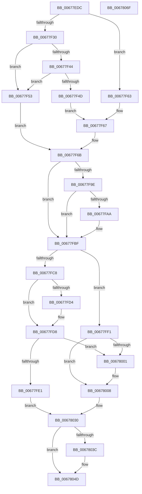

# MiInsertUnusedSubsectionInternal

- RVA: `0x00677EDC`–`0x00678070` (길이 `404` bytes)
- VA: `0x0000000140677EDC`
- 실행 섹션: `.text`
- PDB 이름 있음: `예`; PDB Function 태그: `아니요`
- unwind 정보 RVA: `0x0005FEF8`
- 디코드: `104`개 명령, `404/404` bytes 표시
- 미해석 바이트: `0` (있으면 어셈블리에 `.byte`로 보존)

> 이 문서는 커널 이미지의 기계어와 PDB 기호를 분석해 생성했습니다. 4번과 5번은 함수 원형과 자료형을 바이너리 사용 방식에서 추정한 C 해석이며 원본 소스 복구 결과는 아닙니다.

## 1. Dependencies

- 직접 호출 지점: **4**; 고유 호출 대상: **4**
- 직접 호출자로 확인된 함수: **2**
- RIP 상대 이미지 참조: **2**

### Outgoing calls
- `0x00677F75` → [ExAcquireSpinLockExclusiveAtDpcLevel](../24/ExAcquireSpinLockExclusiveAtDpcLevel_function_00248E80.md) (function, `0x00248E80`)
- `0x00677FAF` → [MiUpdateSubsectionCrossPartitionRefs](../4F/MiUpdateSubsectionCrossPartitionRefs_function_004FB5DC.md) (function, `0x004FB5DC`)
- `0x00678033` → [ExReleaseSpinLockExclusiveFromDpcLevel](../24/ExReleaseSpinLockExclusiveFromDpcLevel_function_002497E0.md) (function, `0x002497E0`)
- `0x00678048` → [KeSetEvent](../33/KeSetEvent_function_0033F310.md) (function, `0x0033F310`)

### Direct callers
- [MiDeleteCachedSubsection](../29/MiDeleteCachedSubsection_function_00297888.md) at `0x0029798D`
- [MiInsertUnusedSubsection](../29/MiInsertUnusedSubsection_function_00298D50.md) at `0x00298D56`

### Static image references
- `0x00677F0D` → RVA `0x00E30088` (`.data`; read)
- `0x00677F8B` → RVA `0x00E2CD18` (`.data`; read/write)

## 2. Other-region calls and transfers

- 다른 실행 섹션으로 향하는 call: **0**
- 별도 외부 분기/꼬리 이동을 확인하지 못했습니다.

## 3. Assembly (complete function range)

```asm
00677EDC  48 8B C4                        mov rax, rsp
00677EDF  48 89 58 08                     mov qword ptr [rax + 8], rbx
00677EE3  48 89 68 10                     mov qword ptr [rax + 0x10], rbp
00677EE7  48 89 70 18                     mov qword ptr [rax + 0x18], rsi
00677EEB  48 89 78 20                     mov qword ptr [rax + 0x20], rdi
00677EEF  41 54                           push r12
00677EF1  41 56                           push r14
00677EF3  41 57                           push r15
00677EF5  48 83 EC 20                     sub rsp, 0x20
00677EF9  48 8B 01                        mov rax, qword ptr [rcx]
00677EFC  33 ED                           xor ebp, ebp
00677EFE  44 8B 79 2C                     mov r15d, dword ptr [rcx + 0x2c]
00677F02  4C 8B F2                        mov r14, rdx
00677F05  48 8B F9                        mov rdi, rcx
00677F08  44 0F B7 40 3C                  movzx r8d, word ptr [rax + 0x3c]
00677F0D  48 8B 05 74 81 7B 00            mov rax, qword ptr [rip + 0x7b8174]
00677F14  4A 8D 1C FD 00 00 00 00         lea rbx, [r15*8]
00677F1C  41 81 E0 FF 03 00 00            and r8d, 0x3ff
00677F23  4A 8B 34 C0                     mov rsi, qword ptr [rax + r8*8]
00677F27  48 81 FB E0 0F 00 00            cmp rbx, 0xfe0
00677F2E  76 33                           jbe 0x140677f63
00677F30  42 8D 04 FD 00 00 00 00         lea eax, [r15*8]
00677F38  25 FF 0F 00 00                  and eax, 0xfff
00677F3D  3D C0 0F 00 00                  cmp eax, 0xfc0
00677F42  77 0F                           ja 0x140677f53
00677F44  48 81 FB 00 00 01 00            cmp rbx, 0x10000
00677F4B  73 06                           jae 0x140677f53
00677F4D  48 83 C3 0F                     add rbx, 0xf
00677F51  EB 14                           jmp 0x140677f67
00677F53  48 81 C3 FF 0F 00 00            add rbx, 0xfff
00677F5A  48 81 E3 00 F0 FF FF            and rbx, 0xfffffffffffff000
00677F61  EB 08                           jmp 0x140677f6b
00677F63  48 83 C3 1F                     add rbx, 0x1f
00677F67  48 83 E3 F0                     and rbx, 0xfffffffffffffff0
00677F6B  4C 8D A6 C0 06 00 00            lea r12, [rsi + 0x6c0]
00677F72  49 8B CC                        mov rcx, r12
00677F75  E8 06 0F BD FF                  call 0x140248e80
00677F7A  8B 47 20                        mov eax, dword ptr [rdi + 0x20]
00677F7D  0F BA E8 13                     bts eax, 0x13
00677F81  89 47 20                        mov dword ptr [rdi + 0x20], eax
00677F84  48 01 9E 38 08 00 00            add qword ptr [rsi + 0x838], rbx
00677F8B  F0 48 01 1D 85 4D 7B 00         lock add qword ptr [rip + 0x7b4d85], rbx
00677F93  48 8B 07                        mov rax, qword ptr [rdi]
00677F96  33 DB                           xor ebx, ebx
00677F98  F6 40 3E 0C                     test byte ptr [rax + 0x3e], 0xc
00677F9C  75 21                           jne 0x140677fbf
00677F9E  41 B8 FF FF FF 3F               mov r8d, 0x3fffffff
00677FA4  44 85 47 30                     test dword ptr [rdi + 0x30], r8d
00677FA8  74 15                           je 0x140677fbf
00677FAA  33 D2                           xor edx, edx
00677FAC  48 8B CF                        mov rcx, rdi
00677FAF  E8 28 36 E8 FF                  call 0x1404fb5dc
00677FB4  8B 4F 34                        mov ecx, dword ptr [rdi + 0x34]
00677FB7  8B 5F 2C                        mov ebx, dword ptr [rdi + 0x2c]
00677FBA  41 23 C8                        and ecx, r8d
00677FBD  2B D9                           sub ebx, ecx
00677FBF  48 8D 47 58                     lea rax, [rdi + 0x58]
00677FC3  39 6F 68                        cmp dword ptr [rdi + 0x68], ebp
00677FC6  74 29                           je 0x140677ff1
00677FC8  48 8D 8E 40 08 00 00            lea rcx, [rsi + 0x840]
00677FCF  4D 85 F6                        test r14, r14
00677FD2  74 04                           je 0x140677fd8
00677FD4  49 8B 4E 10                     mov rcx, qword ptr [r14 + 0x10]
00677FD8  48 8B 51 08                     mov rdx, qword ptr [rcx + 8]
00677FDC  48 39 0A                        cmp qword ptr [rdx], rcx
00677FDF  75 20                           jne 0x140678001
00677FE1  48 89 08                        mov qword ptr [rax], rcx
00677FE4  48 89 50 08                     mov qword ptr [rax + 8], rdx
00677FE8  48 89 02                        mov qword ptr [rdx], rax
00677FEB  48 89 41 08                     mov qword ptr [rcx + 8], rax
00677FEF  EB 3F                           jmp 0x140678030
00677FF1  48 8D 8E 50 08 00 00            lea rcx, [rsi + 0x850]
00677FF8  48 8B 51 08                     mov rdx, qword ptr [rcx + 8]
00677FFC  48 39 0A                        cmp qword ptr [rdx], rcx
00677FFF  74 07                           je 0x140678008
00678001  B9 03 00 00 00                  mov ecx, 3
00678006  CD 29                           int 0x29
00678008  48 89 08                        mov qword ptr [rax], rcx
0067800B  48 89 50 08                     mov qword ptr [rax + 8], rdx
0067800F  48 89 02                        mov qword ptr [rdx], rax
00678012  48 89 41 08                     mov qword ptr [rcx + 8], rax
00678016  B9 01 00 00 00                  mov ecx, 1
0067801B  4C 01 BE 10 07 00 00            add qword ptr [rsi + 0x710], r15
00678022  48 81 BE 10 07 00 00 00 00 02 00  cmp qword ptr [rsi + 0x710], 0x20000
0067802D  0F 43 E9                        cmovae ebp, ecx
00678030  49 8B CC                        mov rcx, r12
00678033  E8 A8 17 BD FF                  call 0x1402497e0
00678038  85 ED                           test ebp, ebp
0067803A  74 11                           je 0x14067804d
0067803C  48 8D 8E E0 06 00 00            lea rcx, [rsi + 0x6e0]
00678043  45 33 C0                        xor r8d, r8d
00678046  33 D2                           xor edx, edx
00678048  E8 C3 72 CC FF                  call 0x14033f310
0067804D  48 8B 6C 24 48                  mov rbp, qword ptr [rsp + 0x48]
00678052  48 8B C3                        mov rax, rbx
00678055  48 8B 5C 24 40                  mov rbx, qword ptr [rsp + 0x40]
0067805A  48 8B 74 24 50                  mov rsi, qword ptr [rsp + 0x50]
0067805F  48 8B 7C 24 58                  mov rdi, qword ptr [rsp + 0x58]
00678064  48 83 C4 20                     add rsp, 0x20
00678068  41 5F                           pop r15
0067806A  41 5E                           pop r14
0067806C  41 5C                           pop r12
0067806E  C3                              ret
0067806F  CC                              int3
```

## 4. C-style interpretation (structured pseudocode)

```c
__int64 __fastcall MiInsertUnusedSubsectionInternal(__int64 a1, __int64 a2)
{
    __int64 result;
    __int64 v_rbp;
    __int64 v_rbx;
    __int64 v_rsp;
    unsigned __int64 v_stack_p10;
    unsigned __int64 v_stack_p18;
    unsigned __int64 v_stack_p20;
    unsigned __int64 v_stack_p8;

    *(unsigned __int64 *)(v_rsp + 8) = v_rbx;
    *(unsigned __int64 *)(v_rsp + 16) = v_rbp;
    *(unsigned __int64 *)(v_rsp + 24) = v_rsi;
    *(unsigned __int64 *)(v_rsp + 32) = v_rdi;
    v_rsp = (v_rsp) - (32);
    v_rbp = 0;
    a3 = (unsigned int)((*(unsigned __int16 *)(*(unsigned __int64 *)(a1) + 60)) & (0x3FFULL));
    if (((unsigned int)(*(unsigned int *)(a1 + 44)) * 8) <= 0xFE0ULL) goto loc_00677F63;
    result = (unsigned int)(((unsigned int)(*(unsigned int *)(a1 + 44)) * 8) & (0xFFFULL));
    if (((unsigned int)(result)) > 0xFC0ULL) goto loc_00677F53;
    if (((unsigned int)(*(unsigned int *)(a1 + 44)) * 8) >= 0x10000ULL) goto loc_00677F53;
    v_rbx = ((unsigned int)(*(unsigned int *)(a1 + 44)) * 8) + (15);
    goto loc_00677F67;
loc_00677F53:
    v_rbx = (v_rbx) + (0xFFFULL);
    v_rbx = (v_rbx) & (0xFFFFFFFFFFFFF000ULL);
    goto loc_00677F6B;
loc_00677F63:
    v_rbx = (v_rbx) + (31);
loc_00677F67:
    v_rbx = (v_rbx) & (-16);
loc_00677F6B:
    result = ExAcquireSpinLockExclusiveAtDpcLevel(*(unsigned __int64 *)(*(unsigned __int64 *)(v_rip + 8094068) + a3 * 8) + 1728, a2, a3, a4);
    *(unsigned int *)(a1 + 32) = (unsigned int)((unsigned int)(*(unsigned int *)(a1 + 32)));
    v_rbx = 0;
    if (((*(unsigned __int8 *)(*(unsigned __int64 *)(a1) + 62)) & (12)) != 0) goto loc_00677FBF;
    result = *(unsigned __int64 *)(a1);
    if (((*(unsigned int *)(a1 + 48)) & ((unsigned int)((unsigned int)(0x3FFFFFFFULL)))) != 0) {
        a2 = 0;
        a1 = a1;
        result = MiUpdateSubsectionCrossPartitionRefs(a1, a2, (unsigned int)(0x3FFFFFFFULL), a4);
        a1 = *(unsigned int *)(a1 + 52);
        v_rbx = *(unsigned int *)(a1 + 44);
        a1 = (unsigned int)((a1) & ((unsigned int)((unsigned int)(0x3FFFFFFFULL))));
        v_rbx = (unsigned int)((v_rbx) - ((unsigned int)(a1)));
    }
    if ((*(unsigned int *)(a1 + 104)) == 0) goto loc_00677FF1;
    if (0 != 0) {
        a1 = *(unsigned __int64 *)(a2 + 16);
    }
    if ((*(unsigned __int64 *)(*(unsigned __int64 *)(a1 + 8))) != a1) goto loc_00678001;
    *(unsigned __int64 *)(a1 + 88) = a1;
    *(unsigned __int64 *)(a1 + 88 + 8) = *(unsigned __int64 *)(a1 + 8);
    *(unsigned __int64 *)(*(unsigned __int64 *)(a1 + 8)) = a1 + 88;
    *(unsigned __int64 *)(a1 + 8) = a1 + 88;
    goto loc_00678030;
loc_00677FF1:
    if ((*(unsigned __int64 *)(*(unsigned __int64 *)(*(unsigned __int64 *)(*(unsigned __int64 *)(v_rip + 8094068) + a3 * 8) + 2128 + 8))) != (*(unsigned __int64 *)(*(unsigned __int64 *)(v_rip + 8094068) + a3 * 8) + 2128)) {
        a1 = 3;
    }
    *(unsigned __int64 *)(a1 + 88) = a1;
    *(unsigned __int64 *)(a1 + 88 + 8) = *(unsigned __int64 *)(*(unsigned __int64 *)(*(unsigned __int64 *)(v_rip + 8094068) + a3 * 8) + 2128 + 8);
    *(unsigned __int64 *)(*(unsigned __int64 *)(*(unsigned __int64 *)(*(unsigned __int64 *)(v_rip + 8094068) + a3 * 8) + 2128 + 8)) = a1 + 88;
    *(unsigned __int64 *)(a1 + 8) = a1 + 88;
    if ((*(unsigned __int64 *)(*(unsigned __int64 *)(*(unsigned __int64 *)(v_rip + 8094068) + a3 * 8) + 1808)) >= 0x20000ULL) { v_rbp = 1; }
loc_00678030:
    result = ExReleaseSpinLockExclusiveFromDpcLevel(*(unsigned __int64 *)(*(unsigned __int64 *)(v_rip + 8094068) + a3 * 8) + 1728, *(unsigned __int64 *)(*(unsigned __int64 *)(*(unsigned __int64 *)(v_rip + 8094068) + a3 * 8) + 2128 + 8), (unsigned int)(0x3FFFFFFFULL), a4);
    if ((unsigned int)(v_rbp) != 0) {
        a1 = *(unsigned __int64 *)(*(unsigned __int64 *)(v_rip + 8094068) + a3 * 8) + 1760;
        a3 = 0;
        a2 = 0;
        result = KeSetEvent(a1, a2, a3, a4);
    }
    v_rsp = (v_rsp) + (32);
    return v_rbx;
}
```

## 5. (Beta) C Style

```c
int64_t MiInsertUnusedSubsectionInternal(void *Arg1, int64_t Arg2)
{
    uint8_t *arg1 = (uint8_t *)Arg1;

    int64_t result;
    int64_t local_rbp;
    int64_t local_rbx;
    int64_t local_rsp;
    uint64_t v_stack_p10;
    uint64_t v_stack_p18;
    uint64_t v_stack_p20;
    uint64_t v_stack_p8;

    *(uint64_t *)(local_rsp + 0x8) = local_rbx;
    *(uint64_t *)(local_rsp + 0x10) = local_rbp;
    *(uint64_t *)(local_rsp + 0x18) = local_rsi;
    *(uint64_t *)(local_rsp + 0x20) = local_rdi;
    local_rsp = (local_rsp) - (32);
    local_rbp = 0;
    a3 = (uint32_t)((*(uint16_t *)(*(uint64_t *)(arg1) + 0x3C)) & (0x3FFULL));
    if (((uint32_t)(*(uint32_t *)(arg1 + 0x2C)) * 8) <= 0xFE0ULL) goto loc_00677F63;
    result = (uint32_t)(((uint32_t)(*(uint32_t *)(arg1 + 0x2C)) * 8) & (0xFFFULL));
    if (((uint32_t)(result)) > 0xFC0ULL) goto loc_00677F53;
    if (((uint32_t)(*(uint32_t *)(arg1 + 0x2C)) * 8) >= 0x10000ULL) goto loc_00677F53;
    local_rbx = ((uint32_t)(*(uint32_t *)(arg1 + 0x2C)) * 8) + (15);
    goto loc_00677F67;
loc_00677F53:
    local_rbx = (local_rbx) + (0xFFFULL);
    local_rbx = (local_rbx) & (0xFFFFFFFFFFFFF000ULL);
    goto loc_00677F6B;
loc_00677F63:
    local_rbx = (local_rbx) + (31);
loc_00677F67:
    local_rbx = (local_rbx) & (-16);
loc_00677F6B:
    result = ExAcquireSpinLockExclusiveAtDpcLevel(*(uint64_t *)(*(uint64_t *)(v_rip + 0x7B8174) + a3 * 8) + 1728, Arg2, a3, a4);
    *(uint32_t *)(arg1 + 0x20) = (uint32_t)((uint32_t)(*(uint32_t *)(arg1 + 0x20)));
    local_rbx = 0;
    if (((*(uint8_t *)(*(uint64_t *)(arg1) + 0x3E)) & (12)) != 0) goto loc_00677FBF;
    result = *(uint64_t *)(arg1);
    if (((*(uint32_t *)(arg1 + 0x30)) & ((uint32_t)((uint32_t)(0x3FFFFFFFULL)))) != 0) {
        Arg2 = 0;
        Arg1 = Arg1;
        result = MiUpdateSubsectionCrossPartitionRefs(Arg1, Arg2, (uint32_t)(0x3FFFFFFFULL), a4);
        Arg1 = *(uint32_t *)(arg1 + 0x34);
        local_rbx = *(uint32_t *)(arg1 + 0x2C);
        Arg1 = (uint32_t)((Arg1) & ((uint32_t)((uint32_t)(0x3FFFFFFFULL))));
        local_rbx = (uint32_t)((local_rbx) - ((uint32_t)(Arg1)));
    }
    if ((*(uint32_t *)(arg1 + 0x68)) == 0) goto loc_00677FF1;
    if (0 != 0) {
        Arg1 = *(uint64_t *)(Arg2 + 0x10);
    }
    if ((*(uint64_t *)(*(uint64_t *)(arg1 + 0x8))) != Arg1) goto loc_00678001;
    *(void **)(arg1 + 0x58) = Arg1;
    *(uint64_t *)(arg1 + 0x58 + 0x8) = *(uint64_t *)(arg1 + 0x8);
    *(void **)(*(uint64_t *)(arg1 + 0x8)) = Arg1 + 88;
    *(void **)(arg1 + 0x8) = Arg1 + 88;
    goto loc_00678030;
loc_00677FF1:
    if ((*(uint64_t *)(*(uint64_t *)(*(uint64_t *)(*(uint64_t *)(v_rip + 0x7B8174) + a3 * 8) + 0x850 + 0x8))) != (*(uint64_t *)(*(uint64_t *)(v_rip + 0x7B8174) + a3 * 8) + 2128)) {
        Arg1 = 3;
    }
    *(void **)(arg1 + 0x58) = Arg1;
    *(uint64_t *)(arg1 + 0x58 + 0x8) = *(uint64_t *)(*(uint64_t *)(*(uint64_t *)(v_rip + 0x7B8174) + a3 * 8) + 0x850 + 0x8);
    *(void **)(*(uint64_t *)(*(uint64_t *)(*(uint64_t *)(v_rip + 0x7B8174) + a3 * 8) + 0x850 + 0x8)) = Arg1 + 88;
    *(void **)(arg1 + 0x8) = Arg1 + 88;
    if ((*(uint64_t *)(*(uint64_t *)(*(uint64_t *)(v_rip + 0x7B8174) + a3 * 8) + 0x710)) >= 0x20000ULL) { local_rbp = 1; }
loc_00678030:
    result = ExReleaseSpinLockExclusiveFromDpcLevel(*(uint64_t *)(*(uint64_t *)(v_rip + 0x7B8174) + a3 * 8) + 1728, *(uint64_t *)(*(uint64_t *)(*(uint64_t *)(v_rip + 0x7B8174) + a3 * 8) + 0x850 + 0x8), (uint32_t)(0x3FFFFFFFULL), a4);
    if ((uint32_t)(local_rbp) != 0) {
        Arg1 = *(uint64_t *)(*(uint64_t *)(v_rip + 0x7B8174) + a3 * 8) + 1760;
        a3 = 0;
        Arg2 = 0;
        result = KeSetEvent(Arg1, Arg2, a3, a4);
    }
    local_rsp = (local_rsp) + (32);
    return local_rbx;
}
```

### 관측된 메모리 오프셋

구조체 형식이 확인되지 않은 접근은 인자 기준의 오프셋으로만 기록했습니다.

| 기준 인자 | 오프셋 표현 | 폭 (bit) | 접근 |
|---|---:|---:|---|
| `Arg1` | `+ 0x0` | `64` | `R` |
| `Arg1` | `+ 0x0` | `64` | `W` |
| `Arg1` | `+ 0x8` | `64` | `W` |
| `Arg1` | `+ 0x20` | `32` | `R` |
| `Arg1` | `+ 0x20` | `32` | `W` |
| `Arg1` | `+ 0x2C` | `32` | `R` |
| `Arg1` | `+ 0x30` | `32` | `R` |
| `Arg1` | `+ 0x34` | `32` | `R` |
| `Arg1` | `+ 0x58` | `64` | `R` |
| `Arg1` | `+ 0x68` | `32` | `R` |

## 6. Execution-region graph

[열기: 2D/3D 그래프와 함수 탐색 컨트롤 패널](../../../control-panel.html?section=text&rva=0x00677EDC&view=graph)

- 2D 그래프는 위에서 아래로 흐르고, 3D 그래프는 빈 공간을 드래그해 회전합니다. Shift+드래그는 이동, 휠은 확대·축소, 함수 노드 선택은 대상 보고서 이동입니다.

### Static fallback


