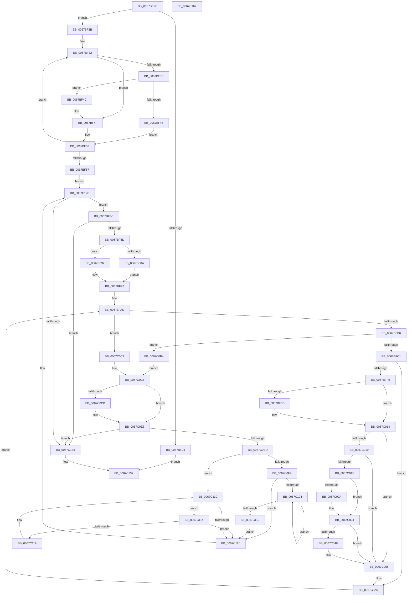

# MiIoPfnTreeExclusionCompatible

- RVA: `0x0067BE9C`–`0x0067C163` (길이 `711` bytes)
- VA: `0x000000014067BE9C`
- 실행 섹션: `.text`
- PDB 이름 있음: `예`; PDB Function 태그: `아니요`
- unwind 정보 RVA: `0x000D7E8C`
- 디코드: `204`개 명령, `711/711` bytes 표시
- 미해석 바이트: `0` (있으면 어셈블리에 `.byte`로 보존)

> 이 문서는 커널 이미지의 기계어와 PDB 기호를 분석해 생성했습니다. 4번과 5번은 함수 원형과 자료형을 바이너리 사용 방식에서 추정한 C 해석이며 원본 소스 복구 결과는 아닙니다.

## 1. Dependencies

- 직접 호출 지점: **5**; 고유 호출 대상: **4**
- 직접 호출자로 확인된 함수: **1**
- RIP 상대 이미지 참조: **4**

### Outgoing calls
- `0x0067BEDD` → [memset](../6C/memset_function_006C6C40.md) (function, `0x006C6C40`)
- `0x0067BFFD` → [MiFlushEntireTbDueToAttributeChange](../30/MiFlushEntireTbDueToAttributeChange_function_00308AE0.md) (function, `0x00308AE0`)
- `0x0067C050` → [MiFlushCachedIoPfnRange](MiFlushCachedIoPfnRange_function_0067BC24.md) (function, `0x0067BC24`)
- `0x0067C0DC` → [MiFlushCachedIoPfnRange](MiFlushCachedIoPfnRange_function_0067BC24.md) (function, `0x0067BC24`)
- `0x0067C142` → [_security_check_cookie](../6A/_security_check_cookie_function_006AC640.md) (function, `0x006AC640`)

### Direct callers
- [MiCreateIoPageExclusion](MiCreateIoPageExclusion_function_0067B638.md) at `0x0067B6BF`

### Static image references
- `0x0067BEB3` → RVA `0x00E0A740` (`.data`; read)
- `0x0067BEE2` → RVA `0x00E2DC38` (`.data`; read)
- `0x0067BF0E` → RVA `0x00E37280` (`.data`; read)
- `0x0067C01E` → RVA `0x00E3733C` (`.data`; read/write)

## 2. Other-region calls and transfers

- 다른 실행 섹션으로 향하는 call: **0**
- 별도 외부 분기/꼬리 이동을 확인하지 못했습니다.

## 3. Assembly (complete function range)

```asm
0067BE9C  48 89 5C 24 18                  mov qword ptr [rsp + 0x18], rbx
0067BEA1  55                              push rbp
0067BEA2  56                              push rsi
0067BEA3  57                              push rdi
0067BEA4  41 54                           push r12
0067BEA6  41 55                           push r13
0067BEA8  41 56                           push r14
0067BEAA  41 57                           push r15
0067BEAC  48 81 EC 00 01 00 00            sub rsp, 0x100
0067BEB3  48 8B 05 86 E8 78 00            mov rax, qword ptr [rip + 0x78e886]
0067BEBA  48 33 C4                        xor rax, rsp
0067BEBD  48 89 84 24 F0 00 00 00         mov qword ptr [rsp + 0xf0], rax
0067BEC5  48 8B F2                        mov rsi, rdx
0067BEC8  48 89 54 24 30                  mov qword ptr [rsp + 0x30], rdx
0067BECD  48 63 D9                        movsxd rbx, ecx
0067BED0  33 D2                           xor edx, edx
0067BED2  48 8D 4C 24 40                  lea rcx, [rsp + 0x40]
0067BED7  41 B8 B0 00 00 00               mov r8d, 0xb0
0067BEDD  E8 5E AD 04 00                  call 0x1406c6c40
0067BEE2  8A 0D 50 1D 7B 00               mov cl, byte ptr [rip + 0x7b1d50]
0067BEE8  45 33 C9                        xor r9d, r9d
0067BEEB  48 8B 56 18                     mov rdx, qword ptr [rsi + 0x18]
0067BEEF  80 C1 F4                        add cl, 0xf4
0067BEF2  48 C1 E3 06                     shl rbx, 6
0067BEF6  45 8B F1                        mov r14d, r9d
0067BEF9  44 89 4C 24 24                  mov dword ptr [rsp + 0x24], r9d
0067BEFE  45 8B E9                        mov r13d, r9d
0067BF01  45 8D 51 01                     lea r10d, [r9 + 1]
0067BF05  41 8B E9                        mov ebp, r9d
0067BF08  41 8B FA                        mov edi, r10d
0067BF0B  48 D3 E7                        shl rdi, cl
0067BF0E  48 8D 0D 6B B3 7B 00            lea rcx, [rip + 0x7bb36b]
0067BF15  48 8B 0C 0B                     mov rcx, qword ptr [rbx + rcx]
0067BF19  49 2B FA                        sub rdi, r10
0067BF1C  48 23 FA                        and rdi, rdx
0067BF1F  48 85 C9                        test rcx, rcx
0067BF22  75 07                           jne 0x14067bf2b
0067BF24  33 C0                           xor eax, eax
0067BF26  E9 0C 02 00 00                  jmp 0x14067c137
0067BF2B  4C 8B 46 20                     mov r8, qword ptr [rsi + 0x20]
0067BF2F  49 8B D9                        mov rbx, r9
0067BF32  48 8B 41 18                     mov rax, qword ptr [rcx + 0x18]
0067BF36  4C 3B C0                        cmp r8, rax
0067BF39  72 14                           jb 0x14067bf4f
0067BF3B  48 05 00 02 00 00               add rax, 0x200
0067BF41  48 3B D0                        cmp rdx, rax
0067BF44  72 06                           jb 0x14067bf4c
0067BF46  48 8B 49 08                     mov rcx, qword ptr [rcx + 8]
0067BF4A  EB 06                           jmp 0x14067bf52
0067BF4C  48 8B D9                        mov rbx, rcx
0067BF4F  48 8B 09                        mov rcx, qword ptr [rcx]
0067BF52  48 85 C9                        test rcx, rcx
0067BF55  75 DB                           jne 0x14067bf32
0067BF57  E9 CF 01 00 00                  jmp 0x14067c12b
0067BF5C  48 8B 76 20                     mov rsi, qword ptr [rsi + 0x20]
0067BF60  48 8B 53 18                     mov rdx, qword ptr [rbx + 0x18]
0067BF64  48 3B F2                        cmp rsi, rdx
0067BF67  0F 82 C7 01 00 00               jb 0x14067c134
0067BF6D  4C 8B F7                        mov r14, rdi
0067BF70  48 8D 8A 00 02 00 00            lea rcx, [rdx + 0x200]
0067BF77  4C 2B F2                        sub r14, rdx
0067BF7A  48 8D 46 01                     lea rax, [rsi + 1]
0067BF7E  48 3B FA                        cmp rdi, rdx
0067BF81  4D 0F 42 F1                     cmovb r14, r9
0067BF85  48 3B C1                        cmp rax, rcx
0067BF88  77 08                           ja 0x14067bf92
0067BF8A  48 2B F2                        sub rsi, rdx
0067BF8D  49 03 F2                        add rsi, r10
0067BF90  EB 05                           jmp 0x14067bf97
0067BF92  BE 00 02 00 00                  mov esi, 0x200
0067BF97  49 8D 3C 16                     lea rdi, [r14 + rdx]
0067BF9B  45 8B F9                        mov r15d, r9d
0067BF9E  41 8B D1                        mov edx, r9d
0067BFA1  4D 8D 66 58                     lea r12, [r14 + 0x58]
0067BFA5  89 54 24 20                     mov dword ptr [rsp + 0x20], edx
0067BFA9  4E 8D 24 63                     lea r12, [rbx + r12*2]
0067BFAD  4C 3B F6                        cmp r14, rsi
0067BFB0  0F 83 0B 01 00 00               jae 0x14067c0c1
0067BFB6  66 45 39 0C 24                  cmp word ptr [r12], r9w
0067BFBB  0F 85 F3 00 00 00               jne 0x14067c0b4
0067BFC1  8A 0D 71 1C 7B 00               mov cl, byte ptr [rip + 0x7b1c71]
0067BFC7  49 8B C2                        mov rax, r10
0067BFCA  80 C1 F4                        add cl, 0xf4
0067BFCD  48 D3 E0                        shl rax, cl
0067BFD0  41 2B C2                        sub eax, r10d
0067BFD3  23 C7                           and eax, edi
0067BFD5  2B 43 18                        sub eax, dword ptr [rbx + 0x18]
0067BFD8  03 C0                           add eax, eax
0067BFDA  8B C8                           mov ecx, eax
0067BFDC  48 C1 E8 05                     shr rax, 5
0067BFE0  83 E1 1F                        and ecx, 0x1f
0067BFE3  8B 44 83 2C                     mov eax, dword ptr [rbx + rax*4 + 0x2c]
0067BFE7  D3 E8                           shr eax, cl
0067BFE9  83 E0 03                        and eax, 3
0067BFEC  89 44 24 28                     mov dword ptr [rsp + 0x28], eax
0067BFF0  83 F8 03                        cmp eax, 3
0067BFF3  0F 84 AC 00 00 00               je 0x14067c0a5
0067BFF9  85 D2                           test edx, edx
0067BFFB  75 17                           jne 0x14067c014
0067BFFD  E8 DE CA C8 FF                  call 0x140308ae0
0067C002  8B 44 24 28                     mov eax, dword ptr [rsp + 0x28]
0067C006  41 BA 01 00 00 00               mov r10d, 1
0067C00C  44 89 54 24 20                  mov dword ptr [rsp + 0x20], r10d
0067C011  45 33 C9                        xor r9d, r9d
0067C014  41 3B C2                        cmp eax, r10d
0067C017  75 4C                           jne 0x14067c065
0067C019  45 85 FF                        test r15d, r15d
0067C01C  75 47                           jne 0x14067c065
0067C01E  44 01 15 17 B3 7B 00            add dword ptr [rip + 0x7bb317], r10d
0067C025  48 85 ED                        test rbp, rbp
0067C028  75 0A                           jne 0x14067c034
0067C02A  48 8D 6C 24 40                  lea rbp, [rsp + 0x40]
0067C02F  4C 8D 6C 24 70                  lea r13, [rsp + 0x70]
0067C034  49 89 7D 00                     mov qword ptr [r13], rdi
0067C038  48 8D 85 B0 00 00 00            lea rax, [rbp + 0xb0]
0067C03F  49 83 C5 08                     add r13, 8
0067C043  4C 3B E8                        cmp r13, rax
0067C046  75 1D                           jne 0x14067c065
0067C048  BA 10 00 00 00                  mov edx, 0x10
0067C04D  48 8B CD                        mov rcx, rbp
0067C050  E8 CF FB FF FF                  call 0x14067bc24
0067C055  45 33 C9                        xor r9d, r9d
0067C058  85 C0                           test eax, eax
0067C05A  41 8B E9                        mov ebp, r9d
0067C05D  45 8D 51 01                     lea r10d, [r9 + 1]
0067C061  45 0F 45 FA                     cmovne r15d, r10d
0067C065  8A 0D CD 1B 7B 00               mov cl, byte ptr [rip + 0x7b1bcd]
0067C06B  49 8B C2                        mov rax, r10
0067C06E  80 C1 F4                        add cl, 0xf4
0067C071  BA 03 00 00 00                  mov edx, 3
0067C076  48 D3 E0                        shl rax, cl
0067C079  41 2B C2                        sub eax, r10d
0067C07C  23 C7                           and eax, edi
0067C07E  2B 43 18                        sub eax, dword ptr [rbx + 0x18]
0067C081  03 C0                           add eax, eax
0067C083  8B C8                           mov ecx, eax
0067C085  44 8B C0                        mov r8d, eax
0067C088  49 C1 E8 05                     shr r8, 5
0067C08C  83 E1 1F                        and ecx, 0x1f
0067C08F  D3 E2                           shl edx, cl
0067C091  8B C2                           mov eax, edx
0067C093  F7 D0                           not eax
0067C095  42 23 44 83 2C                  and eax, dword ptr [rbx + r8*4 + 0x2c]
0067C09A  0B C2                           or eax, edx
0067C09C  8B 54 24 20                     mov edx, dword ptr [rsp + 0x20]
0067C0A0  42 89 44 83 2C                  mov dword ptr [rbx + r8*4 + 0x2c], eax
0067C0A5  4D 03 F2                        add r14, r10
0067C0A8  49 83 C4 02                     add r12, 2
0067C0AC  49 03 FA                        add rdi, r10
0067C0AF  E9 F9 FE FF FF                  jmp 0x14067bfad
0067C0B4  41 BE 18 00 00 C0               mov r14d, 0xc0000018
0067C0BA  44 89 74 24 24                  mov dword ptr [rsp + 0x24], r14d
0067C0BF  EB 05                           jmp 0x14067c0c6
0067C0C1  44 8B 74 24 24                  mov r14d, dword ptr [rsp + 0x24]
0067C0C6  48 85 ED                        test rbp, rbp
0067C0C9  74 1D                           je 0x14067c0e8
0067C0CB  49 8B D5                        mov rdx, r13
0067C0CE  48 8B CD                        mov rcx, rbp
0067C0D1  48 2B D5                        sub rdx, rbp
0067C0D4  48 83 EA 30                     sub rdx, 0x30
0067C0D8  48 C1 FA 03                     sar rdx, 3
0067C0DC  E8 43 FB FF FF                  call 0x14067bc24
0067C0E1  45 33 C9                        xor r9d, r9d
0067C0E4  45 8D 51 01                     lea r10d, [r9 + 1]
0067C0E8  45 85 F6                        test r14d, r14d
0067C0EB  78 47                           js 0x14067c134
0067C0ED  48 8B 43 08                     mov rax, qword ptr [rbx + 8]
0067C0F1  48 8B CB                        mov rcx, rbx
0067C0F4  48 85 C0                        test rax, rax
0067C0F7  74 23                           je 0x14067c11c
0067C0F9  48 8B 08                        mov rcx, qword ptr [rax]
0067C0FC  48 8B D8                        mov rbx, rax
0067C0FF  48 85 C9                        test rcx, rcx
0067C102  74 22                           je 0x14067c126
0067C104  48 8B 01                        mov rax, qword ptr [rcx]
0067C107  48 8B D9                        mov rbx, rcx
0067C10A  48 8B C8                        mov rcx, rax
0067C10D  48 85 C0                        test rax, rax
0067C110  75 F2                           jne 0x14067c104
0067C112  EB 12                           jmp 0x14067c126
0067C114  48 39 0B                        cmp qword ptr [rbx], rcx
0067C117  74 0D                           je 0x14067c126
0067C119  48 8B CB                        mov rcx, rbx
0067C11C  48 8B 5B 10                     mov rbx, qword ptr [rbx + 0x10]
0067C120  48 83 E3 FC                     and rbx, 0xfffffffffffffffc
0067C124  75 EE                           jne 0x14067c114
0067C126  48 8B 74 24 30                  mov rsi, qword ptr [rsp + 0x30]
0067C12B  48 85 DB                        test rbx, rbx
0067C12E  0F 85 28 FE FF FF               jne 0x14067bf5c
0067C134  41 8B C6                        mov eax, r14d
0067C137  48 8B 8C 24 F0 00 00 00         mov rcx, qword ptr [rsp + 0xf0]
0067C13F  48 33 CC                        xor rcx, rsp
0067C142  E8 F9 04 03 00                  call 0x1406ac640
0067C147  48 8B 9C 24 50 01 00 00         mov rbx, qword ptr [rsp + 0x150]
0067C14F  48 81 C4 00 01 00 00            add rsp, 0x100
0067C156  41 5F                           pop r15
0067C158  41 5E                           pop r14
0067C15A  41 5D                           pop r13
0067C15C  41 5C                           pop r12
0067C15E  5F                              pop rdi
0067C15F  5E                              pop rsi
0067C160  5D                              pop rbp
0067C161  C3                              ret
0067C162  CC                              int3
```

## 4. C-style interpretation (structured pseudocode)

```c
__int64 __fastcall MiIoPfnTreeExclusionCompatible(int a1, __int64 a2, __int64 a3, int a4)
{
    __int64 result;
    __int64 v_r10;
    __int64 v_r12;
    __int64 v_r13;
    __int64 v_r14;
    __int64 v_r15;
    __int64 v_rbp;
    __int64 v_rbx;
    __int64 v_rdi;
    __int64 v_rsi;
    __int64 v_rsp;
    unsigned __int64 v_stack_m108;
    unsigned int v_stack_m110;
    unsigned int v_stack_m114;
    unsigned int v_stack_m118;
    unsigned __int64 v_stack_m48;
    unsigned __int64 v_stack_mC8;
    unsigned __int64 v_stack_mF8;
    unsigned __int64 v_stack_p18;

    v_stack_p18 = v_rbx;
    v_rsp = (v_rsp) - (256);
    result = (*(unsigned __int64 *)(v_rip + 7923846)) ^ (v_rsp);
    v_stack_m48 = result;
    v_stack_m108 = a2;
    a2 = 0;
    result = memset(v_stack_mF8, a2, 176, a4);
    a4 = 0;
    a1 = (unsigned __int8)((*(unsigned __int8 *)(v_rip + 8068432)) + (244));
    v_rbx = ((int)(a1)) << (6);
    v_stack_m114 = 0;
    v_rdi = ((unsigned int)((unsigned int)(a4 + 1))) << ((unsigned __int8)(a1));
    v_rdi = (v_rdi) - (a4 + 1);
    v_rdi = (v_rdi) & (*(unsigned __int64 *)(a2 + 24));
    if (*(unsigned __int64 *)(v_rbx + v_rip + 8106859 * 1) != 0) goto loc_0067BF2B;
    result = 0;
    goto loc_0067C137;
loc_0067BF2B:
loc_0067BF32:
    if ((*(unsigned __int64 *)(a2 + 32)) < (*(unsigned __int64 *)(*(unsigned __int64 *)(v_rbx + v_rip + 8106859 * 1) + 24))) goto loc_0067BF4F;
    result = (*(unsigned __int64 *)(*(unsigned __int64 *)(v_rbx + v_rip + 8106859 * 1) + 24)) + (512);
    if ((*(unsigned __int64 *)(a2 + 24)) < result) goto loc_0067BF4C;
    goto loc_0067BF52;
loc_0067BF4C:
loc_0067BF4F:
loc_0067BF52:
    if (*(unsigned __int64 *)(*(unsigned __int64 *)(*(unsigned __int64 *)(v_rbx + v_rip + 8106859 * 1) + 8)) != 0) goto loc_0067BF32;
    goto loc_0067C12B;
loc_0067BF5C:
    if ((*(unsigned __int64 *)(a2 + 32)) < (*(unsigned __int64 *)(*(unsigned __int64 *)(*(unsigned __int64 *)(v_rbx + v_rip + 8106859 * 1) + 8) + 24))) goto loc_0067C134;
    v_r14 = (v_rdi) - (*(unsigned __int64 *)(*(unsigned __int64 *)(*(unsigned __int64 *)(v_rbx + v_rip + 8106859 * 1) + 8) + 24));
    if (v_rdi < (*(unsigned __int64 *)(*(unsigned __int64 *)(*(unsigned __int64 *)(v_rbx + v_rip + 8106859 * 1) + 8) + 24))) { v_r14 = 0; }
    if ((*(unsigned __int64 *)(a2 + 32) + 1) > (*(unsigned __int64 *)(*(unsigned __int64 *)(*(unsigned __int64 *)(v_rbx + v_rip + 8106859 * 1) + 8) + 24) + 512)) goto loc_0067BF92;
    v_rsi = (*(unsigned __int64 *)(a2 + 32)) - (*(unsigned __int64 *)(*(unsigned __int64 *)(*(unsigned __int64 *)(v_rbx + v_rip + 8106859 * 1) + 8) + 24));
    v_rsi = (v_rsi) + (a4 + 1);
    goto loc_0067BF97;
loc_0067BF92:
loc_0067BF97:
    v_stack_m118 = 0;
loc_0067BFAD:
    if (v_r14 >= 512) goto loc_0067C0C1;
    if ((*(unsigned __int16 *)(*(unsigned __int64 *)(*(unsigned __int64 *)(v_rbx + v_rip + 8106859 * 1) + 8) + v_r14 + 88 * 2)) != 0) goto loc_0067C0B4;
    a1 = (unsigned __int8)((*(unsigned __int8 *)(v_rip + 8068209)) + (244));
    result = (a4 + 1) << ((unsigned __int8)(a1));
    result = (unsigned int)((result) - ((unsigned int)(a4 + 1)));
    result = (unsigned int)((result) & ((unsigned int)(v_r14 + *(unsigned __int64 *)(*(unsigned __int64 *)(*(unsigned __int64 *)(v_rbx + v_rip + 8106859 * 1) + 8) + 24) * 1)));
    result = (unsigned int)((result) - (*(unsigned int *)(*(unsigned __int64 *)(*(unsigned __int64 *)(v_rbx + v_rip + 8106859 * 1) + 8) + 24)));
    result = (unsigned int)((result) + ((unsigned int)(result)));
    result = (result) >> (5);
    a1 = (unsigned int)(((unsigned int)((unsigned int)(result))) & (31));
    result = (unsigned int)(((unsigned int)(*(unsigned int *)(*(unsigned __int64 *)(*(unsigned __int64 *)(v_rbx + v_rip + 8106859 * 1) + 8) + result * 4 + 44))) >> ((unsigned __int8)(a1)));
    result = (unsigned int)((result) & (3));
    v_stack_m110 = (unsigned int)(result);
    if (((unsigned int)(result)) == 3) goto loc_0067C0A5;
    v_r10 = a4 + 1;
    if (0 == 0) {
        result = MiFlushEntireTbDueToAttributeChange(a1, 0, *(unsigned __int64 *)(a2 + 32), a4);
        result = v_stack_m110;
        v_r10 = 1;
        v_stack_m118 = (unsigned int)(v_r10);
        a4 = 0;
    }
    if (((unsigned int)(result)) != ((unsigned int)(v_r10))) goto loc_0067C065;
    if (0 != 0) goto loc_0067C065;
    v_rbp = 0;
    v_r13 = 0;
    if (0 == 0) {
        v_rbp = v_stack_mF8;
        v_r13 = v_stack_mC8;
    }
    *(unsigned __int64 *)(v_r13) = v_r14 + *(unsigned __int64 *)(*(unsigned __int64 *)(*(unsigned __int64 *)(v_rbx + v_rip + 8106859 * 1) + 8) + 24) * 1;
    v_r13 = (v_r13) + (8);
    result = v_stack_m48;
    v_r15 = 0;
    if (v_r13 == v_stack_m48) {
        a2 = 16;
        a1 = v_rbp;
        result = MiFlushCachedIoPfnRange(a1, a2, *(unsigned __int64 *)(a2 + 32), a4);
        a4 = 0;
        v_rbp = 0;
        v_r10 = a4 + 1;
        v_r15 = 0;
        if ((unsigned int)(result) != 0) { v_r15 = (unsigned int)(v_r10); }
    }
    a1 = (unsigned __int8)((*(unsigned __int8 *)(v_rip + 8068045)) + (244));
    result = (v_r10) << ((unsigned __int8)(a1));
    result = (unsigned int)((result) - ((unsigned int)(v_r10)));
    result = (unsigned int)((result) & ((unsigned int)(v_r14 + *(unsigned __int64 *)(*(unsigned __int64 *)(*(unsigned __int64 *)(v_rbx + v_rip + 8106859 * 1) + 8) + 24) * 1)));
    result = (unsigned int)((result) - (*(unsigned int *)(*(unsigned __int64 *)(*(unsigned __int64 *)(v_rbx + v_rip + 8106859 * 1) + 8) + 24)));
    result = (unsigned int)((result) + ((unsigned int)(result)));
    a3 = ((unsigned int)((unsigned int)(result))) >> (5);
    a1 = (unsigned int)(((unsigned int)((unsigned int)(result))) & (31));
    a2 = (unsigned int)((3) << ((unsigned __int8)(a1)));
    result = (unsigned int)(~((unsigned int)((unsigned int)(a2))));
    result = (unsigned int)((result) & (*(unsigned int *)(*(unsigned __int64 *)(*(unsigned __int64 *)(v_rbx + v_rip + 8106859 * 1) + 8) + a3 * 4 + 44)));
    result = (unsigned int)((result) | ((unsigned int)(a2)));
    *(unsigned int *)(*(unsigned __int64 *)(*(unsigned __int64 *)(v_rbx + v_rip + 8106859 * 1) + 8) + a3 * 4 + 44) = (unsigned int)(result);
loc_0067C0A5:
    v_r14 = (v_r14) + (v_r10);
    v_r12 = (*(unsigned __int64 *)(*(unsigned __int64 *)(v_rbx + v_rip + 8106859 * 1) + 8) + v_r14 + 88 * 2) + (2);
    v_rdi = (v_r14 + *(unsigned __int64 *)(*(unsigned __int64 *)(*(unsigned __int64 *)(v_rbx + v_rip + 8106859 * 1) + 8) + 24) * 1) + (v_r10);
    goto loc_0067BFAD;
loc_0067C0B4:
    v_stack_m114 = (unsigned int)((unsigned int)(0xC0000018ULL));
    goto loc_0067C0C6;
loc_0067C0C1:
loc_0067C0C6:
    if (v_rbp != 0) {
        a2 = v_r13;
        a1 = v_rbp;
        a2 = (a2) - (v_rbp);
        a2 = (a2) - (48);
        a2 = (a2) >> (3);
        result = MiFlushCachedIoPfnRange(a1, a2, a3, a4);
        a4 = 0;
        v_r10 = a4 + 1;
    }
    if (sign_flag) goto loc_0067C134;
    if (*(unsigned __int64 *)(*(unsigned __int64 *)(*(unsigned __int64 *)(v_rbx + v_rip + 8106859 * 1) + 8) + 8) == 0) goto loc_0067C11C;
    if (*(unsigned __int64 *)(*(unsigned __int64 *)(*(unsigned __int64 *)(*(unsigned __int64 *)(v_rbx + v_rip + 8106859 * 1) + 8) + 8)) == 0) goto loc_0067C126;
loc_0067C104:
    if (*(unsigned __int64 *)(*(unsigned __int64 *)(*(unsigned __int64 *)(*(unsigned __int64 *)(*(unsigned __int64 *)(v_rbx + v_rip + 8106859 * 1) + 8) + 8))) != 0) goto loc_0067C104;
    goto loc_0067C126;
loc_0067C114:
    if ((*(unsigned __int64 *)(*(unsigned __int64 *)(*(unsigned __int64 *)(*(unsigned __int64 *)(*(unsigned __int64 *)(v_rbx + v_rip + 8106859 * 1) + 8) + 8)))) == (*(unsigned __int64 *)(*(unsigned __int64 *)(*(unsigned __int64 *)(*(unsigned __int64 *)(*(unsigned __int64 *)(v_rbx + v_rip + 8106859 * 1) + 8) + 8))))) goto loc_0067C126;
loc_0067C11C:
    v_rbx = (*(unsigned __int64 *)(*(unsigned __int64 *)(*(unsigned __int64 *)(*(unsigned __int64 *)(*(unsigned __int64 *)(v_rbx + v_rip + 8106859 * 1) + 8) + 8)) + 16)) & (-4);
    if (condition_is_not_equal) goto loc_0067C114;
loc_0067C126:
loc_0067C12B:
    if (v_rbx != 0) goto loc_0067BF5C;
loc_0067C134:
loc_0067C137:
    a1 = (v_stack_m48) ^ (v_rsp);
    result = _security_check_cookie(a1, a2, a3, a4);
    v_rsp = (v_rsp) + (256);
    return result;
}
```

## 5. (Beta) C Style

```c
int64_t MiIoPfnTreeExclusionCompatible(int32_t Arg1, void *Arg2, int64_t Arg3, int32_t Arg4)
{
    uint8_t *arg2 = (uint8_t *)Arg2;

    int64_t result;
    int64_t local_r10;
    int64_t local_r12;
    int64_t local_r13;
    int64_t local_r14;
    int64_t local_r15;
    int64_t local_rbp;
    int64_t local_rbx;
    int64_t local_rdi;
    int64_t local_rsi;
    int64_t local_rsp;
    uint64_t v_stack_m108;
    uint32_t v_stack_m110;
    uint32_t v_stack_m114;
    uint32_t v_stack_m118;
    uint64_t v_stack_m48;
    uint64_t v_stack_mC8;
    uint64_t v_stack_mF8;
    uint64_t v_stack_p18;

    v_stack_p18 = local_rbx;
    local_rsp = (local_rsp) - (256);
    result = (*(uint64_t *)(v_rip + 0x78E886)) ^ (local_rsp);
    v_stack_m48 = result;
    v_stack_m108 = Arg2;
    Arg2 = 0;
    result = memset(v_stack_mF8, Arg2, 176, Arg4);
    Arg4 = 0;
    Arg1 = (uint8_t)((*(uint8_t *)(v_rip + 0x7B1D50)) + (244));
    local_rbx = ((int32_t)(Arg1)) << (6);
    v_stack_m114 = 0;
    local_rdi = ((uint32_t)((uint32_t)(Arg4 + 1))) << ((uint8_t)(Arg1));
    local_rdi = (local_rdi) - (Arg4 + 1);
    local_rdi = (local_rdi) & (*(uint64_t *)(arg2 + 0x18));
    if (*(uint64_t *)(local_rbx + v_rip + 0x7BB36B * 1) != 0) goto loc_0067BF2B;
    result = 0;
    goto loc_0067C137;
loc_0067BF2B:
loc_0067BF32:
    if ((*(uint64_t *)(arg2 + 0x20)) < (*(uint64_t *)(*(uint64_t *)(local_rbx + v_rip + 0x7BB36B * 1) + 0x18))) goto loc_0067BF4F;
    result = (*(uint64_t *)(*(uint64_t *)(local_rbx + v_rip + 0x7BB36B * 1) + 0x18)) + (512);
    if ((*(uint64_t *)(arg2 + 0x18)) < result) goto loc_0067BF4C;
    goto loc_0067BF52;
loc_0067BF4C:
loc_0067BF4F:
loc_0067BF52:
    if (*(uint64_t *)(*(uint64_t *)(*(uint64_t *)(local_rbx + v_rip + 0x7BB36B * 1) + 0x8)) != 0) goto loc_0067BF32;
    goto loc_0067C12B;
loc_0067BF5C:
    if ((*(uint64_t *)(arg2 + 0x20)) < (*(uint64_t *)(*(uint64_t *)(*(uint64_t *)(local_rbx + v_rip + 0x7BB36B * 1) + 0x8) + 0x18))) goto loc_0067C134;
    local_r14 = (local_rdi) - (*(uint64_t *)(*(uint64_t *)(*(uint64_t *)(local_rbx + v_rip + 0x7BB36B * 1) + 0x8) + 0x18));
    if (local_rdi < (*(uint64_t *)(*(uint64_t *)(*(uint64_t *)(local_rbx + v_rip + 0x7BB36B * 1) + 0x8) + 0x18))) { local_r14 = 0; }
    if ((*(uint64_t *)(arg2 + 0x20) + 1) > (*(uint64_t *)(*(uint64_t *)(*(uint64_t *)(local_rbx + v_rip + 0x7BB36B * 1) + 0x8) + 0x18) + 512)) goto loc_0067BF92;
    local_rsi = (*(uint64_t *)(arg2 + 0x20)) - (*(uint64_t *)(*(uint64_t *)(*(uint64_t *)(local_rbx + v_rip + 0x7BB36B * 1) + 0x8) + 0x18));
    local_rsi = (local_rsi) + (Arg4 + 1);
    goto loc_0067BF97;
loc_0067BF92:
loc_0067BF97:
    v_stack_m118 = 0;
loc_0067BFAD:
    if (local_r14 >= 512) goto loc_0067C0C1;
    if ((*(uint16_t *)(*(uint64_t *)(*(uint64_t *)(local_rbx + v_rip + 0x7BB36B * 1) + 0x8) + local_r14 + 0x58 * 2)) != 0) goto loc_0067C0B4;
    Arg1 = (uint8_t)((*(uint8_t *)(v_rip + 0x7B1C71)) + (244));
    result = (Arg4 + 1) << ((uint8_t)(Arg1));
    result = (uint32_t)((result) - ((uint32_t)(Arg4 + 1)));
    result = (uint32_t)((result) & ((uint32_t)(local_r14 + *(uint64_t *)(*(uint64_t *)(*(uint64_t *)(local_rbx + v_rip + 0x7BB36B * 1) + 0x8) + 0x18) * 1)));
    result = (uint32_t)((result) - (*(uint32_t *)(*(uint64_t *)(*(uint64_t *)(local_rbx + v_rip + 0x7BB36B * 1) + 0x8) + 0x18)));
    result = (uint32_t)((result) + ((uint32_t)(result)));
    result = (result) >> (5);
    Arg1 = (uint32_t)(((uint32_t)((uint32_t)(result))) & (31));
    result = (uint32_t)(((uint32_t)(*(uint32_t *)(*(uint64_t *)(*(uint64_t *)(local_rbx + v_rip + 0x7BB36B * 1) + 0x8) + result * 4 + 0x2C))) >> ((uint8_t)(Arg1)));
    result = (uint32_t)((result) & (3));
    v_stack_m110 = (uint32_t)(result);
    if (((uint32_t)(result)) == 3) goto loc_0067C0A5;
    local_r10 = Arg4 + 1;
    if (0 == 0) {
        result = MiFlushEntireTbDueToAttributeChange(Arg1, 0, *(uint64_t *)(arg2 + 0x20), Arg4);
        result = v_stack_m110;
        local_r10 = 1;
        v_stack_m118 = (uint32_t)(local_r10);
        Arg4 = 0;
    }
    if (((uint32_t)(result)) != ((uint32_t)(local_r10))) goto loc_0067C065;
    if (0 != 0) goto loc_0067C065;
    local_rbp = 0;
    local_r13 = 0;
    if (0 == 0) {
        local_rbp = v_stack_mF8;
        local_r13 = v_stack_mC8;
    }
    *(uint64_t *)(local_r13) = local_r14 + *(uint64_t *)(*(uint64_t *)(*(uint64_t *)(local_rbx + v_rip + 0x7BB36B * 1) + 0x8) + 0x18) * 1;
    local_r13 = (local_r13) + (8);
    result = v_stack_m48;
    local_r15 = 0;
    if (local_r13 == v_stack_m48) {
        Arg2 = 16;
        Arg1 = local_rbp;
        result = MiFlushCachedIoPfnRange(Arg1, Arg2, *(uint64_t *)(arg2 + 0x20), Arg4);
        Arg4 = 0;
        local_rbp = 0;
        local_r10 = Arg4 + 1;
        local_r15 = 0;
        if ((uint32_t)(result) != 0) { local_r15 = (uint32_t)(local_r10); }
    }
    Arg1 = (uint8_t)((*(uint8_t *)(v_rip + 0x7B1BCD)) + (244));
    result = (local_r10) << ((uint8_t)(Arg1));
    result = (uint32_t)((result) - ((uint32_t)(local_r10)));
    result = (uint32_t)((result) & ((uint32_t)(local_r14 + *(uint64_t *)(*(uint64_t *)(*(uint64_t *)(local_rbx + v_rip + 0x7BB36B * 1) + 0x8) + 0x18) * 1)));
    result = (uint32_t)((result) - (*(uint32_t *)(*(uint64_t *)(*(uint64_t *)(local_rbx + v_rip + 0x7BB36B * 1) + 0x8) + 0x18)));
    result = (uint32_t)((result) + ((uint32_t)(result)));
    Arg3 = ((uint32_t)((uint32_t)(result))) >> (5);
    Arg1 = (uint32_t)(((uint32_t)((uint32_t)(result))) & (31));
    Arg2 = (uint32_t)((3) << ((uint8_t)(Arg1)));
    result = (uint32_t)(~((uint32_t)((uint32_t)(Arg2))));
    result = (uint32_t)((result) & (*(uint32_t *)(*(uint64_t *)(*(uint64_t *)(local_rbx + v_rip + 0x7BB36B * 1) + 0x8) + Arg3 * 4 + 0x2C)));
    result = (uint32_t)((result) | ((uint32_t)(Arg2)));
    *(uint32_t *)(*(uint64_t *)(*(uint64_t *)(local_rbx + v_rip + 0x7BB36B * 1) + 0x8) + Arg3 * 4 + 0x2C) = (uint32_t)(result);
loc_0067C0A5:
    local_r14 = (local_r14) + (local_r10);
    local_r12 = (*(uint64_t *)(*(uint64_t *)(local_rbx + v_rip + 0x7BB36B * 1) + 0x8) + local_r14 + 88 * 2) + (2);
    local_rdi = (local_r14 + *(uint64_t *)(*(uint64_t *)(*(uint64_t *)(local_rbx + v_rip + 0x7BB36B * 1) + 0x8) + 0x18) * 1) + (local_r10);
    goto loc_0067BFAD;
loc_0067C0B4:
    v_stack_m114 = (uint32_t)((uint32_t)(0xC0000018ULL));
    goto loc_0067C0C6;
loc_0067C0C1:
loc_0067C0C6:
    if (local_rbp != 0) {
        Arg2 = local_r13;
        Arg1 = local_rbp;
        Arg2 = (Arg2) - (local_rbp);
        Arg2 = (Arg2) - (48);
        Arg2 = (Arg2) >> (3);
        result = MiFlushCachedIoPfnRange(Arg1, Arg2, Arg3, Arg4);
        Arg4 = 0;
        local_r10 = Arg4 + 1;
    }
    if (sign_flag) goto loc_0067C134;
    if (*(uint64_t *)(*(uint64_t *)(*(uint64_t *)(local_rbx + v_rip + 0x7BB36B * 1) + 0x8) + 0x8) == 0) goto loc_0067C11C;
    if (*(uint64_t *)(*(uint64_t *)(*(uint64_t *)(*(uint64_t *)(local_rbx + v_rip + 0x7BB36B * 1) + 0x8) + 0x8)) == 0) goto loc_0067C126;
loc_0067C104:
    if (*(uint64_t *)(*(uint64_t *)(*(uint64_t *)(*(uint64_t *)(*(uint64_t *)(local_rbx + v_rip + 0x7BB36B * 1) + 0x8) + 0x8))) != 0) goto loc_0067C104;
    goto loc_0067C126;
loc_0067C114:
    if ((*(uint64_t *)(*(uint64_t *)(*(uint64_t *)(*(uint64_t *)(*(uint64_t *)(local_rbx + v_rip + 0x7BB36B * 1) + 0x8) + 0x8)))) == (*(uint64_t *)(*(uint64_t *)(*(uint64_t *)(*(uint64_t *)(*(uint64_t *)(local_rbx + v_rip + 0x7BB36B * 1) + 0x8) + 0x8))))) goto loc_0067C126;
loc_0067C11C:
    local_rbx = (*(uint64_t *)(*(uint64_t *)(*(uint64_t *)(*(uint64_t *)(*(uint64_t *)(local_rbx + v_rip + 0x7BB36B * 1) + 0x8) + 0x8)) + 0x10)) & (-4);
    if (condition_is_not_equal) goto loc_0067C114;
loc_0067C126:
loc_0067C12B:
    if (local_rbx != 0) goto loc_0067BF5C;
loc_0067C134:
loc_0067C137:
    Arg1 = (v_stack_m48) ^ (local_rsp);
    result = _security_check_cookie(Arg1, Arg2, Arg3, Arg4);
    local_rsp = (local_rsp) + (256);
    return result;
}
```

### 관측된 메모리 오프셋

구조체 형식이 확인되지 않은 접근은 인자 기준의 오프셋으로만 기록했습니다.

| 기준 인자 | 오프셋 표현 | 폭 (bit) | 접근 |
|---|---:|---:|---|
| `Arg2` | `+ 0x18` | `64` | `R` |
| `Arg2` | `+ 0x20` | `64` | `R` |

## 6. Execution-region graph

[열기: 2D/3D 그래프와 함수 탐색 컨트롤 패널](../../../control-panel.html?section=text&rva=0x0067BE9C&view=graph)

- 2D 그래프는 위에서 아래로 흐르고, 3D 그래프는 빈 공간을 드래그해 회전합니다. Shift+드래그는 이동, 휠은 확대·축소, 함수 노드 선택은 대상 보고서 이동입니다.

### Static fallback


