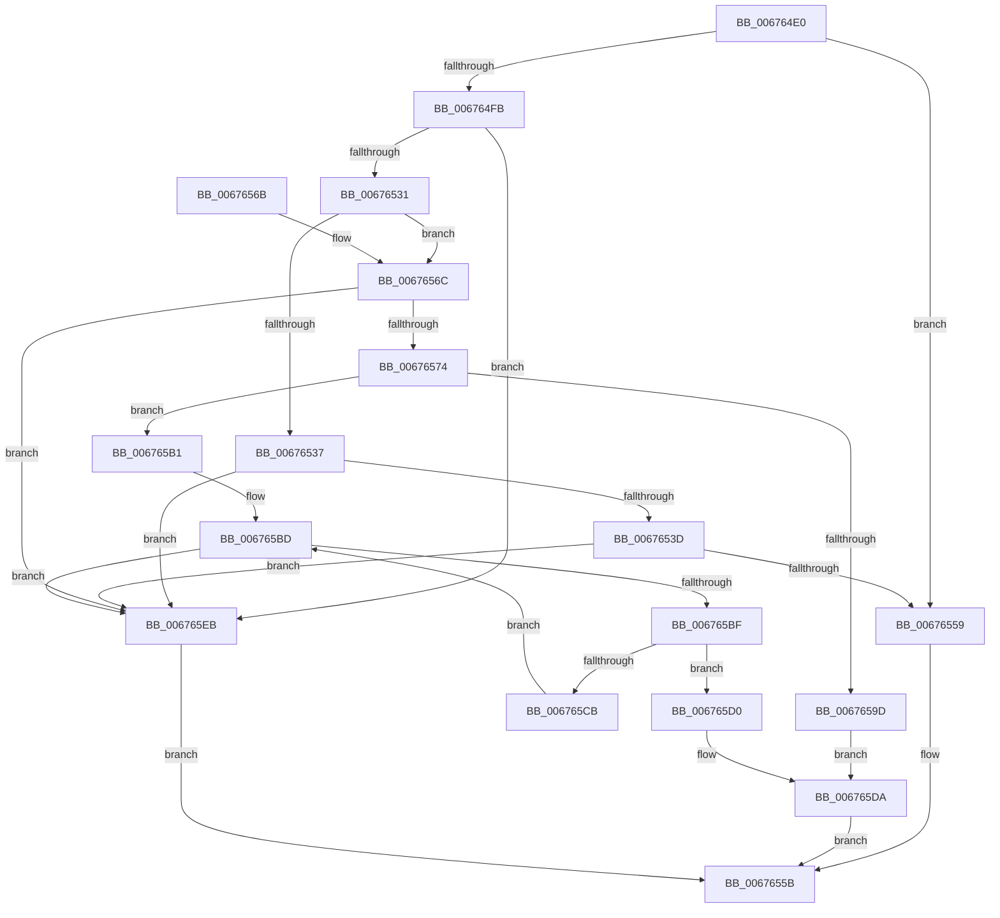

# MiIsAnyPartOfRangeInHugePfn

- RVA: `0x006764E0`–`0x006765F5` (길이 `277` bytes)
- VA: `0x00000001406764E0`
- 실행 섹션: `.text`
- PDB 이름 있음: `예`; PDB Function 태그: `아니요`
- unwind 정보 RVA: `0x000D7C64`
- 디코드: `78`개 명령, `277/277` bytes 표시
- 미해석 바이트: `0` (있으면 어셈블리에 `.byte`로 보존)

> 이 문서는 커널 이미지의 기계어와 PDB 기호를 분석해 생성했습니다. 4번과 5번은 함수 원형과 자료형을 바이너리 사용 방식에서 추정한 C 해석이며 원본 소스 복구 결과는 아닙니다.

## 1. Dependencies

- 직접 호출 지점: **0**; 고유 호출 대상: **0**
- 직접 호출자로 확인된 함수: **1**
- RIP 상대 이미지 참조: **2**

### Outgoing calls
- 직접 디코드된 call 명령이 없습니다.

### Direct callers
- [MiAcquireAddMemoryResources](../../page/7F/MiAcquireAddMemoryResources_function_007F9538.md) at `0x007F954F`

### Static image references
- `0x006764F2` → RVA `0x00E300B8` (`.data`; read)
- `0x0067651B` → RVA `0x00E300B0` (`.data`; read)

## 2. Other-region calls and transfers

- 다른 실행 섹션으로 향하는 call: **0**
- 별도 외부 분기/꼬리 이동을 확인하지 못했습니다.

## 3. Assembly (complete function range)

```asm
006764E0  48 89 5C 24 08                  mov qword ptr [rsp + 8], rbx
006764E5  48 89 74 24 10                  mov qword ptr [rsp + 0x10], rsi
006764EA  48 89 7C 24 18                  mov qword ptr [rsp + 0x18], rdi
006764EF  45 33 D2                        xor r10d, r10d
006764F2  4C 39 15 BF 9B 7B 00            cmp qword ptr [rip + 0x7b9bbf], r10
006764F9  74 5E                           je 0x140676559
006764FB  B8 FF FF 3F 00                  mov eax, 0x3fffff
00676500  48 8D 5A FF                     lea rbx, [rdx - 1]
00676504  48 03 D9                        add rbx, rcx
00676507  4C 8B C1                        mov r8, rcx
0067650A  48 C1 EB 12                     shr rbx, 0x12
0067650E  48 23 D8                        and rbx, rax
00676511  49 C1 E8 12                     shr r8, 0x12
00676515  4C 23 C0                        and r8, rax
00676518  4C 8B DB                        mov r11, rbx
0067651B  48 8B 05 8E 9B 7B 00            mov rax, qword ptr [rip + 0x7b9b8e]
00676522  4D 2B D8                        sub r11, r8
00676525  49 FF C3                        inc r11
00676528  4C 3B C0                        cmp r8, rax
0067652B  0F 83 BA 00 00 00               jae 0x1406765eb
00676531  49 83 FB 01                     cmp r11, 1
00676535  77 35                           ja 0x14067656c
00676537  0F 85 AE 00 00 00               jne 0x1406765eb
0067653D  48 8B 05 74 9B 7B 00            mov rax, qword ptr [rip + 0x7b9b74]
00676544  49 8B C8                        mov rcx, r8
00676547  49 C1 E8 06                     shr r8, 6
0067654B  83 E1 3F                        and ecx, 0x3f
0067654E  4A 0F A3 0C C0                  bt qword ptr [rax + r8*8], rcx
00676553  0F 82 92 00 00 00               jb 0x1406765eb
00676559  33 C0                           xor eax, eax
0067655B  48 8B 5C 24 08                  mov rbx, qword ptr [rsp + 8]
00676560  48 8B 74 24 10                  mov rsi, qword ptr [rsp + 0x10]
00676565  48 8B 7C 24 18                  mov rdi, qword ptr [rsp + 0x18]
0067656A  C3                              ret
0067656B  CC                              int3
0067656C  49 2B C0                        sub rax, r8
0067656F  49 3B C3                        cmp rax, r11
00676572  72 77                           jb 0x1406765eb
00676574  48 8B 15 3D 9B 7B 00            mov rdx, qword ptr [rip + 0x7b9b3d]
0067657B  49 8B C0                        mov rax, r8
0067657E  48 C1 E8 06                     shr rax, 6
00676582  4C 8D 0C C2                     lea r9, [rdx + rax*8]
00676586  48 8B C3                        mov rax, rbx
00676589  49 8B 31                        mov rsi, qword ptr [r9]
0067658C  48 C1 E8 06                     shr rax, 6
00676590  48 8D 3C C2                     lea rdi, [rdx + rax*8]
00676594  48 83 CA FF                     or rdx, 0xffffffffffffffff
00676598  4C 3B CF                        cmp r9, rdi
0067659B  75 14                           jne 0x1406765b1
0067659D  8D 4A 41                        lea ecx, [rdx + 0x41]
006765A0  41 2A CB                        sub cl, r11b
006765A3  48 D3 EA                        shr rdx, cl
006765A6  49 8B C8                        mov rcx, r8
006765A9  48 D3 E2                        shl rdx, cl
006765AC  48 85 F2                        test rdx, rsi
006765AF  EB 29                           jmp 0x1406765da
006765B1  49 8B C8                        mov rcx, r8
006765B4  48 8B C2                        mov rax, rdx
006765B7  48 D3 E0                        shl rax, cl
006765BA  48 85 F0                        test rax, rsi
006765BD  75 2C                           jne 0x1406765eb
006765BF  49 83 C1 08                     add r9, 8
006765C3  49 8B 01                        mov rax, qword ptr [r9]
006765C6  4C 3B CF                        cmp r9, rdi
006765C9  74 05                           je 0x1406765d0
006765CB  48 85 C0                        test rax, rax
006765CE  EB ED                           jmp 0x1406765bd
006765D0  8A CB                           mov cl, bl
006765D2  F6 D1                           not cl
006765D4  48 D3 EA                        shr rdx, cl
006765D7  48 85 C2                        test rdx, rax
006765DA  0F 94 C0                        sete al
006765DD  84 C0                           test al, al
006765DF  41 0F 94 C2                     sete r10b
006765E3  41 8B C2                        mov eax, r10d
006765E6  E9 70 FF FF FF                  jmp 0x14067655b
006765EB  B8 01 00 00 00                  mov eax, 1
006765F0  E9 66 FF FF FF                  jmp 0x14067655b
```

## 4. C-style interpretation (structured pseudocode)

```c
__int64 __fastcall MiIsAnyPartOfRangeInHugePfn(__int64 a1, __int64 a2)
{
    __int64 result;
    __int64 v_r10;
    __int64 v_r11;
    __int64 v_rbx;
    unsigned __int64 v_stack_p10;
    unsigned __int64 v_stack_p18;
    unsigned __int64 v_stack_p8;

    v_stack_p8 = v_rbx;
    v_stack_p10 = v_rsi;
    v_stack_p18 = v_rdi;
    v_r10 = 0;
    if ((*(unsigned __int64 *)(v_rip + 8100799)) == 0) goto loc_00676559;
    v_rbx = (a2 - 1) + (a1);
    v_rbx = (v_rbx) >> (18);
    v_rbx = (v_rbx) & ((unsigned int)(0x3FFFFFULL));
    a3 = (a1) >> (18);
    a3 = (a3) & ((unsigned int)(0x3FFFFFULL));
    v_r11 = (v_rbx) - (a3);
    v_r11 = (v_r11) + 1;
    if (a3 >= (*(unsigned __int64 *)(v_rip + 8100750))) goto loc_006765EB;
    if (v_r11 > 1) goto loc_0067656C;
    if (v_r11 != 1) goto loc_006765EB;
    a3 = (a3) >> (6);
    a1 = (unsigned int)((a3) & (63));
    if (condition_is_below) goto loc_006765EB;
loc_00676559:
    result = 0;
loc_0067655B:
    return result;
loc_0067656C:
    result = (result) - (a3);
    if (result < v_r11) goto loc_006765EB;
    result = (a3) >> (6);
    result = (v_stack_p8) >> (6);
    a2 = (*(unsigned __int64 *)(v_rip + 8100669)) | (-1);
    if ((*(unsigned __int64 *)(v_rip + 8100669) + result * 8) != (*(unsigned __int64 *)(v_rip + 8100669) + result * 8)) goto loc_006765B1;
    a1 = (unsigned __int8)((a2 + 65) - ((unsigned __int8)(v_r11)));
    a2 = (a2) >> ((unsigned __int8)(a1));
    a2 = (a2) << ((unsigned __int8)(a3));
    goto loc_006765DA;
loc_006765B1:
    result = (a2) << ((unsigned __int8)(a3));
loc_006765BD:
    if (((result) & (*(unsigned __int64 *)(*(unsigned __int64 *)(v_rip + 8100669) + result * 8))) != 0) goto loc_006765EB;
    a4 = (*(unsigned __int64 *)(v_rip + 8100669) + result * 8) + (8);
    if (a4 == (*(unsigned __int64 *)(v_rip + 8100669) + result * 8)) goto loc_006765D0;
    goto loc_006765BD;
loc_006765D0:
    a1 = (unsigned __int8)(~((unsigned __int8)(v_stack_p8)));
    a2 = (a2) >> ((unsigned __int8)(a1));
loc_006765DA:
    result = (((a2) & (*(unsigned __int64 *)(a4))) == 0) ? 1 : 0;
    v_r10 = ((unsigned __int8)(result) == 0) ? 1 : 0;
    goto loc_0067655B;
loc_006765EB:
    goto loc_0067655B;
}
```

## 5. (Beta) C Style

```c
int64_t MiIsAnyPartOfRangeInHugePfn(int64_t Arg1, void *Arg2)
{
    uint8_t *arg2 = (uint8_t *)Arg2;

    int64_t result;
    int64_t local_r10;
    int64_t local_r11;
    int64_t local_rbx;
    uint64_t v_stack_p10;
    uint64_t v_stack_p18;
    uint64_t v_stack_p8;

    v_stack_p8 = local_rbx;
    v_stack_p10 = local_rsi;
    v_stack_p18 = local_rdi;
    local_r10 = 0;
    if ((*(uint64_t *)(v_rip + 0x7B9BBF)) == 0) goto loc_00676559;
    local_rbx = (Arg2 - 1) + (Arg1);
    local_rbx = (local_rbx) >> (18);
    local_rbx = (local_rbx) & ((uint32_t)(0x3FFFFFULL));
    a3 = (Arg1) >> (18);
    a3 = (a3) & ((uint32_t)(0x3FFFFFULL));
    local_r11 = (local_rbx) - (a3);
    local_r11 = (local_r11) + 1;
    if (a3 >= (*(uint64_t *)(v_rip + 0x7B9B8E))) goto loc_006765EB;
    if (local_r11 > 1) goto loc_0067656C;
    if (local_r11 != 1) goto loc_006765EB;
    a3 = (a3) >> (6);
    Arg1 = (uint32_t)((a3) & (63));
    if (condition_is_below) goto loc_006765EB;
loc_00676559:
    result = 0;
loc_0067655B:
    return result;
loc_0067656C:
    result = (result) - (a3);
    if (result < local_r11) goto loc_006765EB;
    result = (a3) >> (6);
    result = (v_stack_p8) >> (6);
    Arg2 = (*(uint64_t *)(v_rip + 0x7B9B3D)) | (-1);
    if ((*(uint64_t *)(v_rip + 0x7B9B3D) + result * 8) != (*(uint64_t *)(v_rip + 0x7B9B3D) + result * 8)) goto loc_006765B1;
    Arg1 = (uint8_t)((Arg2 + 65) - ((uint8_t)(local_r11)));
    Arg2 = (Arg2) >> ((uint8_t)(Arg1));
    Arg2 = (Arg2) << ((uint8_t)(a3));
    goto loc_006765DA;
loc_006765B1:
    result = (Arg2) << ((uint8_t)(a3));
loc_006765BD:
    if (((result) & (*(uint64_t *)(*(uint64_t *)(v_rip + 0x7B9B3D) + result * 8))) != 0) goto loc_006765EB;
    a4 = (*(uint64_t *)(v_rip + 0x7B9B3D) + result * 8) + (8);
    if (a4 == (*(uint64_t *)(v_rip + 0x7B9B3D) + result * 8)) goto loc_006765D0;
    goto loc_006765BD;
loc_006765D0:
    Arg1 = (uint8_t)(~((uint8_t)(v_stack_p8)));
    Arg2 = (Arg2) >> ((uint8_t)(Arg1));
loc_006765DA:
    result = (((Arg2) & (*(uint64_t *)(a4))) == 0) ? 1 : 0;
    local_r10 = ((uint8_t)(result) == 0) ? 1 : 0;
    goto loc_0067655B;
loc_006765EB:
    goto loc_0067655B;
}
```

### 관측된 메모리 오프셋

구조체 형식이 확인되지 않은 접근은 인자 기준의 오프셋으로만 기록했습니다.

| 기준 인자 | 오프셋 표현 | 폭 (bit) | 접근 |
|---|---:|---:|---|
| `Arg2` | `- 0x1` | `64` | `R` |

## 6. Execution-region graph

[열기: 2D/3D 그래프와 함수 탐색 컨트롤 패널](../../../control-panel.html?section=text&rva=0x006764E0&view=graph)

- 2D 그래프는 위에서 아래로 흐르고, 3D 그래프는 빈 공간을 드래그해 회전합니다. Shift+드래그는 이동, 휠은 확대·축소, 함수 노드 선택은 대상 보고서 이동입니다.

### Static fallback


