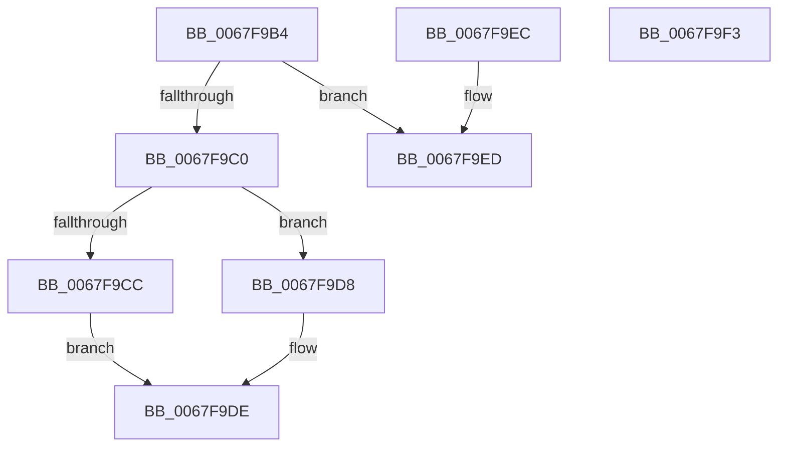

# MiIsDriverVaImportOptimizable

- RVA: `0x0067F9B4`–`0x0067F9F4` (길이 `64` bytes)
- VA: `0x000000014067F9B4`
- 실행 섹션: `.text`
- PDB 이름 있음: `예`; PDB Function 태그: `아니요`
- unwind 정보 RVA: `0x000DB714`
- 디코드: `19`개 명령, `64/64` bytes 표시
- 미해석 바이트: `0` (있으면 어셈블리에 `.byte`로 보존)

> 이 문서는 커널 이미지의 기계어와 PDB 기호를 분석해 생성했습니다. 4번과 5번은 함수 원형과 자료형을 바이너리 사용 방식에서 추정한 C 해석이며 원본 소스 복구 결과는 아닙니다.

## 1. Dependencies

- 직접 호출 지점: **0**; 고유 호출 대상: **0**
- 직접 호출자로 확인된 함수: **2**
- RIP 상대 이미지 참조: **3**

### Outgoing calls
- 직접 디코드된 call 명령이 없습니다.

### Direct callers
- [MiMakeSystemRangeAvailable](../4E/MiMakeSystemRangeAvailable_function_004EE174.md) at `0x004EE33E`
- [MiReserveBestDriverRange](../../page/7F/MiReserveBestDriverRange_function_007F92E0.md) at `0x007F9368`
- [MiReserveBestDriverRange](../../page/7F/MiReserveBestDriverRange_function_007F92E0.md) at `0x007F93CD`

### Static image references
- `0x0067F9B4` → RVA `0x00F10EC0` (`.data`; read)
- `0x0067F9C0` → RVA `0x00FC6CB0` (`ALMOSTRO`; read)
- `0x0067F9CC` → RVA `0x00FC6B28` (`ALMOSTRO`; read)

## 2. Other-region calls and transfers

- 다른 실행 섹션으로 향하는 call: **0**
- 별도 외부 분기/꼬리 이동을 확인하지 못했습니다.

## 3. Assembly (complete function range)

```asm
0067F9B4  F7 05 02 15 89 00 00 00 02 00   test dword ptr [rip + 0x891502], 0x20000
0067F9BE  75 2D                           jne 0x14067f9ed
0067F9C0  48 8B 05 E9 72 94 00            mov rax, qword ptr [rip + 0x9472e9]
0067F9C7  48 3B C8                        cmp rcx, rax
0067F9CA  72 0C                           jb 0x14067f9d8
0067F9CC  48 2B 0D 55 71 94 00            sub rcx, qword ptr [rip + 0x947155]
0067F9D3  48 03 CA                        add rcx, rdx
0067F9D6  EB 06                           jmp 0x14067f9de
0067F9D8  48 2B C1                        sub rax, rcx
0067F9DB  48 8B C8                        mov rcx, rax
0067F9DE  33 C0                           xor eax, eax
0067F9E0  BA 00 00 00 80                  mov edx, 0x80000000
0067F9E5  48 3B CA                        cmp rcx, rdx
0067F9E8  0F 92 C0                        setb al
0067F9EB  C3                              ret
0067F9EC  CC                              int3
0067F9ED  B8 01 00 00 00                  mov eax, 1
0067F9F2  C3                              ret
0067F9F3  CC                              int3
```

## 4. C-style interpretation (structured pseudocode)

```c
__int64 __fastcall MiIsDriverVaImportOptimizable(__int64 a1, __int64 a2)
{
    __int64 result;

    if (((*(unsigned int *)(v_rip + 8983810)) & (0x20000ULL)) != 0) goto loc_0067F9ED;
    if (a1 < (*(unsigned __int64 *)(v_rip + 9728745))) goto loc_0067F9D8;
    a1 = (a1) - (*(unsigned __int64 *)(v_rip + 9728341));
    a1 = (a1) + (a2);
    goto loc_0067F9DE;
loc_0067F9D8:
    result = (*(unsigned __int64 *)(v_rip + 9728745)) - (a1);
loc_0067F9DE:
    result = 0;
    result = (0 < ((unsigned int)(0x80000000ULL))) ? 1 : 0;
    return result;
loc_0067F9ED:
    return 1;
}
```

## 5. (Beta) C Style

```c
int64_t MiIsDriverVaImportOptimizable(int64_t Arg1, int64_t Arg2)
{
    int64_t result;

    if (((*(uint32_t *)(v_rip + 0x891502)) & (0x20000ULL)) != 0) goto loc_0067F9ED;
    if (Arg1 < (*(uint64_t *)(v_rip + 0x9472E9))) goto loc_0067F9D8;
    Arg1 = (Arg1) - (*(uint64_t *)(v_rip + 0x947155));
    Arg1 = (Arg1) + (Arg2);
    goto loc_0067F9DE;
loc_0067F9D8:
    result = (*(uint64_t *)(v_rip + 0x9472E9)) - (Arg1);
loc_0067F9DE:
    result = 0;
    result = (0 < ((uint32_t)(0x80000000ULL))) ? 1 : 0;
    return result;
loc_0067F9ED:
    return 1;
}
```

## 6. Execution-region graph

[열기: 2D/3D 그래프와 함수 탐색 컨트롤 패널](../../../control-panel.html?section=text&rva=0x0067F9B4&view=graph)

- 2D 그래프는 위에서 아래로 흐르고, 3D 그래프는 빈 공간을 드래그해 회전합니다. Shift+드래그는 이동, 휠은 확대·축소, 함수 노드 선택은 대상 보고서 이동입니다.

### Static fallback


