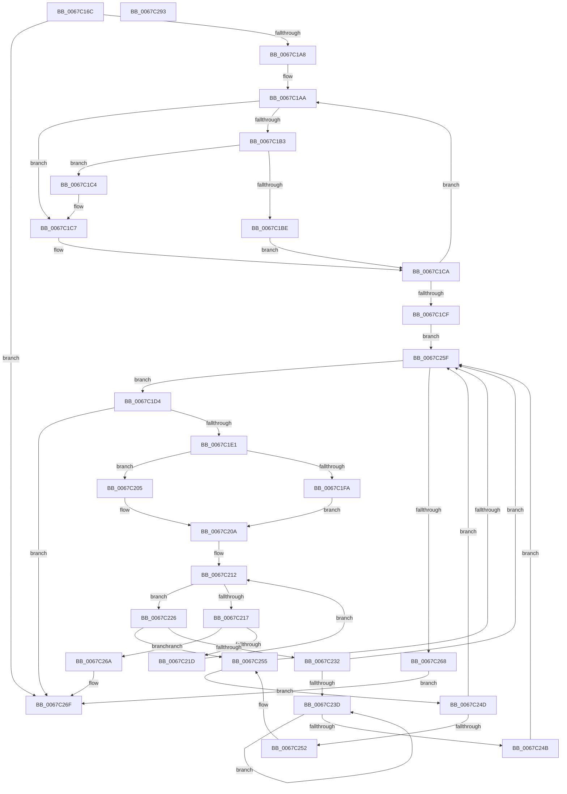

# MiIsProbeActive

- RVA: `0x0067C16C`–`0x0067C294` (길이 `296` bytes)
- VA: `0x000000014067C16C`
- 실행 섹션: `.text`
- PDB 이름 있음: `예`; PDB Function 태그: `아니요`
- unwind 정보 RVA: `0x0005C954`
- 디코드: `88`개 명령, `296/296` bytes 표시
- 미해석 바이트: `0` (있으면 어셈블리에 `.byte`로 보존)

> 이 문서는 커널 이미지의 기계어와 PDB 기호를 분석해 생성했습니다. 4번과 5번은 함수 원형과 자료형을 바이너리 사용 방식에서 추정한 C 해석이며 원본 소스 복구 결과는 아닙니다.

## 1. Dependencies

- 직접 호출 지점: **2**; 고유 호출 대상: **2**
- 직접 호출자로 확인된 함수: **1**
- RIP 상대 이미지 참조: **1**

### Outgoing calls
- `0x0067C190` → [MiLockIoPfnTree](../2A/MiLockIoPfnTree_function_002AC8A4.md) (function, `0x002AC8A4`)
- `0x0067C277` → [MiUnlockIoPfnTree](../2A/MiUnlockIoPfnTree_function_002AC7F8.md) (function, `0x002AC7F8`)

### Direct callers
- [MmIsIoSpaceActive](MmIsIoSpaceActive_function_0067C970.md) at `0x0067C98E`

### Static image references
- `0x0067C195` → RVA `0x00E37280` (`.data`; read)

## 2. Other-region calls and transfers

- 다른 실행 섹션으로 향하는 call: **0**
- 별도 외부 분기/꼬리 이동을 확인하지 못했습니다.

## 3. Assembly (complete function range)

```asm
0067C16C  48 89 5C 24 08                  mov qword ptr [rsp + 8], rbx
0067C171  48 89 6C 24 10                  mov qword ptr [rsp + 0x10], rbp
0067C176  48 89 74 24 18                  mov qword ptr [rsp + 0x18], rsi
0067C17B  57                              push rdi
0067C17C  48 83 EC 20                     sub rsp, 0x20
0067C180  48 8D 2C 11                     lea rbp, [rcx + rdx]
0067C184  48 8B F1                        mov rsi, rcx
0067C187  33 DB                           xor ebx, ebx
0067C189  48 8D 7D FF                     lea rdi, [rbp - 1]
0067C18D  8D 4B 01                        lea ecx, [rbx + 1]
0067C190  E8 0F 07 C3 FF                  call 0x1402ac8a4
0067C195  48 8B 15 E4 B0 7B 00            mov rdx, qword ptr [rip + 0x7bb0e4]
0067C19C  44 8A C8                        mov r9b, al
0067C19F  48 85 D2                        test rdx, rdx
0067C1A2  0F 84 C7 00 00 00               je 0x14067c26f
0067C1A8  8B CB                           mov ecx, ebx
0067C1AA  48 8B 42 18                     mov rax, qword ptr [rdx + 0x18]
0067C1AE  48 3B F8                        cmp rdi, rax
0067C1B1  72 14                           jb 0x14067c1c7
0067C1B3  48 05 00 02 00 00               add rax, 0x200
0067C1B9  48 3B F0                        cmp rsi, rax
0067C1BC  72 06                           jb 0x14067c1c4
0067C1BE  48 8B 52 08                     mov rdx, qword ptr [rdx + 8]
0067C1C2  EB 06                           jmp 0x14067c1ca
0067C1C4  48 8B CA                        mov rcx, rdx
0067C1C7  48 8B 12                        mov rdx, qword ptr [rdx]
0067C1CA  48 85 D2                        test rdx, rdx
0067C1CD  75 DB                           jne 0x14067c1aa
0067C1CF  E9 8B 00 00 00                  jmp 0x14067c25f
0067C1D4  4C 8B 41 18                     mov r8, qword ptr [rcx + 0x18]
0067C1D8  49 3B F8                        cmp rdi, r8
0067C1DB  0F 82 8E 00 00 00               jb 0x14067c26f
0067C1E1  48 8B D6                        mov rdx, rsi
0067C1E4  49 8D 80 00 02 00 00            lea rax, [r8 + 0x200]
0067C1EB  49 2B D0                        sub rdx, r8
0067C1EE  49 3B F0                        cmp rsi, r8
0067C1F1  48 0F 42 D3                     cmovb rdx, rbx
0067C1F5  48 3B E8                        cmp rbp, rax
0067C1F8  77 0B                           ja 0x14067c205
0067C1FA  48 8B C7                        mov rax, rdi
0067C1FD  49 2B C0                        sub rax, r8
0067C200  48 FF C0                        inc rax
0067C203  EB 05                           jmp 0x14067c20a
0067C205  B8 00 02 00 00                  mov eax, 0x200
0067C20A  4C 8D 42 58                     lea r8, [rdx + 0x58]
0067C20E  4E 8D 04 41                     lea r8, [rcx + r8*2]
0067C212  48 3B D0                        cmp rdx, rax
0067C215  73 0F                           jae 0x14067c226
0067C217  66 41 39 18                     cmp word ptr [r8], bx
0067C21B  75 4D                           jne 0x14067c26a
0067C21D  48 FF C2                        inc rdx
0067C220  49 83 C0 02                     add r8, 2
0067C224  EB EC                           jmp 0x14067c212
0067C226  48 8B 41 08                     mov rax, qword ptr [rcx + 8]
0067C22A  48 8B D1                        mov rdx, rcx
0067C22D  48 85 C0                        test rax, rax
0067C230  74 23                           je 0x14067c255
0067C232  48 8B 10                        mov rdx, qword ptr [rax]
0067C235  48 8B C8                        mov rcx, rax
0067C238  48 85 D2                        test rdx, rdx
0067C23B  74 22                           je 0x14067c25f
0067C23D  48 8B 02                        mov rax, qword ptr [rdx]
0067C240  48 8B CA                        mov rcx, rdx
0067C243  48 8B D0                        mov rdx, rax
0067C246  48 85 C0                        test rax, rax
0067C249  75 F2                           jne 0x14067c23d
0067C24B  EB 12                           jmp 0x14067c25f
0067C24D  48 39 11                        cmp qword ptr [rcx], rdx
0067C250  74 0D                           je 0x14067c25f
0067C252  48 8B D1                        mov rdx, rcx
0067C255  48 8B 49 10                     mov rcx, qword ptr [rcx + 0x10]
0067C259  48 83 E1 FC                     and rcx, 0xfffffffffffffffc
0067C25D  75 EE                           jne 0x14067c24d
0067C25F  48 85 C9                        test rcx, rcx
0067C262  0F 85 6C FF FF FF               jne 0x14067c1d4
0067C268  EB 05                           jmp 0x14067c26f
0067C26A  BB 01 00 00 00                  mov ebx, 1
0067C26F  BA 01 00 00 00                  mov edx, 1
0067C274  41 8A C9                        mov cl, r9b
0067C277  E8 7C 05 C3 FF                  call 0x1402ac7f8
0067C27C  48 8B 6C 24 38                  mov rbp, qword ptr [rsp + 0x38]
0067C281  8B C3                           mov eax, ebx
0067C283  48 8B 5C 24 30                  mov rbx, qword ptr [rsp + 0x30]
0067C288  48 8B 74 24 40                  mov rsi, qword ptr [rsp + 0x40]
0067C28D  48 83 C4 20                     add rsp, 0x20
0067C291  5F                              pop rdi
0067C292  C3                              ret
0067C293  CC                              int3
```

## 4. C-style interpretation (structured pseudocode)

```c
__int64 __fastcall MiIsProbeActive(__int64 a1, __int64 a2)
{
    __int64 result;
    __int64 v_rbx;
    __int64 v_rsp;
    unsigned __int64 v_stack_p10;
    unsigned __int64 v_stack_p18;
    unsigned __int64 v_stack_p8;

    v_stack_p8 = v_rbx;
    v_stack_p10 = v_rbp;
    v_stack_p18 = v_rsi;
    v_rsp = (v_rsp) - (32);
    v_rbx = 0;
    result = MiLockIoPfnTree(v_rbx + 1, a2, a3, a4);
    if (*(unsigned __int64 *)(v_rip + 8106212) == 0) goto loc_0067C26F;
loc_0067C1AA:
    if ((a1 + a2 * 1 - 1) < (*(unsigned __int64 *)(*(unsigned __int64 *)(v_rip + 8106212) + 24))) goto loc_0067C1C7;
    result = (*(unsigned __int64 *)(*(unsigned __int64 *)(v_rip + 8106212) + 24)) + (512);
    if (a1 < result) goto loc_0067C1C4;
    goto loc_0067C1CA;
loc_0067C1C4:
loc_0067C1C7:
loc_0067C1CA:
    if (*(unsigned __int64 *)(*(unsigned __int64 *)(*(unsigned __int64 *)(v_rip + 8106212) + 8)) != 0) goto loc_0067C1AA;
    goto loc_0067C25F;
loc_0067C1D4:
    if ((a1 + a2 * 1 - 1) < (*(unsigned __int64 *)(*(unsigned __int64 *)(*(unsigned __int64 *)(v_rip + 8106212) + 8) + 24))) goto loc_0067C26F;
    a2 = (a1) - (*(unsigned __int64 *)(*(unsigned __int64 *)(*(unsigned __int64 *)(v_rip + 8106212) + 8) + 24));
    if (a1 < (*(unsigned __int64 *)(*(unsigned __int64 *)(*(unsigned __int64 *)(v_rip + 8106212) + 8) + 24))) { a2 = 0; }
    if ((a1 + a2 * 1) > (*(unsigned __int64 *)(*(unsigned __int64 *)(*(unsigned __int64 *)(v_rip + 8106212) + 8) + 24) + 512)) goto loc_0067C205;
    result = (a1 + a2 * 1 - 1) - (*(unsigned __int64 *)(*(unsigned __int64 *)(*(unsigned __int64 *)(v_rip + 8106212) + 8) + 24));
    result = (result) + 1;
    goto loc_0067C20A;
loc_0067C205:
loc_0067C20A:
loc_0067C212:
    if (a2 >= 512) goto loc_0067C226;
    if ((*(unsigned __int16 *)(*(unsigned __int64 *)(*(unsigned __int64 *)(v_rip + 8106212) + 8) + a2 + 88 * 2)) != 0) goto loc_0067C26A;
    a2 = (a2) + 1;
    a3 = (*(unsigned __int64 *)(*(unsigned __int64 *)(v_rip + 8106212) + 8) + a2 + 88 * 2) + (2);
    goto loc_0067C212;
loc_0067C226:
    if (*(unsigned __int64 *)(*(unsigned __int64 *)(*(unsigned __int64 *)(v_rip + 8106212) + 8) + 8) == 0) goto loc_0067C255;
    if (*(unsigned __int64 *)(*(unsigned __int64 *)(*(unsigned __int64 *)(*(unsigned __int64 *)(v_rip + 8106212) + 8) + 8)) == 0) goto loc_0067C25F;
loc_0067C23D:
    if (*(unsigned __int64 *)(*(unsigned __int64 *)(*(unsigned __int64 *)(*(unsigned __int64 *)(*(unsigned __int64 *)(v_rip + 8106212) + 8) + 8))) != 0) goto loc_0067C23D;
    goto loc_0067C25F;
loc_0067C24D:
    if ((*(unsigned __int64 *)(*(unsigned __int64 *)(*(unsigned __int64 *)(*(unsigned __int64 *)(*(unsigned __int64 *)(v_rip + 8106212) + 8) + 8)))) == (*(unsigned __int64 *)(*(unsigned __int64 *)(*(unsigned __int64 *)(*(unsigned __int64 *)(*(unsigned __int64 *)(v_rip + 8106212) + 8) + 8))))) goto loc_0067C25F;
loc_0067C255:
    a1 = (*(unsigned __int64 *)(*(unsigned __int64 *)(*(unsigned __int64 *)(*(unsigned __int64 *)(*(unsigned __int64 *)(v_rip + 8106212) + 8) + 8)) + 16)) & (-4);
    if (condition_is_not_equal) goto loc_0067C24D;
loc_0067C25F:
    if (a1 != 0) goto loc_0067C1D4;
    goto loc_0067C26F;
loc_0067C26A:
loc_0067C26F:
    result = MiUnlockIoPfnTree((unsigned __int8)((unsigned __int8)(result)), 1, a3, (unsigned __int8)(result));
    v_rsp = (v_rsp) + (32);
    return 1;
}
```

## 5. (Beta) C Style

```c
int64_t MiIsProbeActive(void *Arg1, int64_t Arg2)
{
    uint8_t *arg1 = (uint8_t *)Arg1;

    int64_t result;
    int64_t local_rbx;
    int64_t local_rsp;
    uint64_t v_stack_p10;
    uint64_t v_stack_p18;
    uint64_t v_stack_p8;

    v_stack_p8 = local_rbx;
    v_stack_p10 = local_rbp;
    v_stack_p18 = local_rsi;
    local_rsp = (local_rsp) - (32);
    local_rbx = 0;
    result = MiLockIoPfnTree(local_rbx + 1, Arg2, a3, a4);
    if (*(uint64_t *)(v_rip + 0x7BB0E4) == 0) goto loc_0067C26F;
loc_0067C1AA:
    if ((Arg1 + Arg2 * 1 - 1) < (*(uint64_t *)(*(uint64_t *)(v_rip + 0x7BB0E4) + 0x18))) goto loc_0067C1C7;
    result = (*(uint64_t *)(*(uint64_t *)(v_rip + 0x7BB0E4) + 0x18)) + (512);
    if (Arg1 < result) goto loc_0067C1C4;
    goto loc_0067C1CA;
loc_0067C1C4:
loc_0067C1C7:
loc_0067C1CA:
    if (*(uint64_t *)(*(uint64_t *)(*(uint64_t *)(v_rip + 0x7BB0E4) + 0x8)) != 0) goto loc_0067C1AA;
    goto loc_0067C25F;
loc_0067C1D4:
    if ((Arg1 + Arg2 * 1 - 1) < (*(uint64_t *)(*(uint64_t *)(*(uint64_t *)(v_rip + 0x7BB0E4) + 0x8) + 0x18))) goto loc_0067C26F;
    Arg2 = (Arg1) - (*(uint64_t *)(*(uint64_t *)(*(uint64_t *)(v_rip + 0x7BB0E4) + 0x8) + 0x18));
    if (Arg1 < (*(uint64_t *)(*(uint64_t *)(*(uint64_t *)(v_rip + 0x7BB0E4) + 0x8) + 0x18))) { Arg2 = 0; }
    if ((Arg1 + Arg2 * 1) > (*(uint64_t *)(*(uint64_t *)(*(uint64_t *)(v_rip + 0x7BB0E4) + 0x8) + 0x18) + 512)) goto loc_0067C205;
    result = (Arg1 + Arg2 * 1 - 1) - (*(uint64_t *)(*(uint64_t *)(*(uint64_t *)(v_rip + 0x7BB0E4) + 0x8) + 0x18));
    result = (result) + 1;
    goto loc_0067C20A;
loc_0067C205:
loc_0067C20A:
loc_0067C212:
    if (Arg2 >= 512) goto loc_0067C226;
    if ((*(uint16_t *)(*(uint64_t *)(*(uint64_t *)(v_rip + 0x7BB0E4) + 0x8) + Arg2 + 0x58 * 2)) != 0) goto loc_0067C26A;
    Arg2 = (Arg2) + 1;
    a3 = (*(uint64_t *)(*(uint64_t *)(v_rip + 0x7BB0E4) + 0x8) + Arg2 + 88 * 2) + (2);
    goto loc_0067C212;
loc_0067C226:
    if (*(uint64_t *)(*(uint64_t *)(*(uint64_t *)(v_rip + 0x7BB0E4) + 0x8) + 0x8) == 0) goto loc_0067C255;
    if (*(uint64_t *)(*(uint64_t *)(*(uint64_t *)(*(uint64_t *)(v_rip + 0x7BB0E4) + 0x8) + 0x8)) == 0) goto loc_0067C25F;
loc_0067C23D:
    if (*(uint64_t *)(*(uint64_t *)(*(uint64_t *)(*(uint64_t *)(*(uint64_t *)(v_rip + 0x7BB0E4) + 0x8) + 0x8))) != 0) goto loc_0067C23D;
    goto loc_0067C25F;
loc_0067C24D:
    if ((*(uint64_t *)(*(uint64_t *)(*(uint64_t *)(*(uint64_t *)(*(uint64_t *)(v_rip + 0x7BB0E4) + 0x8) + 0x8)))) == (*(uint64_t *)(*(uint64_t *)(*(uint64_t *)(*(uint64_t *)(*(uint64_t *)(v_rip + 0x7BB0E4) + 0x8) + 0x8))))) goto loc_0067C25F;
loc_0067C255:
    Arg1 = (*(uint64_t *)(*(uint64_t *)(*(uint64_t *)(*(uint64_t *)(*(uint64_t *)(v_rip + 0x7BB0E4) + 0x8) + 0x8)) + 0x10)) & (-4);
    if (condition_is_not_equal) goto loc_0067C24D;
loc_0067C25F:
    if (Arg1 != NULL) goto loc_0067C1D4;
    goto loc_0067C26F;
loc_0067C26A:
loc_0067C26F:
    result = MiUnlockIoPfnTree((uint8_t)((uint8_t)(result)), 1, a3, (uint8_t)(result));
    local_rsp = (local_rsp) + (32);
    return 1;
}
```

### 관측된 메모리 오프셋

구조체 형식이 확인되지 않은 접근은 인자 기준의 오프셋으로만 기록했습니다.

| 기준 인자 | 오프셋 표현 | 폭 (bit) | 접근 |
|---|---:|---:|---|
| `Arg1` | `- 0x1` | `64` | `R` |
| `Arg1` | `+ 0x0 + rdx*1` | `64` | `R` |

## 6. Execution-region graph

[열기: 2D/3D 그래프와 함수 탐색 컨트롤 패널](../../../control-panel.html?section=text&rva=0x0067C16C&view=graph)

- 2D 그래프는 위에서 아래로 흐르고, 3D 그래프는 빈 공간을 드래그해 회전합니다. Shift+드래그는 이동, 휠은 확대·축소, 함수 노드 선택은 대상 보고서 이동입니다.

### Static fallback


