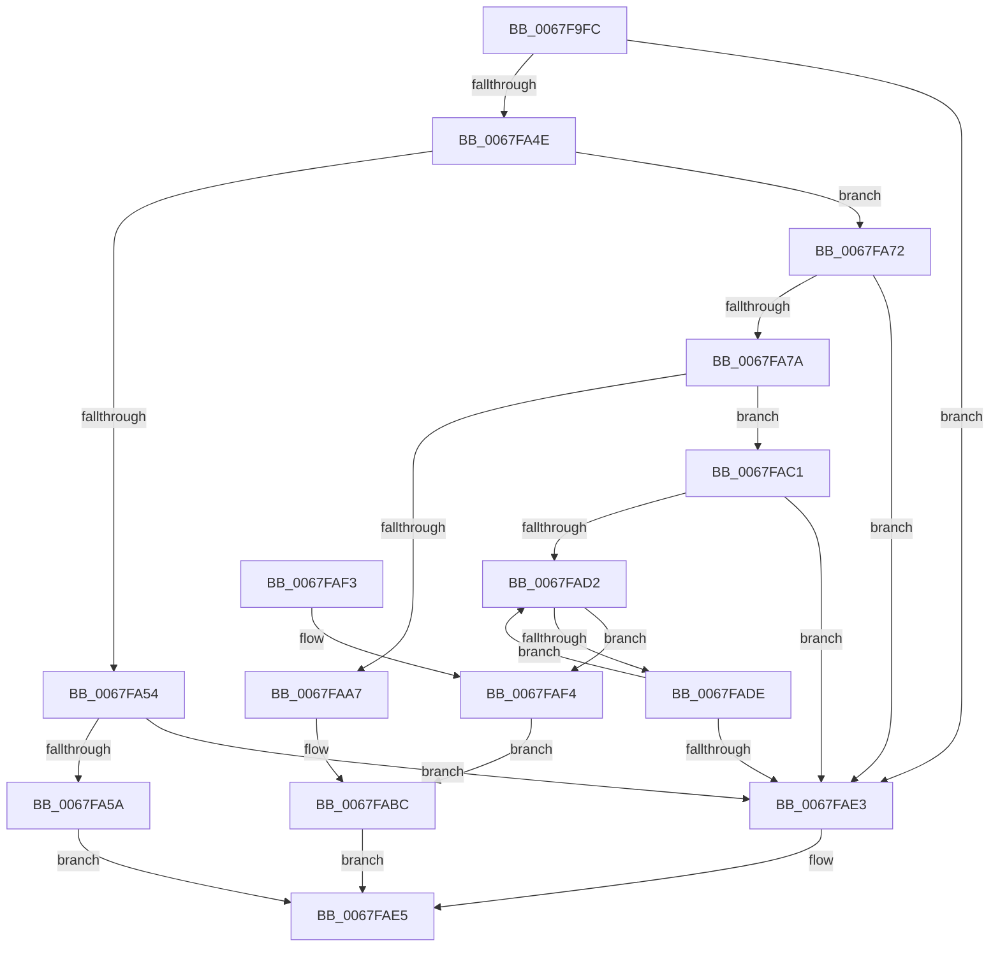

# MiIsSystemVaAllocated

- RVA: `0x0067F9FC`–`0x0067FB04` (길이 `264` bytes)
- VA: `0x000000014067F9FC`
- 실행 섹션: `.text`
- PDB 이름 있음: `예`; PDB Function 태그: `아니요`
- unwind 정보 RVA: `0x0009D5D8`
- 디코드: `82`개 명령, `264/264` bytes 표시
- 미해석 바이트: `0` (있으면 어셈블리에 `.byte`로 보존)

> 이 문서는 커널 이미지의 기계어와 PDB 기호를 분석해 생성했습니다. 4번과 5번은 함수 원형과 자료형을 바이너리 사용 방식에서 추정한 C 해석이며 원본 소스 복구 결과는 아닙니다.

## 1. Dependencies

- 직접 호출 지점: **1**; 고유 호출 대상: **1**
- 직접 호출자로 확인된 함수: **2**
- RIP 상대 이미지 참조: **0**

### Outgoing calls
- `0x0067FA0B` → [MiSystemVaToDynamicBitmap](../3B/MiSystemVaToDynamicBitmap_function_003B4F88.md) (function, `0x003B4F88`)

### Direct callers
- [MmAllocateSecurePoolMemory](../68/MmAllocateSecurePoolMemory_function_00682CC8.md) at `0x00682D67`
- [MmFreeSecurePoolMemory](../68/MmFreeSecurePoolMemory_function_00682E10.md) at `0x00682E5A`

### Static image references
- 디코드된 RIP-relative 메모리 참조가 없습니다.

## 2. Other-region calls and transfers

- 다른 실행 섹션으로 향하는 call: **0**
- 별도 외부 분기/꼬리 이동을 확인하지 못했습니다.

## 3. Assembly (complete function range)

```asm
0067F9FC  48 89 5C 24 08                  mov qword ptr [rsp + 8], rbx
0067FA01  57                              push rdi
0067FA02  48 83 EC 20                     sub rsp, 0x20
0067FA06  B9 0E 00 00 00                  mov ecx, 0xe
0067FA0B  E8 78 55 D3 FF                  call 0x1403b4f88
0067FA10  4C 8B CA                        mov r9, rdx
0067FA13  4D 8D 50 FF                     lea r10, [r8 - 1]
0067FA17  4C 03 D2                        add r10, rdx
0067FA1A  4C 8B D8                        mov r11, rax
0067FA1D  49 C1 EA 12                     shr r10, 0x12
0067FA21  4C 2B 48 20                     sub r9, qword ptr [rax + 0x20]
0067FA25  B8 F8 FF FF 3F                  mov eax, 0x3ffffff8
0067FA2A  4C 23 D0                        and r10, rax
0067FA2D  48 C1 EA 12                     shr rdx, 0x12
0067FA31  48 23 D0                        and rdx, rax
0067FA34  49 C1 E9 15                     shr r9, 0x15
0067FA38  49 8B 03                        mov rax, qword ptr [r11]
0067FA3B  4C 2B D2                        sub r10, rdx
0067FA3E  49 C1 FA 03                     sar r10, 3
0067FA42  49 FF C2                        inc r10
0067FA45  4C 3B C8                        cmp r9, rax
0067FA48  0F 83 95 00 00 00               jae 0x14067fae3
0067FA4E  49 83 FA 01                     cmp r10, 1
0067FA52  77 1E                           ja 0x14067fa72
0067FA54  0F 85 89 00 00 00               jne 0x14067fae3
0067FA5A  49 8B 43 08                     mov rax, qword ptr [r11 + 8]
0067FA5E  49 8B C9                        mov rcx, r9
0067FA61  49 C1 E9 06                     shr r9, 6
0067FA65  83 E1 3F                        and ecx, 0x3f
0067FA68  4A 0F A3 0C C8                  bt qword ptr [rax + r9*8], rcx
0067FA6D  0F 92 C0                        setb al
0067FA70  EB 73                           jmp 0x14067fae5
0067FA72  49 2B C1                        sub rax, r9
0067FA75  49 3B C2                        cmp rax, r10
0067FA78  72 69                           jb 0x14067fae3
0067FA7A  49 8B 53 08                     mov rdx, qword ptr [r11 + 8]
0067FA7E  49 8D 79 FF                     lea rdi, [r9 - 1]
0067FA82  49 03 FA                        add rdi, r10
0067FA85  49 8B C1                        mov rax, r9
0067FA88  48 C1 E8 06                     shr rax, 6
0067FA8C  4C 8D 04 C2                     lea r8, [rdx + rax*8]
0067FA90  48 8B C7                        mov rax, rdi
0067FA93  4D 8B 18                        mov r11, qword ptr [r8]
0067FA96  48 C1 E8 06                     shr rax, 6
0067FA9A  48 8D 1C C2                     lea rbx, [rdx + rax*8]
0067FA9E  48 83 CA FF                     or rdx, 0xffffffffffffffff
0067FAA2  4C 3B C3                        cmp r8, rbx
0067FAA5  75 1A                           jne 0x14067fac1
0067FAA7  8D 4A 41                        lea ecx, [rdx + 0x41]
0067FAAA  41 2A CA                        sub cl, r10b
0067FAAD  48 D3 EA                        shr rdx, cl
0067FAB0  49 8B C9                        mov rcx, r9
0067FAB3  48 D3 E2                        shl rdx, cl
0067FAB6  4C 23 DA                        and r11, rdx
0067FAB9  4C 3B DA                        cmp r11, rdx
0067FABC  0F 94 C0                        sete al
0067FABF  EB 24                           jmp 0x14067fae5
0067FAC1  49 8B C9                        mov rcx, r9
0067FAC4  48 8B C2                        mov rax, rdx
0067FAC7  48 D3 E0                        shl rax, cl
0067FACA  4C 23 D8                        and r11, rax
0067FACD  4C 3B D8                        cmp r11, rax
0067FAD0  75 11                           jne 0x14067fae3
0067FAD2  49 83 C0 08                     add r8, 8
0067FAD6  49 8B 00                        mov rax, qword ptr [r8]
0067FAD9  4C 3B C3                        cmp r8, rbx
0067FADC  74 16                           je 0x14067faf4
0067FADE  48 3B C2                        cmp rax, rdx
0067FAE1  74 EF                           je 0x14067fad2
0067FAE3  32 C0                           xor al, al
0067FAE5  48 8B 5C 24 30                  mov rbx, qword ptr [rsp + 0x30]
0067FAEA  0F B6 C0                        movzx eax, al
0067FAED  48 83 C4 20                     add rsp, 0x20
0067FAF1  5F                              pop rdi
0067FAF2  C3                              ret
0067FAF3  CC                              int3
0067FAF4  40 8A CF                        mov cl, dil
0067FAF7  F6 D1                           not cl
0067FAF9  48 D3 EA                        shr rdx, cl
0067FAFC  48 23 C2                        and rax, rdx
0067FAFF  48 3B C2                        cmp rax, rdx
0067FB02  EB B8                           jmp 0x14067fabc
```

## 4. C-style interpretation (structured pseudocode)

```c
__int64 __fastcall MiIsSystemVaAllocated(__int64 a1, __int64 a2, __int64 a3)
{
    __int64 result;
    __int64 v_r10;
    __int64 v_r11;
    __int64 v_rdi;
    __int64 v_rsp;
    unsigned __int64 v_stack_p8;

    v_stack_p8 = v_rbx;
    v_rsp = (v_rsp) - (32);
    result = MiSystemVaToDynamicBitmap(14, a2, a3, a4);
    v_r10 = (a3 - 1) + (a2);
    v_r10 = (v_r10) >> (18);
    a4 = (a2) - (*(unsigned __int64 *)(result + 32));
    v_r10 = (v_r10) & ((unsigned int)(0x3FFFFFF8ULL));
    a2 = (a2) >> (18);
    a2 = (a2) & ((unsigned int)(0x3FFFFFF8ULL));
    a4 = (a4) >> (21);
    v_r10 = (v_r10) - (a2);
    v_r10 = (v_r10) >> (3);
    v_r10 = (v_r10) + 1;
    if (a4 >= (*(unsigned __int64 *)(result))) goto loc_0067FAE3;
    if (v_r10 > 1) goto loc_0067FA72;
    if (v_r10 != 1) goto loc_0067FAE3;
    a4 = (a4) >> (6);
    a1 = (unsigned int)((a4) & (63));
    result = (condition_is_below) ? 1 : 0;
    goto loc_0067FAE5;
loc_0067FA72:
    result = (result) - (a4);
    if (result < v_r10) goto loc_0067FAE3;
    v_rdi = (a4 - 1) + (v_r10);
    result = (a4) >> (6);
    result = (v_rdi) >> (6);
    a2 = (*(unsigned __int64 *)(result + 8)) | (-1);
    if ((*(unsigned __int64 *)(result + 8) + result * 8) != (*(unsigned __int64 *)(result + 8) + result * 8)) goto loc_0067FAC1;
    a1 = (unsigned __int8)((a2 + 65) - ((unsigned __int8)(v_r10)));
    a2 = (a2) >> ((unsigned __int8)(a1));
    a2 = (a2) << ((unsigned __int8)(a4));
    v_r11 = (*(unsigned __int64 *)(*(unsigned __int64 *)(result + 8) + result * 8)) & (a2);
loc_0067FABC:
    result = (v_r11 == a2) ? 1 : 0;
    goto loc_0067FAE5;
loc_0067FAC1:
    result = (a2) << ((unsigned __int8)(a4));
    v_r11 = (v_r11) & (result);
    if (v_r11 != result) goto loc_0067FAE3;
loc_0067FAD2:
    a3 = (*(unsigned __int64 *)(result + 8) + result * 8) + (8);
    if (a3 == (*(unsigned __int64 *)(result + 8) + result * 8)) goto loc_0067FAF4;
    if ((*(unsigned __int64 *)(a3)) == a2) goto loc_0067FAD2;
loc_0067FAE3:
    result = 0;
loc_0067FAE5:
    v_rsp = (v_rsp) + (32);
    return 0;
loc_0067FAF4:
    a1 = (unsigned __int8)(~((unsigned __int8)(v_rdi)));
    a2 = (a2) >> ((unsigned __int8)(a1));
    result = (0) & (a2);
    goto loc_0067FABC;
}
```

## 5. (Beta) C Style

```c
int64_t MiIsSystemVaAllocated(int64_t Arg1, int64_t Arg2, int64_t Arg3)
{
    int64_t result;
    int64_t local_r10;
    int64_t local_r11;
    int64_t local_rdi;
    int64_t local_rsp;
    uint64_t v_stack_p8;

    v_stack_p8 = local_rbx;
    local_rsp = (local_rsp) - (32);
    result = MiSystemVaToDynamicBitmap(14, Arg2, Arg3, a4);
    local_r10 = (Arg3 - 1) + (Arg2);
    local_r10 = (local_r10) >> (18);
    a4 = (Arg2) - (*(uint64_t *)(result + 0x20));
    local_r10 = (local_r10) & ((uint32_t)(0x3FFFFFF8ULL));
    Arg2 = (Arg2) >> (18);
    Arg2 = (Arg2) & ((uint32_t)(0x3FFFFFF8ULL));
    a4 = (a4) >> (21);
    local_r10 = (local_r10) - (Arg2);
    local_r10 = (local_r10) >> (3);
    local_r10 = (local_r10) + 1;
    if (a4 >= (*(uint64_t *)(result))) goto loc_0067FAE3;
    if (local_r10 > 1) goto loc_0067FA72;
    if (local_r10 != 1) goto loc_0067FAE3;
    a4 = (a4) >> (6);
    Arg1 = (uint32_t)((a4) & (63));
    result = (condition_is_below) ? 1 : 0;
    goto loc_0067FAE5;
loc_0067FA72:
    result = (result) - (a4);
    if (result < local_r10) goto loc_0067FAE3;
    local_rdi = (a4 - 1) + (local_r10);
    result = (a4) >> (6);
    result = (local_rdi) >> (6);
    Arg2 = (*(uint64_t *)(result + 0x8)) | (-1);
    if ((*(uint64_t *)(result + 0x8) + result * 8) != (*(uint64_t *)(result + 0x8) + result * 8)) goto loc_0067FAC1;
    Arg1 = (uint8_t)((Arg2 + 65) - ((uint8_t)(local_r10)));
    Arg2 = (Arg2) >> ((uint8_t)(Arg1));
    Arg2 = (Arg2) << ((uint8_t)(a4));
    local_r11 = (*(uint64_t *)(*(uint64_t *)(result + 0x8) + result * 8)) & (Arg2);
loc_0067FABC:
    result = (local_r11 == Arg2) ? 1 : 0;
    goto loc_0067FAE5;
loc_0067FAC1:
    result = (Arg2) << ((uint8_t)(a4));
    local_r11 = (local_r11) & (result);
    if (local_r11 != result) goto loc_0067FAE3;
loc_0067FAD2:
    Arg3 = (*(uint64_t *)(result + 0x8) + result * 8) + (8);
    if (Arg3 == (*(uint64_t *)(result + 0x8) + result * 8)) goto loc_0067FAF4;
    if ((*(uint64_t *)(Arg3)) == Arg2) goto loc_0067FAD2;
loc_0067FAE3:
    result = 0;
loc_0067FAE5:
    local_rsp = (local_rsp) + (32);
    return 0;
loc_0067FAF4:
    Arg1 = (uint8_t)(~((uint8_t)(local_rdi)));
    Arg2 = (Arg2) >> ((uint8_t)(Arg1));
    result = (0) & (Arg2);
    goto loc_0067FABC;
}
```

## 6. Execution-region graph

[열기: 2D/3D 그래프와 함수 탐색 컨트롤 패널](../../../control-panel.html?section=text&rva=0x0067F9FC&view=graph)

- 2D 그래프는 위에서 아래로 흐르고, 3D 그래프는 빈 공간을 드래그해 회전합니다. Shift+드래그는 이동, 휠은 확대·축소, 함수 노드 선택은 대상 보고서 이동입니다.

### Static fallback


