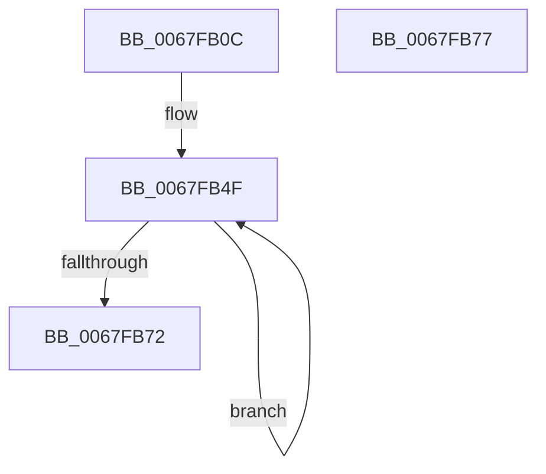

# MiKcsanPopulateHierarchy

- RVA: `0x0067FB0C`–`0x0067FB78` (길이 `108` bytes)
- VA: `0x000000014067FB0C`
- 실행 섹션: `.text`
- PDB 이름 있음: `예`; PDB Function 태그: `아니요`
- unwind 정보 RVA: `0x0006E590`
- 디코드: `29`개 명령, `108/108` bytes 표시
- 미해석 바이트: `0` (있으면 어셈블리에 `.byte`로 보존)

> 이 문서는 커널 이미지의 기계어와 PDB 기호를 분석해 생성했습니다. 4번과 5번은 함수 원형과 자료형을 바이너리 사용 방식에서 추정한 C 해석이며 원본 소스 복구 결과는 아닙니다.

## 1. Dependencies

- 직접 호출 지점: **2**; 고유 호출 대상: **1**
- 직접 호출자로 확인된 함수: **1**
- RIP 상대 이미지 참조: **0**

### Outgoing calls
- `0x0067FB3B` → [MiFillPteHierarchy](../3F/MiFillPteHierarchy_function_003F7F90.md) (function, `0x003F7F90`)
- `0x0067FB48` → [MiFillPteHierarchy](../3F/MiFillPteHierarchy_function_003F7F90.md) (function, `0x003F7F90`)

### Direct callers
- [MmKcsanGetIgnoredRangeList](MmKcsanGetIgnoredRangeList_function_0067FD68.md) at `0x0067FDB7`
- [MmKcsanGetIgnoredRangeList](MmKcsanGetIgnoredRangeList_function_0067FD68.md) at `0x0067FDDC`

### Static image references
- 디코드된 RIP-relative 메모리 참조가 없습니다.

## 2. Other-region calls and transfers

- 다른 실행 섹션으로 향하는 call: **0**
- 별도 외부 분기/꼬리 이동을 확인하지 못했습니다.

## 3. Assembly (complete function range)

```asm
0067FB0C  48 83 EC 68                     sub rsp, 0x68
0067FB10  48 8B C2                        mov rax, rdx
0067FB13  4C 8B D9                        mov r11, rcx
0067FB16  0F 57 C0                        xorps xmm0, xmm0
0067FB19  48 8D 54 24 20                  lea rdx, [rsp + 0x20]
0067FB1E  0F 57 C9                        xorps xmm1, xmm1
0067FB21  48 8B C8                        mov rcx, rax
0067FB24  4D 8B D0                        mov r10, r8
0067FB27  0F 11 44 24 20                  movups xmmword ptr [rsp + 0x20], xmm0
0067FB2C  0F 11 44 24 30                  movups xmmword ptr [rsp + 0x30], xmm0
0067FB31  0F 11 4C 24 40                  movups xmmword ptr [rsp + 0x40], xmm1
0067FB36  0F 11 4C 24 50                  movups xmmword ptr [rsp + 0x50], xmm1
0067FB3B  E8 50 84 D7 FF                  call 0x1403f7f90
0067FB40  49 8B CA                        mov rcx, r10
0067FB43  48 8D 54 24 40                  lea rdx, [rsp + 0x40]
0067FB48  E8 43 84 D7 FF                  call 0x1403f7f90
0067FB4D  33 C9                           xor ecx, ecx
0067FB4F  48 8B 44 0C 20                  mov rax, qword ptr [rsp + rcx + 0x20]
0067FB54  49 89 03                        mov qword ptr [r11], rax
0067FB57  4D 8D 5B 10                     lea r11, [r11 + 0x10]
0067FB5B  48 8B 44 0C 40                  mov rax, qword ptr [rsp + rcx + 0x40]
0067FB60  48 83 C1 08                     add rcx, 8
0067FB64  48 83 C0 08                     add rax, 8
0067FB68  49 89 43 F8                     mov qword ptr [r11 - 8], rax
0067FB6C  48 83 F9 20                     cmp rcx, 0x20
0067FB70  72 DD                           jb 0x14067fb4f
0067FB72  48 83 C4 68                     add rsp, 0x68
0067FB76  C3                              ret
0067FB77  CC                              int3
```

## 4. C-style interpretation (structured pseudocode)

```c
__int64 __fastcall MiKcsanPopulateHierarchy(__int64 a1, __int64 a2, __int64 a3)
{
    __int64 result;
    __int64 v_rsp;
    unsigned __int64 v_stack_m18;
    unsigned __int64 v_stack_m28;
    unsigned __int64 v_stack_m38;
    unsigned __int64 v_stack_m48;

    v_rsp = (v_rsp) - (104);
    v_stack_m48 = v_xmm0;
    v_stack_m38 = v_xmm0;
    v_stack_m28 = v_xmm1;
    v_stack_m18 = v_xmm1;
    result = MiFillPteHierarchy(a2, v_stack_m48, a3, a4);
    result = MiFillPteHierarchy(a3, v_stack_m28, a3, a4);
    a1 = 0;
loc_0067FB4F:
    *(unsigned __int64 *)(a1) = *(unsigned __int64 *)(v_rsp + a1 * 1 + 32);
    a1 = (a1) + (8);
    result = (*(unsigned __int64 *)(v_rsp + a1 * 1 + 64)) + (8);
    *(unsigned __int64 *)(a1 + 16 - 8) = result;
    if (a1 < 32) goto loc_0067FB4F;
    v_rsp = (v_rsp) + (104);
    return result;
}
```

## 5. (Beta) C Style

```c
int64_t MiKcsanPopulateHierarchy(int64_t Arg1, int64_t Arg2, int64_t Arg3)
{
    int64_t result;
    int64_t local_rsp;
    uint64_t v_stack_m18;
    uint64_t v_stack_m28;
    uint64_t v_stack_m38;
    uint64_t v_stack_m48;

    local_rsp = (local_rsp) - (104);
    v_stack_m48 = v_xmm0;
    v_stack_m38 = v_xmm0;
    v_stack_m28 = v_xmm1;
    v_stack_m18 = v_xmm1;
    result = MiFillPteHierarchy(Arg2, v_stack_m48, Arg3, a4);
    result = MiFillPteHierarchy(Arg3, v_stack_m28, Arg3, a4);
    Arg1 = 0;
loc_0067FB4F:
    *(uint64_t *)(Arg1) = *(uint64_t *)(local_rsp + Arg1 * 1 + 0x20);
    Arg1 = (Arg1) + (8);
    result = (*(uint64_t *)(local_rsp + Arg1 * 1 + 0x40)) + (8);
    *(uint64_t *)(Arg1 + 0x10 - 0x8) = result;
    if (Arg1 < 32) goto loc_0067FB4F;
    local_rsp = (local_rsp) + (104);
    return result;
}
```

## 6. Execution-region graph

[열기: 2D/3D 그래프와 함수 탐색 컨트롤 패널](../../../control-panel.html?section=text&rva=0x0067FB0C&view=graph)

- 2D 그래프는 위에서 아래로 흐르고, 3D 그래프는 빈 공간을 드래그해 회전합니다. Shift+드래그는 이동, 휠은 확대·축소, 함수 노드 선택은 대상 보고서 이동입니다.

### Static fallback


