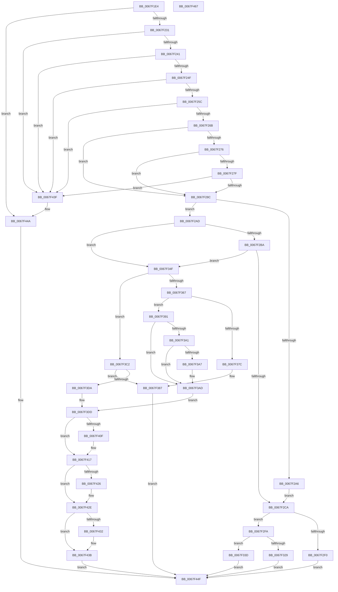

# MiLocateSharedPageViews

- RVA: `0x0067F1E4`–`0x0067F468` (길이 `644` bytes)
- VA: `0x000000014067F1E4`
- 실행 섹션: `.text`
- PDB 이름 있음: `예`; PDB Function 태그: `아니요`
- unwind 정보 RVA: `0x000D7D44`
- 디코드: `175`개 명령, `644/644` bytes 표시
- 미해석 바이트: `0` (있으면 어셈블리에 `.byte`로 보존)

> 이 문서는 커널 이미지의 기계어와 PDB 기호를 분석해 생성했습니다. 4번과 5번은 함수 원형과 자료형을 바이너리 사용 방식에서 추정한 C 해석이며 원본 소스 복구 결과는 아닙니다.

## 1. Dependencies

- 직접 호출 지점: **17**; 고유 호출 대상: **13**
- 직접 호출자로 확인된 함수: **1**
- RIP 상대 이미지 참조: **4**

### Outgoing calls
- `0x0067F221` → [MiSafeLockPage](../32/MiSafeLockPage_function_00321620.md) (function, `0x00321620`)
- `0x0067F234` → [MiIsPageOnBadList](../2B/MiIsPageOnBadList_function_002B1018.md) (function, `0x002B1018`)
- `0x0067F2D0` → [MiUnlockPage](../31/MiUnlockPage_function_0031A3E0.md) (function, `0x0031A3E0`)
- `0x0067F2E3` → [MiAllocatePool](../35/MiAllocatePool_function_0035B540.md) (function, `0x0035B540`)
- `0x0067F320` → [ObReferenceObjectSafeWithTag](../21/ObReferenceObjectSafeWithTag_function_00210EE0.md) (function, `0x00210EE0`)
- `0x0067F32E` → [ExFreePoolWithTag](../../poolcode/B8/ExFreePoolWithTag_function_00B82870.md) (function, `0x00B82870`)
- `0x0067F36F` → [MiPreventControlAreaDeletion](../2B/MiPreventControlAreaDeletion_function_002BBD10.md) (function, `0x002BBD10`)
- `0x0067F382` → [MiUnlockPage](../31/MiUnlockPage_function_0031A3E0.md) (function, `0x0031A3E0`)
- `0x0067F3B7` → [MiUnlockPage](../31/MiUnlockPage_function_0031A3E0.md) (function, `0x0031A3E0`)
- `0x0067F3C5` → [MiUnlockPage](../31/MiUnlockPage_function_0031A3E0.md) (function, `0x0031A3E0`)
- `0x0067F3CD` → [MiReferencePfBackedSection](../2B/MiReferencePfBackedSection_function_002B9B70.md) (function, `0x002B9B70`)
- `0x0067F403` → [MiTrimSection](../2E/MiTrimSection_function_002E0810.md) (function, `0x002E0810`)
- `0x0067F412` → [MiDecrementSubsection](../29/MiDecrementSubsection_function_00298D68.md) (function, `0x00298D68`)
- `0x0067F41C` → [MiDecrementModifiedWriteCount](../29/MiDecrementModifiedWriteCount_function_00298184.md) (function, `0x00298184`)
- `0x0067F429` → [MiReleaseControlAreaWaiters](../28/MiReleaseControlAreaWaiters_function_002865F0.md) (function, `0x002865F0`)
- `0x0067F436` → [MiDeleteTrimViewInfoList](../../page/A6/MiDeleteTrimViewInfoList_function_00A610A4.md) (function, `0x00A610A4`)
- `0x0067F445` → [MiUnlockPage](../31/MiUnlockPage_function_0031A3E0.md) (function, `0x0031A3E0`)

### Direct callers
- [MmQueryBadAddresses](../../page/AD/MmQueryBadAddresses_function_00AD5430.md) at `0x00AD5755`

### Static image references
- `0x0067F29D` → RVA `0x00E2DB68` (`.data`; read)
- `0x0067F2AD` → RVA `0x00E2DB70` (`.data`; read)
- `0x0067F2BA` → RVA `0x00E2DB78` (`.data`; read)
- `0x0067F391` → RVA `0x00E2DC80` (`.data`; read)

## 2. Other-region calls and transfers

- 다른 실행 섹션으로 향하는 call: **2**
  - `0x0067F32E` → [ExFreePoolWithTag](../../poolcode/B8/ExFreePoolWithTag_function_00B82870.md) (`.text` → `POOLCODE`)
  - `0x0067F436` → [MiDeleteTrimViewInfoList](../../page/A6/MiDeleteTrimViewInfoList_function_00A610A4.md) (`.text` → `PAGE`)
- 별도 외부 분기/꼬리 이동을 확인하지 못했습니다.

## 3. Assembly (complete function range)

```asm
0067F1E4  48 89 5C 24 18                  mov qword ptr [rsp + 0x18], rbx
0067F1E9  55                              push rbp
0067F1EA  56                              push rsi
0067F1EB  57                              push rdi
0067F1EC  41 54                           push r12
0067F1EE  41 55                           push r13
0067F1F0  41 56                           push r14
0067F1F2  41 57                           push r15
0067F1F4  48 8B EC                        mov rbp, rsp
0067F1F7  48 83 EC 50                     sub rsp, 0x50
0067F1FB  45 33 E4                        xor r12d, r12d
0067F1FE  48 8D 1C 49                     lea rbx, [rcx + rcx*2]
0067F202  44 89 65 FC                     mov dword ptr [rbp - 4], r12d
0067F206  4D 8B F0                        mov r14, r8
0067F209  4C 89 62 08                     mov qword ptr [rdx + 8], r12
0067F20D  4C 8B EA                        mov r13, rdx
0067F210  48 C1 E3 04                     shl rbx, 4
0067F214  48 B8 00 00 00 00 00 DE FF FF   movabs rax, 0xffffde0000000000
0067F21E  48 03 D8                        add rbx, rax
0067F221  E8 FA 23 CA FF                  call 0x140321620
0067F226  44 8A F8                        mov r15b, al
0067F229  3C 11                           cmp al, 0x11
0067F22B  0F 84 19 02 00 00               je 0x14067f44a
0067F231  48 8B CB                        mov rcx, rbx
0067F234  E8 DF 1D C3 FF                  call 0x1402b1018
0067F239  85 C0                           test eax, eax
0067F23B  0F 85 FE 01 00 00               jne 0x14067f43f
0067F241  8B 43 20                        mov eax, dword ptr [rbx + 0x20]
0067F244  C1 E8 18                        shr eax, 0x18
0067F247  A8 40                           test al, 0x40
0067F249  0F 84 F0 01 00 00               je 0x14067f43f
0067F24F  48 8B 43 28                     mov rax, qword ptr [rbx + 0x28]
0067F253  48 85 C0                        test rax, rax
0067F256  0F 89 E3 01 00 00               jns 0x14067f43f
0067F25C  48 8B 43 18                     mov rax, qword ptr [rbx + 0x18]
0067F260  48 0F BA E0 3E                  bt rax, 0x3e
0067F265  0F 82 D4 01 00 00               jb 0x14067f43f
0067F26B  48 8B 43 28                     mov rax, qword ptr [rbx + 0x28]
0067F26F  48 0F BA E0 28                  bt rax, 0x28
0067F274  72 16                           jb 0x14067f28c
0067F276  48 8B 43 08                     mov rax, qword ptr [rbx + 8]
0067F27A  48 85 C0                        test rax, rax
0067F27D  78 0D                           js 0x14067f28c
0067F27F  48 8B 43 08                     mov rax, qword ptr [rbx + 8]
0067F283  48 85 C0                        test rax, rax
0067F286  0F 85 B3 01 00 00               jne 0x14067f43f
0067F28C  48 8B 73 08                     mov rsi, qword ptr [rbx + 8]
0067F290  48 B8 00 00 00 00 00 00 00 80   movabs rax, 0x8000000000000000
0067F29A  48 0B F0                        or rsi, rax
0067F29D  48 3B 35 C4 E8 7A 00            cmp rsi, qword ptr [rip + 0x7ae8c4]
0067F2A4  75 07                           jne 0x14067f2ad
0067F2A6  BF 00 00 FE 7F                  mov edi, 0x7ffe0000
0067F2AB  EB 1D                           jmp 0x14067f2ca
0067F2AD  48 3B 35 BC E8 7A 00            cmp rsi, qword ptr [rip + 0x7ae8bc]
0067F2B4  0F 85 95 00 00 00               jne 0x14067f34f
0067F2BA  48 8B 3D B7 E8 7A 00            mov rdi, qword ptr [rip + 0x7ae8b7]
0067F2C1  48 85 FF                        test rdi, rdi
0067F2C4  0F 84 85 00 00 00               je 0x14067f34f
0067F2CA  41 8A D7                        mov dl, r15b
0067F2CD  48 8B CB                        mov rcx, rbx
0067F2D0  E8 0B B1 C9 FF                  call 0x14031a3e0
0067F2D5  BA 30 00 00 00                  mov edx, 0x30
0067F2DA  41 B8 4D 69 56 61               mov r8d, 0x6156694d
0067F2E0  8D 4A 10                        lea ecx, [rdx + 0x10]
0067F2E3  E8 58 C2 CD FF                  call 0x14035b540
0067F2E8  48 8B D8                        mov rbx, rax
0067F2EB  48 85 C0                        test rax, rax
0067F2EE  75 0A                           jne 0x14067f2fa
0067F2F0  B8 9A 00 00 C0                  mov eax, 0xc000009a
0067F2F5  E9 55 01 00 00                  jmp 0x14067f44f
0067F2FA  48 89 78 10                     mov qword ptr [rax + 0x10], rdi
0067F2FE  BA 4D 6D 56 77                  mov edx, 0x77566d4d
0067F303  48 8D 87 00 10 00 00            lea rax, [rdi + 0x1000]
0067F30A  4C 89 73 08                     mov qword ptr [rbx + 8], r14
0067F30E  49 8B CE                        mov rcx, r14
0067F311  48 89 43 18                     mov qword ptr [rbx + 0x18], rax
0067F315  4C 89 63 20                     mov qword ptr [rbx + 0x20], r12
0067F319  C7 43 28 01 00 00 00            mov dword ptr [rbx + 0x28], 1
0067F320  E8 BB 1B B9 FF                  call 0x140210ee0
0067F325  84 C0                           test al, al
0067F327  75 14                           jne 0x14067f33d
0067F329  33 D2                           xor edx, edx
0067F32B  48 8B CB                        mov rcx, rbx
0067F32E  E8 3D 35 50 00                  call 0x140b82870
0067F333  B8 0A 01 00 C0                  mov eax, 0xc000010a
0067F338  E9 12 01 00 00                  jmp 0x14067f44f
0067F33D  49 8B 45 08                     mov rax, qword ptr [r13 + 8]
0067F341  48 89 03                        mov qword ptr [rbx], rax
0067F344  33 C0                           xor eax, eax
0067F346  49 89 5D 08                     mov qword ptr [r13 + 8], rbx
0067F34A  E9 00 01 00 00                  jmp 0x14067f44f
0067F34F  8B 43 10                        mov eax, dword ptr [rbx + 0x10]
0067F352  4D 8B F4                        mov r14, r12
0067F355  4C 89 65 48                     mov qword ptr [rbp + 0x48], r12
0067F359  48 8B CB                        mov rcx, rbx
0067F35C  4C 89 65 40                     mov qword ptr [rbp + 0x40], r12
0067F360  48 0F BA E0 0A                  bt rax, 0xa
0067F365  73 5B                           jae 0x14067f3c2
0067F367  4C 8D 45 48                     lea r8, [rbp + 0x48]
0067F36B  48 8D 55 40                     lea rdx, [rbp + 0x40]
0067F36F  E8 9C C9 C3 FF                  call 0x1402bbd10
0067F374  4C 8B E0                        mov r12, rax
0067F377  48 85 C0                        test rax, rax
0067F37A  75 15                           jne 0x14067f391
0067F37C  41 8A D7                        mov dl, r15b
0067F37F  48 8B CB                        mov rcx, rbx
0067F382  E8 59 B0 C9 FF                  call 0x14031a3e0
0067F387  B8 19 00 00 C0                  mov eax, 0xc0000019
0067F38C  E9 BE 00 00 00                  jmp 0x14067f44f
0067F391  48 8B 05 E8 E8 7A 00            mov rax, qword ptr [rip + 0x7ae8e8]
0067F398  48 8B 7B 10                     mov rdi, qword ptr [rbx + 0x10]
0067F39C  48 85 C0                        test rax, rax
0067F39F  74 0C                           je 0x14067f3ad
0067F3A1  40 F6 C7 10                     test dil, 0x10
0067F3A5  75 06                           jne 0x14067f3ad
0067F3A7  48 F7 D0                        not rax
0067F3AA  48 23 F8                        and rdi, rax
0067F3AD  48 C1 FF 10                     sar rdi, 0x10
0067F3B1  41 8A D7                        mov dl, r15b
0067F3B4  48 8B CB                        mov rcx, rbx
0067F3B7  E8 24 B0 C9 FF                  call 0x14031a3e0
0067F3BC  4C 8B 75 40                     mov r14, qword ptr [rbp + 0x40]
0067F3C0  EB 1B                           jmp 0x14067f3dd
0067F3C2  41 8A D7                        mov dl, r15b
0067F3C5  E8 16 B0 C9 FF                  call 0x14031a3e0
0067F3CA  48 8B CE                        mov rcx, rsi
0067F3CD  E8 9E A7 C3 FF                  call 0x1402b9b70
0067F3D2  48 8B F8                        mov rdi, rax
0067F3D5  48 85 C0                        test rax, rax
0067F3D8  74 AD                           je 0x14067f387
0067F3DA  4C 8B 20                        mov r12, qword ptr [rax]
0067F3DD  83 65 F8 00                     and dword ptr [rbp - 8], 0
0067F3E1  48 8D 4D D0                     lea rcx, [rbp - 0x30]
0067F3E5  45 33 C9                        xor r9d, r9d
0067F3E8  4C 89 65 D0                     mov qword ptr [rbp - 0x30], r12
0067F3EC  49 8B D5                        mov rdx, r13
0067F3EF  48 89 75 D8                     mov qword ptr [rbp - 0x28], rsi
0067F3F3  48 89 75 E0                     mov qword ptr [rbp - 0x20], rsi
0067F3F7  48 89 7D E8                     mov qword ptr [rbp - 0x18], rdi
0067F3FB  45 8D 41 01                     lea r8d, [r9 + 1]
0067F3FF  48 89 7D F0                     mov qword ptr [rbp - 0x10], rdi
0067F403  E8 08 14 C6 FF                  call 0x1402e0810
0067F408  8B D8                           mov ebx, eax
0067F40A  4D 85 F6                        test r14, r14
0067F40D  74 08                           je 0x14067f417
0067F40F  49 8B CE                        mov rcx, r14
0067F412  E8 51 99 C1 FF                  call 0x140298d68
0067F417  33 D2                           xor edx, edx
0067F419  49 8B CC                        mov rcx, r12
0067F41C  E8 63 8D C1 FF                  call 0x140298184
0067F421  48 85 C0                        test rax, rax
0067F424  74 08                           je 0x14067f42e
0067F426  48 8B C8                        mov rcx, rax
0067F429  E8 C2 71 C0 FF                  call 0x1402865f0
0067F42E  85 DB                           test ebx, ebx
0067F430  79 09                           jns 0x14067f43b
0067F432  49 8B 4D 08                     mov rcx, qword ptr [r13 + 8]
0067F436  E8 69 1C 3E 00                  call 0x140a610a4
0067F43B  8B C3                           mov eax, ebx
0067F43D  EB 10                           jmp 0x14067f44f
0067F43F  41 8A D7                        mov dl, r15b
0067F442  48 8B CB                        mov rcx, rbx
0067F445  E8 96 AF C9 FF                  call 0x14031a3e0
0067F44A  B8 34 04 00 C0                  mov eax, 0xc0000434
0067F44F  48 8B 9C 24 A0 00 00 00         mov rbx, qword ptr [rsp + 0xa0]
0067F457  48 83 C4 50                     add rsp, 0x50
0067F45B  41 5F                           pop r15
0067F45D  41 5E                           pop r14
0067F45F  41 5D                           pop r13
0067F461  41 5C                           pop r12
0067F463  5F                              pop rdi
0067F464  5E                              pop rsi
0067F465  5D                              pop rbp
0067F466  C3                              ret
0067F467  CC                              int3
```

## 4. C-style interpretation (structured pseudocode)

```c
__int64 __fastcall MiLocateSharedPageViews(__int64 a1, __int64 a2, __int64 a3, int a4)
{
    __int64 result;
    __int64 v_r12;
    __int64 v_rbx;
    __int64 v_rdi;
    __int64 v_rsi;
    __int64 v_rsp;
    unsigned int v_stack_m3C;
    unsigned int v_stack_m40;
    unsigned __int64 v_stack_m48;
    unsigned __int64 v_stack_m50;
    unsigned __int64 v_stack_m58;
    unsigned __int64 v_stack_m60;
    unsigned __int64 v_stack_m68;
    unsigned __int64 v_stack_p10;
    unsigned __int64 v_stack_p18;
    unsigned __int64 v_stack_p8;

    v_stack_p18 = v_rbx;
    v_rsp = (v_rsp) - (80);
    v_r12 = 0;
    v_stack_m3C = 0;
    *(unsigned __int64 *)(a2 + 8) = 0;
    v_rbx = (a1 + a1 * 2) << (4);
    v_rbx = (v_rbx) + (result);
    result = MiSafeLockPage(a1, a2, a3, a4);
    if (((unsigned __int8)(result)) == 17) goto loc_0067F44A;
    result = MiIsPageOnBadList(v_rbx, a2, a3, a4);
    if ((unsigned int)(result) != 0) goto loc_0067F43F;
    result = (unsigned int)(((unsigned int)(*(unsigned int *)(v_rbx + 32))) >> (24));
    if ((((unsigned __int8)(result)) & (64)) == 0) goto loc_0067F43F;
    if (!sign_flag) goto loc_0067F43F;
    if (condition_is_below) goto loc_0067F43F;
    if (condition_is_below) goto loc_0067F28C;
    if (sign_flag) goto loc_0067F28C;
    if (*(unsigned __int64 *)(v_rbx + 8) != 0) goto loc_0067F43F;
loc_0067F28C:
    v_rsi = (*(unsigned __int64 *)(v_rbx + 8)) | (*(unsigned __int64 *)(v_rbx + 8));
    if (v_rsi != (*(unsigned __int64 *)(v_rip + 8054980))) goto loc_0067F2AD;
    goto loc_0067F2CA;
loc_0067F2AD:
    if (v_rsi != (*(unsigned __int64 *)(v_rip + 8054972))) goto loc_0067F34F;
    if (*(unsigned __int64 *)(v_rip + 8054967) == 0) goto loc_0067F34F;
loc_0067F2CA:
    result = MiUnlockPage(v_rbx, (unsigned __int8)((unsigned __int8)(result)), a3, a4);
    result = MiAllocatePool(48 + 16, 48, (unsigned int)(0x6156694DULL), a4);
    if (result != 0) goto loc_0067F2FA;
    goto loc_0067F44F;
loc_0067F2FA:
    *(unsigned __int64 *)((unsigned int)(0xC000009AULL) + 16) = *(unsigned __int64 *)(v_rip + 8054967);
    *(unsigned __int64 *)(result + 8) = a3;
    *(unsigned __int64 *)(result + 24) = *(unsigned __int64 *)(v_rip + 8054967) + 4096;
    *(unsigned __int64 *)(result + 32) = 0;
    *(unsigned int *)(result + 40) = 1;
    result = ObReferenceObjectSafeWithTag(a3, (unsigned int)(0x77566D4DULL), (unsigned int)(0x6156694DULL), a4);
    if ((unsigned __int8)(result) != 0) goto loc_0067F33D;
    a2 = 0;
    result = ExFreePoolWithTag(result, a2, (unsigned int)(0x6156694DULL), a4);
    goto loc_0067F44F;
loc_0067F33D:
    *(unsigned __int64 *)(result) = *(unsigned __int64 *)(a2 + 8);
    result = 0;
    *(unsigned __int64 *)(a2 + 8) = 0;
    goto loc_0067F44F;
loc_0067F34F:
    v_stack_p10 = 0;
    v_stack_p8 = 0;
    if (condition_is_above_or_equal) goto loc_0067F3C2;
    result = MiPreventControlAreaDeletion(0, v_stack_p8, v_stack_p10, a4);
    if (result != 0) goto loc_0067F391;
    result = MiUnlockPage(result, (unsigned __int8)((unsigned __int8)(result)), v_stack_p10, a4);
loc_0067F387:
    goto loc_0067F44F;
loc_0067F391:
    if (*(unsigned __int64 *)(v_rip + 8055016) == 0) goto loc_0067F3AD;
    result = *(unsigned __int64 *)(v_rip + 8055016);
    v_rdi = *(unsigned __int64 *)(result + 16);
    if ((((unsigned __int8)(*(unsigned __int64 *)(result + 16))) & (16)) == 0) {
        result = ~(*(unsigned __int64 *)(v_rip + 8055016));
        v_rdi = (*(unsigned __int64 *)(result + 16)) & (result);
    }
    v_rdi = (v_rdi) >> (16);
    result = MiUnlockPage(result, (unsigned __int8)((unsigned __int8)(result)), v_stack_p10, a4);
    goto loc_0067F3DD;
loc_0067F3C2:
    result = MiUnlockPage(result, (unsigned __int8)((unsigned __int8)(result)), v_stack_p10, a4);
    result = MiReferencePfBackedSection(v_rsi, (unsigned __int8)((unsigned __int8)(result)), v_stack_p10, a4);
    if (result == 0) goto loc_0067F387;
loc_0067F3DD:
    a4 = 0;
    v_stack_m68 = *(unsigned __int64 *)(result);
    v_stack_m60 = v_rsi;
    v_stack_m58 = v_rsi;
    v_stack_m50 = result;
    v_stack_m48 = result;
    result = MiTrimSection(v_stack_m68, 0, a4 + 1, a4);
    if (v_stack_p8 != 0) {
        a1 = v_stack_p8;
        result = MiDecrementSubsection(a1, 0, a4 + 1, a4);
    }
    a2 = 0;
    result = MiDecrementModifiedWriteCount(*(unsigned __int64 *)(result), a2, a4 + 1, a4);
    if (result != 0) {
        a1 = result;
        result = MiReleaseControlAreaWaiters(a1, a2, a4 + 1, a4);
    }
    if (sign_flag) {
        a1 = *(unsigned __int64 *)(a2 + 8);
        result = MiDeleteTrimViewInfoList(a1, a2, a4 + 1, a4);
    }
    goto loc_0067F44F;
loc_0067F43F:
    result = MiUnlockPage((unsigned int)((unsigned int)(result)), (unsigned __int8)((unsigned __int8)(result)), a4 + 1, a4);
loc_0067F44A:
loc_0067F44F:
    v_rsp = (v_rsp) + (80);
    return (unsigned int)(0xC0000434ULL);
}
```

## 5. (Beta) C Style

```c
int64_t MiLocateSharedPageViews(void *Arg1, void *Arg2, int64_t Arg3, int32_t Arg4)
{
    uint8_t *arg1 = (uint8_t *)Arg1;
    uint8_t *arg2 = (uint8_t *)Arg2;

    int64_t result;
    int64_t local_r12;
    int64_t local_rbx;
    int64_t local_rdi;
    int64_t local_rsi;
    int64_t local_rsp;
    uint32_t v_stack_m3C;
    uint32_t v_stack_m40;
    uint64_t v_stack_m48;
    uint64_t v_stack_m50;
    uint64_t v_stack_m58;
    uint64_t v_stack_m60;
    uint64_t v_stack_m68;
    uint64_t v_stack_p10;
    uint64_t v_stack_p18;
    uint64_t v_stack_p8;

    v_stack_p18 = local_rbx;
    local_rsp = (local_rsp) - (80);
    local_r12 = 0;
    v_stack_m3C = 0;
    *(uint64_t *)(arg2 + 0x8) = 0;
    local_rbx = (Arg1 + Arg1 * 2) << (4);
    local_rbx = (local_rbx) + (result);
    result = MiSafeLockPage(Arg1, Arg2, Arg3, Arg4);
    if (((uint8_t)(result)) == 17) goto loc_0067F44A;
    result = MiIsPageOnBadList(local_rbx, Arg2, Arg3, Arg4);
    if ((uint32_t)(result) != 0) goto loc_0067F43F;
    result = (uint32_t)(((uint32_t)(*(uint32_t *)(local_rbx + 0x20))) >> (24));
    if ((((uint8_t)(result)) & (64)) == 0) goto loc_0067F43F;
    if (!sign_flag) goto loc_0067F43F;
    if (condition_is_below) goto loc_0067F43F;
    if (condition_is_below) goto loc_0067F28C;
    if (sign_flag) goto loc_0067F28C;
    if (*(uint64_t *)(local_rbx + 0x8) != 0) goto loc_0067F43F;
loc_0067F28C:
    local_rsi = (*(uint64_t *)(local_rbx + 0x8)) | (*(uint64_t *)(local_rbx + 0x8));
    if (local_rsi != (*(uint64_t *)(v_rip + 0x7AE8C4))) goto loc_0067F2AD;
    goto loc_0067F2CA;
loc_0067F2AD:
    if (local_rsi != (*(uint64_t *)(v_rip + 0x7AE8BC))) goto loc_0067F34F;
    if (*(uint64_t *)(v_rip + 0x7AE8B7) == 0) goto loc_0067F34F;
loc_0067F2CA:
    result = MiUnlockPage(local_rbx, (uint8_t)((uint8_t)(result)), Arg3, Arg4);
    result = MiAllocatePool(48 + 16, 48, (uint32_t)(0x6156694DULL), Arg4);
    if (result != 0) goto loc_0067F2FA;
    goto loc_0067F44F;
loc_0067F2FA:
    *(uint64_t *)((uint32_t)(0xC000009AULL) + 0x10) = *(uint64_t *)(v_rip + 0x7AE8B7);
    *(uint64_t *)(result + 0x8) = Arg3;
    *(uint64_t *)(result + 0x18) = *(uint64_t *)(v_rip + 0x7AE8B7) + 4096;
    *(uint64_t *)(result + 0x20) = 0;
    *(uint32_t *)(result + 0x28) = 1;
    result = ObReferenceObjectSafeWithTag(Arg3, (uint32_t)(0x77566D4DULL), (uint32_t)(0x6156694DULL), Arg4);
    if ((uint8_t)(result) != 0) goto loc_0067F33D;
    Arg2 = 0;
    result = ExFreePoolWithTag(result, Arg2, (uint32_t)(0x6156694DULL), Arg4);
    goto loc_0067F44F;
loc_0067F33D:
    *(uint64_t *)(result) = *(uint64_t *)(arg2 + 0x8);
    result = 0;
    *(uint64_t *)(arg2 + 0x8) = 0;
    goto loc_0067F44F;
loc_0067F34F:
    v_stack_p10 = 0;
    v_stack_p8 = 0;
    if (condition_is_above_or_equal) goto loc_0067F3C2;
    result = MiPreventControlAreaDeletion(0, v_stack_p8, v_stack_p10, Arg4);
    if (result != 0) goto loc_0067F391;
    result = MiUnlockPage(result, (uint8_t)((uint8_t)(result)), v_stack_p10, Arg4);
loc_0067F387:
    goto loc_0067F44F;
loc_0067F391:
    if (*(uint64_t *)(v_rip + 0x7AE8E8) == 0) goto loc_0067F3AD;
    result = *(uint64_t *)(v_rip + 0x7AE8E8);
    local_rdi = *(uint64_t *)(result + 0x10);
    if ((((uint8_t)(*(uint64_t *)(result + 0x10))) & (16)) == 0) {
        result = ~(*(uint64_t *)(v_rip + 0x7AE8E8));
        local_rdi = (*(uint64_t *)(result + 0x10)) & (result);
    }
    local_rdi = (local_rdi) >> (16);
    result = MiUnlockPage(result, (uint8_t)((uint8_t)(result)), v_stack_p10, Arg4);
    goto loc_0067F3DD;
loc_0067F3C2:
    result = MiUnlockPage(result, (uint8_t)((uint8_t)(result)), v_stack_p10, Arg4);
    result = MiReferencePfBackedSection(local_rsi, (uint8_t)((uint8_t)(result)), v_stack_p10, Arg4);
    if (result == 0) goto loc_0067F387;
loc_0067F3DD:
    Arg4 = 0;
    v_stack_m68 = *(uint64_t *)(result);
    v_stack_m60 = local_rsi;
    v_stack_m58 = local_rsi;
    v_stack_m50 = result;
    v_stack_m48 = result;
    result = MiTrimSection(v_stack_m68, 0, Arg4 + 1, Arg4);
    if (v_stack_p8 != 0) {
        Arg1 = v_stack_p8;
        result = MiDecrementSubsection(Arg1, 0, Arg4 + 1, Arg4);
    }
    Arg2 = 0;
    result = MiDecrementModifiedWriteCount(*(uint64_t *)(result), Arg2, Arg4 + 1, Arg4);
    if (result != 0) {
        Arg1 = result;
        result = MiReleaseControlAreaWaiters(Arg1, Arg2, Arg4 + 1, Arg4);
    }
    if (sign_flag) {
        Arg1 = *(uint64_t *)(arg2 + 0x8);
        result = MiDeleteTrimViewInfoList(Arg1, Arg2, Arg4 + 1, Arg4);
    }
    goto loc_0067F44F;
loc_0067F43F:
    result = MiUnlockPage((uint32_t)((uint32_t)(result)), (uint8_t)((uint8_t)(result)), Arg4 + 1, Arg4);
loc_0067F44A:
loc_0067F44F:
    local_rsp = (local_rsp) + (80);
    return (uint32_t)(0xC0000434ULL);
}
```

### 관측된 메모리 오프셋

구조체 형식이 확인되지 않은 접근은 인자 기준의 오프셋으로만 기록했습니다.

| 기준 인자 | 오프셋 표현 | 폭 (bit) | 접근 |
|---|---:|---:|---|
| `Arg1` | `+ 0x0 + rcx*2` | `64` | `R` |
| `Arg2` | `+ 0x8` | `64` | `R` |
| `Arg2` | `+ 0x8` | `64` | `W` |

## 6. Execution-region graph

[열기: 2D/3D 그래프와 함수 탐색 컨트롤 패널](../../../control-panel.html?section=text&rva=0x0067F1E4&view=graph)

- 2D 그래프는 위에서 아래로 흐르고, 3D 그래프는 빈 공간을 드래그해 회전합니다. Shift+드래그는 이동, 휠은 확대·축소, 함수 노드 선택은 대상 보고서 이동입니다.

### Static fallback


