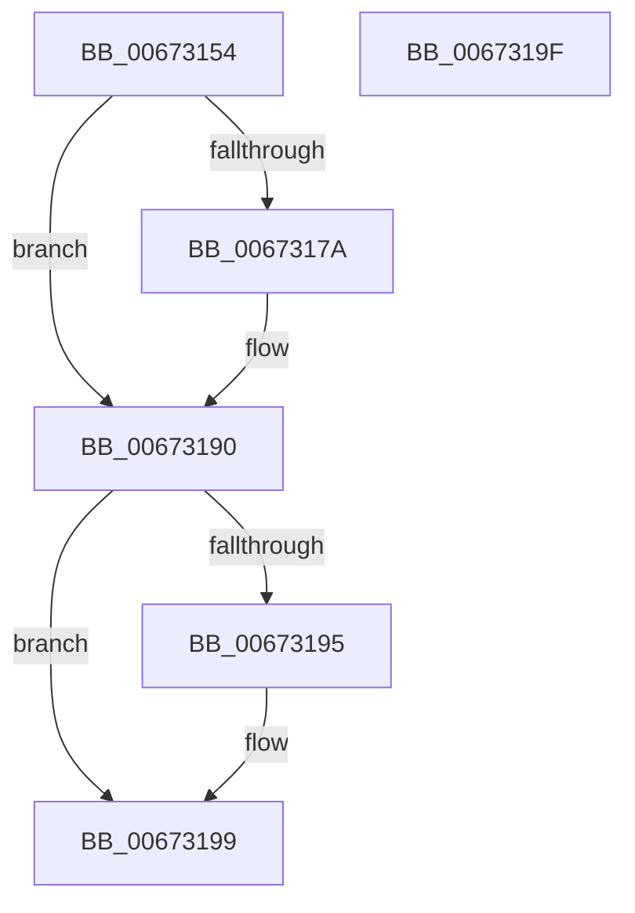

# MiLockDynamicMemoryNestedExclusive

- RVA: `0x00673154`–`0x006731A0` (길이 `76` bytes)
- VA: `0x0000000140673154`
- 실행 섹션: `.text`
- PDB 이름 있음: `예`; PDB Function 태그: `아니요`
- unwind 정보 RVA: `0x0005CF00`
- 디코드: `20`개 명령, `76/76` bytes 표시
- 미해석 바이트: `0` (있으면 어셈블리에 `.byte`로 보존)

> 이 문서는 커널 이미지의 기계어와 PDB 기호를 분석해 생성했습니다. 4번과 5번은 함수 원형과 자료형을 바이너리 사용 방식에서 추정한 C 해석이며 원본 소스 복구 결과는 아닙니다.

## 1. Dependencies

- 직접 호출 지점: **2**; 고유 호출 대상: **2**
- 직접 호출자로 확인된 함수: **2**
- RIP 상대 이미지 참조: **2**

### Outgoing calls
- `0x00673166` → [KeAbPreAcquire](../21/KeAbPreAcquire_function_00210230.md) (function, `0x00210230`)
- `0x0067318B` → [ExfAcquirePushLockExclusiveEx](../20/ExfAcquirePushLockExclusiveEx_function_0020FC90.md) (function, `0x0020FC90`)

### Direct callers
- [MiAcquireAddMemoryLocks](../../page/7F/MiAcquireAddMemoryLocks_function_007F94F8.md) at `0x007F9524`
- [MiNodeZeroConductor](../../page/81/MiNodeZeroConductor_function_00810AC0.md) at `0x00810B14`

### Static image references
- `0x0067315D` → RVA `0x00E38DC0` (`.data`; read)
- `0x0067316B` → RVA `0x00E38DC0` (`.data`; read/write)

## 2. Other-region calls and transfers

- 다른 실행 섹션으로 향하는 call: **0**
- 별도 외부 분기/꼬리 이동을 확인하지 못했습니다.

## 3. Assembly (complete function range)

```asm
00673154  40 53                           push rbx
00673156  48 83 EC 20                     sub rsp, 0x20
0067315A  45 33 C0                        xor r8d, r8d
0067315D  48 8D 0D 5C 5C 7C 00            lea rcx, [rip + 0x7c5c5c]
00673164  33 D2                           xor edx, edx
00673166  E8 C5 D0 B9 FF                  call 0x140210230
0067316B  F0 48 0F BA 2D 4B 5C 7C 00 00   lock bts qword ptr [rip + 0x7c5c4b], 0
00673175  48 8B D8                        mov rbx, rax
00673178  73 16                           jae 0x140673190
0067317A  4C 8D 05 3F 5C 7C 00            lea r8, [rip + 0x7c5c3f]
00673181  48 8B D0                        mov rdx, rax
00673184  48 8D 0D 35 5C 7C 00            lea rcx, [rip + 0x7c5c35]
0067318B  E8 00 CB B9 FF                  call 0x14020fc90
00673190  48 85 DB                        test rbx, rbx
00673193  74 04                           je 0x140673199
00673195  C6 43 0A 01                     mov byte ptr [rbx + 0xa], 1
00673199  48 83 C4 20                     add rsp, 0x20
0067319D  5B                              pop rbx
0067319E  C3                              ret
0067319F  CC                              int3
```

## 4. C-style interpretation (structured pseudocode)

```c
__int64 __fastcall MiLockDynamicMemoryNestedExclusive(__int64 a1, int a2, int a3)
{
    __int64 result;
    __int64 v_rsp;

    v_rsp = (v_rsp) - (32);
    a3 = 0;
    a2 = 0;
    result = KeAbPreAcquire(v_rip + 8150108, a2, a3, a4);
    if (!(condition_is_above_or_equal)) {
        a3 = v_rip + 8150079;
        a2 = result;
        a1 = v_rip + 8150069;
        result = ExfAcquirePushLockExclusiveEx(a1, a2, a3, a4);
    }
    if (result != 0) {
        *(unsigned __int8 *)(result + 10) = 1;
    }
    v_rsp = (v_rsp) + (32);
    return result;
}
```

## 5. (Beta) C Style

```c
int64_t MiLockDynamicMemoryNestedExclusive(int64_t Arg1, int32_t Arg2, int32_t Arg3)
{
    int64_t result;
    int64_t local_rsp;

    local_rsp = (local_rsp) - (32);
    Arg3 = 0;
    Arg2 = 0;
    result = KeAbPreAcquire(v_rip + 8150108, Arg2, Arg3, a4);
    if (!(condition_is_above_or_equal)) {
        Arg3 = v_rip + 8150079;
        Arg2 = result;
        Arg1 = v_rip + 8150069;
        result = ExfAcquirePushLockExclusiveEx(Arg1, Arg2, Arg3, a4);
    }
    if (result != 0) {
        *(uint8_t *)(result + 0xA) = 1;
    }
    local_rsp = (local_rsp) + (32);
    return result;
}
```

## 6. Execution-region graph

[열기: 2D/3D 그래프와 함수 탐색 컨트롤 패널](../../../control-panel.html?section=text&rva=0x00673154&view=graph)

- 2D 그래프는 위에서 아래로 흐르고, 3D 그래프는 빈 공간을 드래그해 회전합니다. Shift+드래그는 이동, 휠은 확대·축소, 함수 노드 선택은 대상 보고서 이동입니다.

### Static fallback


