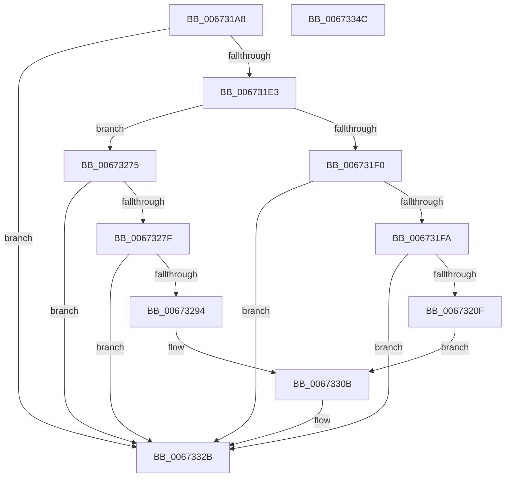

# MiLogAddPhysicalMemory

- RVA: `0x006731A8`–`0x0067334D` (길이 `421` bytes)
- VA: `0x00000001406731A8`
- 실행 섹션: `.text`
- PDB 이름 있음: `예`; PDB Function 태그: `아니요`
- unwind 정보 RVA: `0x000C4AE8`
- 디코드: `103`개 명령, `421/421` bytes 표시
- 미해석 바이트: `0` (있으면 어셈블리에 `.byte`로 보존)

> 이 문서는 커널 이미지의 기계어와 PDB 기호를 분석해 생성했습니다. 4번과 5번은 함수 원형과 자료형을 바이너리 사용 방식에서 추정한 C 해석이며 원본 소스 복구 결과는 아닙니다.

## 1. Dependencies

- 직접 호출 지점: **4**; 고유 호출 대상: **3**
- 직접 호출자로 확인된 함수: **2**
- RIP 상대 이미지 참조: **4**

### Outgoing calls
- `0x00673202` → [tlgKeywordOn](../42/tlgKeywordOn_function_0042EAA0.md) (function, `0x0042EAA0`)
- `0x00673287` → [tlgKeywordOn](../42/tlgKeywordOn_function_0042EAA0.md) (function, `0x0042EAA0`)
- `0x00673326` → [tlgWriteEx_EtwWriteEx](../4A/tlgWriteEx_EtwWriteEx_function_004AA348.md) (function, `0x004AA348`)
- `0x00673332` → [_security_check_cookie](../6A/_security_check_cookie_function_006AC640.md) (function, `0x006AC640`)

### Direct callers
- [MiAddPhysicalMemory](../../page/7F/MiAddPhysicalMemory_function_007F95FC.md) at `0x007F98AA`
- [MiValidateAddPhysicalMemoryParameters](../../page/7F/MiValidateAddPhysicalMemoryParameters_function_007FB19C.md) at `0x007FB2F6`

### Static image references
- `0x006731BF` → RVA `0x00E0A740` (`.data`; read)
- `0x006731CD` → RVA `0x00E37618` (`.data`; read)
- `0x0067325D` → RVA `0x00057D57` (`.rdata`; read)
- `0x006732F5` → RVA `0x00057DAF` (`.rdata`; read)

## 2. Other-region calls and transfers

- 다른 실행 섹션으로 향하는 call: **0**
- 별도 외부 분기/꼬리 이동을 확인하지 못했습니다.

## 3. Assembly (complete function range)

```asm
006731A8  48 89 5C 24 08                  mov qword ptr [rsp + 8], rbx
006731AD  48 89 7C 24 10                  mov qword ptr [rsp + 0x10], rdi
006731B2  55                              push rbp
006731B3  48 8D 6C 24 B1                  lea rbp, [rsp - 0x4f]
006731B8  48 81 EC E0 00 00 00            sub rsp, 0xe0
006731BF  48 8B 05 7A 75 79 00            mov rax, qword ptr [rip + 0x79757a]
006731C6  48 33 C4                        xor rax, rsp
006731C9  48 89 45 3F                     mov qword ptr [rbp + 0x3f], rax
006731CD  4C 8B 15 44 44 7C 00            mov r10, qword ptr [rip + 0x7c4444]
006731D4  48 8B DA                        mov rbx, rdx
006731D7  48 8B F9                        mov rdi, rcx
006731DA  4D 85 D2                        test r10, r10
006731DD  0F 84 48 01 00 00               je 0x14067332b
006731E3  4C 8B 5D 7F                     mov r11, qword ptr [rbp + 0x7f]
006731E7  4D 85 DB                        test r11, r11
006731EA  0F 85 85 00 00 00               jne 0x140673275
006731F0  41 83 3A 05                     cmp dword ptr [r10], 5
006731F4  0F 86 31 01 00 00               jbe 0x14067332b
006731FA  BA 00 01 00 00                  mov edx, 0x100
006731FF  49 8B CA                        mov rcx, r10
00673202  E8 99 B8 DB FF                  call 0x14042eaa0
00673207  84 C0                           test al, al
00673209  0F 84 1C 01 00 00               je 0x14067332b
0067320F  0F B7 07                        movzx eax, word ptr [rdi]
00673212  41 8D 4B 04                     lea ecx, [r11 + 4]
00673216  44 21 5D FB                     and dword ptr [rbp - 5], r11d
0067321A  8D 51 04                        lea edx, [rcx + 4]
0067321D  89 45 AF                        mov dword ptr [rbp - 0x51], eax
00673220  48 8D 45 AF                     lea rax, [rbp - 0x51]
00673224  48 89 45 EF                     mov qword ptr [rbp - 0x11], rax
00673228  48 8B 03                        mov rax, qword ptr [rbx]
0067322B  48 89 45 B7                     mov qword ptr [rbp - 0x49], rax
0067322F  48 8D 45 B7                     lea rax, [rbp - 0x49]
00673233  48 89 45 FF                     mov qword ptr [rbp - 1], rax
00673237  49 8B 00                        mov rax, qword ptr [r8]
0067323A  48 89 45 BF                     mov qword ptr [rbp - 0x41], rax
0067323E  48 8D 45 BF                     lea rax, [rbp - 0x41]
00673242  48 89 45 0F                     mov qword ptr [rbp + 0xf], rax
00673246  48 8D 45 B3                     lea rax, [rbp - 0x4d]
0067324A  48 89 45 1F                     mov qword ptr [rbp + 0x1f], rax
0067324E  48 8D 45 CF                     lea rax, [rbp - 0x31]
00673252  48 89 44 24 38                  mov qword ptr [rsp + 0x38], rax
00673257  89 55 07                        mov dword ptr [rbp + 7], edx
0067325A  89 55 17                        mov dword ptr [rbp + 0x17], edx
0067325D  48 8D 15 F3 4A 9E FF            lea rdx, [rip - 0x61b50d]
00673264  C7 44 24 30 06 00 00 00         mov dword ptr [rsp + 0x30], 6
0067326C  44 89 4D B3                     mov dword ptr [rbp - 0x4d], r9d
00673270  E9 96 00 00 00                  jmp 0x14067330b
00673275  41 83 3A 05                     cmp dword ptr [r10], 5
00673279  0F 86 AC 00 00 00               jbe 0x14067332b
0067327F  BA 00 01 00 00                  mov edx, 0x100
00673284  49 8B CA                        mov rcx, r10
00673287  E8 14 B8 DB FF                  call 0x14042eaa0
0067328C  84 C0                           test al, al
0067328E  0F 84 97 00 00 00               je 0x14067332b
00673294  0F B7 07                        movzx eax, word ptr [rdi]
00673297  B9 04 00 00 00                  mov ecx, 4
0067329C  83 65 FB 00                     and dword ptr [rbp - 5], 0
006732A0  83 65 3B 00                     and dword ptr [rbp + 0x3b], 0
006732A4  89 45 B3                        mov dword ptr [rbp - 0x4d], eax
006732A7  48 8D 45 B3                     lea rax, [rbp - 0x4d]
006732AB  48 89 45 EF                     mov qword ptr [rbp - 0x11], rax
006732AF  8D 51 04                        lea edx, [rcx + 4]
006732B2  48 8B 03                        mov rax, qword ptr [rbx]
006732B5  48 89 45 BF                     mov qword ptr [rbp - 0x41], rax
006732B9  48 8D 45 BF                     lea rax, [rbp - 0x41]
006732BD  48 89 45 FF                     mov qword ptr [rbp - 1], rax
006732C1  49 8B 00                        mov rax, qword ptr [r8]
006732C4  48 89 45 C7                     mov qword ptr [rbp - 0x39], rax
006732C8  48 8D 45 C7                     lea rax, [rbp - 0x39]
006732CC  48 89 45 0F                     mov qword ptr [rbp + 0xf], rax
006732D0  48 8D 45 AF                     lea rax, [rbp - 0x51]
006732D4  48 89 45 1F                     mov qword ptr [rbp + 0x1f], rax
006732D8  41 8B 03                        mov eax, dword ptr [r11]
006732DB  89 45 B7                        mov dword ptr [rbp - 0x49], eax
006732DE  48 8D 45 B7                     lea rax, [rbp - 0x49]
006732E2  48 89 45 2F                     mov qword ptr [rbp + 0x2f], rax
006732E6  48 8D 45 CF                     lea rax, [rbp - 0x31]
006732EA  48 89 44 24 38                  mov qword ptr [rsp + 0x38], rax
006732EF  89 55 07                        mov dword ptr [rbp + 7], edx
006732F2  89 55 17                        mov dword ptr [rbp + 0x17], edx
006732F5  48 8D 15 B3 4A 9E FF            lea rdx, [rip - 0x61b54d]
006732FC  C7 44 24 30 07 00 00 00         mov dword ptr [rsp + 0x30], 7
00673304  44 89 4D AF                     mov dword ptr [rbp - 0x51], r9d
00673308  89 4D 37                        mov dword ptr [rbp + 0x37], ecx
0067330B  83 65 0B 00                     and dword ptr [rbp + 0xb], 0
0067330F  41 B9 01 00 00 00               mov r9d, 1
00673315  83 65 1B 00                     and dword ptr [rbp + 0x1b], 0
00673319  83 65 2B 00                     and dword ptr [rbp + 0x2b], 0
0067331D  89 4D F7                        mov dword ptr [rbp - 9], ecx
00673320  89 4D 27                        mov dword ptr [rbp + 0x27], ecx
00673323  49 8B CA                        mov rcx, r10
00673326  E8 1D 70 E3 FF                  call 0x1404aa348
0067332B  48 8B 4D 3F                     mov rcx, qword ptr [rbp + 0x3f]
0067332F  48 33 CC                        xor rcx, rsp
00673332  E8 09 93 03 00                  call 0x1406ac640
00673337  4C 8D 9C 24 E0 00 00 00         lea r11, [rsp + 0xe0]
0067333F  49 8B 5B 10                     mov rbx, qword ptr [r11 + 0x10]
00673343  49 8B 7B 18                     mov rdi, qword ptr [r11 + 0x18]
00673347  49 8B E3                        mov rsp, r11
0067334A  5D                              pop rbp
0067334B  C3                              ret
0067334C  CC                              int3
```

## 4. C-style interpretation (structured pseudocode)

```c
__int64 __fastcall MiLogAddPhysicalMemory(__int64 a1, __int64 a2, __int64 a3, int a4, __int64 a5)
{
    __int64 result;
    __int64 v_rsp;
    unsigned __int64 v_stack_m18;
    unsigned int v_stack_m1C;
    unsigned int v_stack_m20;
    unsigned __int64 v_stack_m28;
    unsigned int v_stack_m2C;
    unsigned int v_stack_m30;
    unsigned __int64 v_stack_m38;
    unsigned int v_stack_m3C;
    unsigned int v_stack_m40;
    unsigned __int64 v_stack_m48;
    unsigned int v_stack_m4C;
    unsigned int v_stack_m50;
    unsigned __int64 v_stack_m57;
    unsigned __int64 v_stack_m58;
    unsigned int v_stack_m5C;
    unsigned int v_stack_m60;
    unsigned __int64 v_stack_m68;
    unsigned __int64 v_stack_m8;
    unsigned __int64 v_stack_m88;
    unsigned __int64 v_stack_m90;
    unsigned __int64 v_stack_m98;
    unsigned __int64 v_stack_mA0;
    unsigned __int64 v_stack_mA4;
    unsigned int v_stack_mA8;
    unsigned __int64 v_stack_mB0;
    unsigned int v_stack_mB8;
    unsigned __int64 v_stack_p10;
    unsigned __int64 v_stack_p8;

    v_stack_p8 = v_rbx;
    v_stack_p10 = v_rdi;
    v_rsp = (v_rsp) - (224);
    result = (*(unsigned __int64 *)(v_rip + 7959930)) ^ (v_rsp);
    v_stack_m18 = result;
    if (*(unsigned __int64 *)(v_rip + 8143940) == 0) goto loc_0067332B;
    if (a5 != 0) goto loc_00673275;
    if ((*(unsigned int *)(*(unsigned __int64 *)(v_rip + 8143940))) <= 5) goto loc_0067332B;
    result = tlgKeywordOn(*(unsigned __int64 *)(v_rip + 8143940), 256, a3, a4);
    if ((unsigned __int8)(result) == 0) goto loc_0067332B;
    v_stack_mA8 = (unsigned int)(*(unsigned __int16 *)(a1));
    v_stack_m68 = v_stack_mA8;
    v_stack_mA0 = *(unsigned __int64 *)(a2);
    v_stack_m58 = v_stack_mA0;
    v_stack_m98 = *(unsigned __int64 *)(a3);
    v_stack_m48 = v_stack_m98;
    v_stack_m38 = v_stack_mA4;
    v_stack_mB0 = v_stack_m88;
    v_stack_m50 = (unsigned int)(a5 + 4 + 4);
    v_stack_m40 = (unsigned int)(a5 + 4 + 4);
    v_stack_mB8 = 6;
    v_stack_mA4 = a4;
    goto loc_0067330B;
loc_00673275:
    if ((*(unsigned int *)(*(unsigned __int64 *)(v_rip + 8143940))) <= 5) goto loc_0067332B;
    result = tlgKeywordOn(*(unsigned __int64 *)(v_rip + 8143940), 256, a3, a4);
    if ((unsigned __int8)(result) == 0) goto loc_0067332B;
    v_stack_mA4 = (unsigned int)(*(unsigned __int16 *)(a1));
    v_stack_m68 = v_stack_mA4;
    v_stack_m98 = *(unsigned __int64 *)(a2);
    v_stack_m58 = v_stack_m98;
    v_stack_m90 = *(unsigned __int64 *)(a3);
    v_stack_m48 = v_stack_m90;
    v_stack_m38 = v_stack_mA8;
    v_stack_mA0 = (unsigned int)((unsigned int)(*(unsigned int *)(a5)));
    v_stack_m28 = v_stack_mA0;
    v_stack_mB0 = v_stack_m88;
    v_stack_m50 = (unsigned int)(4 + 4);
    v_stack_m40 = (unsigned int)(4 + 4);
    v_stack_mB8 = 7;
    v_stack_mA8 = a4;
    v_stack_m20 = 4;
loc_0067330B:
    v_stack_m60 = 4;
    v_stack_m30 = 4;
    result = tlgWriteEx_EtwWriteEx(*(unsigned __int64 *)(v_rip + 8143940), v_rip - 6403405, a3, 1);
loc_0067332B:
    a1 = (v_stack_m18) ^ (v_rsp);
    result = _security_check_cookie(a1, v_rip - 6403405, a3, 1);
    return result;
}
```

## 5. (Beta) C Style

```c
int64_t MiLogAddPhysicalMemory(void *Arg1, void *Arg2, int64_t Arg3, int32_t Arg4, int64_t Arg5)
{
    uint8_t *arg1 = (uint8_t *)Arg1;
    uint8_t *arg2 = (uint8_t *)Arg2;

    int64_t result;
    int64_t local_rsp;
    uint64_t v_stack_m18;
    uint32_t v_stack_m1C;
    uint32_t v_stack_m20;
    uint64_t v_stack_m28;
    uint32_t v_stack_m2C;
    uint32_t v_stack_m30;
    uint64_t v_stack_m38;
    uint32_t v_stack_m3C;
    uint32_t v_stack_m40;
    uint64_t v_stack_m48;
    uint32_t v_stack_m4C;
    uint32_t v_stack_m50;
    uint64_t v_stack_m57;
    uint64_t v_stack_m58;
    uint32_t v_stack_m5C;
    uint32_t v_stack_m60;
    uint64_t v_stack_m68;
    uint64_t v_stack_m8;
    uint64_t v_stack_m88;
    uint64_t v_stack_m90;
    uint64_t v_stack_m98;
    uint64_t v_stack_mA0;
    uint64_t v_stack_mA4;
    uint32_t v_stack_mA8;
    uint64_t v_stack_mB0;
    uint32_t v_stack_mB8;
    uint64_t v_stack_p10;
    uint64_t v_stack_p8;

    v_stack_p8 = local_rbx;
    v_stack_p10 = local_rdi;
    local_rsp = (local_rsp) - (224);
    result = (*(uint64_t *)(v_rip + 0x79757A)) ^ (local_rsp);
    v_stack_m18 = result;
    if (*(uint64_t *)(v_rip + 0x7C4444) == 0) goto loc_0067332B;
    if (Arg5 != 0) goto loc_00673275;
    if ((*(uint32_t *)(*(uint64_t *)(v_rip + 0x7C4444))) <= 5) goto loc_0067332B;
    result = tlgKeywordOn(*(uint64_t *)(v_rip + 0x7C4444), 256, Arg3, Arg4);
    if ((uint8_t)(result) == 0) goto loc_0067332B;
    v_stack_mA8 = (uint32_t)(*(uint16_t *)(arg1));
    v_stack_m68 = v_stack_mA8;
    v_stack_mA0 = *(uint64_t *)(arg2);
    v_stack_m58 = v_stack_mA0;
    v_stack_m98 = *(uint64_t *)(Arg3);
    v_stack_m48 = v_stack_m98;
    v_stack_m38 = v_stack_mA4;
    v_stack_mB0 = v_stack_m88;
    v_stack_m50 = (uint32_t)(Arg5 + 4 + 4);
    v_stack_m40 = (uint32_t)(Arg5 + 4 + 4);
    v_stack_mB8 = 6;
    v_stack_mA4 = Arg4;
    goto loc_0067330B;
loc_00673275:
    if ((*(uint32_t *)(*(uint64_t *)(v_rip + 0x7C4444))) <= 5) goto loc_0067332B;
    result = tlgKeywordOn(*(uint64_t *)(v_rip + 0x7C4444), 256, Arg3, Arg4);
    if ((uint8_t)(result) == 0) goto loc_0067332B;
    v_stack_mA4 = (uint32_t)(*(uint16_t *)(arg1));
    v_stack_m68 = v_stack_mA4;
    v_stack_m98 = *(uint64_t *)(arg2);
    v_stack_m58 = v_stack_m98;
    v_stack_m90 = *(uint64_t *)(Arg3);
    v_stack_m48 = v_stack_m90;
    v_stack_m38 = v_stack_mA8;
    v_stack_mA0 = (uint32_t)((uint32_t)(*(uint32_t *)(Arg5)));
    v_stack_m28 = v_stack_mA0;
    v_stack_mB0 = v_stack_m88;
    v_stack_m50 = (uint32_t)(4 + 4);
    v_stack_m40 = (uint32_t)(4 + 4);
    v_stack_mB8 = 7;
    v_stack_mA8 = Arg4;
    v_stack_m20 = 4;
loc_0067330B:
    v_stack_m60 = 4;
    v_stack_m30 = 4;
    result = tlgWriteEx_EtwWriteEx(*(uint64_t *)(v_rip + 0x7C4444), v_rip - 6403405, Arg3, 1);
loc_0067332B:
    Arg1 = (v_stack_m18) ^ (local_rsp);
    result = _security_check_cookie(Arg1, v_rip - 6403405, Arg3, 1);
    return result;
}
```

### 관측된 메모리 오프셋

구조체 형식이 확인되지 않은 접근은 인자 기준의 오프셋으로만 기록했습니다.

| 기준 인자 | 오프셋 표현 | 폭 (bit) | 접근 |
|---|---:|---:|---|
| `Arg1` | `+ 0x0` | `16` | `R` |
| `Arg2` | `+ 0x0` | `64` | `R` |

## 6. Execution-region graph

[열기: 2D/3D 그래프와 함수 탐색 컨트롤 패널](../../../control-panel.html?section=text&rva=0x006731A8&view=graph)

- 2D 그래프는 위에서 아래로 흐르고, 3D 그래프는 빈 공간을 드래그해 회전합니다. Shift+드래그는 이동, 휠은 확대·축소, 함수 노드 선택은 대상 보고서 이동입니다.

### Static fallback


