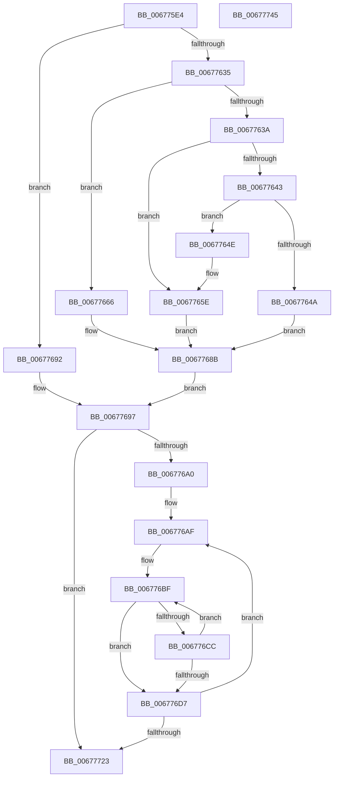

# MiLogMdlRangeEvent

- RVA: `0x006775E4`–`0x00677746` (길이 `354` bytes)
- VA: `0x00000001406775E4`
- 실행 섹션: `.text`
- PDB 이름 있음: `예`; PDB Function 태그: `아니요`
- unwind 정보 RVA: `0x000D7C78`
- 디코드: `94`개 명령, `354/354` bytes 표시
- 미해석 바이트: `0` (있으면 어셈블리에 `.byte`로 보존)

> 이 문서는 커널 이미지의 기계어와 PDB 기호를 분석해 생성했습니다. 4번과 5번은 함수 원형과 자료형을 바이너리 사용 방식에서 추정한 C 해석이며 원본 소스 복구 결과는 아닙니다.

## 1. Dependencies

- 직접 호출 지점: **5**; 고유 호출 대상: **5**
- 직접 호출자로 확인된 함수: **2**
- RIP 상대 이미지 참조: **1**

### Outgoing calls
- `0x00677669` → [MiLockPageInline](../31/MiLockPageInline_function_0031A340.md) (function, `0x0031A340`)
- `0x00677679` → [MiGetPfnPidSafe](../43/MiGetPfnPidSafe_function_00438D88.md) (function, `0x00438D88`)
- `0x00677686` → [MiUnlockPage](../31/MiUnlockPage_function_0031A3E0.md) (function, `0x0031A3E0`)
- `0x00677719` → [EtwTraceKernelEvent](../23/EtwTraceKernelEvent_function_00235350.md) (function, `0x00235350`)
- `0x0067772B` → [_security_check_cookie](../6A/_security_check_cookie_function_006AC640.md) (function, `0x006AC640`)

### Direct callers
- [MiAllocatePagesForMdl](../3E/MiAllocatePagesForMdl_function_003EABEC.md) at `0x003EADE4`
- [MiFreePagesFromMdl](../3F/MiFreePagesFromMdl_function_003F8300.md) at `0x003F8400`

### Static image references
- `0x006775F6` → RVA `0x00E0A740` (`.data`; read)

## 2. Other-region calls and transfers

- 다른 실행 섹션으로 향하는 call: **0**
- 별도 외부 분기/꼬리 이동을 확인하지 못했습니다.

## 3. Assembly (complete function range)

```asm
006775E4  48 89 5C 24 08                  mov qword ptr [rsp + 8], rbx
006775E9  48 89 6C 24 20                  mov qword ptr [rsp + 0x20], rbp
006775EE  56                              push rsi
006775EF  57                              push rdi
006775F0  41 56                           push r14
006775F2  48 83 EC 60                     sub rsp, 0x60
006775F6  48 8B 05 43 31 79 00            mov rax, qword ptr [rip + 0x793143]
006775FD  48 33 C4                        xor rax, rsp
00677600  48 89 44 24 58                  mov qword ptr [rsp + 0x58], rax
00677605  48 8B 02                        mov rax, qword ptr [rdx]
00677608  49 8B E9                        mov rbp, r9
0067760B  45 0F B7 F0                     movzx r14d, r8w
0067760F  48 8B FA                        mov rdi, rdx
00677612  48 8D 34 40                     lea rsi, [rax + rax*2]
00677616  48 C1 E6 04                     shl rsi, 4
0067761A  48 B8 00 00 00 00 00 DE FF FF   movabs rax, 0xffffde0000000000
00677624  48 03 F0                        add rsi, rax
00677627  48 8B 46 28                     mov rax, qword ptr [rsi + 0x28]
0067762B  48 C1 E8 3C                     shr rax, 0x3c
0067762F  24 07                           and al, 7
00677631  3C 01                           cmp al, 1
00677633  75 5D                           jne 0x140677692
00677635  48 85 C9                        test rcx, rcx
00677638  74 2C                           je 0x140677666
0067763A  48 81 39 40 19 06 00            cmp qword ptr [rcx], 0x61940
00677641  75 1B                           jne 0x14067765e
00677643  8B 41 08                        mov eax, dword ptr [rcx + 8]
00677646  A8 01                           test al, 1
00677648  75 04                           jne 0x14067764e
0067764A  33 DB                           xor ebx, ebx
0067764C  EB 3D                           jmp 0x14067768b
0067764E  65 48 8B 04 25 88 01 00 00      mov rax, qword ptr gs:[0x188]
00677657  48 8B 88 B8 00 00 00            mov rcx, qword ptr [rax + 0xb8]
0067765E  8B 99 D0 01 00 00               mov ebx, dword ptr [rcx + 0x1d0]
00677664  EB 25                           jmp 0x14067768b
00677666  48 8B CE                        mov rcx, rsi
00677669  E8 D2 2C CA FF                  call 0x14031a340
0067766E  BA 03 00 00 00                  mov edx, 3
00677673  48 8B CE                        mov rcx, rsi
00677676  44 8A D0                        mov r10b, al
00677679  E8 0A 17 DC FF                  call 0x140438d88
0067767E  41 8A D2                        mov dl, r10b
00677681  8B D8                           mov ebx, eax
00677683  48 8B CE                        mov rcx, rsi
00677686  E8 55 2D CA FF                  call 0x14031a3e0
0067768B  B8 09 00 00 00                  mov eax, 9
00677690  EB 05                           jmp 0x140677697
00677692  33 DB                           xor ebx, ebx
00677694  8D 43 0A                        lea eax, [rbx + 0xa]
00677697  48 85 ED                        test rbp, rbp
0067769A  0F 84 83 00 00 00               je 0x140677723
006776A0  48 8B B4 24 A0 00 00 00         mov rsi, qword ptr [rsp + 0xa0]
006776A8  48 C1 E3 04                     shl rbx, 4
006776AC  48 0B D8                        or rbx, rax
006776AF  48 8B 07                        mov rax, qword ptr [rdi]
006776B2  48 8B D7                        mov rdx, rdi
006776B5  48 89 44 24 38                  mov qword ptr [rsp + 0x38], rax
006776BA  48 89 5C 24 30                  mov qword ptr [rsp + 0x30], rbx
006776BF  48 8B C7                        mov rax, rdi
006776C2  48 83 C7 08                     add rdi, 8
006776C6  48 83 ED 01                     sub rbp, 1
006776CA  74 0B                           je 0x1406776d7
006776CC  48 8B 08                        mov rcx, qword ptr [rax]
006776CF  48 03 CE                        add rcx, rsi
006776D2  48 39 0F                        cmp qword ptr [rdi], rcx
006776D5  74 E8                           je 0x1406776bf
006776D7  83 64 24 54 00                  and dword ptr [rsp + 0x54], 0
006776DC  48 8D 4C 24 48                  lea rcx, [rsp + 0x48]
006776E1  48 8B C7                        mov rax, rdi
006776E4  C7 44 24 50 18 00 00 00         mov dword ptr [rsp + 0x50], 0x18
006776EC  48 2B C2                        sub rax, rdx
006776EF  C7 44 24 20 04 1B 50 11         mov dword ptr [rsp + 0x20], 0x11501b04
006776F7  48 C1 F8 03                     sar rax, 3
006776FB  45 0F B7 CE                     movzx r9d, r14w
006776FF  48 89 44 24 40                  mov qword ptr [rsp + 0x40], rax
00677704  BA 01 00 00 00                  mov edx, 1
00677709  48 8D 44 24 30                  lea rax, [rsp + 0x30]
0067770E  41 B8 01 00 00 20               mov r8d, 0x20000001
00677714  48 89 44 24 48                  mov qword ptr [rsp + 0x48], rax
00677719  E8 32 DC BB FF                  call 0x140235350
0067771E  48 85 ED                        test rbp, rbp
00677721  75 8C                           jne 0x1406776af
00677723  48 8B 4C 24 58                  mov rcx, qword ptr [rsp + 0x58]
00677728  48 33 CC                        xor rcx, rsp
0067772B  E8 10 4F 03 00                  call 0x1406ac640
00677730  4C 8D 5C 24 60                  lea r11, [rsp + 0x60]
00677735  49 8B 5B 20                     mov rbx, qword ptr [r11 + 0x20]
00677739  49 8B 6B 38                     mov rbp, qword ptr [r11 + 0x38]
0067773D  49 8B E3                        mov rsp, r11
00677740  41 5E                           pop r14
00677742  5F                              pop rdi
00677743  5E                              pop rsi
00677744  C3                              ret
00677745  CC                              int3
```

## 4. C-style interpretation (structured pseudocode)

```c
__int64 __fastcall MiLogMdlRangeEvent(__int64 a1, __int64 a2, unsigned __int16 a3, __int64 a4, __int64 a5)
{
    __int64 result;
    __int64 v_rbp;
    __int64 v_rbx;
    __int64 v_rdi;
    __int64 v_rsi;
    __int64 v_rsp;
    unsigned __int64 v_stack_m18;
    unsigned __int64 v_stack_m20;
    unsigned int v_stack_m24;
    unsigned int v_stack_m28;
    unsigned __int64 v_stack_m30;
    unsigned __int64 v_stack_m38;
    unsigned __int64 v_stack_m40;
    unsigned __int64 v_stack_m48;
    unsigned int v_stack_m58;
    unsigned __int64 v_stack_p20;
    unsigned __int64 v_stack_p8;

    v_stack_p8 = v_rbx;
    v_stack_p20 = v_rbp;
    v_rsp = (v_rsp) - (96);
    result = (*(unsigned __int64 *)(v_rip + 7942467)) ^ (v_rsp);
    v_stack_m20 = result;
    v_rsi = (*(unsigned __int64 *)(a2) + *(unsigned __int64 *)(a2) * 2) << (4);
    v_rsi = (v_rsi) + (*(unsigned __int64 *)(a2));
    result = (*(unsigned __int64 *)(v_rsi + 40)) >> (60);
    result = (unsigned __int8)((result) & (7));
    if (((unsigned __int8)(result)) != 1) goto loc_00677692;
    if (a1 == 0) goto loc_00677666;
    if ((*(unsigned __int64 *)(a1)) != 0x61940ULL) goto loc_0067765E;
    if ((((unsigned __int8)((unsigned int)(*(unsigned int *)(a1 + 8)))) & (1)) != 0) goto loc_0067764E;
    v_rbx = 0;
    goto loc_0067768B;
loc_0067764E:
loc_0067765E:
    goto loc_0067768B;
loc_00677666:
    result = MiLockPageInline(v_rsi, a2, a3, a4);
    result = MiGetPfnPidSafe(v_rsi, 3, a3, a4);
    result = MiUnlockPage(v_rsi, (unsigned __int8)((unsigned __int8)(result)), a3, a4);
loc_0067768B:
    goto loc_00677697;
loc_00677692:
    v_rbx = 0;
loc_00677697:
    if (a4 == 0) goto loc_00677723;
    v_rbx = (v_rbx) << (4);
    v_rbx = (v_rbx) | (v_rbx + 10);
loc_006776AF:
    v_stack_m40 = *(unsigned __int64 *)(a2);
    v_stack_m48 = v_rbx;
loc_006776BF:
    v_rdi = (a2) + (8);
    v_rbp = (a4) - (1);
    if (condition_is_equal) goto loc_006776D7;
    a1 = (*(unsigned __int64 *)(a2)) + (a5);
    if ((*(unsigned __int64 *)(v_rdi)) == a1) goto loc_006776BF;
loc_006776D7:
    v_stack_m28 = 24;
    result = (v_rdi) - (a2);
    v_stack_m58 = 0x11501B04ULL;
    result = (result) >> (3);
    v_stack_m38 = result;
    v_stack_m30 = v_stack_m48;
    result = EtwTraceKernelEvent(v_stack_m30, 1, (unsigned int)(0x20000001ULL), a3);
    if (v_rbp != 0) goto loc_006776AF;
loc_00677723:
    a1 = (v_stack_m20) ^ (v_rsp);
    result = _security_check_cookie(a1, 1, (unsigned int)(0x20000001ULL), a3);
    return result;
}
```

## 5. (Beta) C Style

```c
int64_t MiLogMdlRangeEvent(int64_t Arg1, void *Arg2, uint16_t Arg3, int64_t Arg4, int64_t Arg5)
{
    uint8_t *arg2 = (uint8_t *)Arg2;

    int64_t result;
    int64_t local_rbp;
    int64_t local_rbx;
    int64_t local_rdi;
    int64_t local_rsi;
    int64_t local_rsp;
    uint64_t v_stack_m18;
    uint64_t v_stack_m20;
    uint32_t v_stack_m24;
    uint32_t v_stack_m28;
    uint64_t v_stack_m30;
    uint64_t v_stack_m38;
    uint64_t v_stack_m40;
    uint64_t v_stack_m48;
    uint32_t v_stack_m58;
    uint64_t v_stack_p20;
    uint64_t v_stack_p8;

    v_stack_p8 = local_rbx;
    v_stack_p20 = local_rbp;
    local_rsp = (local_rsp) - (96);
    result = (*(uint64_t *)(v_rip + 0x793143)) ^ (local_rsp);
    v_stack_m20 = result;
    local_rsi = (*(uint64_t *)(arg2) + *(uint64_t *)(arg2) * 2) << (4);
    local_rsi = (local_rsi) + (*(uint64_t *)(arg2));
    result = (*(uint64_t *)(local_rsi + 0x28)) >> (60);
    result = (uint8_t)((result) & (7));
    if (((uint8_t)(result)) != 1) goto loc_00677692;
    if (Arg1 == 0) goto loc_00677666;
    if ((*(uint64_t *)(Arg1)) != 0x61940ULL) goto loc_0067765E;
    if ((((uint8_t)((uint32_t)(*(uint32_t *)(Arg1 + 0x8)))) & (1)) != 0) goto loc_0067764E;
    local_rbx = 0;
    goto loc_0067768B;
loc_0067764E:
loc_0067765E:
    goto loc_0067768B;
loc_00677666:
    result = MiLockPageInline(local_rsi, Arg2, Arg3, Arg4);
    result = MiGetPfnPidSafe(local_rsi, 3, Arg3, Arg4);
    result = MiUnlockPage(local_rsi, (uint8_t)((uint8_t)(result)), Arg3, Arg4);
loc_0067768B:
    goto loc_00677697;
loc_00677692:
    local_rbx = 0;
loc_00677697:
    if (Arg4 == 0) goto loc_00677723;
    local_rbx = (local_rbx) << (4);
    local_rbx = (local_rbx) | (local_rbx + 10);
loc_006776AF:
    v_stack_m40 = *(uint64_t *)(arg2);
    v_stack_m48 = local_rbx;
loc_006776BF:
    local_rdi = (Arg2) + (8);
    local_rbp = (Arg4) - (1);
    if (condition_is_equal) goto loc_006776D7;
    Arg1 = (*(uint64_t *)(arg2)) + (Arg5);
    if ((*(uint64_t *)(local_rdi)) == Arg1) goto loc_006776BF;
loc_006776D7:
    v_stack_m28 = 24;
    result = (local_rdi) - (Arg2);
    v_stack_m58 = 0x11501B04ULL;
    result = (result) >> (3);
    v_stack_m38 = result;
    v_stack_m30 = v_stack_m48;
    result = EtwTraceKernelEvent(v_stack_m30, 1, (uint32_t)(0x20000001ULL), Arg3);
    if (local_rbp != 0) goto loc_006776AF;
loc_00677723:
    Arg1 = (v_stack_m20) ^ (local_rsp);
    result = _security_check_cookie(Arg1, 1, (uint32_t)(0x20000001ULL), Arg3);
    return result;
}
```

### 관측된 메모리 오프셋

구조체 형식이 확인되지 않은 접근은 인자 기준의 오프셋으로만 기록했습니다.

| 기준 인자 | 오프셋 표현 | 폭 (bit) | 접근 |
|---|---:|---:|---|
| `Arg2` | `+ 0x0` | `64` | `R` |

## 6. Execution-region graph

[열기: 2D/3D 그래프와 함수 탐색 컨트롤 패널](../../../control-panel.html?section=text&rva=0x006775E4&view=graph)

- 2D 그래프는 위에서 아래로 흐르고, 3D 그래프는 빈 공간을 드래그해 회전합니다. Shift+드래그는 이동, 휠은 확대·축소, 함수 노드 선택은 대상 보고서 이동입니다.

### Static fallback


