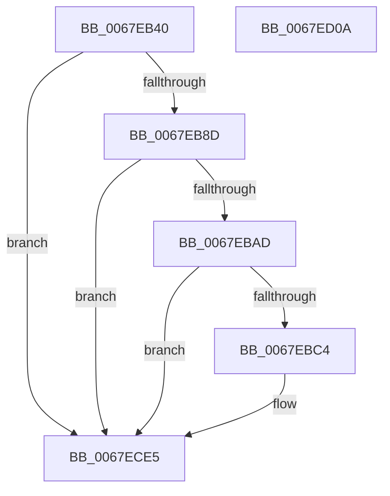

# MiLogUpdateOldPagesInWs

- RVA: `0x0067EB40`–`0x0067ED0B` (길이 `459` bytes)
- VA: `0x000000014067EB40`
- 실행 섹션: `.text`
- PDB 이름 있음: `예`; PDB Function 태그: `아니요`
- unwind 정보 RVA: `0x000D7FD4`
- 디코드: `97`개 명령, `459/459` bytes 표시
- 미해석 바이트: `0` (있으면 어셈블리에 `.byte`로 보존)

> 이 문서는 커널 이미지의 기계어와 PDB 기호를 분석해 생성했습니다. 4번과 5번은 함수 원형과 자료형을 바이너리 사용 방식에서 추정한 C 해석이며 원본 소스 복구 결과는 아닙니다.

## 1. Dependencies

- 직접 호출 지점: **5**; 고유 호출 대상: **5**
- 직접 호출자로 확인된 함수: **1**
- RIP 상대 이미지 참조: **3**

### Outgoing calls
- `0x0067EB97` → [MiFillLogProcessInfo](../44/MiFillLogProcessInfo_function_00448110.md) (function, `0x00448110`)
- `0x0067EBB7` → [tlgKeywordOn](../42/tlgKeywordOn_function_0042EAA0.md) (function, `0x0042EAA0`)
- `0x0067EBE7` → [tlgCreate1Sz_char](../42/tlgCreate1Sz_char_function_00427304.md) (function, `0x00427304`)
- `0x0067ECE0` → [tlgWriteEx_EtwWriteEx](../4A/tlgWriteEx_EtwWriteEx_function_004AA348.md) (function, `0x004AA348`)
- `0x0067ECEC` → [_security_check_cookie](../6A/_security_check_cookie_function_006AC640.md) (function, `0x006AC640`)

### Direct callers
- [MmUpdateOldWorkingSetPages](../4E/MmUpdateOldWorkingSetPages_function_004EDF18.md) at `0x004EE126`

### Static image references
- `0x0067EB5B` → RVA `0x00E0A740` (`.data`; read)
- `0x0067EB6E` → RVA `0x00E37618` (`.data`; read)
- `0x0067EBF9` → RVA `0x00058235` (`.rdata`; read)

## 2. Other-region calls and transfers

- 다른 실행 섹션으로 향하는 call: **0**
- 별도 외부 분기/꼬리 이동을 확인하지 못했습니다.

## 3. Assembly (complete function range)

```asm
0067EB40  48 8B C4                        mov rax, rsp
0067EB43  48 89 58 10                     mov qword ptr [rax + 0x10], rbx
0067EB47  48 89 70 18                     mov qword ptr [rax + 0x18], rsi
0067EB4B  48 89 78 20                     mov qword ptr [rax + 0x20], rdi
0067EB4F  55                              push rbp
0067EB50  48 8D 68 98                     lea rbp, [rax - 0x68]
0067EB54  48 81 EC 60 01 00 00            sub rsp, 0x160
0067EB5B  48 8B 05 DE BB 78 00            mov rax, qword ptr [rip + 0x78bbde]
0067EB62  48 33 C4                        xor rax, rsp
0067EB65  48 89 45 50                     mov qword ptr [rbp + 0x50], rax
0067EB69  33 F6                           xor esi, esi
0067EB6B  4D 8B D9                        mov r11, r9
0067EB6E  48 39 35 A3 8A 7B 00            cmp qword ptr [rip + 0x7b8aa3], rsi
0067EB75  49 8B D8                        mov rbx, r8
0067EB78  48 8B FA                        mov rdi, rdx
0067EB7B  89 74 24 44                     mov dword ptr [rsp + 0x44], esi
0067EB7F  4C 8B D1                        mov r10, rcx
0067EB82  48 89 74 24 48                  mov qword ptr [rsp + 0x48], rsi
0067EB87  0F 84 58 01 00 00               je 0x14067ece5
0067EB8D  4C 8D 44 24 48                  lea r8, [rsp + 0x48]
0067EB92  48 8D 54 24 44                  lea rdx, [rsp + 0x44]
0067EB97  E8 74 95 DC FF                  call 0x140448110
0067EB9C  4C 8B 05 75 8A 7B 00            mov r8, qword ptr [rip + 0x7b8a75]
0067EBA3  41 83 38 05                     cmp dword ptr [r8], 5
0067EBA7  0F 86 38 01 00 00               jbe 0x14067ece5
0067EBAD  44 8D 4E 01                     lea r9d, [rsi + 1]
0067EBB1  49 8B C8                        mov rcx, r8
0067EBB4  41 8B D1                        mov edx, r9d
0067EBB7  E8 E4 FE DA FF                  call 0x14042eaa0
0067EBBC  84 C0                           test al, al
0067EBBE  0F 84 21 01 00 00               je 0x14067ece5
0067EBC4  41 8B 82 B8 00 00 00            mov eax, dword ptr [r10 + 0xb8]
0067EBCB  48 8D 4D B0                     lea rcx, [rbp - 0x50]
0067EBCF  24 0F                           and al, 0xf
0067EBD1  48 89 55 A8                     mov qword ptr [rbp - 0x58], rdx
0067EBD5  48 8B 54 24 48                  mov rdx, qword ptr [rsp + 0x48]
0067EBDA  88 44 24 40                     mov byte ptr [rsp + 0x40], al
0067EBDE  48 8D 44 24 40                  lea rax, [rsp + 0x40]
0067EBE3  48 89 45 A0                     mov qword ptr [rbp - 0x60], rax
0067EBE7  E8 18 87 DA FF                  call 0x140427304
0067EBEC  8B 4C 24 44                     mov ecx, dword ptr [rsp + 0x44]
0067EBF0  48 8D 44 24 50                  lea rax, [rsp + 0x50]
0067EBF5  48 89 45 C0                     mov qword ptr [rbp - 0x40], rax
0067EBF9  48 8D 15 35 96 9D FF            lea rdx, [rip - 0x6269cb]
0067EC00  48 8D 44 24 60                  lea rax, [rsp + 0x60]
0067EC05  89 4C 24 50                     mov dword ptr [rsp + 0x50], ecx
0067EC09  48 89 45 D0                     mov qword ptr [rbp - 0x30], rax
0067EC0D  49 8B C8                        mov rcx, r8
0067EC10  48 8D 44 24 68                  lea rax, [rsp + 0x68]
0067EC15  48 C7 45 C8 04 00 00 00         mov qword ptr [rbp - 0x38], 4
0067EC1D  48 89 45 E0                     mov qword ptr [rbp - 0x20], rax
0067EC21  48 8D 44 24 70                  lea rax, [rsp + 0x70]
0067EC26  48 89 45 F0                     mov qword ptr [rbp - 0x10], rax
0067EC2A  8B 85 90 00 00 00               mov eax, dword ptr [rbp + 0x90]
0067EC30  89 44 24 54                     mov dword ptr [rsp + 0x54], eax
0067EC34  48 8D 44 24 54                  lea rax, [rsp + 0x54]
0067EC39  48 89 45 00                     mov qword ptr [rbp], rax
0067EC3D  8B 85 98 00 00 00               mov eax, dword ptr [rbp + 0x98]
0067EC43  89 44 24 58                     mov dword ptr [rsp + 0x58], eax
0067EC47  48 8D 44 24 58                  lea rax, [rsp + 0x58]
0067EC4C  48 89 45 10                     mov qword ptr [rbp + 0x10], rax
0067EC50  8B 85 A0 00 00 00               mov eax, dword ptr [rbp + 0xa0]
0067EC56  89 44 24 5C                     mov dword ptr [rsp + 0x5c], eax
0067EC5A  48 8D 44 24 5C                  lea rax, [rsp + 0x5c]
0067EC5F  48 89 45 20                     mov qword ptr [rbp + 0x20], rax
0067EC63  49 8D 42 28                     lea rax, [r10 + 0x28]
0067EC67  48 89 45 30                     mov qword ptr [rbp + 0x30], rax
0067EC6B  41 0F B7 82 AE 00 00 00         movzx eax, word ptr [r10 + 0xae]
0067EC73  89 44 24 48                     mov dword ptr [rsp + 0x48], eax
0067EC77  48 8D 44 24 48                  lea rax, [rsp + 0x48]
0067EC7C  48 89 45 40                     mov qword ptr [rbp + 0x40], rax
0067EC80  48 8D 45 80                     lea rax, [rbp - 0x80]
0067EC84  48 89 44 24 38                  mov qword ptr [rsp + 0x38], rax
0067EC89  C7 44 24 30 0D 00 00 00         mov dword ptr [rsp + 0x30], 0xd
0067EC91  4C 89 5C 24 60                  mov qword ptr [rsp + 0x60], r11
0067EC96  48 C7 45 D8 08 00 00 00         mov qword ptr [rbp - 0x28], 8
0067EC9E  48 89 7C 24 68                  mov qword ptr [rsp + 0x68], rdi
0067ECA3  48 C7 45 E8 08 00 00 00         mov qword ptr [rbp - 0x18], 8
0067ECAB  48 89 5C 24 70                  mov qword ptr [rsp + 0x70], rbx
0067ECB0  48 C7 45 F8 08 00 00 00         mov qword ptr [rbp - 8], 8
0067ECB8  48 C7 45 08 04 00 00 00         mov qword ptr [rbp + 8], 4
0067ECC0  48 C7 45 18 04 00 00 00         mov qword ptr [rbp + 0x18], 4
0067ECC8  48 C7 45 28 04 00 00 00         mov qword ptr [rbp + 0x28], 4
0067ECD0  48 C7 45 38 40 00 00 00         mov qword ptr [rbp + 0x38], 0x40
0067ECD8  48 C7 45 48 04 00 00 00         mov qword ptr [rbp + 0x48], 4
0067ECE0  E8 63 B6 E2 FF                  call 0x1404aa348
0067ECE5  48 8B 4D 50                     mov rcx, qword ptr [rbp + 0x50]
0067ECE9  48 33 CC                        xor rcx, rsp
0067ECEC  E8 4F D9 02 00                  call 0x1406ac640
0067ECF1  4C 8D 9C 24 60 01 00 00         lea r11, [rsp + 0x160]
0067ECF9  49 8B 5B 18                     mov rbx, qword ptr [r11 + 0x18]
0067ECFD  49 8B 73 20                     mov rsi, qword ptr [r11 + 0x20]
0067ED01  49 8B 7B 28                     mov rdi, qword ptr [r11 + 0x28]
0067ED05  49 8B E3                        mov rsp, r11
0067ED08  5D                              pop rbp
0067ED09  C3                              ret
0067ED0A  CC                              int3
```

## 4. C-style interpretation (structured pseudocode)

```c
__int64 __fastcall MiLogUpdateOldPagesInWs(__int64 a1, __int64 a2, __int64 a3, __int64 a4)
{
    __int64 result;
    __int64 v_rsi;
    __int64 v_rsp;
    unsigned __int64 v_stack_m100;
    unsigned __int64 v_stack_m108;
    unsigned int v_stack_m10C;
    unsigned int v_stack_m110;
    unsigned int v_stack_m114;
    unsigned __int64 v_stack_m118;
    unsigned __int64 v_stack_m120;
    unsigned int v_stack_m124;
    unsigned __int8 v_stack_m128;
    unsigned __int64 v_stack_m130;
    unsigned int v_stack_m138;
    unsigned __int64 v_stack_m8;
    unsigned __int64 v_stack_mF8;

    *(unsigned __int64 *)(v_rsp + 16) = v_rbx;
    *(unsigned __int64 *)(v_rsp + 24) = v_rsi;
    *(unsigned __int64 *)(v_rsp + 32) = v_rdi;
    v_rsp = (v_rsp) - (352);
    result = (*(unsigned __int64 *)(v_rip + 7912414)) ^ (v_rsp);
    *(unsigned __int64 *)(v_rsp - 104 + 80) = result;
    v_rsi = 0;
    v_stack_m124 = 0;
    v_stack_m120 = 0;
    if ((*(unsigned __int64 *)(v_rip + 8096419)) == 0) goto loc_0067ECE5;
    result = MiFillLogProcessInfo(a1, v_stack_m124, v_stack_m120, a4);
    if ((*(unsigned int *)(*(unsigned __int64 *)(v_rip + 8096373))) <= 5) goto loc_0067ECE5;
    result = tlgKeywordOn(*(unsigned __int64 *)(v_rip + 8096373), (unsigned int)((unsigned int)(v_rsi + 1)), *(unsigned __int64 *)(v_rip + 8096373), v_rsi + 1);
    if ((unsigned __int8)(result) != 0) {
        result = *(unsigned int *)(a1 + 184);
        a1 = v_rsp - 104 - 80;
        result = (unsigned __int8)((result) & (15));
        *(unsigned __int64 *)(v_rsp - 104 - 88) = (unsigned int)((unsigned int)(v_rsi + 1));
        a2 = v_stack_m120;
        v_stack_m128 = (unsigned __int8)(result);
        result = v_stack_m128;
        *(unsigned __int64 *)(v_rsp - 104 - 96) = result;
        result = tlgCreate1Sz_char(a1, a2, *(unsigned __int64 *)(v_rip + 8096373), v_rsi + 1);
        a1 = v_stack_m124;
        result = v_stack_m118;
        *(unsigned __int64 *)(v_rsp - 104 - 64) = result;
        a2 = v_rip - 6449611;
        result = v_stack_m108;
        v_stack_m118 = (unsigned int)(a1);
        *(unsigned __int64 *)(v_rsp - 104 - 48) = result;
        a1 = *(unsigned __int64 *)(v_rip + 8096373);
        result = v_stack_m100;
        *(unsigned __int64 *)(v_rsp - 104 - 56) = 4;
        *(unsigned __int64 *)(v_rsp - 104 - 32) = result;
        result = v_stack_mF8;
        *(unsigned __int64 *)(v_rsp - 104 - 16) = result;
        result = *(unsigned int *)(v_rsp - 104 + 144);
        v_stack_m114 = (unsigned int)(result);
        result = v_stack_m114;
        *(unsigned __int64 *)(v_rsp - 104) = result;
        result = *(unsigned int *)(v_rsp - 104 + 152);
        v_stack_m110 = (unsigned int)(result);
        result = v_stack_m110;
        *(unsigned __int64 *)(v_rsp - 104 + 16) = result;
        result = *(unsigned int *)(v_rsp - 104 + 160);
        v_stack_m10C = (unsigned int)(result);
        result = v_stack_m10C;
        *(unsigned __int64 *)(v_rsp - 104 + 32) = result;
        result = a1 + 40;
        *(unsigned __int64 *)(v_rsp - 104 + 48) = result;
        result = *(unsigned __int16 *)(a1 + 174);
        v_stack_m120 = (unsigned int)(result);
        result = v_stack_m120;
        *(unsigned __int64 *)(v_rsp - 104 + 64) = result;
        result = v_rsp - 104 - 128;
        v_stack_m130 = result;
        v_stack_m138 = 13;
        v_stack_m108 = a4;
        *(unsigned __int64 *)(v_rsp - 104 - 40) = 8;
        v_stack_m100 = a2;
        *(unsigned __int64 *)(v_rsp - 104 - 24) = 8;
        v_stack_mF8 = a3;
        *(unsigned __int64 *)(v_rsp - 104 - 8) = 8;
        *(unsigned __int64 *)(v_rsp - 104 + 8) = 4;
        *(unsigned __int64 *)(v_rsp - 104 + 24) = 4;
        *(unsigned __int64 *)(v_rsp - 104 + 40) = 4;
        *(unsigned __int64 *)(v_rsp - 104 + 56) = 64;
        *(unsigned __int64 *)(v_rsp - 104 + 72) = 4;
        result = tlgWriteEx_EtwWriteEx(a1, a2, *(unsigned __int64 *)(v_rip + 8096373), v_rsi + 1);
    }
    a1 = (*(unsigned __int64 *)(v_rsp - 104 + 80)) ^ (v_rsp);
    result = _security_check_cookie(a1, a2, *(unsigned __int64 *)(v_rip + 8096373), v_rsi + 1);
    return result;
}
```

## 5. (Beta) C Style

```c
int64_t MiLogUpdateOldPagesInWs(int64_t Arg1, int64_t Arg2, int64_t Arg3, int64_t Arg4)
{
    int64_t result;
    int64_t local_rsi;
    int64_t local_rsp;
    uint64_t v_stack_m100;
    uint64_t v_stack_m108;
    uint32_t v_stack_m10C;
    uint32_t v_stack_m110;
    uint32_t v_stack_m114;
    uint64_t v_stack_m118;
    uint64_t v_stack_m120;
    uint32_t v_stack_m124;
    uint8_t v_stack_m128;
    uint64_t v_stack_m130;
    uint32_t v_stack_m138;
    uint64_t v_stack_m8;
    uint64_t v_stack_mF8;

    *(uint64_t *)(local_rsp + 0x10) = local_rbx;
    *(uint64_t *)(local_rsp + 0x18) = local_rsi;
    *(uint64_t *)(local_rsp + 0x20) = local_rdi;
    local_rsp = (local_rsp) - (352);
    result = (*(uint64_t *)(v_rip + 0x78BBDE)) ^ (local_rsp);
    *(uint64_t *)(local_rsp - 0x68 + 0x50) = result;
    local_rsi = 0;
    v_stack_m124 = 0;
    v_stack_m120 = 0;
    if ((*(uint64_t *)(v_rip + 0x7B8AA3)) == 0) goto loc_0067ECE5;
    result = MiFillLogProcessInfo(Arg1, v_stack_m124, v_stack_m120, Arg4);
    if ((*(uint32_t *)(*(uint64_t *)(v_rip + 0x7B8A75))) <= 5) goto loc_0067ECE5;
    result = tlgKeywordOn(*(uint64_t *)(v_rip + 0x7B8A75), (uint32_t)((uint32_t)(local_rsi + 1)), *(uint64_t *)(v_rip + 0x7B8A75), local_rsi + 1);
    if ((uint8_t)(result) != 0) {
        result = *(uint32_t *)(Arg1 + 0xB8);
        Arg1 = local_rsp - 104 - 80;
        result = (uint8_t)((result) & (15));
        *(uint64_t *)(local_rsp - 0x68 - 0x58) = (uint32_t)((uint32_t)(local_rsi + 1));
        Arg2 = v_stack_m120;
        v_stack_m128 = (uint8_t)(result);
        result = v_stack_m128;
        *(uint64_t *)(local_rsp - 0x68 - 0x60) = result;
        result = tlgCreate1Sz_char(Arg1, Arg2, *(uint64_t *)(v_rip + 0x7B8A75), local_rsi + 1);
        Arg1 = v_stack_m124;
        result = v_stack_m118;
        *(uint64_t *)(local_rsp - 0x68 - 0x40) = result;
        Arg2 = v_rip - 6449611;
        result = v_stack_m108;
        v_stack_m118 = (uint32_t)(Arg1);
        *(uint64_t *)(local_rsp - 0x68 - 0x30) = result;
        Arg1 = *(uint64_t *)(v_rip + 0x7B8A75);
        result = v_stack_m100;
        *(uint64_t *)(local_rsp - 0x68 - 0x38) = 4;
        *(uint64_t *)(local_rsp - 0x68 - 0x20) = result;
        result = v_stack_mF8;
        *(uint64_t *)(local_rsp - 0x68 - 0x10) = result;
        result = *(uint32_t *)(local_rsp - 0x68 + 0x90);
        v_stack_m114 = (uint32_t)(result);
        result = v_stack_m114;
        *(uint64_t *)(local_rsp - 0x68) = result;
        result = *(uint32_t *)(local_rsp - 0x68 + 0x98);
        v_stack_m110 = (uint32_t)(result);
        result = v_stack_m110;
        *(uint64_t *)(local_rsp - 0x68 + 0x10) = result;
        result = *(uint32_t *)(local_rsp - 0x68 + 0xA0);
        v_stack_m10C = (uint32_t)(result);
        result = v_stack_m10C;
        *(uint64_t *)(local_rsp - 0x68 + 0x20) = result;
        result = Arg1 + 40;
        *(uint64_t *)(local_rsp - 0x68 + 0x30) = result;
        result = *(uint16_t *)(Arg1 + 0xAE);
        v_stack_m120 = (uint32_t)(result);
        result = v_stack_m120;
        *(uint64_t *)(local_rsp - 0x68 + 0x40) = result;
        result = local_rsp - 104 - 128;
        v_stack_m130 = result;
        v_stack_m138 = 13;
        v_stack_m108 = Arg4;
        *(uint64_t *)(local_rsp - 0x68 - 0x28) = 8;
        v_stack_m100 = Arg2;
        *(uint64_t *)(local_rsp - 0x68 - 0x18) = 8;
        v_stack_mF8 = Arg3;
        *(uint64_t *)(local_rsp - 0x68 - 0x8) = 8;
        *(uint64_t *)(local_rsp - 0x68 + 0x8) = 4;
        *(uint64_t *)(local_rsp - 0x68 + 0x18) = 4;
        *(uint64_t *)(local_rsp - 0x68 + 0x28) = 4;
        *(uint64_t *)(local_rsp - 0x68 + 0x38) = 64;
        *(uint64_t *)(local_rsp - 0x68 + 0x48) = 4;
        result = tlgWriteEx_EtwWriteEx(Arg1, Arg2, *(uint64_t *)(v_rip + 0x7B8A75), local_rsi + 1);
    }
    Arg1 = (*(uint64_t *)(local_rsp - 0x68 + 0x50)) ^ (local_rsp);
    result = _security_check_cookie(Arg1, Arg2, *(uint64_t *)(v_rip + 0x7B8A75), local_rsi + 1);
    return result;
}
```

## 6. Execution-region graph

[열기: 2D/3D 그래프와 함수 탐색 컨트롤 패널](../../../control-panel.html?section=text&rva=0x0067EB40&view=graph)

- 2D 그래프는 위에서 아래로 흐르고, 3D 그래프는 빈 공간을 드래그해 회전합니다. Shift+드래그는 이동, 휠은 확대·축소, 함수 노드 선택은 대상 보고서 이동입니다.

### Static fallback


