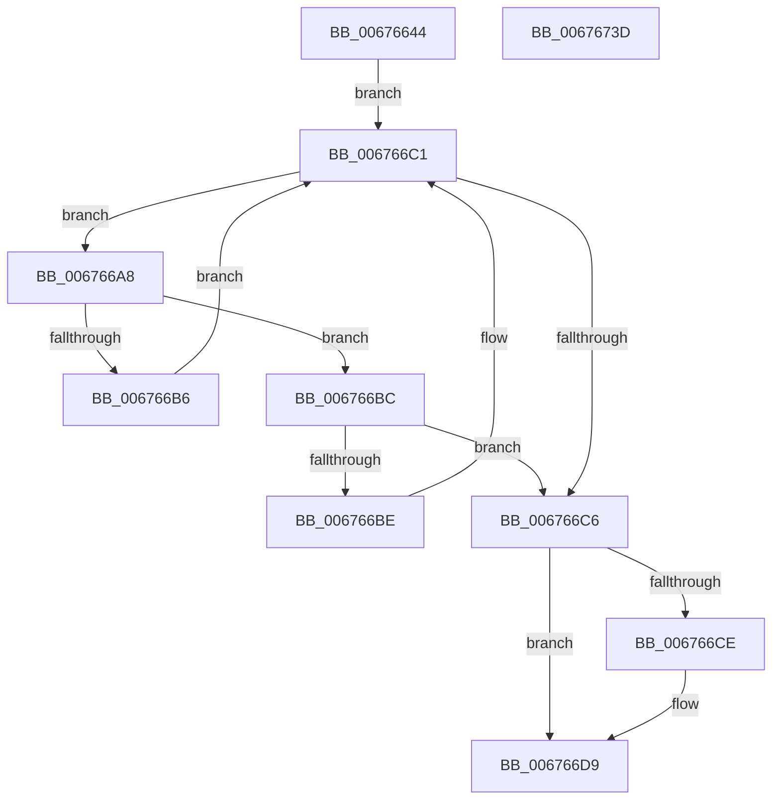

# MiMakeEntireHugePfnGood

- RVA: `0x00676644`–`0x0067673E` (길이 `250` bytes)
- VA: `0x0000000140676644`
- 실행 섹션: `.text`
- PDB 이름 있음: `예`; PDB Function 태그: `아니요`
- unwind 정보 RVA: `0x00084C9C`
- 디코드: `66`개 명령, `250/250` bytes 표시
- 미해석 바이트: `0` (있으면 어셈블리에 `.byte`로 보존)

> 이 문서는 커널 이미지의 기계어와 PDB 기호를 분석해 생성했습니다. 4번과 5번은 함수 원형과 자료형을 바이너리 사용 방식에서 추정한 C 해석이며 원본 소스 복구 결과는 아닙니다.

## 1. Dependencies

- 직접 호출 지점: **7**; 고유 호출 대상: **7**
- 직접 호출자로 확인된 함수: **1**
- RIP 상대 이미지 참조: **4**

### Outgoing calls
- `0x00676680` → [MiHugePfnPartition](../43/MiHugePfnPartition_function_004371B4.md) (function, `0x004371B4`)
- `0x0067668E` → [MiPageToNode](../33/MiPageToNode_function_00338CD0.md) (function, `0x00338CD0`)
- `0x0067669A` → [ExAcquireSpinLockExclusiveAtDpcLevel](../24/ExAcquireSpinLockExclusiveAtDpcLevel_function_00248E80.md) (function, `0x00248E80`)
- `0x006766D4` → [MiUnlinkHugeRange](../43/MiUnlinkHugeRange_function_00436EF0.md) (function, `0x00436EF0`)
- `0x006766F0` → [RtlNumberOfSetBitsEx](../41/RtlNumberOfSetBitsEx_function_00418CA0.md) (function, `0x00418CA0`)
- `0x00676706` → [RtlAvlRemoveNode](../29/RtlAvlRemoveNode_function_00296650.md) (function, `0x00296650`)
- `0x00676712` → [ExReleaseSpinLockExclusiveFromDpcLevel](../24/ExReleaseSpinLockExclusiveFromDpcLevel_function_002497E0.md) (function, `0x002497E0`)

### Direct callers
- [MiHotRemoveHugeRange](MiHotRemoveHugeRange_function_00675DD0.md) at `0x00675E88`

### Static image references
- `0x0067666F` → RVA `0x00E300C0` (`.data`; read)
- `0x00676693` → RVA `0x00E2FFD0` (`.data`; read)
- `0x0067669F` → RVA `0x00E30020` (`.data`; read)
- `0x006766F5` → RVA `0x00E30028` (`.data`; read/write)

## 2. Other-region calls and transfers

- 다른 실행 섹션으로 향하는 call: **0**
- 별도 외부 분기/꼬리 이동을 확인하지 못했습니다.

## 3. Assembly (complete function range)

```asm
00676644  48 8B C4                        mov rax, rsp
00676647  48 89 58 08                     mov qword ptr [rax + 8], rbx
0067664B  48 89 68 10                     mov qword ptr [rax + 0x10], rbp
0067664F  48 89 70 18                     mov qword ptr [rax + 0x18], rsi
00676653  57                              push rdi
00676654  41 56                           push r14
00676656  41 57                           push r15
00676658  48 83 EC 30                     sub rsp, 0x30
0067665C  48 8B E9                        mov rbp, rcx
0067665F  48 8B F9                        mov rdi, rcx
00676662  0F 57 C0                        xorps xmm0, xmm0
00676665  81 E5 FF FF 3F 00               and ebp, 0x3fffff
0067666B  0F 11 40 D8                     movups xmmword ptr [rax - 0x28], xmm0
0067666F  48 8B 05 4A 9A 7B 00            mov rax, qword ptr [rip + 0x7b9a4a]
00676676  4C 8D 34 E8                     lea r14, [rax + rbp*8]
0067667A  49 8B 1E                        mov rbx, qword ptr [r14]
0067667D  49 8B CE                        mov rcx, r14
00676680  E8 2F 0B DC FF                  call 0x1404371b4
00676685  8B CD                           mov ecx, ebp
00676687  4C 8B F8                        mov r15, rax
0067668A  48 C1 E1 12                     shl rcx, 0x12
0067668E  E8 3D 26 CC FF                  call 0x140338cd0
00676693  48 8D 0D 36 99 7B 00            lea rcx, [rip + 0x7b9936]
0067669A  E8 E1 27 BD FF                  call 0x140248e80
0067669F  48 8B 35 7A 99 7B 00            mov rsi, qword ptr [rip + 0x7b997a]
006766A6  EB 19                           jmp 0x1406766c1
006766A8  48 8B 46 18                     mov rax, qword ptr [rsi + 0x18]
006766AC  25 FF FF 3F 00                  and eax, 0x3fffff
006766B1  48 3B E8                        cmp rbp, rax
006766B4  76 06                           jbe 0x1406766bc
006766B6  48 8B 76 08                     mov rsi, qword ptr [rsi + 8]
006766BA  EB 05                           jmp 0x1406766c1
006766BC  73 08                           jae 0x1406766c6
006766BE  48 8B 36                        mov rsi, qword ptr [rsi]
006766C1  48 85 F6                        test rsi, rsi
006766C4  75 E2                           jne 0x1406766a8
006766C6  80 E3 07                        and bl, 7
006766C9  80 FB 04                        cmp bl, 4
006766CC  75 0B                           jne 0x1406766d9
006766CE  48 8B D7                        mov rdx, rdi
006766D1  49 8B CF                        mov rcx, r15
006766D4  E8 17 08 DC FF                  call 0x140436ef0
006766D9  48 8B 56 20                     mov rdx, qword ptr [rsi + 0x20]
006766DD  48 8D 4C 24 20                  lea rcx, [rsp + 0x20]
006766E2  48 89 54 24 28                  mov qword ptr [rsp + 0x28], rdx
006766E7  48 C7 44 24 20 00 00 04 00      mov qword ptr [rsp + 0x20], 0x40000
006766F0  E8 AB 25 DA FF                  call 0x140418ca0
006766F5  48 29 05 2C 99 7B 00            sub qword ptr [rip + 0x7b992c], rax
006766FC  48 8D 0D 1D 99 7B 00            lea rcx, [rip + 0x7b991d]
00676703  48 8B D6                        mov rdx, rsi
00676706  E8 45 FF C1 FF                  call 0x140296650
0067670B  48 8D 0D BE 98 7B 00            lea rcx, [rip + 0x7b98be]
00676712  E8 C9 30 BD FF                  call 0x1402497e0
00676717  49 8B 0E                        mov rcx, qword ptr [r14]
0067671A  48 8B C6                        mov rax, rsi
0067671D  48 8B 5C 24 50                  mov rbx, qword ptr [rsp + 0x50]
00676722  48 83 E1 F7                     and rcx, 0xfffffffffffffff7
00676726  48 8B 6C 24 58                  mov rbp, qword ptr [rsp + 0x58]
0067672B  48 8B 74 24 60                  mov rsi, qword ptr [rsp + 0x60]
00676730  49 89 0E                        mov qword ptr [r14], rcx
00676733  48 83 C4 30                     add rsp, 0x30
00676737  41 5F                           pop r15
00676739  41 5E                           pop r14
0067673B  5F                              pop rdi
0067673C  C3                              ret
0067673D  CC                              int3
```

## 4. C-style interpretation (structured pseudocode)

```c
__int64 __fastcall MiMakeEntireHugePfnGood(__int64 a1)
{
    __int64 result;
    __int64 v_rbp;
    __int64 v_rbx;
    __int64 v_rsp;
    unsigned __int64 v_stack_m20;
    unsigned __int64 v_stack_m28;
    unsigned __int64 v_stack_p10;
    unsigned __int64 v_stack_p18;
    unsigned __int64 v_stack_p8;

    *(unsigned __int64 *)(v_rsp + 8) = v_rbx;
    *(unsigned __int64 *)(v_rsp + 16) = v_rbp;
    *(unsigned __int64 *)(v_rsp + 24) = v_rsi;
    v_rsp = (v_rsp) - (48);
    v_rbp = (unsigned int)((a1) & (0x3FFFFFULL));
    *(unsigned __int64 *)(v_rsp - 40) = v_xmm0;
    result = MiHugePfnPartition(*(unsigned __int64 *)(v_rip + 8100426) + v_rbp * 8, a2, a3, a4);
    a1 = ((unsigned int)((unsigned int)(v_rbp))) << (18);
    result = MiPageToNode(a1, a2, a3, a4);
    result = ExAcquireSpinLockExclusiveAtDpcLevel(v_rip + 8100150, a2, a3, a4);
    goto loc_006766C1;
loc_006766A8:
    result = (unsigned int)((*(unsigned __int64 *)(*(unsigned __int64 *)(v_rip + 8100218) + 24)) & (0x3FFFFFULL));
    if (v_rbp <= result) goto loc_006766BC;
    goto loc_006766C1;
loc_006766BC:
    if (v_rbp >= result) goto loc_006766C6;
loc_006766C1:
    if (*(unsigned __int64 *)(*(unsigned __int64 *)(*(unsigned __int64 *)(v_rip + 8100218) + 8)) != 0) goto loc_006766A8;
loc_006766C6:
    v_rbx = (unsigned __int8)((*(unsigned __int64 *)(*(unsigned __int64 *)(v_rip + 8100426) + v_rbp * 8)) & (7));
    if (((unsigned __int8)(v_rbx)) == 4) {
        a2 = a1;
        a1 = result;
        result = MiUnlinkHugeRange(a1, a2, a3, a4);
    }
    v_stack_m20 = *(unsigned __int64 *)(*(unsigned __int64 *)(*(unsigned __int64 *)(*(unsigned __int64 *)(v_rip + 8100218) + 8)) + 32);
    v_stack_m28 = 0x40000ULL;
    result = RtlNumberOfSetBitsEx(v_stack_m28, *(unsigned __int64 *)(*(unsigned __int64 *)(*(unsigned __int64 *)(*(unsigned __int64 *)(v_rip + 8100218) + 8)) + 32), a3, a4);
    result = RtlAvlRemoveNode(v_rip + 8100125, *(unsigned __int64 *)(*(unsigned __int64 *)(*(unsigned __int64 *)(v_rip + 8100218) + 8)), a3, a4);
    result = ExReleaseSpinLockExclusiveFromDpcLevel(v_rip + 8100030, *(unsigned __int64 *)(*(unsigned __int64 *)(*(unsigned __int64 *)(v_rip + 8100218) + 8)), a3, a4);
    a1 = (*(unsigned __int64 *)(*(unsigned __int64 *)(v_rip + 8100426) + v_rbp * 8)) & (-9);
    *(unsigned __int64 *)(*(unsigned __int64 *)(v_rip + 8100426) + v_rbp * 8) = a1;
    v_rsp = (v_rsp) + (48);
    return *(unsigned __int64 *)(*(unsigned __int64 *)(*(unsigned __int64 *)(v_rip + 8100218) + 8));
}
```

## 5. (Beta) C Style

```c
int64_t MiMakeEntireHugePfnGood(int64_t Arg1)
{
    int64_t result;
    int64_t local_rbp;
    int64_t local_rbx;
    int64_t local_rsp;
    uint64_t v_stack_m20;
    uint64_t v_stack_m28;
    uint64_t v_stack_p10;
    uint64_t v_stack_p18;
    uint64_t v_stack_p8;

    *(uint64_t *)(local_rsp + 0x8) = local_rbx;
    *(uint64_t *)(local_rsp + 0x10) = local_rbp;
    *(uint64_t *)(local_rsp + 0x18) = local_rsi;
    local_rsp = (local_rsp) - (48);
    local_rbp = (uint32_t)((Arg1) & (0x3FFFFFULL));
    *(uint64_t *)(local_rsp - 0x28) = v_xmm0;
    result = MiHugePfnPartition(*(uint64_t *)(v_rip + 0x7B9A4A) + local_rbp * 8, a2, a3, a4);
    Arg1 = ((uint32_t)((uint32_t)(local_rbp))) << (18);
    result = MiPageToNode(Arg1, a2, a3, a4);
    result = ExAcquireSpinLockExclusiveAtDpcLevel(v_rip + 8100150, a2, a3, a4);
    goto loc_006766C1;
loc_006766A8:
    result = (uint32_t)((*(uint64_t *)(*(uint64_t *)(v_rip + 0x7B997A) + 0x18)) & (0x3FFFFFULL));
    if (local_rbp <= result) goto loc_006766BC;
    goto loc_006766C1;
loc_006766BC:
    if (local_rbp >= result) goto loc_006766C6;
loc_006766C1:
    if (*(uint64_t *)(*(uint64_t *)(*(uint64_t *)(v_rip + 0x7B997A) + 0x8)) != 0) goto loc_006766A8;
loc_006766C6:
    local_rbx = (uint8_t)((*(uint64_t *)(*(uint64_t *)(v_rip + 0x7B9A4A) + local_rbp * 8)) & (7));
    if (((uint8_t)(local_rbx)) == 4) {
        a2 = Arg1;
        Arg1 = result;
        result = MiUnlinkHugeRange(Arg1, a2, a3, a4);
    }
    v_stack_m20 = *(uint64_t *)(*(uint64_t *)(*(uint64_t *)(*(uint64_t *)(v_rip + 0x7B997A) + 0x8)) + 0x20);
    v_stack_m28 = 0x40000ULL;
    result = RtlNumberOfSetBitsEx(v_stack_m28, *(uint64_t *)(*(uint64_t *)(*(uint64_t *)(*(uint64_t *)(v_rip + 0x7B997A) + 0x8)) + 0x20), a3, a4);
    result = RtlAvlRemoveNode(v_rip + 8100125, *(uint64_t *)(*(uint64_t *)(*(uint64_t *)(v_rip + 0x7B997A) + 0x8)), a3, a4);
    result = ExReleaseSpinLockExclusiveFromDpcLevel(v_rip + 8100030, *(uint64_t *)(*(uint64_t *)(*(uint64_t *)(v_rip + 0x7B997A) + 0x8)), a3, a4);
    Arg1 = (*(uint64_t *)(*(uint64_t *)(v_rip + 0x7B9A4A) + local_rbp * 8)) & (-9);
    *(uint64_t *)(*(uint64_t *)(v_rip + 0x7B9A4A) + local_rbp * 8) = Arg1;
    local_rsp = (local_rsp) + (48);
    return *(uint64_t *)(*(uint64_t *)(*(uint64_t *)(v_rip + 0x7B997A) + 0x8));
}
```

## 6. Execution-region graph

[열기: 2D/3D 그래프와 함수 탐색 컨트롤 패널](../../../control-panel.html?section=text&rva=0x00676644&view=graph)

- 2D 그래프는 위에서 아래로 흐르고, 3D 그래프는 빈 공간을 드래그해 회전합니다. Shift+드래그는 이동, 휠은 확대·축소, 함수 노드 선택은 대상 보고서 이동입니다.

### Static fallback


