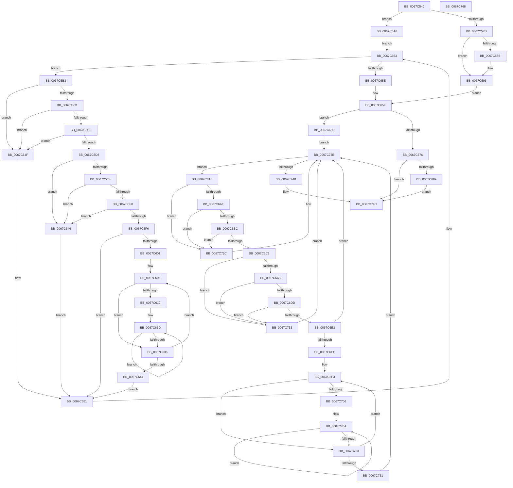

# MiMakeIoRangePermanentDpc

- RVA: `0x0067C540`–`0x0067C769` (길이 `553` bytes)
- VA: `0x000000014067C540`
- 실행 섹션: `.text`
- PDB 이름 있음: `예`; PDB Function 태그: `아니요`
- unwind 정보 RVA: `0x0008CE80`
- 디코드: `175`개 명령, `553/553` bytes 표시
- 미해석 바이트: `0` (있으면 어셈블리에 `.byte`로 보존)

> 이 문서는 커널 이미지의 기계어와 PDB 기호를 분석해 생성했습니다. 4번과 5번은 함수 원형과 자료형을 바이너리 사용 방식에서 추정한 C 해석이며 원본 소스 복구 결과는 아닙니다.

## 1. Dependencies

- 직접 호출 지점: **11**; 고유 호출 대상: **6**
- 직접 호출자로 확인된 함수: **0**
- RIP 상대 이미지 참조: **3**

### Outgoing calls
- `0x0067C591` → [KeWakeAddressAll](../21/KeWakeAddressAll_function_00217C20.md) (function, `0x00217C20`)
- `0x0067C599` → [MiMakeIoRangePermanent](MiMakeIoRangePermanent_function_0067C29C.md) (function, `0x0067C29C`)
- `0x0067C5CF` → [KiCheckVpBackingLongSpinWaitHypercall](../30/KiCheckVpBackingLongSpinWaitHypercall_function_0030F490.md) (function, `0x0030F490`)
- `0x0067C5DB` → [KeCanUseHaltOnAddress](../4F/KeCanUseHaltOnAddress_function_004FC22C.md) (function, `0x004FC22C`)
- `0x0067C62B` → [KiHaltOnAddress](../4F/KiHaltOnAddress_function_004FBA3C.md) (function, `0x004FBA3C`)
- `0x0067C648` → [HvlNotifyLongSpinWait](../30/HvlNotifyLongSpinWait_function_0030F460.md) (function, `0x0030F460`)
- `0x0067C68C` → [KeWakeAddressAll](../21/KeWakeAddressAll_function_00217C20.md) (function, `0x00217C20`)
- `0x0067C6BC` → [KiCheckVpBackingLongSpinWaitHypercall](../30/KiCheckVpBackingLongSpinWaitHypercall_function_0030F490.md) (function, `0x0030F490`)
- `0x0067C6C8` → [KeCanUseHaltOnAddress](../4F/KeCanUseHaltOnAddress_function_004FC22C.md) (function, `0x004FC22C`)
- `0x0067C718` → [KiHaltOnAddress](../4F/KiHaltOnAddress_function_004FBA3C.md) (function, `0x004FBA3C`)
- `0x0067C735` → [HvlNotifyLongSpinWait](../30/HvlNotifyLongSpinWait_function_0030F460.md) (function, `0x0030F460`)

### Direct callers
- 이 함수 시작 RVA로 연결되는 직접 call은 확인되지 않았습니다. 간접 호출은 완전히 역산할 수 없습니다.

### Static image references
- `0x0067C5B5` → RVA `0x00FC52AC` (`ALMOSTRO`; reference)
- `0x0067C5C1` → RVA `0x00FC6AB8` (`ALMOSTRO`; read)
- `0x0067C5E4` → RVA `0x00FC6B38` (`ALMOSTRO`; read)

## 2. Other-region calls and transfers

- 다른 실행 섹션으로 향하는 call: **0**
- 별도 외부 분기/꼬리 이동을 확인하지 못했습니다.

## 3. Assembly (complete function range)

```asm
0067C540  48 89 5C 24 08                  mov qword ptr [rsp + 8], rbx
0067C545  48 89 6C 24 18                  mov qword ptr [rsp + 0x18], rbp
0067C54A  56                              push rsi
0067C54B  57                              push rdi
0067C54C  41 54                           push r12
0067C54E  41 55                           push r13
0067C550  41 56                           push r14
0067C552  48 83 EC 20                     sub rsp, 0x20
0067C556  49 8B D9                        mov rbx, r9
0067C559  4D 8B E0                        mov r12, r8
0067C55C  48 8B F2                        mov rsi, rdx
0067C55F  83 C8 FF                        or eax, 0xffffffff
0067C562  F0 41 0F C1 01                  lock xadd dword ptr [r9], eax
0067C567  FF C8                           dec eax
0067C569  41 BD 00 00 00 80               mov r13d, 0x80000000
0067C56F  8B F8                           mov edi, eax
0067C571  F7 D7                           not edi
0067C573  41 23 FD                        and edi, r13d
0067C576  A9 FF FF FF 3F                  test eax, 0x3fffffff
0067C57B  75 29                           jne 0x14067c5a6
0067C57D  41 0B 79 04                     or edi, dword ptr [r9 + 4]
0067C581  41 87 39                        xchg dword ptr [r9], edi
0067C584  89 7C 24 58                     mov dword ptr [rsp + 0x58], edi
0067C588  0F BA E7 1E                     bt edi, 0x1e
0067C58C  73 08                           jae 0x14067c596
0067C58E  48 8B CB                        mov rcx, rbx
0067C591  E8 8A B6 B9 FF                  call 0x140217c20
0067C596  48 8B 0E                        mov rcx, qword ptr [rsi]
0067C599  E8 FE FC FF FF                  call 0x14067c29c
0067C59E  89 46 08                        mov dword ptr [rsi + 8], eax
0067C5A1  E9 B9 00 00 00                  jmp 0x14067c65f
0067C5A6  41 8B 01                        mov eax, dword ptr [r9]
0067C5A9  33 ED                           xor ebp, ebp
0067C5AB  45 33 F6                        xor r14d, r14d
0067C5AE  E9 A0 00 00 00                  jmp 0x14067c653
0067C5B3  FF C5                           inc ebp
0067C5B5  85 2D F1 8C 94 00               test dword ptr [rip + 0x948cf1], ebp
0067C5BB  0F 85 8E 00 00 00               jne 0x14067c64f
0067C5C1  8B 05 F1 A4 94 00               mov eax, dword ptr [rip + 0x94a4f1]
0067C5C7  A8 40                           test al, 0x40
0067C5C9  0F 84 80 00 00 00               je 0x14067c64f
0067C5CF  E8 BC 2E C9 FF                  call 0x14030f490
0067C5D4  84 C0                           test al, al
0067C5D6  74 77                           je 0x14067c64f
0067C5D8  41 FF C6                        inc r14d
0067C5DB  E8 4C FC E7 FF                  call 0x1404fc22c
0067C5E0  84 C0                           test al, al
0067C5E2  74 62                           je 0x14067c646
0067C5E4  F7 05 4A A5 94 00 00 00 02 00   test dword ptr [rip + 0x94a54a], 0x20000
0067C5EE  74 56                           je 0x14067c646
0067C5F0  41 F6 C6 07                     test r14b, 7
0067C5F4  75 50                           jne 0x14067c646
0067C5F6  8B 0B                           mov ecx, dword ptr [rbx]
0067C5F8  8B C1                           mov eax, ecx
0067C5FA  41 23 C5                        and eax, r13d
0067C5FD  3B C7                           cmp eax, edi
0067C5FF  74 50                           je 0x14067c651
0067C601  8B D1                           mov edx, ecx
0067C603  44 8B C1                        mov r8d, ecx
0067C606  0F BA E9 1E                     bts ecx, 0x1e
0067C60A  8B C2                           mov eax, edx
0067C60C  8B F1                           mov esi, ecx
0067C60E  F0 0F B1 33                     lock cmpxchg dword ptr [rbx], esi
0067C612  8B C8                           mov ecx, eax
0067C614  41 3B C0                        cmp eax, r8d
0067C617  75 1D                           jne 0x14067c636
0067C619  89 74 24 58                     mov dword ptr [rsp + 0x58], esi
0067C61D  41 B8 04 00 00 00               mov r8d, 4
0067C623  48 8D 54 24 58                  lea rdx, [rsp + 0x58]
0067C628  48 8B CB                        mov rcx, rbx
0067C62B  E8 0C F4 E7 FF                  call 0x1404fba3c
0067C630  8B 0B                           mov ecx, dword ptr [rbx]
0067C632  3B CE                           cmp ecx, esi
0067C634  74 E7                           je 0x14067c61d
0067C636  8B C1                           mov eax, ecx
0067C638  8B D1                           mov edx, ecx
0067C63A  41 23 C5                        and eax, r13d
0067C63D  44 8B C1                        mov r8d, ecx
0067C640  3B C7                           cmp eax, edi
0067C642  75 C2                           jne 0x14067c606
0067C644  EB 0B                           jmp 0x14067c651
0067C646  8B CD                           mov ecx, ebp
0067C648  E8 13 2E C9 FF                  call 0x14030f460
0067C64D  EB 02                           jmp 0x14067c651
0067C64F  F3 90                           pause
0067C651  8B 03                           mov eax, dword ptr [rbx]
0067C653  41 23 C5                        and eax, r13d
0067C656  3B C7                           cmp eax, edi
0067C658  0F 85 55 FF FF FF               jne 0x14067c5b3
0067C65E  90                              nop
0067C65F  83 C8 FF                        or eax, 0xffffffff
0067C662  F0 0F C1 03                     lock xadd dword ptr [rbx], eax
0067C666  FF C8                           dec eax
0067C668  8B F8                           mov edi, eax
0067C66A  F7 D7                           not edi
0067C66C  41 23 FD                        and edi, r13d
0067C66F  A9 FF FF FF 3F                  test eax, 0x3fffffff
0067C674  75 20                           jne 0x14067c696
0067C676  0B 7B 04                        or edi, dword ptr [rbx + 4]
0067C679  87 3B                           xchg dword ptr [rbx], edi
0067C67B  89 7C 24 68                     mov dword ptr [rsp + 0x68], edi
0067C67F  0F BA E7 1E                     bt edi, 0x1e
0067C683  0F 83 C3 00 00 00               jae 0x14067c74c
0067C689  48 8B CB                        mov rcx, rbx
0067C68C  E8 8F B5 B9 FF                  call 0x140217c20
0067C691  E9 B6 00 00 00                  jmp 0x14067c74c
0067C696  33 ED                           xor ebp, ebp
0067C698  45 33 F6                        xor r14d, r14d
0067C69B  E9 9E 00 00 00                  jmp 0x14067c73e
0067C6A0  FF C5                           inc ebp
0067C6A2  85 2D 04 8C 94 00               test dword ptr [rip + 0x948c04], ebp
0067C6A8  0F 85 8E 00 00 00               jne 0x14067c73c
0067C6AE  8B 05 04 A4 94 00               mov eax, dword ptr [rip + 0x94a404]
0067C6B4  A8 40                           test al, 0x40
0067C6B6  0F 84 80 00 00 00               je 0x14067c73c
0067C6BC  E8 CF 2D C9 FF                  call 0x14030f490
0067C6C1  84 C0                           test al, al
0067C6C3  74 77                           je 0x14067c73c
0067C6C5  41 FF C6                        inc r14d
0067C6C8  E8 5F FB E7 FF                  call 0x1404fc22c
0067C6CD  84 C0                           test al, al
0067C6CF  74 62                           je 0x14067c733
0067C6D1  F7 05 5D A4 94 00 00 00 02 00   test dword ptr [rip + 0x94a45d], 0x20000
0067C6DB  74 56                           je 0x14067c733
0067C6DD  41 F6 C6 07                     test r14b, 7
0067C6E1  75 50                           jne 0x14067c733
0067C6E3  8B 0B                           mov ecx, dword ptr [rbx]
0067C6E5  8B C1                           mov eax, ecx
0067C6E7  41 23 C5                        and eax, r13d
0067C6EA  3B C7                           cmp eax, edi
0067C6EC  74 50                           je 0x14067c73e
0067C6EE  8B D1                           mov edx, ecx
0067C6F0  44 8B C1                        mov r8d, ecx
0067C6F3  0F BA E9 1E                     bts ecx, 0x1e
0067C6F7  8B C2                           mov eax, edx
0067C6F9  8B F1                           mov esi, ecx
0067C6FB  F0 0F B1 33                     lock cmpxchg dword ptr [rbx], esi
0067C6FF  8B C8                           mov ecx, eax
0067C701  41 3B C0                        cmp eax, r8d
0067C704  75 1D                           jne 0x14067c723
0067C706  89 74 24 68                     mov dword ptr [rsp + 0x68], esi
0067C70A  41 B8 04 00 00 00               mov r8d, 4
0067C710  48 8D 54 24 68                  lea rdx, [rsp + 0x68]
0067C715  48 8B CB                        mov rcx, rbx
0067C718  E8 1F F3 E7 FF                  call 0x1404fba3c
0067C71D  8B 0B                           mov ecx, dword ptr [rbx]
0067C71F  3B CE                           cmp ecx, esi
0067C721  74 E7                           je 0x14067c70a
0067C723  8B C1                           mov eax, ecx
0067C725  8B D1                           mov edx, ecx
0067C727  41 23 C5                        and eax, r13d
0067C72A  44 8B C1                        mov r8d, ecx
0067C72D  3B C7                           cmp eax, edi
0067C72F  75 C2                           jne 0x14067c6f3
0067C731  EB 0B                           jmp 0x14067c73e
0067C733  8B CD                           mov ecx, ebp
0067C735  E8 26 2D C9 FF                  call 0x14030f460
0067C73A  EB 02                           jmp 0x14067c73e
0067C73C  F3 90                           pause
0067C73E  8B 03                           mov eax, dword ptr [rbx]
0067C740  41 23 C5                        and eax, r13d
0067C743  3B C7                           cmp eax, edi
0067C745  0F 85 55 FF FF FF               jne 0x14067c6a0
0067C74B  90                              nop
0067C74C  F0 41 FF 0C 24                  lock dec dword ptr [r12]
0067C751  48 8B 5C 24 50                  mov rbx, qword ptr [rsp + 0x50]
0067C756  48 8B 6C 24 60                  mov rbp, qword ptr [rsp + 0x60]
0067C75B  48 83 C4 20                     add rsp, 0x20
0067C75F  41 5E                           pop r14
0067C761  41 5D                           pop r13
0067C763  41 5C                           pop r12
0067C765  5F                              pop rdi
0067C766  5E                              pop rsi
0067C767  C3                              ret
0067C768  CC                              int3
```

## 4. C-style interpretation (structured pseudocode)

```c
__int64 __fastcall MiMakeIoRangePermanentDpc(__int64 a1, __int64 a2, __int64 a3, __int64 a4)
{
    __int64 result;
    __int64 v_r14;
    __int64 v_rbp;
    __int64 v_rdi;
    __int64 v_rsp;
    unsigned int v_stack_p10;
    unsigned __int64 v_stack_p18;
    unsigned int v_stack_p20;
    unsigned __int64 v_stack_p8;

    v_stack_p8 = v_rbx;
    v_stack_p18 = v_rbp;
    v_rsp = (v_rsp) - (32);
    result = (unsigned int)((result) | (0xFFFFFFFFULL));
    result = (unsigned int)((result) - 1);
    v_rdi = (unsigned int)(~((unsigned int)((unsigned int)(result))));
    v_rdi = (unsigned int)((v_rdi) & ((unsigned int)((unsigned int)(0x80000000ULL))));
    if ((((unsigned int)(result)) & (0x3FFFFFFFULL)) != 0) goto loc_0067C5A6;
    v_rdi = (unsigned int)((v_rdi) | (*(unsigned int *)(a4 + 4)));
    v_stack_p10 = (unsigned int)(v_rdi);
    if (!(condition_is_above_or_equal)) {
        a1 = a4;
        result = KeWakeAddressAll(a1, a2, a3, a4);
    }
    result = MiMakeIoRangePermanent(*(unsigned __int64 *)(a2), a2, a3, a4);
    *(unsigned int *)(a2 + 8) = (unsigned int)(result);
    goto loc_0067C65F;
loc_0067C5A6:
    v_rbp = 0;
    v_r14 = 0;
    goto loc_0067C653;
loc_0067C5B3:
    v_rbp = (unsigned int)((v_rbp) + 1);
    if (((*(unsigned int *)(v_rip + 9735409)) & ((unsigned int)(v_rbp))) != 0) goto loc_0067C64F;
    if ((((unsigned __int8)((unsigned int)(*(unsigned int *)(v_rip + 9741553)))) & (64)) == 0) goto loc_0067C64F;
    result = KiCheckVpBackingLongSpinWaitHypercall(*(unsigned __int64 *)(a2), a2, a3, a4);
    if ((unsigned __int8)(result) == 0) goto loc_0067C64F;
    v_r14 = (unsigned int)((v_r14) + 1);
    result = KeCanUseHaltOnAddress(*(unsigned __int64 *)(a2), a2, a3, a4);
    if ((unsigned __int8)(result) == 0) goto loc_0067C646;
    if (((*(unsigned int *)(v_rip + 9741642)) & (0x20000ULL)) == 0) goto loc_0067C646;
    if ((((unsigned __int8)(v_r14)) & (7)) != 0) goto loc_0067C646;
    result = (unsigned int)(((unsigned int)((unsigned int)((unsigned int)(*(unsigned int *)(a4))))) & ((unsigned int)((unsigned int)(0x80000000ULL))));
    if (((unsigned int)(result)) == ((unsigned int)(v_rdi))) goto loc_0067C651;
loc_0067C606:
    if (((unsigned int)((unsigned int)((unsigned int)((unsigned int)((unsigned int)((unsigned int)(*(unsigned int *)(a4)))))))) != ((unsigned int)((unsigned int)((unsigned int)((unsigned int)(*(unsigned int *)(a4))))))) goto loc_0067C636;
    v_stack_p10 = (unsigned int)((unsigned int)((unsigned int)((unsigned int)(*(unsigned int *)(a4)))));
loc_0067C61D:
    result = KiHaltOnAddress(a4, v_stack_p10, 4, a4);
    if (((unsigned int)((unsigned int)(*(unsigned int *)(a4)))) == ((unsigned int)((unsigned int)((unsigned int)((unsigned int)(*(unsigned int *)(a4))))))) goto loc_0067C61D;
loc_0067C636:
    result = (unsigned int)(((unsigned int)((unsigned int)((unsigned int)(*(unsigned int *)(a4))))) & ((unsigned int)((unsigned int)(0x80000000ULL))));
    if (((unsigned int)(result)) != ((unsigned int)(v_rdi))) goto loc_0067C606;
    goto loc_0067C651;
loc_0067C646:
    result = HvlNotifyLongSpinWait((unsigned int)((unsigned int)(v_rbp)), (unsigned int)((unsigned int)((unsigned int)(*(unsigned int *)(a4)))), (unsigned int)((unsigned int)((unsigned int)(*(unsigned int *)(a4)))), a4);
    goto loc_0067C651;
loc_0067C64F:
loc_0067C651:
loc_0067C653:
    result = (unsigned int)(((unsigned int)(*(unsigned int *)(a4))) & ((unsigned int)((unsigned int)(0x80000000ULL))));
    if (((unsigned int)(result)) != ((unsigned int)(v_rdi))) goto loc_0067C5B3;
loc_0067C65F:
    result = (unsigned int)((result) | (0xFFFFFFFFULL));
    result = (unsigned int)((result) - 1);
    v_rdi = (unsigned int)(~((unsigned int)((unsigned int)(result))));
    v_rdi = (unsigned int)((v_rdi) & ((unsigned int)((unsigned int)(0x80000000ULL))));
    if ((((unsigned int)(result)) & (0x3FFFFFFFULL)) != 0) goto loc_0067C696;
    v_rdi = (unsigned int)((v_rdi) | (*(unsigned int *)(a4 + 4)));
    v_stack_p20 = (unsigned int)(v_rdi);
    if (condition_is_above_or_equal) goto loc_0067C74C;
    result = KeWakeAddressAll(a4, (unsigned int)((unsigned int)((unsigned int)(*(unsigned int *)(a4)))), (unsigned int)((unsigned int)((unsigned int)(*(unsigned int *)(a4)))), a4);
    goto loc_0067C74C;
loc_0067C696:
    v_rbp = 0;
    v_r14 = 0;
    goto loc_0067C73E;
loc_0067C6A0:
    v_rbp = (unsigned int)((v_rbp) + 1);
    if (((*(unsigned int *)(v_rip + 9735172)) & ((unsigned int)(v_rbp))) != 0) goto loc_0067C73C;
    if ((((unsigned __int8)((unsigned int)(*(unsigned int *)(v_rip + 9741316)))) & (64)) == 0) goto loc_0067C73C;
    result = KiCheckVpBackingLongSpinWaitHypercall(a4, (unsigned int)((unsigned int)((unsigned int)(*(unsigned int *)(a4)))), (unsigned int)((unsigned int)((unsigned int)(*(unsigned int *)(a4)))), a4);
    if ((unsigned __int8)(result) == 0) goto loc_0067C73C;
    v_r14 = (unsigned int)((v_r14) + 1);
    result = KeCanUseHaltOnAddress(a4, (unsigned int)((unsigned int)((unsigned int)(*(unsigned int *)(a4)))), (unsigned int)((unsigned int)((unsigned int)(*(unsigned int *)(a4)))), a4);
    if ((unsigned __int8)(result) == 0) goto loc_0067C733;
    if (((*(unsigned int *)(v_rip + 9741405)) & (0x20000ULL)) == 0) goto loc_0067C733;
    if ((((unsigned __int8)(v_r14)) & (7)) != 0) goto loc_0067C733;
    result = (unsigned int)(((unsigned int)((unsigned int)((unsigned int)(*(unsigned int *)(a4))))) & ((unsigned int)((unsigned int)(0x80000000ULL))));
    if (((unsigned int)(result)) == ((unsigned int)(v_rdi))) goto loc_0067C73E;
loc_0067C6F3:
    if (((unsigned int)((unsigned int)((unsigned int)((unsigned int)((unsigned int)((unsigned int)(*(unsigned int *)(a4)))))))) != ((unsigned int)((unsigned int)((unsigned int)((unsigned int)(*(unsigned int *)(a4))))))) goto loc_0067C723;
    v_stack_p20 = (unsigned int)((unsigned int)((unsigned int)((unsigned int)(*(unsigned int *)(a4)))));
loc_0067C70A:
    result = KiHaltOnAddress(a4, v_stack_p20, 4, a4);
    if (((unsigned int)((unsigned int)(*(unsigned int *)(a4)))) == ((unsigned int)((unsigned int)((unsigned int)((unsigned int)(*(unsigned int *)(a4))))))) goto loc_0067C70A;
loc_0067C723:
    result = (unsigned int)(((unsigned int)((unsigned int)((unsigned int)(*(unsigned int *)(a4))))) & ((unsigned int)((unsigned int)(0x80000000ULL))));
    if (((unsigned int)(result)) != ((unsigned int)(v_rdi))) goto loc_0067C6F3;
    goto loc_0067C73E;
loc_0067C733:
    result = HvlNotifyLongSpinWait((unsigned int)((unsigned int)(v_rbp)), (unsigned int)((unsigned int)((unsigned int)(*(unsigned int *)(a4)))), (unsigned int)((unsigned int)((unsigned int)(*(unsigned int *)(a4)))), a4);
    goto loc_0067C73E;
loc_0067C73C:
loc_0067C73E:
    result = (unsigned int)(((unsigned int)(*(unsigned int *)(a4))) & ((unsigned int)((unsigned int)(0x80000000ULL))));
    if (((unsigned int)(result)) != ((unsigned int)(v_rdi))) goto loc_0067C6A0;
loc_0067C74C:
    v_rsp = (v_rsp) + (32);
    return result;
}
```

## 5. (Beta) C Style

```c
int64_t MiMakeIoRangePermanentDpc(int64_t Arg1, void *Arg2, void *Arg3, void *Arg4)
{
    uint8_t *arg2 = (uint8_t *)Arg2;
    uint8_t *arg3 = (uint8_t *)Arg3;
    uint8_t *arg4 = (uint8_t *)Arg4;

    int64_t result;
    int64_t local_r14;
    int64_t local_rbp;
    int64_t local_rdi;
    int64_t local_rsp;
    uint32_t v_stack_p10;
    uint64_t v_stack_p18;
    uint32_t v_stack_p20;
    uint64_t v_stack_p8;

    v_stack_p8 = local_rbx;
    v_stack_p18 = local_rbp;
    local_rsp = (local_rsp) - (32);
    result = (uint32_t)((result) | (0xFFFFFFFFULL));
    result = (uint32_t)((result) - 1);
    local_rdi = (uint32_t)(~((uint32_t)((uint32_t)(result))));
    local_rdi = (uint32_t)((local_rdi) & ((uint32_t)((uint32_t)(0x80000000ULL))));
    if ((((uint32_t)(result)) & (0x3FFFFFFFULL)) != 0) goto loc_0067C5A6;
    local_rdi = (uint32_t)((local_rdi) | (*(uint32_t *)(arg4 + 0x4)));
    v_stack_p10 = (uint32_t)(local_rdi);
    if (!(condition_is_above_or_equal)) {
        Arg1 = Arg4;
        result = KeWakeAddressAll(Arg1, Arg2, Arg3, Arg4);
    }
    result = MiMakeIoRangePermanent(*(uint64_t *)(arg2), Arg2, Arg3, Arg4);
    *(uint32_t *)(arg2 + 0x8) = (uint32_t)(result);
    goto loc_0067C65F;
loc_0067C5A6:
    local_rbp = 0;
    local_r14 = 0;
    goto loc_0067C653;
loc_0067C5B3:
    local_rbp = (uint32_t)((local_rbp) + 1);
    if (((*(uint32_t *)(v_rip + 0x948CF1)) & ((uint32_t)(local_rbp))) != 0) goto loc_0067C64F;
    if ((((uint8_t)((uint32_t)(*(uint32_t *)(v_rip + 0x94A4F1)))) & (64)) == 0) goto loc_0067C64F;
    result = KiCheckVpBackingLongSpinWaitHypercall(*(uint64_t *)(arg2), Arg2, Arg3, Arg4);
    if ((uint8_t)(result) == 0) goto loc_0067C64F;
    local_r14 = (uint32_t)((local_r14) + 1);
    result = KeCanUseHaltOnAddress(*(uint64_t *)(arg2), Arg2, Arg3, Arg4);
    if ((uint8_t)(result) == 0) goto loc_0067C646;
    if (((*(uint32_t *)(v_rip + 0x94A54A)) & (0x20000ULL)) == 0) goto loc_0067C646;
    if ((((uint8_t)(local_r14)) & (7)) != 0) goto loc_0067C646;
    result = (uint32_t)(((uint32_t)((uint32_t)((uint32_t)(*(uint32_t *)(arg4))))) & ((uint32_t)((uint32_t)(0x80000000ULL))));
    if (((uint32_t)(result)) == ((uint32_t)(local_rdi))) goto loc_0067C651;
loc_0067C606:
    if (((uint32_t)((uint32_t)((uint32_t)((uint32_t)((uint32_t)((uint32_t)(*(uint32_t *)(arg4)))))))) != ((uint32_t)((uint32_t)((uint32_t)((uint32_t)(*(uint32_t *)(arg4))))))) goto loc_0067C636;
    v_stack_p10 = (uint32_t)((uint32_t)((uint32_t)((uint32_t)(*(uint32_t *)(arg4)))));
loc_0067C61D:
    result = KiHaltOnAddress(Arg4, v_stack_p10, 4, Arg4);
    if (((uint32_t)((uint32_t)(*(uint32_t *)(arg4)))) == ((uint32_t)((uint32_t)((uint32_t)((uint32_t)(*(uint32_t *)(arg4))))))) goto loc_0067C61D;
loc_0067C636:
    result = (uint32_t)(((uint32_t)((uint32_t)((uint32_t)(*(uint32_t *)(arg4))))) & ((uint32_t)((uint32_t)(0x80000000ULL))));
    if (((uint32_t)(result)) != ((uint32_t)(local_rdi))) goto loc_0067C606;
    goto loc_0067C651;
loc_0067C646:
    result = HvlNotifyLongSpinWait((uint32_t)((uint32_t)(local_rbp)), (uint32_t)((uint32_t)((uint32_t)(*(uint32_t *)(arg4)))), (uint32_t)((uint32_t)((uint32_t)(*(uint32_t *)(arg4)))), Arg4);
    goto loc_0067C651;
loc_0067C64F:
loc_0067C651:
loc_0067C653:
    result = (uint32_t)(((uint32_t)(*(uint32_t *)(arg4))) & ((uint32_t)((uint32_t)(0x80000000ULL))));
    if (((uint32_t)(result)) != ((uint32_t)(local_rdi))) goto loc_0067C5B3;
loc_0067C65F:
    result = (uint32_t)((result) | (0xFFFFFFFFULL));
    result = (uint32_t)((result) - 1);
    local_rdi = (uint32_t)(~((uint32_t)((uint32_t)(result))));
    local_rdi = (uint32_t)((local_rdi) & ((uint32_t)((uint32_t)(0x80000000ULL))));
    if ((((uint32_t)(result)) & (0x3FFFFFFFULL)) != 0) goto loc_0067C696;
    local_rdi = (uint32_t)((local_rdi) | (*(uint32_t *)(arg4 + 0x4)));
    v_stack_p20 = (uint32_t)(local_rdi);
    if (condition_is_above_or_equal) goto loc_0067C74C;
    result = KeWakeAddressAll(Arg4, (uint32_t)((uint32_t)((uint32_t)(*(uint32_t *)(arg4)))), (uint32_t)((uint32_t)((uint32_t)(*(uint32_t *)(arg4)))), Arg4);
    goto loc_0067C74C;
loc_0067C696:
    local_rbp = 0;
    local_r14 = 0;
    goto loc_0067C73E;
loc_0067C6A0:
    local_rbp = (uint32_t)((local_rbp) + 1);
    if (((*(uint32_t *)(v_rip + 0x948C04)) & ((uint32_t)(local_rbp))) != 0) goto loc_0067C73C;
    if ((((uint8_t)((uint32_t)(*(uint32_t *)(v_rip + 0x94A404)))) & (64)) == 0) goto loc_0067C73C;
    result = KiCheckVpBackingLongSpinWaitHypercall(Arg4, (uint32_t)((uint32_t)((uint32_t)(*(uint32_t *)(arg4)))), (uint32_t)((uint32_t)((uint32_t)(*(uint32_t *)(arg4)))), Arg4);
    if ((uint8_t)(result) == 0) goto loc_0067C73C;
    local_r14 = (uint32_t)((local_r14) + 1);
    result = KeCanUseHaltOnAddress(Arg4, (uint32_t)((uint32_t)((uint32_t)(*(uint32_t *)(arg4)))), (uint32_t)((uint32_t)((uint32_t)(*(uint32_t *)(arg4)))), Arg4);
    if ((uint8_t)(result) == 0) goto loc_0067C733;
    if (((*(uint32_t *)(v_rip + 0x94A45D)) & (0x20000ULL)) == 0) goto loc_0067C733;
    if ((((uint8_t)(local_r14)) & (7)) != 0) goto loc_0067C733;
    result = (uint32_t)(((uint32_t)((uint32_t)((uint32_t)(*(uint32_t *)(arg4))))) & ((uint32_t)((uint32_t)(0x80000000ULL))));
    if (((uint32_t)(result)) == ((uint32_t)(local_rdi))) goto loc_0067C73E;
loc_0067C6F3:
    if (((uint32_t)((uint32_t)((uint32_t)((uint32_t)((uint32_t)((uint32_t)(*(uint32_t *)(arg4)))))))) != ((uint32_t)((uint32_t)((uint32_t)((uint32_t)(*(uint32_t *)(arg4))))))) goto loc_0067C723;
    v_stack_p20 = (uint32_t)((uint32_t)((uint32_t)((uint32_t)(*(uint32_t *)(arg4)))));
loc_0067C70A:
    result = KiHaltOnAddress(Arg4, v_stack_p20, 4, Arg4);
    if (((uint32_t)((uint32_t)(*(uint32_t *)(arg4)))) == ((uint32_t)((uint32_t)((uint32_t)((uint32_t)(*(uint32_t *)(arg4))))))) goto loc_0067C70A;
loc_0067C723:
    result = (uint32_t)(((uint32_t)((uint32_t)((uint32_t)(*(uint32_t *)(arg4))))) & ((uint32_t)((uint32_t)(0x80000000ULL))));
    if (((uint32_t)(result)) != ((uint32_t)(local_rdi))) goto loc_0067C6F3;
    goto loc_0067C73E;
loc_0067C733:
    result = HvlNotifyLongSpinWait((uint32_t)((uint32_t)(local_rbp)), (uint32_t)((uint32_t)((uint32_t)(*(uint32_t *)(arg4)))), (uint32_t)((uint32_t)((uint32_t)(*(uint32_t *)(arg4)))), Arg4);
    goto loc_0067C73E;
loc_0067C73C:
loc_0067C73E:
    result = (uint32_t)(((uint32_t)(*(uint32_t *)(arg4))) & ((uint32_t)((uint32_t)(0x80000000ULL))));
    if (((uint32_t)(result)) != ((uint32_t)(local_rdi))) goto loc_0067C6A0;
loc_0067C74C:
    local_rsp = (local_rsp) + (32);
    return result;
}
```

### 관측된 메모리 오프셋

구조체 형식이 확인되지 않은 접근은 인자 기준의 오프셋으로만 기록했습니다.

| 기준 인자 | 오프셋 표현 | 폭 (bit) | 접근 |
|---|---:|---:|---|
| `Arg2` | `+ 0x0` | `64` | `R` |
| `Arg2` | `+ 0x8` | `32` | `W` |
| `Arg3` | `+ 0x0` | `32` | `R/W` |
| `Arg4` | `+ 0x0` | `32` | `R` |
| `Arg4` | `+ 0x0` | `32` | `R/W` |
| `Arg4` | `+ 0x4` | `32` | `R` |

## 6. Execution-region graph

[열기: 2D/3D 그래프와 함수 탐색 컨트롤 패널](../../../control-panel.html?section=text&rva=0x0067C540&view=graph)

- 2D 그래프는 위에서 아래로 흐르고, 3D 그래프는 빈 공간을 드래그해 회전합니다. Shift+드래그는 이동, 휠은 확대·축소, 함수 노드 선택은 대상 보고서 이동입니다.

### Static fallback


