# MiMakeIoRangePermanent

- RVA: `0x0067C29C`–`0x0067C535` (길이 `665` bytes)
- VA: `0x000000014067C29C`
- 실행 섹션: `.text`
- PDB 이름 있음: `예`; PDB Function 태그: `아니요`
- unwind 정보 RVA: `0x000D7E6C`
- 디코드: `196`개 명령, `665/665` bytes 표시
- 미해석 바이트: `0` (있으면 어셈블리에 `.byte`로 보존)

> 이 문서는 커널 이미지의 기계어와 PDB 기호를 분석해 생성했습니다. 4번과 5번은 함수 원형과 자료형을 바이너리 사용 방식에서 추정한 C 해석이며 원본 소스 복구 결과는 아닙니다.

## 1. Dependencies

- 직접 호출 지점: **4**; 고유 호출 대상: **4**
- 직접 호출자로 확인된 함수: **1**
- RIP 상대 이미지 참조: **6**

### Outgoing calls
- `0x0067C2D0` → [MiLockIoPfnTree](../2A/MiLockIoPfnTree_function_002AC8A4.md) (function, `0x002AC8A4`)
- `0x0067C3FC` → [MiFlushEntireTbDueToAttributeChange](../30/MiFlushEntireTbDueToAttributeChange_function_00308AE0.md) (function, `0x00308AE0`)
- `0x0067C4D0` → [RtlAvlInsertNodeEx](../26/RtlAvlInsertNodeEx_function_00265790.md) (function, `0x00265790`)
- `0x0067C4DC` → [MiUnlockIoPfnTree](../2A/MiUnlockIoPfnTree_function_002AC7F8.md) (function, `0x002AC7F8`)

### Direct callers
- [MiMakeIoRangePermanentDpc](MiMakeIoRangePermanentDpc_function_0067C540.md) at `0x0067C599`

### Static image references
- `0x0067C2D5` → RVA `0x00E37308` (`.data`; read)
- `0x0067C313` → RVA `0x00E372C0` (`.data`; read)
- `0x0067C3B7` → RVA `0x00E2DC38` (`.data`; read)
- `0x0067C4A5` → RVA `0x00E37300` (`.data`; read)
- `0x0067C501` → RVA `0x00E37340` (`.data`; read/write)
- `0x0067C527` → RVA `0x00E37344` (`.data`; read/write)

## 2. Other-region calls and transfers

- 다른 실행 섹션으로 향하는 call: **0**
- 별도 외부 분기/꼬리 이동을 확인하지 못했습니다.

## 3. Assembly (complete function range)

```asm
0067C29C  48 89 5C 24 10                  mov qword ptr [rsp + 0x10], rbx
0067C2A1  48 89 6C 24 18                  mov qword ptr [rsp + 0x18], rbp
0067C2A6  48 89 74 24 20                  mov qword ptr [rsp + 0x20], rsi
0067C2AB  57                              push rdi
0067C2AC  41 54                           push r12
0067C2AE  41 55                           push r13
0067C2B0  41 56                           push r14
0067C2B2  41 57                           push r15
0067C2B4  48 83 EC 20                     sub rsp, 0x20
0067C2B8  8B 41 28                        mov eax, dword ptr [rcx + 0x28]
0067C2BB  33 DB                           xor ebx, ebx
0067C2BD  4C 8B 61 18                     mov r12, qword ptr [rcx + 0x18]
0067C2C1  48 8B E9                        mov rbp, rcx
0067C2C4  89 44 24 50                     mov dword ptr [rsp + 0x50], eax
0067C2C8  8B F3                           mov esi, ebx
0067C2CA  44 8A EB                        mov r13b, bl
0067C2CD  8D 4B 06                        lea ecx, [rbx + 6]
0067C2D0  E8 CF 05 C3 FF                  call 0x1402ac8a4
0067C2D5  48 8B 15 2C B0 7B 00            mov rdx, qword ptr [rip + 0x7bb02c]
0067C2DC  48 85 D2                        test rdx, rdx
0067C2DF  74 32                           je 0x14067c313
0067C2E1  48 8B 4D 20                     mov rcx, qword ptr [rbp + 0x20]
0067C2E5  48 8B 42 18                     mov rax, qword ptr [rdx + 0x18]
0067C2E9  48 3B C8                        cmp rcx, rax
0067C2EC  73 05                           jae 0x14067c2f3
0067C2EE  48 8B 12                        mov rdx, qword ptr [rdx]
0067C2F1  EB 10                           jmp 0x14067c303
0067C2F3  48 05 00 02 00 00               add rax, 0x200
0067C2F9  48 39 45 18                     cmp qword ptr [rbp + 0x18], rax
0067C2FD  72 0B                           jb 0x14067c30a
0067C2FF  48 8B 52 08                     mov rdx, qword ptr [rdx + 8]
0067C303  48 85 D2                        test rdx, rdx
0067C306  75 DD                           jne 0x14067c2e5
0067C308  EB 09                           jmp 0x14067c313
0067C30A  48 85 D2                        test rdx, rdx
0067C30D  0F 85 1B 02 00 00               jne 0x14067c52e
0067C313  48 8B 0D A6 AF 7B 00            mov rcx, qword ptr [rip + 0x7bafa6]
0067C31A  41 B9 01 00 00 00               mov r9d, 1
0067C320  48 85 C9                        test rcx, rcx
0067C323  0F 84 7C 01 00 00               je 0x14067c4a5
0067C329  48 8B 55 20                     mov rdx, qword ptr [rbp + 0x20]
0067C32D  48 8B FB                        mov rdi, rbx
0067C330  48 8B 41 18                     mov rax, qword ptr [rcx + 0x18]
0067C334  48 3B D0                        cmp rdx, rax
0067C337  72 15                           jb 0x14067c34e
0067C339  48 05 00 02 00 00               add rax, 0x200
0067C33F  48 39 45 18                     cmp qword ptr [rbp + 0x18], rax
0067C343  72 06                           jb 0x14067c34b
0067C345  48 8B 49 08                     mov rcx, qword ptr [rcx + 8]
0067C349  EB 06                           jmp 0x14067c351
0067C34B  48 8B F9                        mov rdi, rcx
0067C34E  48 8B 09                        mov rcx, qword ptr [rcx]
0067C351  48 85 C9                        test rcx, rcx
0067C354  75 DA                           jne 0x14067c330
0067C356  48 85 FF                        test rdi, rdi
0067C359  0F 84 46 01 00 00               je 0x14067c4a5
0067C35F  44 8B 44 24 50                  mov r8d, dword ptr [rsp + 0x50]
0067C364  4C 8B 75 20                     mov r14, qword ptr [rbp + 0x20]
0067C368  8B F3                           mov esi, ebx
0067C36A  48 8B 57 18                     mov rdx, qword ptr [rdi + 0x18]
0067C36E  4C 3B F2                        cmp r14, rdx
0067C371  0F 82 2E 01 00 00               jb 0x14067c4a5
0067C377  49 8B F4                        mov rsi, r12
0067C37A  48 8D 8A 00 02 00 00            lea rcx, [rdx + 0x200]
0067C381  48 2B F2                        sub rsi, rdx
0067C384  49 8D 46 01                     lea rax, [r14 + 1]
0067C388  4C 3B E2                        cmp r12, rdx
0067C38B  48 0F 42 F3                     cmovb rsi, rbx
0067C38F  48 3B C1                        cmp rax, rcx
0067C392  77 08                           ja 0x14067c39c
0067C394  4C 2B F2                        sub r14, rdx
0067C397  4D 03 F1                        add r14, r9
0067C39A  EB 06                           jmp 0x14067c3a2
0067C39C  41 BE 00 02 00 00               mov r14d, 0x200
0067C3A2  4C 8D 7E 58                     lea r15, [rsi + 0x58]
0067C3A6  4E 8D 3C 7F                     lea r15, [rdi + r15*2]
0067C3AA  4C 8D 24 32                     lea r12, [rdx + rsi]
0067C3AE  49 3B F6                        cmp rsi, r14
0067C3B1  0F 83 A8 00 00 00               jae 0x14067c45f
0067C3B7  8A 0D 7B 18 7B 00               mov cl, byte ptr [rip + 0x7b187b]
0067C3BD  49 8B C1                        mov rax, r9
0067C3C0  80 C1 F4                        add cl, 0xf4
0067C3C3  48 D3 E0                        shl rax, cl
0067C3C6  41 2B C1                        sub eax, r9d
0067C3C9  41 23 C4                        and eax, r12d
0067C3CC  2B 47 18                        sub eax, dword ptr [rdi + 0x18]
0067C3CF  03 C0                           add eax, eax
0067C3D1  8B C8                           mov ecx, eax
0067C3D3  48 C1 E8 05                     shr rax, 5
0067C3D7  83 E1 1F                        and ecx, 0x1f
0067C3DA  8B 54 87 2C                     mov edx, dword ptr [rdi + rax*4 + 0x2c]
0067C3DE  D3 EA                           shr edx, cl
0067C3E0  83 E2 03                        and edx, 3
0067C3E3  41 3B D0                        cmp edx, r8d
0067C3E6  74 68                           je 0x14067c450
0067C3E8  66 41 39 1F                     cmp word ptr [r15], bx
0067C3EC  0F 85 0F 01 00 00               jne 0x14067c501
0067C3F2  83 FA 03                        cmp edx, 3
0067C3F5  74 13                           je 0x14067c40a
0067C3F7  45 84 ED                        test r13b, r13b
0067C3FA  75 0E                           jne 0x14067c40a
0067C3FC  E8 DF C6 C8 FF                  call 0x140308ae0
0067C401  41 B9 01 00 00 00               mov r9d, 1
0067C407  45 8A E9                        mov r13b, r9b
0067C40A  8A 0D 28 18 7B 00               mov cl, byte ptr [rip + 0x7b1828]
0067C410  49 8B C1                        mov rax, r9
0067C413  80 C1 F4                        add cl, 0xf4
0067C416  BA 03 00 00 00                  mov edx, 3
0067C41B  48 D3 E0                        shl rax, cl
0067C41E  41 2B C1                        sub eax, r9d
0067C421  41 23 C4                        and eax, r12d
0067C424  2B 47 18                        sub eax, dword ptr [rdi + 0x18]
0067C427  03 C0                           add eax, eax
0067C429  8B C8                           mov ecx, eax
0067C42B  44 8B C0                        mov r8d, eax
0067C42E  8B 44 24 50                     mov eax, dword ptr [rsp + 0x50]
0067C432  83 E1 1F                        and ecx, 0x1f
0067C435  49 C1 E8 05                     shr r8, 5
0067C439  D3 E2                           shl edx, cl
0067C43B  F7 D2                           not edx
0067C43D  D3 E0                           shl eax, cl
0067C43F  42 23 54 87 2C                  and edx, dword ptr [rdi + r8*4 + 0x2c]
0067C444  0B D0                           or edx, eax
0067C446  42 89 54 87 2C                  mov dword ptr [rdi + r8*4 + 0x2c], edx
0067C44B  44 8B 44 24 50                  mov r8d, dword ptr [rsp + 0x50]
0067C450  49 03 F1                        add rsi, r9
0067C453  49 83 C7 02                     add r15, 2
0067C457  4D 03 E1                        add r12, r9
0067C45A  E9 4F FF FF FF                  jmp 0x14067c3ae
0067C45F  48 8B 47 08                     mov rax, qword ptr [rdi + 8]
0067C463  48 8B CF                        mov rcx, rdi
0067C466  8B F3                           mov esi, ebx
0067C468  48 85 C0                        test rax, rax
0067C46B  74 25                           je 0x14067c492
0067C46D  48 8B 08                        mov rcx, qword ptr [rax]
0067C470  48 8B F8                        mov rdi, rax
0067C473  48 85 C9                        test rcx, rcx
0067C476  74 24                           je 0x14067c49c
0067C478  48 8B 01                        mov rax, qword ptr [rcx]
0067C47B  48 8B F9                        mov rdi, rcx
0067C47E  48 8B C8                        mov rcx, rax
0067C481  48 85 C0                        test rax, rax
0067C484  75 F2                           jne 0x14067c478
0067C486  EB 14                           jmp 0x14067c49c
0067C488  8B F3                           mov esi, ebx
0067C48A  48 39 0F                        cmp qword ptr [rdi], rcx
0067C48D  74 0D                           je 0x14067c49c
0067C48F  48 8B CF                        mov rcx, rdi
0067C492  48 8B 7F 10                     mov rdi, qword ptr [rdi + 0x10]
0067C496  48 83 E7 FC                     and rdi, 0xfffffffffffffffc
0067C49A  75 EC                           jne 0x14067c488
0067C49C  48 85 FF                        test rdi, rdi
0067C49F  0F 85 BF FE FF FF               jne 0x14067c364
0067C4A5  48 8B 15 54 AE 7B 00            mov rdx, qword ptr [rip + 0x7bae54]
0067C4AC  48 85 D2                        test rdx, rdx
0067C4AF  74 12                           je 0x14067c4c3
0067C4B1  48 8B 4D 20                     mov rcx, qword ptr [rbp + 0x20]
0067C4B5  48 3B 4A 18                     cmp rcx, qword ptr [rdx + 0x18]
0067C4B9  73 4F                           jae 0x14067c50a
0067C4BB  48 8B 02                        mov rax, qword ptr [rdx]
0067C4BE  48 85 C0                        test rax, rax
0067C4C1  75 5A                           jne 0x14067c51d
0067C4C3  4C 8B CD                        mov r9, rbp
0067C4C6  48 8D 0D 33 AE 7B 00            lea rcx, [rip + 0x7bae33]
0067C4CD  44 8A C3                        mov r8b, bl
0067C4D0  E8 BB 92 BE FF                  call 0x140265790
0067C4D5  BA 06 00 00 00                  mov edx, 6
0067C4DA  B1 11                           mov cl, 0x11
0067C4DC  E8 17 03 C3 FF                  call 0x1402ac7f8
0067C4E1  48 8B 5C 24 58                  mov rbx, qword ptr [rsp + 0x58]
0067C4E6  8B C6                           mov eax, esi
0067C4E8  48 8B 74 24 68                  mov rsi, qword ptr [rsp + 0x68]
0067C4ED  48 8B 6C 24 60                  mov rbp, qword ptr [rsp + 0x60]
0067C4F2  48 83 C4 20                     add rsp, 0x20
0067C4F6  41 5F                           pop r15
0067C4F8  41 5E                           pop r14
0067C4FA  41 5D                           pop r13
0067C4FC  41 5C                           pop r12
0067C4FE  5F                              pop rdi
0067C4FF  C3                              ret
0067C500  CC                              int3
0067C501  44 01 0D 38 AE 7B 00            add dword ptr [rip + 0x7bae38], r9d
0067C508  EB 24                           jmp 0x14067c52e
0067C50A  48 8B 42 20                     mov rax, qword ptr [rdx + 0x20]
0067C50E  48 39 45 18                     cmp qword ptr [rbp + 0x18], rax
0067C512  76 13                           jbe 0x14067c527
0067C514  48 8B 42 08                     mov rax, qword ptr [rdx + 8]
0067C518  48 85 C0                        test rax, rax
0067C51B  74 05                           je 0x14067c522
0067C51D  48 8B D0                        mov rdx, rax
0067C520  EB 93                           jmp 0x14067c4b5
0067C522  41 8A D9                        mov bl, r9b
0067C525  EB 9C                           jmp 0x14067c4c3
0067C527  44 01 0D 16 AE 7B 00            add dword ptr [rip + 0x7bae16], r9d
0067C52E  BE 18 00 00 C0                  mov esi, 0xc0000018
0067C533  EB A0                           jmp 0x14067c4d5
```

## 4. C-style interpretation (structured pseudocode)

```c
__int64 __fastcall MiMakeIoRangePermanent(__int64 a1)
{
    __int64 result;
    __int64 v_r12;
    __int64 v_r13;
    __int64 v_r14;
    __int64 v_r15;
    __int64 v_rbx;
    __int64 v_rdi;
    __int64 v_rsi;
    __int64 v_rsp;
    unsigned __int64 v_stack_p10;
    unsigned __int64 v_stack_p18;
    unsigned __int64 v_stack_p20;
    unsigned int v_stack_p8;

    v_stack_p10 = v_rbx;
    v_stack_p18 = v_rbp;
    v_stack_p20 = v_rsi;
    v_rsp = (v_rsp) - (32);
    v_rbx = 0;
    v_stack_p8 = (unsigned int)((unsigned int)(*(unsigned int *)(a1 + 40)));
    result = MiLockIoPfnTree(v_rbx + 6, a2, a3, a4);
    if (*(unsigned __int64 *)(v_rip + 8106028) == 0) goto loc_0067C313;
loc_0067C2E5:
    if ((*(unsigned __int64 *)(a1 + 32)) >= (*(unsigned __int64 *)(*(unsigned __int64 *)(v_rip + 8106028) + 24))) goto loc_0067C2F3;
    goto loc_0067C303;
loc_0067C2F3:
    result = (*(unsigned __int64 *)(*(unsigned __int64 *)(v_rip + 8106028) + 24)) + (512);
    if ((*(unsigned __int64 *)(a1 + 24)) < result) goto loc_0067C30A;
loc_0067C303:
    if (*(unsigned __int64 *)(*(unsigned __int64 *)(*(unsigned __int64 *)(v_rip + 8106028)) + 8) != 0) goto loc_0067C2E5;
    goto loc_0067C313;
loc_0067C30A:
    if (*(unsigned __int64 *)(*(unsigned __int64 *)(*(unsigned __int64 *)(v_rip + 8106028)) + 8) != 0) goto loc_0067C52E;
loc_0067C313:
    if (*(unsigned __int64 *)(v_rip + 8105894) == 0) goto loc_0067C4A5;
loc_0067C330:
    if ((*(unsigned __int64 *)(a1 + 32)) < (*(unsigned __int64 *)(*(unsigned __int64 *)(v_rip + 8105894) + 24))) goto loc_0067C34E;
    result = (*(unsigned __int64 *)(*(unsigned __int64 *)(v_rip + 8105894) + 24)) + (512);
    if ((*(unsigned __int64 *)(a1 + 24)) < result) goto loc_0067C34B;
    goto loc_0067C351;
loc_0067C34B:
loc_0067C34E:
loc_0067C351:
    if (*(unsigned __int64 *)(*(unsigned __int64 *)(*(unsigned __int64 *)(v_rip + 8105894) + 8)) != 0) goto loc_0067C330;
    if (*(unsigned __int64 *)(*(unsigned __int64 *)(v_rip + 8105894) + 8) == 0) goto loc_0067C4A5;
loc_0067C364:
    if ((*(unsigned __int64 *)(a1 + 32)) < (*(unsigned __int64 *)(*(unsigned __int64 *)(*(unsigned __int64 *)(v_rip + 8105894) + 8) + 24))) goto loc_0067C4A5;
    v_rsi = (*(unsigned __int64 *)(a1 + 24)) - (*(unsigned __int64 *)(*(unsigned __int64 *)(*(unsigned __int64 *)(v_rip + 8105894) + 8) + 24));
    if ((*(unsigned __int64 *)(a1 + 24)) < (*(unsigned __int64 *)(*(unsigned __int64 *)(*(unsigned __int64 *)(v_rip + 8105894) + 8) + 24))) { v_rsi = 0; }
    if ((*(unsigned __int64 *)(a1 + 32) + 1) > (*(unsigned __int64 *)(*(unsigned __int64 *)(*(unsigned __int64 *)(v_rip + 8105894) + 8) + 24) + 512)) goto loc_0067C39C;
    v_r14 = (*(unsigned __int64 *)(a1 + 32)) - (*(unsigned __int64 *)(*(unsigned __int64 *)(*(unsigned __int64 *)(v_rip + 8105894) + 8) + 24));
    v_r14 = (v_r14) + (1);
    goto loc_0067C3A2;
loc_0067C39C:
loc_0067C3A2:
loc_0067C3AE:
    if (v_rsi >= 512) goto loc_0067C45F;
    a1 = (unsigned __int8)((*(unsigned __int8 *)(v_rip + 8067195)) + (244));
    result = (1) << ((unsigned __int8)(a1));
    result = (unsigned int)((result) - (1));
    result = (unsigned int)((result) & ((unsigned int)(*(unsigned __int64 *)(*(unsigned __int64 *)(*(unsigned __int64 *)(v_rip + 8105894) + 8) + 24) + v_rsi * 1)));
    result = (unsigned int)((result) - (*(unsigned int *)(*(unsigned __int64 *)(*(unsigned __int64 *)(v_rip + 8105894) + 8) + 24)));
    result = (unsigned int)((result) + ((unsigned int)(result)));
    result = (result) >> (5);
    a1 = (unsigned int)(((unsigned int)((unsigned int)(result))) & (31));
    a2 = (unsigned int)(((unsigned int)(*(unsigned int *)(*(unsigned __int64 *)(*(unsigned __int64 *)(v_rip + 8105894) + 8) + result * 4 + 44))) >> ((unsigned __int8)(a1)));
    a2 = (unsigned int)((a2) & (3));
    if (((unsigned int)(a2)) == ((unsigned int)((unsigned int)(v_stack_p8)))) goto loc_0067C450;
    if ((*(unsigned __int16 *)(*(unsigned __int64 *)(*(unsigned __int64 *)(v_rip + 8105894) + 8) + v_rsi + 88 * 2)) != 0) goto loc_0067C501;
    if (((unsigned int)(a2)) == 3) goto loc_0067C40A;
    v_r13 = 0;
    if (0 == 0) {
        result = MiFlushEntireTbDueToAttributeChange(a1, a2, (unsigned int)(v_stack_p8), 1);
        a4 = 1;
        v_r13 = (unsigned __int8)(a4);
    }
    a1 = (unsigned __int8)((*(unsigned __int8 *)(v_rip + 8067112)) + (244));
    result = (a4) << ((unsigned __int8)(a1));
    result = (unsigned int)((result) - ((unsigned int)(a4)));
    result = (unsigned int)((result) & ((unsigned int)(*(unsigned __int64 *)(*(unsigned __int64 *)(*(unsigned __int64 *)(v_rip + 8105894) + 8) + 24) + v_rsi * 1)));
    result = (unsigned int)((result) - (*(unsigned int *)(*(unsigned __int64 *)(*(unsigned __int64 *)(v_rip + 8105894) + 8) + 24)));
    result = (unsigned int)((result) + ((unsigned int)(result)));
    a1 = (unsigned int)(((unsigned int)((unsigned int)(result))) & (31));
    a3 = ((unsigned int)((unsigned int)(result))) >> (5);
    a2 = (unsigned int)((3) << ((unsigned __int8)(a1)));
    a2 = (unsigned int)(~(a2));
    result = (unsigned int)(((unsigned int)(v_stack_p8)) << ((unsigned __int8)(a1)));
    a2 = (unsigned int)((a2) & (*(unsigned int *)(*(unsigned __int64 *)(*(unsigned __int64 *)(v_rip + 8105894) + 8) + a3 * 4 + 44)));
    a2 = (unsigned int)((a2) | ((unsigned int)(result)));
    *(unsigned int *)(*(unsigned __int64 *)(*(unsigned __int64 *)(v_rip + 8105894) + 8) + a3 * 4 + 44) = (unsigned int)(a2);
loc_0067C450:
    v_rsi = (v_rsi) + (a4);
    v_r15 = (*(unsigned __int64 *)(*(unsigned __int64 *)(v_rip + 8105894) + 8) + v_rsi + 88 * 2) + (2);
    v_r12 = (*(unsigned __int64 *)(*(unsigned __int64 *)(*(unsigned __int64 *)(v_rip + 8105894) + 8) + 24) + v_rsi * 1) + (a4);
    goto loc_0067C3AE;
loc_0067C45F:
    if (*(unsigned __int64 *)(*(unsigned __int64 *)(*(unsigned __int64 *)(v_rip + 8105894) + 8) + 8) == 0) goto loc_0067C492;
    if (*(unsigned __int64 *)(*(unsigned __int64 *)(*(unsigned __int64 *)(*(unsigned __int64 *)(v_rip + 8105894) + 8) + 8)) == 0) goto loc_0067C49C;
loc_0067C478:
    if (*(unsigned __int64 *)(*(unsigned __int64 *)(*(unsigned __int64 *)(*(unsigned __int64 *)(*(unsigned __int64 *)(v_rip + 8105894) + 8) + 8))) != 0) goto loc_0067C478;
    goto loc_0067C49C;
loc_0067C488:
    if ((*(unsigned __int64 *)(*(unsigned __int64 *)(*(unsigned __int64 *)(*(unsigned __int64 *)(*(unsigned __int64 *)(v_rip + 8105894) + 8) + 8)))) == (*(unsigned __int64 *)(*(unsigned __int64 *)(*(unsigned __int64 *)(*(unsigned __int64 *)(*(unsigned __int64 *)(v_rip + 8105894) + 8) + 8))))) goto loc_0067C49C;
loc_0067C492:
    v_rdi = (*(unsigned __int64 *)(*(unsigned __int64 *)(*(unsigned __int64 *)(*(unsigned __int64 *)(*(unsigned __int64 *)(v_rip + 8105894) + 8) + 8)) + 16)) & (-4);
    if (condition_is_not_equal) goto loc_0067C488;
loc_0067C49C:
    if (v_rdi != 0) goto loc_0067C364;
loc_0067C4A5:
    if (*(unsigned __int64 *)(v_rip + 8105556) == 0) goto loc_0067C4C3;
loc_0067C4B5:
    if ((*(unsigned __int64 *)(a1 + 32)) >= (*(unsigned __int64 *)(*(unsigned __int64 *)(v_rip + 8105556) + 24))) goto loc_0067C50A;
    if (*(unsigned __int64 *)(*(unsigned __int64 *)(v_rip + 8105556)) != 0) goto loc_0067C51D;
loc_0067C4C3:
    result = RtlAvlInsertNodeEx(v_rip + 8105523, *(unsigned __int64 *)(v_rip + 8105556), 0, a1);
loc_0067C4D5:
    result = MiUnlockIoPfnTree(17, 6, 0, a1);
    v_rsp = (v_rsp) + (32);
    return 0;
loc_0067C501:
    goto loc_0067C52E;
loc_0067C50A:
    if ((*(unsigned __int64 *)(v_stack_p18 + 24)) <= (*(unsigned __int64 *)(6 + 32))) goto loc_0067C527;
    if (*(unsigned __int64 *)(6 + 8) == 0) goto loc_0067C522;
loc_0067C51D:
    goto loc_0067C4B5;
loc_0067C522:
    goto loc_0067C4C3;
loc_0067C527:
loc_0067C52E:
    goto loc_0067C4D5;
}
```

## 5. (Beta) C Style

```c
int64_t MiMakeIoRangePermanent(void *Arg1)
{
    uint8_t *arg1 = (uint8_t *)Arg1;

    int64_t result;
    int64_t local_r12;
    int64_t local_r13;
    int64_t local_r14;
    int64_t local_r15;
    int64_t local_rbx;
    int64_t local_rdi;
    int64_t local_rsi;
    int64_t local_rsp;
    uint64_t v_stack_p10;
    uint64_t v_stack_p18;
    uint64_t v_stack_p20;
    uint32_t v_stack_p8;

    v_stack_p10 = local_rbx;
    v_stack_p18 = local_rbp;
    v_stack_p20 = local_rsi;
    local_rsp = (local_rsp) - (32);
    local_rbx = 0;
    v_stack_p8 = (uint32_t)((uint32_t)(*(uint32_t *)(arg1 + 0x28)));
    result = MiLockIoPfnTree(local_rbx + 6, a2, a3, a4);
    if (*(uint64_t *)(v_rip + 0x7BB02C) == 0) goto loc_0067C313;
loc_0067C2E5:
    if ((*(uint64_t *)(arg1 + 0x20)) >= (*(uint64_t *)(*(uint64_t *)(v_rip + 0x7BB02C) + 0x18))) goto loc_0067C2F3;
    goto loc_0067C303;
loc_0067C2F3:
    result = (*(uint64_t *)(*(uint64_t *)(v_rip + 0x7BB02C) + 0x18)) + (512);
    if ((*(uint64_t *)(arg1 + 0x18)) < result) goto loc_0067C30A;
loc_0067C303:
    if (*(uint64_t *)(*(uint64_t *)(*(uint64_t *)(v_rip + 0x7BB02C)) + 0x8) != 0) goto loc_0067C2E5;
    goto loc_0067C313;
loc_0067C30A:
    if (*(uint64_t *)(*(uint64_t *)(*(uint64_t *)(v_rip + 0x7BB02C)) + 0x8) != 0) goto loc_0067C52E;
loc_0067C313:
    if (*(uint64_t *)(v_rip + 0x7BAFA6) == 0) goto loc_0067C4A5;
loc_0067C330:
    if ((*(uint64_t *)(arg1 + 0x20)) < (*(uint64_t *)(*(uint64_t *)(v_rip + 0x7BAFA6) + 0x18))) goto loc_0067C34E;
    result = (*(uint64_t *)(*(uint64_t *)(v_rip + 0x7BAFA6) + 0x18)) + (512);
    if ((*(uint64_t *)(arg1 + 0x18)) < result) goto loc_0067C34B;
    goto loc_0067C351;
loc_0067C34B:
loc_0067C34E:
loc_0067C351:
    if (*(uint64_t *)(*(uint64_t *)(*(uint64_t *)(v_rip + 0x7BAFA6) + 0x8)) != 0) goto loc_0067C330;
    if (*(uint64_t *)(*(uint64_t *)(v_rip + 0x7BAFA6) + 0x8) == 0) goto loc_0067C4A5;
loc_0067C364:
    if ((*(uint64_t *)(arg1 + 0x20)) < (*(uint64_t *)(*(uint64_t *)(*(uint64_t *)(v_rip + 0x7BAFA6) + 0x8) + 0x18))) goto loc_0067C4A5;
    local_rsi = (*(uint64_t *)(arg1 + 0x18)) - (*(uint64_t *)(*(uint64_t *)(*(uint64_t *)(v_rip + 0x7BAFA6) + 0x8) + 0x18));
    if ((*(uint64_t *)(arg1 + 0x18)) < (*(uint64_t *)(*(uint64_t *)(*(uint64_t *)(v_rip + 0x7BAFA6) + 0x8) + 0x18))) { local_rsi = 0; }
    if ((*(uint64_t *)(arg1 + 0x20) + 1) > (*(uint64_t *)(*(uint64_t *)(*(uint64_t *)(v_rip + 0x7BAFA6) + 0x8) + 0x18) + 512)) goto loc_0067C39C;
    local_r14 = (*(uint64_t *)(arg1 + 0x20)) - (*(uint64_t *)(*(uint64_t *)(*(uint64_t *)(v_rip + 0x7BAFA6) + 0x8) + 0x18));
    local_r14 = (local_r14) + (1);
    goto loc_0067C3A2;
loc_0067C39C:
loc_0067C3A2:
loc_0067C3AE:
    if (local_rsi >= 512) goto loc_0067C45F;
    Arg1 = (uint8_t)((*(uint8_t *)(v_rip + 0x7B187B)) + (244));
    result = (1) << ((uint8_t)(Arg1));
    result = (uint32_t)((result) - (1));
    result = (uint32_t)((result) & ((uint32_t)(*(uint64_t *)(*(uint64_t *)(*(uint64_t *)(v_rip + 0x7BAFA6) + 0x8) + 0x18) + local_rsi * 1)));
    result = (uint32_t)((result) - (*(uint32_t *)(*(uint64_t *)(*(uint64_t *)(v_rip + 0x7BAFA6) + 0x8) + 0x18)));
    result = (uint32_t)((result) + ((uint32_t)(result)));
    result = (result) >> (5);
    Arg1 = (uint32_t)(((uint32_t)((uint32_t)(result))) & (31));
    a2 = (uint32_t)(((uint32_t)(*(uint32_t *)(*(uint64_t *)(*(uint64_t *)(v_rip + 0x7BAFA6) + 0x8) + result * 4 + 0x2C))) >> ((uint8_t)(Arg1)));
    a2 = (uint32_t)((a2) & (3));
    if (((uint32_t)(a2)) == ((uint32_t)((uint32_t)(v_stack_p8)))) goto loc_0067C450;
    if ((*(uint16_t *)(*(uint64_t *)(*(uint64_t *)(v_rip + 0x7BAFA6) + 0x8) + local_rsi + 0x58 * 2)) != 0) goto loc_0067C501;
    if (((uint32_t)(a2)) == 3) goto loc_0067C40A;
    local_r13 = 0;
    if (0 == 0) {
        result = MiFlushEntireTbDueToAttributeChange(Arg1, a2, (uint32_t)(v_stack_p8), 1);
        a4 = 1;
        local_r13 = (uint8_t)(a4);
    }
    Arg1 = (uint8_t)((*(uint8_t *)(v_rip + 0x7B1828)) + (244));
    result = (a4) << ((uint8_t)(Arg1));
    result = (uint32_t)((result) - ((uint32_t)(a4)));
    result = (uint32_t)((result) & ((uint32_t)(*(uint64_t *)(*(uint64_t *)(*(uint64_t *)(v_rip + 0x7BAFA6) + 0x8) + 0x18) + local_rsi * 1)));
    result = (uint32_t)((result) - (*(uint32_t *)(*(uint64_t *)(*(uint64_t *)(v_rip + 0x7BAFA6) + 0x8) + 0x18)));
    result = (uint32_t)((result) + ((uint32_t)(result)));
    Arg1 = (uint32_t)(((uint32_t)((uint32_t)(result))) & (31));
    a3 = ((uint32_t)((uint32_t)(result))) >> (5);
    a2 = (uint32_t)((3) << ((uint8_t)(Arg1)));
    a2 = (uint32_t)(~(a2));
    result = (uint32_t)(((uint32_t)(v_stack_p8)) << ((uint8_t)(Arg1)));
    a2 = (uint32_t)((a2) & (*(uint32_t *)(*(uint64_t *)(*(uint64_t *)(v_rip + 0x7BAFA6) + 0x8) + a3 * 4 + 0x2C)));
    a2 = (uint32_t)((a2) | ((uint32_t)(result)));
    *(uint32_t *)(*(uint64_t *)(*(uint64_t *)(v_rip + 0x7BAFA6) + 0x8) + a3 * 4 + 0x2C) = (uint32_t)(a2);
loc_0067C450:
    local_rsi = (local_rsi) + (a4);
    local_r15 = (*(uint64_t *)(*(uint64_t *)(v_rip + 0x7BAFA6) + 0x8) + local_rsi + 88 * 2) + (2);
    local_r12 = (*(uint64_t *)(*(uint64_t *)(*(uint64_t *)(v_rip + 0x7BAFA6) + 0x8) + 0x18) + local_rsi * 1) + (a4);
    goto loc_0067C3AE;
loc_0067C45F:
    if (*(uint64_t *)(*(uint64_t *)(*(uint64_t *)(v_rip + 0x7BAFA6) + 0x8) + 0x8) == 0) goto loc_0067C492;
    if (*(uint64_t *)(*(uint64_t *)(*(uint64_t *)(*(uint64_t *)(v_rip + 0x7BAFA6) + 0x8) + 0x8)) == 0) goto loc_0067C49C;
loc_0067C478:
    if (*(uint64_t *)(*(uint64_t *)(*(uint64_t *)(*(uint64_t *)(*(uint64_t *)(v_rip + 0x7BAFA6) + 0x8) + 0x8))) != 0) goto loc_0067C478;
    goto loc_0067C49C;
loc_0067C488:
    if ((*(uint64_t *)(*(uint64_t *)(*(uint64_t *)(*(uint64_t *)(*(uint64_t *)(v_rip + 0x7BAFA6) + 0x8) + 0x8)))) == (*(uint64_t *)(*(uint64_t *)(*(uint64_t *)(*(uint64_t *)(*(uint64_t *)(v_rip + 0x7BAFA6) + 0x8) + 0x8))))) goto loc_0067C49C;
loc_0067C492:
    local_rdi = (*(uint64_t *)(*(uint64_t *)(*(uint64_t *)(*(uint64_t *)(*(uint64_t *)(v_rip + 0x7BAFA6) + 0x8) + 0x8)) + 0x10)) & (-4);
    if (condition_is_not_equal) goto loc_0067C488;
loc_0067C49C:
    if (local_rdi != 0) goto loc_0067C364;
loc_0067C4A5:
    if (*(uint64_t *)(v_rip + 0x7BAE54) == 0) goto loc_0067C4C3;
loc_0067C4B5:
    if ((*(uint64_t *)(arg1 + 0x20)) >= (*(uint64_t *)(*(uint64_t *)(v_rip + 0x7BAE54) + 0x18))) goto loc_0067C50A;
    if (*(uint64_t *)(*(uint64_t *)(v_rip + 0x7BAE54)) != 0) goto loc_0067C51D;
loc_0067C4C3:
    result = RtlAvlInsertNodeEx(v_rip + 8105523, *(uint64_t *)(v_rip + 0x7BAE54), 0, Arg1);
loc_0067C4D5:
    result = MiUnlockIoPfnTree(17, 6, 0, Arg1);
    local_rsp = (local_rsp) + (32);
    return 0;
loc_0067C501:
    goto loc_0067C52E;
loc_0067C50A:
    if ((*(uint64_t *)(v_stack_p18 + 0x18)) <= (*(uint64_t *)(6 + 0x20))) goto loc_0067C527;
    if (*(uint64_t *)(6 + 0x8) == 0) goto loc_0067C522;
loc_0067C51D:
    goto loc_0067C4B5;
loc_0067C522:
    goto loc_0067C4C3;
loc_0067C527:
loc_0067C52E:
    goto loc_0067C4D5;
}
```

### 관측된 메모리 오프셋

구조체 형식이 확인되지 않은 접근은 인자 기준의 오프셋으로만 기록했습니다.

| 기준 인자 | 오프셋 표현 | 폭 (bit) | 접근 |
|---|---:|---:|---|
| `Arg1` | `+ 0x18` | `64` | `R` |
| `Arg1` | `+ 0x20` | `64` | `R` |
| `Arg1` | `+ 0x28` | `32` | `R` |

## 6. Execution-region graph

[열기: 2D/3D 그래프와 함수 탐색 컨트롤 패널](../../../control-panel.html?section=text&rva=0x0067C29C&view=graph)

- 2D 그래프는 위에서 아래로 흐르고, 3D 그래프는 빈 공간을 드래그해 회전합니다. Shift+드래그는 이동, 휠은 확대·축소, 함수 노드 선택은 대상 보고서 이동입니다.

### Static fallback

```mermaid
flowchart TD
  bb_0067C29C[BB_0067C29C]
  bb_0067C2E1[BB_0067C2E1]
  bb_0067C2E5[BB_0067C2E5]
  bb_0067C2EE[BB_0067C2EE]
  bb_0067C2F3[BB_0067C2F3]
  bb_0067C2FF[BB_0067C2FF]
  bb_0067C303[BB_0067C303]
  bb_0067C308[BB_0067C308]
  bb_0067C30A[BB_0067C30A]
  bb_0067C313[BB_0067C313]
  bb_0067C329[BB_0067C329]
  bb_0067C330[BB_0067C330]
  bb_0067C339[BB_0067C339]
  bb_0067C345[BB_0067C345]
  bb_0067C34B[BB_0067C34B]
  bb_0067C34E[BB_0067C34E]
  bb_0067C351[BB_0067C351]
  bb_0067C356[BB_0067C356]
  bb_0067C35F[BB_0067C35F]
  bb_0067C364[BB_0067C364]
  bb_0067C377[BB_0067C377]
  bb_0067C394[BB_0067C394]
  bb_0067C39C[BB_0067C39C]
  bb_0067C3A2[BB_0067C3A2]
  bb_0067C3AE[BB_0067C3AE]
  bb_0067C3B7[BB_0067C3B7]
  bb_0067C3E8[BB_0067C3E8]
  bb_0067C3F2[BB_0067C3F2]
  bb_0067C3F7[BB_0067C3F7]
  bb_0067C3FC[BB_0067C3FC]
  bb_0067C40A[BB_0067C40A]
  bb_0067C450[BB_0067C450]
  bb_0067C45F[BB_0067C45F]
  bb_0067C46D[BB_0067C46D]
  bb_0067C478[BB_0067C478]
  bb_0067C486[BB_0067C486]
  bb_0067C488[BB_0067C488]
  bb_0067C48F[BB_0067C48F]
  bb_0067C492[BB_0067C492]
  bb_0067C49C[BB_0067C49C]
  bb_0067C4A5[BB_0067C4A5]
  bb_0067C4B1[BB_0067C4B1]
  bb_0067C4B5[BB_0067C4B5]
  bb_0067C4BB[BB_0067C4BB]
  bb_0067C4C3[BB_0067C4C3]
  bb_0067C4D5[BB_0067C4D5]
  bb_0067C500[BB_0067C500]
  bb_0067C501[BB_0067C501]
  bb_0067C50A[BB_0067C50A]
  bb_0067C514[BB_0067C514]
  bb_0067C51D[BB_0067C51D]
  bb_0067C522[BB_0067C522]
  bb_0067C527[BB_0067C527]
  bb_0067C52E[BB_0067C52E]
  bb_0067C29C -->|branch| bb_0067C313
  bb_0067C29C -->|fallthrough| bb_0067C2E1
  bb_0067C2E1 -->|flow| bb_0067C2E5
  bb_0067C2E5 -->|branch| bb_0067C2F3
  bb_0067C2E5 -->|fallthrough| bb_0067C2EE
  bb_0067C2EE -->|branch| bb_0067C303
  bb_0067C2F3 -->|branch| bb_0067C30A
  bb_0067C2F3 -->|fallthrough| bb_0067C2FF
  bb_0067C2FF -->|flow| bb_0067C303
  bb_0067C303 -->|branch| bb_0067C2E5
  bb_0067C303 -->|fallthrough| bb_0067C308
  bb_0067C308 -->|branch| bb_0067C313
  bb_0067C30A -->|branch| bb_0067C52E
  bb_0067C30A -->|fallthrough| bb_0067C313
  bb_0067C313 -->|branch| bb_0067C4A5
  bb_0067C313 -->|fallthrough| bb_0067C329
  bb_0067C329 -->|flow| bb_0067C330
  bb_0067C330 -->|branch| bb_0067C34E
  bb_0067C330 -->|fallthrough| bb_0067C339
  bb_0067C339 -->|branch| bb_0067C34B
  bb_0067C339 -->|fallthrough| bb_0067C345
  bb_0067C345 -->|branch| bb_0067C351
  bb_0067C34B -->|flow| bb_0067C34E
  bb_0067C34E -->|flow| bb_0067C351
  bb_0067C351 -->|branch| bb_0067C330
  bb_0067C351 -->|fallthrough| bb_0067C356
  bb_0067C356 -->|branch| bb_0067C4A5
  bb_0067C356 -->|fallthrough| bb_0067C35F
  bb_0067C35F -->|flow| bb_0067C364
  bb_0067C364 -->|branch| bb_0067C4A5
  bb_0067C364 -->|fallthrough| bb_0067C377
  bb_0067C377 -->|branch| bb_0067C39C
  bb_0067C377 -->|fallthrough| bb_0067C394
  bb_0067C394 -->|branch| bb_0067C3A2
  bb_0067C39C -->|flow| bb_0067C3A2
  bb_0067C3A2 -->|flow| bb_0067C3AE
  bb_0067C3AE -->|branch| bb_0067C45F
  bb_0067C3AE -->|fallthrough| bb_0067C3B7
  bb_0067C3B7 -->|branch| bb_0067C450
  bb_0067C3B7 -->|fallthrough| bb_0067C3E8
  bb_0067C3E8 -->|branch| bb_0067C501
  bb_0067C3E8 -->|fallthrough| bb_0067C3F2
  bb_0067C3F2 -->|branch| bb_0067C40A
  bb_0067C3F2 -->|fallthrough| bb_0067C3F7
  bb_0067C3F7 -->|branch| bb_0067C40A
  bb_0067C3F7 -->|fallthrough| bb_0067C3FC
  bb_0067C3FC -->|flow| bb_0067C40A
  bb_0067C40A -->|flow| bb_0067C450
  bb_0067C450 -->|branch| bb_0067C3AE
  bb_0067C45F -->|branch| bb_0067C492
  bb_0067C45F -->|fallthrough| bb_0067C46D
  bb_0067C46D -->|branch| bb_0067C49C
  bb_0067C46D -->|fallthrough| bb_0067C478
  bb_0067C478 -->|branch| bb_0067C478
  bb_0067C478 -->|fallthrough| bb_0067C486
  bb_0067C486 -->|branch| bb_0067C49C
  bb_0067C488 -->|branch| bb_0067C49C
  bb_0067C488 -->|fallthrough| bb_0067C48F
  bb_0067C48F -->|flow| bb_0067C492
  bb_0067C492 -->|branch| bb_0067C488
  bb_0067C492 -->|fallthrough| bb_0067C49C
  bb_0067C49C -->|branch| bb_0067C364
  bb_0067C49C -->|fallthrough| bb_0067C4A5
  bb_0067C4A5 -->|branch| bb_0067C4C3
  bb_0067C4A5 -->|fallthrough| bb_0067C4B1
  bb_0067C4B1 -->|flow| bb_0067C4B5
  bb_0067C4B5 -->|branch| bb_0067C50A
  bb_0067C4B5 -->|fallthrough| bb_0067C4BB
  bb_0067C4BB -->|branch| bb_0067C51D
  bb_0067C4BB -->|fallthrough| bb_0067C4C3
  bb_0067C4C3 -->|flow| bb_0067C4D5
  bb_0067C500 -->|flow| bb_0067C501
  bb_0067C501 -->|branch| bb_0067C52E
  bb_0067C50A -->|branch| bb_0067C527
  bb_0067C50A -->|fallthrough| bb_0067C514
  bb_0067C514 -->|branch| bb_0067C522
  bb_0067C514 -->|fallthrough| bb_0067C51D
  bb_0067C51D -->|branch| bb_0067C4B5
  bb_0067C522 -->|branch| bb_0067C4C3
  bb_0067C527 -->|flow| bb_0067C52E
  bb_0067C52E -->|branch| bb_0067C4D5
```


