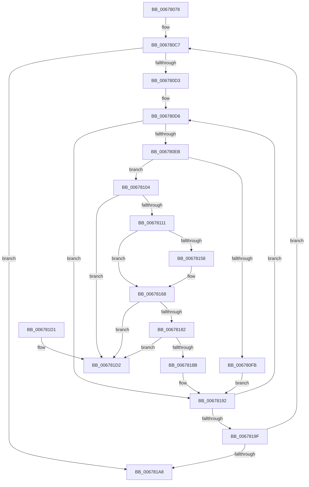

# MiMakeUnusedSegmentDeleteOnClose

- RVA: `0x00678078`–`0x006781D9` (길이 `353` bytes)
- VA: `0x0000000140678078`
- 실행 섹션: `.text`
- PDB 이름 있음: `예`; PDB Function 태그: `아니요`
- unwind 정보 RVA: `0x000D7CB4`
- 디코드: `97`개 명령, `353/353` bytes 표시
- 미해석 바이트: `0` (있으면 어셈블리에 `.byte`로 보존)

> 이 문서는 커널 이미지의 기계어와 PDB 기호를 분석해 생성했습니다. 4번과 5번은 함수 원형과 자료형을 바이너리 사용 방식에서 추정한 C 해석이며 원본 소스 복구 결과는 아닙니다.

## 1. Dependencies

- 직접 호출 지점: **9**; 고유 호출 대상: **7**
- 직접 호출자로 확인된 함수: **1**
- RIP 상대 이미지 참조: **0**

### Outgoing calls
- `0x006780BF` → [ExAcquireSpinLockExclusive](../24/ExAcquireSpinLockExclusive_function_00248690.md) (function, `0x00248690`)
- `0x006780F2` → [ExTryAcquireSpinLockExclusiveAtDpcLevel](../2B/ExTryAcquireSpinLockExclusiveAtDpcLevel_function_002BB800.md) (function, `0x002BB800`)
- `0x0067812B` → [MiUnlinkUnusedControlArea](../4E/MiUnlinkUnusedControlArea_function_004ED9F8.md) (function, `0x004ED9F8`)
- `0x00678133` → [ExReleaseSpinLockExclusiveFromDpcLevel](../24/ExReleaseSpinLockExclusiveFromDpcLevel_function_002497E0.md) (function, `0x002497E0`)
- `0x00678140` → [MiInsertUnusedSegment](../44/MiInsertUnusedSegment_function_004443DC.md) (function, `0x004443DC`)
- `0x0067814E` → [MiReleaseSpinLockExclusive](../24/MiReleaseSpinLockExclusive_function_002482C0.md) (function, `0x002482C0`)
- `0x00678163` → [MiReturnCrossPartitionSectionCharges](../4B/MiReturnCrossPartitionSectionCharges_function_004BA61C.md) (function, `0x004BA61C`)
- `0x0067816B` → [ExAcquireSpinLockExclusive](../24/ExAcquireSpinLockExclusive_function_00248690.md) (function, `0x00248690`)
- `0x006781AE` → [MiReleaseSpinLockExclusive](../24/MiReleaseSpinLockExclusive_function_002482C0.md) (function, `0x002482C0`)

### Direct callers
- [MiDrainCrossPartitionUsage](../69/MiDrainCrossPartitionUsage_function_00690984.md) at `0x00690A25`

### Static image references
- 디코드된 RIP-relative 메모리 참조가 없습니다.

## 2. Other-region calls and transfers

- 다른 실행 섹션으로 향하는 call: **0**
- 별도 외부 분기/꼬리 이동을 확인하지 못했습니다.

## 3. Assembly (complete function range)

```asm
00678078  48 89 5C 24 10                  mov qword ptr [rsp + 0x10], rbx
0067807D  48 89 74 24 18                  mov qword ptr [rsp + 0x18], rsi
00678082  48 89 7C 24 20                  mov qword ptr [rsp + 0x20], rdi
00678087  55                              push rbp
00678088  41 54                           push r12
0067808A  41 55                           push r13
0067808C  41 56                           push r14
0067808E  41 57                           push r15
00678090  48 8B EC                        mov rbp, rsp
00678093  48 83 EC 40                     sub rsp, 0x40
00678097  48 8D B9 C0 06 00 00            lea rdi, [rcx + 0x6c0]
0067809E  4C 8B F1                        mov r14, rcx
006780A1  0F 57 C0                        xorps xmm0, xmm0
006780A4  48 8D B1 40 08 00 00            lea rsi, [rcx + 0x840]
006780AB  33 C0                           xor eax, eax
006780AD  4C 8D A9 B8 07 00 00            lea r13, [rcx + 0x7b8]
006780B4  48 8B CF                        mov rcx, rdi
006780B7  48 89 45 F0                     mov qword ptr [rbp - 0x10], rax
006780BB  0F 11 45 E0                     movups xmmword ptr [rbp - 0x20], xmm0
006780BF  E8 CC 05 BD FF                  call 0x140248690
006780C4  88 45 30                        mov byte ptr [rbp + 0x30], al
006780C7  48 8B 16                        mov rdx, qword ptr [rsi]
006780CA  48 3B D6                        cmp rdx, rsi
006780CD  0F 84 D5 00 00 00               je 0x1406781a8
006780D3  45 33 FF                        xor r15d, r15d
006780D6  48 8B 0A                        mov rcx, qword ptr [rdx]
006780D9  48 8D 5A F8                     lea rbx, [rdx - 8]
006780DD  48 89 4D F0                     mov qword ptr [rbp - 0x10], rcx
006780E1  48 83 3B 00                     cmp qword ptr [rbx], 0
006780E5  0F 8D A7 00 00 00               jge 0x140678192
006780EB  4C 8D 63 48                     lea r12, [rbx + 0x48]
006780EF  49 8B CC                        mov rcx, r12
006780F2  E8 09 37 C4 FF                  call 0x1402bb800
006780F7  85 C0                           test eax, eax
006780F9  75 09                           jne 0x140678104
006780FB  44 8D 78 01                     lea r15d, [rax + 1]
006780FF  E9 8E 00 00 00                  jmp 0x140678192
00678104  49 8B 45 08                     mov rax, qword ptr [r13 + 8]
00678108  4C 39 28                        cmp qword ptr [rax], r13
0067810B  0F 85 C1 00 00 00               jne 0x1406781d2
00678111  48 89 45 E8                     mov qword ptr [rbp - 0x18], rax
00678115  48 8D 4D E0                     lea rcx, [rbp - 0x20]
00678119  4C 89 6D E0                     mov qword ptr [rbp - 0x20], r13
0067811D  48 89 08                        mov qword ptr [rax], rcx
00678120  48 8D 45 E0                     lea rax, [rbp - 0x20]
00678124  48 8B CB                        mov rcx, rbx
00678127  49 89 45 08                     mov qword ptr [r13 + 8], rax
0067812B  E8 C8 58 E7 FF                  call 0x1404ed9f8
00678130  48 8B CF                        mov rcx, rdi
00678133  E8 A8 16 BD FF                  call 0x1402497e0
00678138  0F BA 6B 38 12                  bts dword ptr [rbx + 0x38], 0x12
0067813D  48 8B CB                        mov rcx, rbx
00678140  E8 97 C2 DC FF                  call 0x1404443dc
00678145  8A 55 30                        mov dl, byte ptr [rbp + 0x30]
00678148  49 8B CC                        mov rcx, r12
0067814B  48 8B D8                        mov rbx, rax
0067814E  E8 6D 01 BD FF                  call 0x1402482c0
00678153  48 85 DB                        test rbx, rbx
00678156  74 10                           je 0x140678168
00678158  4C 8B C3                        mov r8, rbx
0067815B  BA 01 00 00 00                  mov edx, 1
00678160  49 8B CE                        mov rcx, r14
00678163  E8 B4 24 E4 FF                  call 0x1404ba61c
00678168  48 8B CF                        mov rcx, rdi
0067816B  E8 20 05 BD FF                  call 0x140248690
00678170  48 8B 4D E0                     mov rcx, qword ptr [rbp - 0x20]
00678174  48 8D 55 E0                     lea rdx, [rbp - 0x20]
00678178  48 8B 45 E8                     mov rax, qword ptr [rbp - 0x18]
0067817C  48 39 51 08                     cmp qword ptr [rcx + 8], rdx
00678180  75 50                           jne 0x1406781d2
00678182  48 8D 55 E0                     lea rdx, [rbp - 0x20]
00678186  48 39 10                        cmp qword ptr [rax], rdx
00678189  75 47                           jne 0x1406781d2
0067818B  48 89 08                        mov qword ptr [rax], rcx
0067818E  48 89 41 08                     mov qword ptr [rcx + 8], rax
00678192  48 8B 55 F0                     mov rdx, qword ptr [rbp - 0x10]
00678196  48 3B D6                        cmp rdx, rsi
00678199  0F 85 37 FF FF FF               jne 0x1406780d6
0067819F  45 85 FF                        test r15d, r15d
006781A2  0F 85 1F FF FF FF               jne 0x1406780c7
006781A8  8A 55 30                        mov dl, byte ptr [rbp + 0x30]
006781AB  48 8B CF                        mov rcx, rdi
006781AE  E8 0D 01 BD FF                  call 0x1402482c0
006781B3  4C 8D 5C 24 40                  lea r11, [rsp + 0x40]
006781B8  49 8B 5B 38                     mov rbx, qword ptr [r11 + 0x38]
006781BC  49 8B 73 40                     mov rsi, qword ptr [r11 + 0x40]
006781C0  49 8B 7B 48                     mov rdi, qword ptr [r11 + 0x48]
006781C4  49 8B E3                        mov rsp, r11
006781C7  41 5F                           pop r15
006781C9  41 5E                           pop r14
006781CB  41 5D                           pop r13
006781CD  41 5C                           pop r12
006781CF  5D                              pop rbp
006781D0  C3                              ret
006781D1  CC                              int3
006781D2  B9 03 00 00 00                  mov ecx, 3
006781D7  CD 29                           int 0x29
```

## 4. C-style interpretation (structured pseudocode)

```c
__int64 __fastcall MiMakeUnusedSegmentDeleteOnClose(__int64 a1)
{
    __int64 result;
    __int64 v_r15;
    __int64 v_rsp;
    unsigned __int64 v_stack_m28;
    unsigned __int64 v_stack_m38;
    unsigned __int64 v_stack_m40;
    unsigned __int64 v_stack_m48;
    unsigned __int64 v_stack_p10;
    unsigned __int64 v_stack_p18;
    unsigned __int64 v_stack_p20;
    unsigned __int8 v_stack_p8;

    v_stack_p10 = v_rbx;
    v_stack_p18 = v_rsi;
    v_stack_p20 = v_rdi;
    v_rsp = (v_rsp) - (64);
    result = 0;
    v_stack_m38 = 0;
    v_stack_m48 = v_xmm0;
    result = ExAcquireSpinLockExclusive(a1 + 1728, a2, a3, a4);
    v_stack_p8 = (unsigned __int8)(result);
loc_006780C7:
    if ((*(unsigned __int64 *)(a1 + 2112)) == (a1 + 2112)) goto loc_006781A8;
    v_r15 = 0;
loc_006780D6:
    v_stack_m38 = *(unsigned __int64 *)(*(unsigned __int64 *)(a1 + 2112));
    if ((*(unsigned __int64 *)(*(unsigned __int64 *)(a1 + 2112) - 8)) >= 0) goto loc_00678192;
    result = ExTryAcquireSpinLockExclusiveAtDpcLevel(*(unsigned __int64 *)(a1 + 2112) - 8 + 72, *(unsigned __int64 *)(a1 + 2112), a3, a4);
    if ((unsigned int)(result) != 0) goto loc_00678104;
    goto loc_00678192;
loc_00678104:
    if ((*(unsigned __int64 *)(*(unsigned __int64 *)(a1 + 1976 + 8))) != (a1 + 1976)) goto loc_006781D2;
    v_stack_m40 = *(unsigned __int64 *)(a1 + 1976 + 8);
    v_stack_m48 = a1 + 1976;
    *(unsigned __int64 *)(*(unsigned __int64 *)(a1 + 1976 + 8)) = v_stack_m48;
    *(unsigned __int64 *)(a1 + 1976 + 8) = v_stack_m48;
    result = MiUnlinkUnusedControlArea(*(unsigned __int64 *)(a1 + 2112) - 8, *(unsigned __int64 *)(a1 + 2112), a3, a4);
    result = ExReleaseSpinLockExclusiveFromDpcLevel(a1 + 1728, *(unsigned __int64 *)(a1 + 2112), a3, a4);
    result = MiInsertUnusedSegment(*(unsigned __int64 *)(a1 + 2112) - 8, *(unsigned __int64 *)(a1 + 2112), a3, a4);
    result = MiReleaseSpinLockExclusive(*(unsigned __int64 *)(a1 + 2112) - 8 + 72, v_stack_p8, a3, a4);
    if (result != 0) {
        a3 = result;
        a2 = 1;
        a1 = a1;
        result = MiReturnCrossPartitionSectionCharges(a1, a2, a3, a4);
    }
    result = ExAcquireSpinLockExclusive(a1 + 1728, a2, a3, a4);
    if ((*(unsigned __int64 *)(v_stack_m48 + 8)) != v_stack_m48) goto loc_006781D2;
    if ((*(unsigned __int64 *)(v_stack_m40)) != v_stack_m48) goto loc_006781D2;
    *(unsigned __int64 *)(v_stack_m40) = v_stack_m48;
    *(unsigned __int64 *)(v_stack_m48 + 8) = v_stack_m40;
loc_00678192:
    if (v_stack_m38 != (a1 + 2112)) goto loc_006780D6;
    if ((unsigned int)(result + 1) != 0) goto loc_006780C7;
loc_006781A8:
    result = MiReleaseSpinLockExclusive(a1 + 1728, v_stack_p8, a3, a4);
    return result;
loc_006781D2:
    return result;
}
```

## 5. (Beta) C Style

```c
int64_t MiMakeUnusedSegmentDeleteOnClose(void *Arg1)
{
    uint8_t *arg1 = (uint8_t *)Arg1;

    int64_t result;
    int64_t local_r15;
    int64_t local_rsp;
    uint64_t v_stack_m28;
    uint64_t v_stack_m38;
    uint64_t v_stack_m40;
    uint64_t v_stack_m48;
    uint64_t v_stack_p10;
    uint64_t v_stack_p18;
    uint64_t v_stack_p20;
    uint8_t v_stack_p8;

    v_stack_p10 = local_rbx;
    v_stack_p18 = local_rsi;
    v_stack_p20 = local_rdi;
    local_rsp = (local_rsp) - (64);
    result = 0;
    v_stack_m38 = 0;
    v_stack_m48 = v_xmm0;
    result = ExAcquireSpinLockExclusive(Arg1 + 1728, a2, a3, a4);
    v_stack_p8 = (uint8_t)(result);
loc_006780C7:
    if ((*(uint64_t *)(arg1 + 0x840)) == (Arg1 + 2112)) goto loc_006781A8;
    local_r15 = 0;
loc_006780D6:
    v_stack_m38 = *(uint64_t *)(*(uint64_t *)(arg1 + 0x840));
    if ((*(uint64_t *)(*(uint64_t *)(arg1 + 0x840) - 0x8)) >= 0) goto loc_00678192;
    result = ExTryAcquireSpinLockExclusiveAtDpcLevel(*(uint64_t *)(arg1 + 0x840) - 8 + 72, *(uint64_t *)(arg1 + 0x840), a3, a4);
    if ((uint32_t)(result) != 0) goto loc_00678104;
    goto loc_00678192;
loc_00678104:
    if ((*(uint64_t *)(*(uint64_t *)(arg1 + 0x7B8 + 0x8))) != (Arg1 + 1976)) goto loc_006781D2;
    v_stack_m40 = *(uint64_t *)(arg1 + 0x7B8 + 0x8);
    v_stack_m48 = Arg1 + 1976;
    *(uint64_t *)(*(uint64_t *)(arg1 + 0x7B8 + 0x8)) = v_stack_m48;
    *(uint64_t *)(arg1 + 0x7B8 + 0x8) = v_stack_m48;
    result = MiUnlinkUnusedControlArea(*(uint64_t *)(arg1 + 0x840) - 8, *(uint64_t *)(arg1 + 0x840), a3, a4);
    result = ExReleaseSpinLockExclusiveFromDpcLevel(Arg1 + 1728, *(uint64_t *)(arg1 + 0x840), a3, a4);
    result = MiInsertUnusedSegment(*(uint64_t *)(arg1 + 0x840) - 8, *(uint64_t *)(arg1 + 0x840), a3, a4);
    result = MiReleaseSpinLockExclusive(*(uint64_t *)(arg1 + 0x840) - 8 + 72, v_stack_p8, a3, a4);
    if (result != 0) {
        a3 = result;
        a2 = 1;
        Arg1 = Arg1;
        result = MiReturnCrossPartitionSectionCharges(Arg1, a2, a3, a4);
    }
    result = ExAcquireSpinLockExclusive(Arg1 + 1728, a2, a3, a4);
    if ((*(uint64_t *)(v_stack_m48 + 0x8)) != v_stack_m48) goto loc_006781D2;
    if ((*(uint64_t *)(v_stack_m40)) != v_stack_m48) goto loc_006781D2;
    *(uint64_t *)(v_stack_m40) = v_stack_m48;
    *(uint64_t *)(v_stack_m48 + 0x8) = v_stack_m40;
loc_00678192:
    if (v_stack_m38 != (Arg1 + 2112)) goto loc_006780D6;
    if ((uint32_t)(result + 1) != 0) goto loc_006780C7;
loc_006781A8:
    result = MiReleaseSpinLockExclusive(Arg1 + 1728, v_stack_p8, a3, a4);
    return result;
loc_006781D2:
    return result;
}
```

### 관측된 메모리 오프셋

구조체 형식이 확인되지 않은 접근은 인자 기준의 오프셋으로만 기록했습니다.

| 기준 인자 | 오프셋 표현 | 폭 (bit) | 접근 |
|---|---:|---:|---|
| `Arg1` | `+ 0x0` | `64` | `R` |
| `Arg1` | `+ 0x8` | `64` | `R` |
| `Arg1` | `+ 0x8` | `64` | `W` |
| `Arg1` | `+ 0x6C0` | `64` | `R` |
| `Arg1` | `+ 0x7B8` | `64` | `R` |
| `Arg1` | `+ 0x840` | `64` | `R` |

## 6. Execution-region graph

[열기: 2D/3D 그래프와 함수 탐색 컨트롤 패널](../../../control-panel.html?section=text&rva=0x00678078&view=graph)

- 2D 그래프는 위에서 아래로 흐르고, 3D 그래프는 빈 공간을 드래그해 회전합니다. Shift+드래그는 이동, 휠은 확대·축소, 함수 노드 선택은 대상 보고서 이동입니다.

### Static fallback


