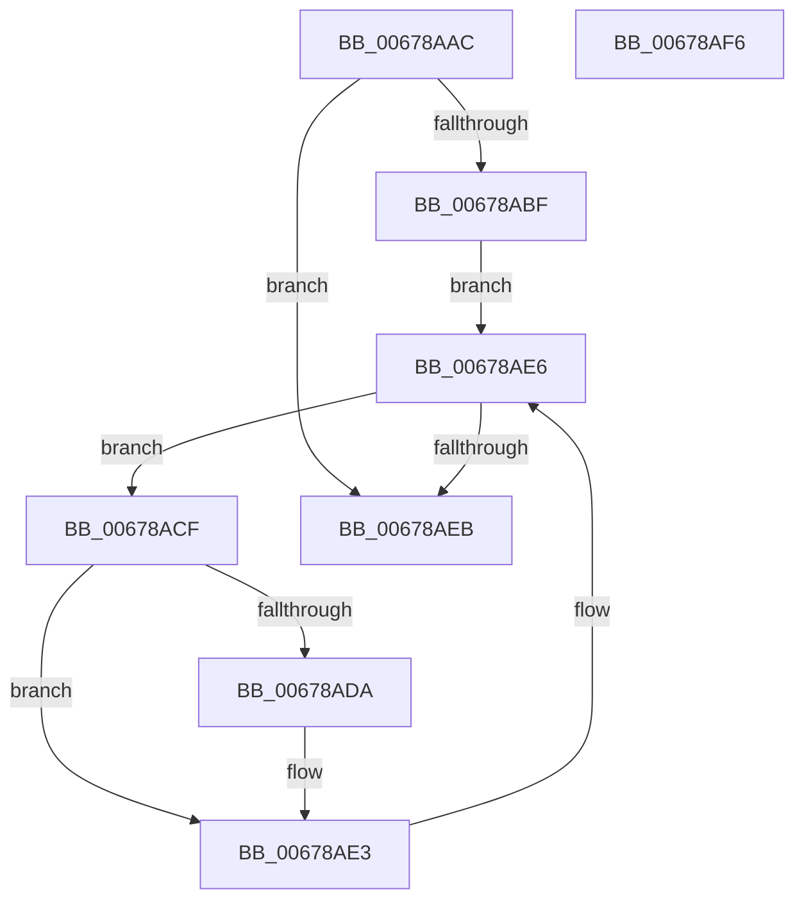

# MiMarkHiberProtectedImages

- RVA: `0x00678AAC`–`0x00678AF7` (길이 `75` bytes)
- VA: `0x0000000140678AAC`
- 실행 섹션: `.text`
- PDB 이름 있음: `예`; PDB Function 태그: `아니요`
- unwind 정보 RVA: `0x0005CAAC`
- 디코드: `21`개 명령, `75/75` bytes 표시
- 미해석 바이트: `0` (있으면 어셈블리에 `.byte`로 보존)

> 이 문서는 커널 이미지의 기계어와 PDB 기호를 분석해 생성했습니다. 4번과 5번은 함수 원형과 자료형을 바이너리 사용 방식에서 추정한 C 해석이며 원본 소스 복구 결과는 아닙니다.

## 1. Dependencies

- 직접 호출 지점: **1**; 고유 호출 대상: **1**
- 직접 호출자로 확인된 함수: **1**
- RIP 상대 이미지 참조: **2**

### Outgoing calls
- `0x00678ADE` → [MmMarkImageForHiberPhase](../../pagelk/B7/MmMarkImageForHiberPhase_function_00B748EC.md) (function, `0x00B748EC`)

### Direct callers
- [MmMarkHiberPhase](../../pagelk/B7/MmMarkHiberPhase_function_00B74578.md) at `0x00B748CA`

### Static image references
- `0x00678AB6` → RVA `0x00FC6A84` (`ALMOSTRO`; read)
- `0x00678ABF` → RVA `0x00EF54C0` (`.data`; read)

## 2. Other-region calls and transfers

- 다른 실행 섹션으로 향하는 call: **1**
  - `0x00678ADE` → [MmMarkImageForHiberPhase](../../pagelk/B7/MmMarkImageForHiberPhase_function_00B748EC.md) (`.text` → `PAGELK`)
- 별도 외부 분기/꼬리 이동을 확인하지 못했습니다.

## 3. Assembly (complete function range)

```asm
00678AAC  48 89 5C 24 08                  mov qword ptr [rsp + 8], rbx
00678AB1  57                              push rdi
00678AB2  48 83 EC 20                     sub rsp, 0x20
00678AB6  80 3D C7 DF 94 00 00            cmp byte ptr [rip + 0x94dfc7], 0
00678ABD  74 2C                           je 0x140678aeb
00678ABF  48 8B 1D FA C9 87 00            mov rbx, qword ptr [rip + 0x87c9fa]
00678AC6  48 8D 3D F3 C9 87 00            lea rdi, [rip + 0x87c9f3]
00678ACD  EB 17                           jmp 0x140678ae6
00678ACF  B9 80 01 00 00                  mov ecx, 0x180
00678AD4  66 85 4B 6E                     test word ptr [rbx + 0x6e], cx
00678AD8  74 09                           je 0x140678ae3
00678ADA  48 8B 4B 30                     mov rcx, qword ptr [rbx + 0x30]
00678ADE  E8 09 BE 4F 00                  call 0x140b748ec
00678AE3  48 8B 1B                        mov rbx, qword ptr [rbx]
00678AE6  48 3B DF                        cmp rbx, rdi
00678AE9  75 E4                           jne 0x140678acf
00678AEB  48 8B 5C 24 30                  mov rbx, qword ptr [rsp + 0x30]
00678AF0  48 83 C4 20                     add rsp, 0x20
00678AF4  5F                              pop rdi
00678AF5  C3                              ret
00678AF6  CC                              int3
```

## 4. C-style interpretation (structured pseudocode)

```c
__int64 __fastcall MiMarkHiberProtectedImages(void)
{
    __int64 result;
    __int64 v_rsp;
    unsigned __int64 v_stack_p8;

    v_stack_p8 = v_rbx;
    v_rsp = (v_rsp) - (32);
    if ((*(unsigned __int8 *)(v_rip + 9756615)) == 0) goto loc_00678AEB;
    goto loc_00678AE6;
loc_00678ACF:
    if (((*(unsigned __int16 *)(*(unsigned __int64 *)(v_rip + 8899066) + 110)) & (384)) != 0) {
        a1 = *(unsigned __int64 *)(*(unsigned __int64 *)(v_rip + 8899066) + 48);
        result = MmMarkImageForHiberPhase(a1, a2, a3, a4);
    }
loc_00678AE6:
    if ((*(unsigned __int64 *)(*(unsigned __int64 *)(v_rip + 8899066))) != (v_rip + 8899059)) goto loc_00678ACF;
loc_00678AEB:
    v_rsp = (v_rsp) + (32);
    return result;
}
```

## 5. (Beta) C Style

```c
void MiMarkHiberProtectedImages(void)
{
    int64_t result;
    int64_t local_rsp;
    uint64_t v_stack_p8;

    v_stack_p8 = local_rbx;
    local_rsp = (local_rsp) - (32);
    if ((*(uint8_t *)(v_rip + 0x94DFC7)) == 0) goto loc_00678AEB;
    goto loc_00678AE6;
loc_00678ACF:
    if (((*(uint16_t *)(*(uint64_t *)(v_rip + 0x87C9FA) + 0x6E)) & (384)) != 0) {
        a1 = *(uint64_t *)(*(uint64_t *)(v_rip + 0x87C9FA) + 0x30);
        result = MmMarkImageForHiberPhase(a1, a2, a3, a4);
    }
loc_00678AE6:
    if ((*(uint64_t *)(*(uint64_t *)(v_rip + 0x87C9FA))) != (v_rip + 8899059)) goto loc_00678ACF;
loc_00678AEB:
    local_rsp = (local_rsp) + (32);
    return result;
}
```

## 6. Execution-region graph

[열기: 2D/3D 그래프와 함수 탐색 컨트롤 패널](../../../control-panel.html?section=text&rva=0x00678AAC&view=graph)

- 2D 그래프는 위에서 아래로 흐르고, 3D 그래프는 빈 공간을 드래그해 회전합니다. Shift+드래그는 이동, 휠은 확대·축소, 함수 노드 선택은 대상 보고서 이동입니다.

### Static fallback


