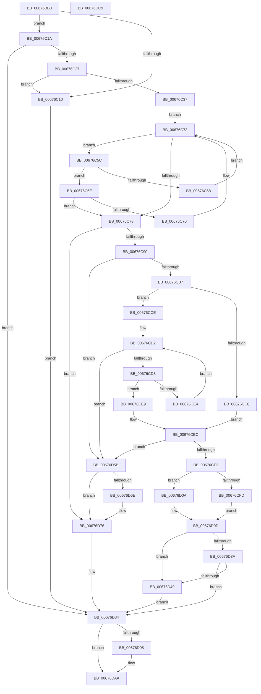

# MiMarkHugePfnGood

- RVA: `0x00676BB0`–`0x00676DCA` (길이 `538` bytes)
- VA: `0x0000000140676BB0`
- 실행 섹션: `.text`
- PDB 이름 있음: `예`; PDB Function 태그: `아니요`
- unwind 정보 RVA: `0x0008C2BC`
- 디코드: `145`개 명령, `538/538` bytes 표시
- 미해석 바이트: `0` (있으면 어셈블리에 `.byte`로 보존)

> 이 문서는 커널 이미지의 기계어와 PDB 기호를 분석해 생성했습니다. 4번과 5번은 함수 원형과 자료형을 바이너리 사용 방식에서 추정한 C 해석이며 원본 소스 복구 결과는 아닙니다.

## 1. Dependencies

- 직접 호출 지점: **13**; 고유 호출 대상: **11**
- 직접 호출자로 확인된 함수: **1**
- RIP 상대 이미지 참조: **4**

### Outgoing calls
- `0x00676BE6` → [MiPageToNode](../33/MiPageToNode_function_00338CD0.md) (function, `0x00338CD0`)
- `0x00676BFB` → [MiLockHugePfn](MiLockHugePfn_function_006765FC.md) (function, `0x006765FC`)
- `0x00676C07` → [MiIsPageInHugePfn](../2A/MiIsPageInHugePfn_function_002AB770.md) (function, `0x002AB770`)
- `0x00676C2A` → [MiHugePfnPartition](../43/MiHugePfnPartition_function_004371B4.md) (function, `0x004371B4`)
- `0x00676C4E` → [ExAcquireSpinLockExclusiveAtDpcLevel](../24/ExAcquireSpinLockExclusiveAtDpcLevel_function_00248E80.md) (function, `0x00248E80`)
- `0x00676D03` → [MiUnlinkHugeRange](../43/MiUnlinkHugeRange_function_00436EF0.md) (function, `0x00436EF0`)
- `0x00676D17` → [RtlAvlRemoveNode](../29/RtlAvlRemoveNode_function_00296650.md) (function, `0x00296650`)
- `0x00676D23` → [ExReleaseSpinLockExclusiveFromDpcLevel](../24/ExReleaseSpinLockExclusiveFromDpcLevel_function_002497E0.md) (function, `0x002497E0`)
- `0x00676D54` → [MiInsertHugeRangeInList](../43/MiInsertHugeRangeInList_function_004371E8.md) (function, `0x004371E8`)
- `0x00676D7D` → [ExReleaseSpinLockExclusiveFromDpcLevel](../24/ExReleaseSpinLockExclusiveFromDpcLevel_function_002497E0.md) (function, `0x002497E0`)
- `0x00676D8B` → [MiUnlockHugePfn](../4D/MiUnlockHugePfn_function_004D90E4.md) (function, `0x004D90E4`)
- `0x00676D9B` → [ExFreePoolWithTag](../../poolcode/B8/ExFreePoolWithTag_function_00B82870.md) (function, `0x00B82870`)
- `0x00676DA5` → [ExFreePoolWithTag](../../poolcode/B8/ExFreePoolWithTag_function_00B82870.md) (function, `0x00B82870`)

### Direct callers
- [MiUnlinkBadPages](MiUnlinkBadPages_function_0067A6FC.md) at `0x0067A74B`

### Static image references
- `0x00676BEB` → RVA `0x00E300C0` (`.data`; read)
- `0x00676C47` → RVA `0x00E2FFD0` (`.data`; read)
- `0x00676C53` → RVA `0x00E30020` (`.data`; read)
- `0x00676C9F` → RVA `0x00E30028` (`.data`; read/write)

## 2. Other-region calls and transfers

- 다른 실행 섹션으로 향하는 call: **2**
  - `0x00676D9B` → [ExFreePoolWithTag](../../poolcode/B8/ExFreePoolWithTag_function_00B82870.md) (`.text` → `POOLCODE`)
  - `0x00676DA5` → [ExFreePoolWithTag](../../poolcode/B8/ExFreePoolWithTag_function_00B82870.md) (`.text` → `POOLCODE`)
- 별도 외부 분기/꼬리 이동을 확인하지 못했습니다.

## 3. Assembly (complete function range)

```asm
00676BB0  48 8B C4                        mov rax, rsp
00676BB3  48 89 58 10                     mov qword ptr [rax + 0x10], rbx
00676BB7  48 89 68 18                     mov qword ptr [rax + 0x18], rbp
00676BBB  48 89 70 20                     mov qword ptr [rax + 0x20], rsi
00676BBF  57                              push rdi
00676BC0  41 54                           push r12
00676BC2  41 55                           push r13
00676BC4  41 56                           push r14
00676BC6  41 57                           push r15
00676BC8  48 83 EC 30                     sub rsp, 0x30
00676BCC  48 83 60 D0 00                  and qword ptr [rax - 0x30], 0
00676BD1  48 8B D9                        mov rbx, rcx
00676BD4  48 C1 EB 12                     shr rbx, 0x12
00676BD8  41 BC FF FF 3F 00               mov r12d, 0x3fffff
00676BDE  49 23 DC                        and rbx, r12
00676BE1  4C 8B F1                        mov r14, rcx
00676BE4  33 ED                           xor ebp, ebp
00676BE6  E8 E5 20 CC FF                  call 0x140338cd0
00676BEB  48 8B 05 CE 94 7B 00            mov rax, qword ptr [rip + 0x7b94ce]
00676BF2  33 F6                           xor esi, esi
00676BF4  4C 8D 3C D8                     lea r15, [rax + rbx*8]
00676BF8  49 8B CF                        mov rcx, r15
00676BFB  E8 FC F9 FF FF                  call 0x1406765fc
00676C00  49 8B CE                        mov rcx, r14
00676C03  88 44 24 60                     mov byte ptr [rsp + 0x60], al
00676C07  E8 64 4B C3 FF                  call 0x1402ab770
00676C0C  85 C0                           test eax, eax
00676C0E  75 0A                           jne 0x140676c1a
00676C10  BD 34 04 00 C0                  mov ebp, 0xc0000434
00676C15  E9 6A 01 00 00                  jmp 0x140676d84
00676C1A  49 8B 3F                        mov rdi, qword ptr [r15]
00676C1D  40 F6 C7 08                     test dil, 8
00676C21  0F 84 5D 01 00 00               je 0x140676d84
00676C27  49 8B CF                        mov rcx, r15
00676C2A  E8 85 05 DC FF                  call 0x1404371b4
00676C2F  4C 8B E8                        mov r13, rax
00676C32  48 85 C0                        test rax, rax
00676C35  74 D9                           je 0x140676c10
00676C37  41 81 E6 FF FF 03 00            and r14d, 0x3ffff
00676C3E  48 C7 44 24 20 00 00 04 00      mov qword ptr [rsp + 0x20], 0x40000
00676C47  48 8D 0D 82 93 7B 00            lea rcx, [rip + 0x7b9382]
00676C4E  E8 2D 22 BD FF                  call 0x140248e80
00676C53  48 8B 35 C6 93 7B 00            mov rsi, qword ptr [rip + 0x7b93c6]
00676C5A  EB 17                           jmp 0x140676c73
00676C5C  48 8B 46 18                     mov rax, qword ptr [rsi + 0x18]
00676C60  49 23 C4                        and rax, r12
00676C63  48 3B D8                        cmp rbx, rax
00676C66  76 06                           jbe 0x140676c6e
00676C68  48 8B 76 08                     mov rsi, qword ptr [rsi + 8]
00676C6C  EB 05                           jmp 0x140676c73
00676C6E  73 08                           jae 0x140676c78
00676C70  48 8B 36                        mov rsi, qword ptr [rsi]
00676C73  48 85 F6                        test rsi, rsi
00676C76  75 E4                           jne 0x140676c5c
00676C78  48 8B 4E 20                     mov rcx, qword ptr [rsi + 0x20]
00676C7C  48 89 4C 24 28                  mov qword ptr [rsp + 0x28], rcx
00676C81  4C 0F A3 31                     bt qword ptr [rcx], r14
00676C85  0F 92 C0                        setb al
00676C88  84 C0                           test al, al
00676C8A  0F 84 E6 00 00 00               je 0x140676d76
00676C90  4C 0F B3 31                     btr qword ptr [rcx], r14
00676C94  48 8B 44 24 20                  mov rax, qword ptr [rsp + 0x20]
00676C99  41 BC 01 00 00 00               mov r12d, 1
00676C9F  4C 29 25 82 93 7B 00            sub qword ptr [rip + 0x7b9382], r12
00676CA6  BD 12 01 00 00                  mov ebp, 0x112
00676CAB  48 3D 00 00 04 00               cmp rax, 0x40000
00676CB1  0F 82 A4 00 00 00               jb 0x140676d5b
00676CB7  48 8B 44 24 28                  mov rax, qword ptr [rsp + 0x28]
00676CBC  48 8D 90 F8 7F 00 00            lea rdx, [rax + 0x7ff8]
00676CC3  48 3B C2                        cmp rax, rdx
00676CC6  75 06                           jne 0x140676cce
00676CC8  48 83 38 00                     cmp qword ptr [rax], 0
00676CCC  EB 1E                           jmp 0x140676cec
00676CCE  48 83 38 00                     cmp qword ptr [rax], 0
00676CD2  0F 85 83 00 00 00               jne 0x140676d5b
00676CD8  48 83 C0 08                     add rax, 8
00676CDC  48 8B 08                        mov rcx, qword ptr [rax]
00676CDF  48 3B C2                        cmp rax, rdx
00676CE2  74 05                           je 0x140676ce9
00676CE4  48 85 C9                        test rcx, rcx
00676CE7  EB E9                           jmp 0x140676cd2
00676CE9  48 85 C9                        test rcx, rcx
00676CEC  0F 94 C0                        sete al
00676CEF  84 C0                           test al, al
00676CF1  74 68                           je 0x140676d5b
00676CF3  40 80 E7 07                     and dil, 7
00676CF7  40 80 FF 04                     cmp dil, 4
00676CFB  75 0D                           jne 0x140676d0a
00676CFD  48 8B D3                        mov rdx, rbx
00676D00  49 8B CD                        mov rcx, r13
00676D03  E8 E8 01 DC FF                  call 0x140436ef0
00676D08  EB 03                           jmp 0x140676d0d
00676D0A  45 33 E4                        xor r12d, r12d
00676D0D  48 8B D6                        mov rdx, rsi
00676D10  48 8D 0D 09 93 7B 00            lea rcx, [rip + 0x7b9309]
00676D17  E8 34 F9 C1 FF                  call 0x140296650
00676D1C  48 8D 0D AD 92 7B 00            lea rcx, [rip + 0x7b92ad]
00676D23  E8 B8 2A BD FF                  call 0x1402497e0
00676D28  49 8B 07                        mov rax, qword ptr [r15]
00676D2B  48 8B C8                        mov rcx, rax
00676D2E  48 83 E1 F7                     and rcx, 0xfffffffffffffff7
00676D32  49 89 0F                        mov qword ptr [r15], rcx
00676D35  45 85 E4                        test r12d, r12d
00676D38  75 0F                           jne 0x140676d49
00676D3A  83 E0 07                        and eax, 7
00676D3D  48 83 E8 03                     sub rax, 3
00676D41  48 A9 FD FF FF FF               test rax, -3
00676D47  74 3B                           je 0x140676d84
00676D49  41 B8 02 00 00 00               mov r8d, 2
00676D4F  48 8B D3                        mov rdx, rbx
00676D52  33 C9                           xor ecx, ecx
00676D54  E8 8F 04 DC FF                  call 0x1404371e8
00676D59  EB 29                           jmp 0x140676d84
00676D5B  48 8B 4E 20                     mov rcx, qword ptr [rsi + 0x20]
00676D5F  4C 0F A3 B1 00 80 00 00         bt qword ptr [rcx + 0x8000], r14
00676D67  0F 92 C0                        setb al
00676D6A  84 C0                           test al, al
00676D6C  74 08                           je 0x140676d76
00676D6E  4C 0F B3 B1 00 80 00 00         btr qword ptr [rcx + 0x8000], r14
00676D76  48 8D 0D 53 92 7B 00            lea rcx, [rip + 0x7b9253]
00676D7D  E8 5E 2A BD FF                  call 0x1402497e0
00676D82  33 F6                           xor esi, esi
00676D84  8A 54 24 60                     mov dl, byte ptr [rsp + 0x60]
00676D88  49 8B CF                        mov rcx, r15
00676D8B  E8 54 23 E6 FF                  call 0x1404d90e4
00676D90  48 85 F6                        test rsi, rsi
00676D93  74 15                           je 0x140676daa
00676D95  48 8B 4E 20                     mov rcx, qword ptr [rsi + 0x20]
00676D99  33 D2                           xor edx, edx
00676D9B  E8 D0 BA 50 00                  call 0x140b82870
00676DA0  33 D2                           xor edx, edx
00676DA2  48 8B CE                        mov rcx, rsi
00676DA5  E8 C6 BA 50 00                  call 0x140b82870
00676DAA  48 8B 5C 24 68                  mov rbx, qword ptr [rsp + 0x68]
00676DAF  8B C5                           mov eax, ebp
00676DB1  48 8B 6C 24 70                  mov rbp, qword ptr [rsp + 0x70]
00676DB6  48 8B 74 24 78                  mov rsi, qword ptr [rsp + 0x78]
00676DBB  48 83 C4 30                     add rsp, 0x30
00676DBF  41 5F                           pop r15
00676DC1  41 5E                           pop r14
00676DC3  41 5D                           pop r13
00676DC5  41 5C                           pop r12
00676DC7  5F                              pop rdi
00676DC8  C3                              ret
00676DC9  CC                              int3
```

## 4. C-style interpretation (structured pseudocode)

```c
__int64 __fastcall MiMarkHugePfnGood(__int64 a1)
{
    __int64 result;
    __int64 v_r12;
    __int64 v_r14;
    __int64 v_rbp;
    __int64 v_rbx;
    __int64 v_rdi;
    __int64 v_rsi;
    __int64 v_rsp;
    unsigned __int64 v_stack_m30;
    unsigned __int64 v_stack_m38;
    unsigned __int64 v_stack_p10;
    unsigned __int64 v_stack_p18;
    unsigned __int64 v_stack_p20;
    unsigned __int8 v_stack_p8;

    *(unsigned __int64 *)(v_rsp + 16) = v_rbx;
    *(unsigned __int64 *)(v_rsp + 24) = v_rbp;
    *(unsigned __int64 *)(v_rsp + 32) = v_rsi;
    v_rsp = (v_rsp) - (48);
    v_rbx = (a1) >> (18);
    v_rbx = (v_rbx) & ((unsigned int)(0x3FFFFFULL));
    v_rbp = 0;
    result = MiPageToNode(a1, a2, a3, a4);
    v_rsi = 0;
    result = MiLockHugePfn(*(unsigned __int64 *)(v_rip + 8099022) + v_rbx * 8, a2, a3, a4);
    v_stack_p8 = (unsigned __int8)(result);
    result = MiIsPageInHugePfn(a1, a2, a3, a4);
    if ((unsigned int)(result) != 0) goto loc_00676C1A;
loc_00676C10:
    goto loc_00676D84;
loc_00676C1A:
    if ((((unsigned __int8)(*(unsigned __int64 *)(*(unsigned __int64 *)(v_rip + 8099022) + v_rbx * 8))) & (8)) == 0) goto loc_00676D84;
    result = MiHugePfnPartition(*(unsigned __int64 *)(v_rip + 8099022) + v_rbx * 8, a2, a3, a4);
    if (result == 0) goto loc_00676C10;
    v_r14 = (unsigned int)((a1) & (0x3FFFFULL));
    v_stack_m38 = 0x40000ULL;
    result = ExAcquireSpinLockExclusiveAtDpcLevel(v_rip + 8098690, a2, a3, a4);
    goto loc_00676C73;
loc_00676C5C:
    result = (*(unsigned __int64 *)(*(unsigned __int64 *)(v_rip + 8098758) + 24)) & ((unsigned int)(0x3FFFFFULL));
    if (v_rbx <= result) goto loc_00676C6E;
    goto loc_00676C73;
loc_00676C6E:
    if (v_rbx >= result) goto loc_00676C78;
loc_00676C73:
    if (*(unsigned __int64 *)(*(unsigned __int64 *)(*(unsigned __int64 *)(v_rip + 8098758) + 8)) != 0) goto loc_00676C5C;
loc_00676C78:
    v_stack_m30 = *(unsigned __int64 *)(*(unsigned __int64 *)(*(unsigned __int64 *)(*(unsigned __int64 *)(v_rip + 8098758) + 8)) + 32);
    result = (condition_is_below) ? 1 : 0;
    if ((unsigned __int8)(result) == 0) goto loc_00676D76;
    if (v_stack_m38 < 0x40000ULL) goto loc_00676D5B;
    if (v_stack_m30 != (v_stack_m30 + 32760)) goto loc_00676CCE;
    goto loc_00676CEC;
loc_00676CCE:
loc_00676CD2:
    if ((*(unsigned __int64 *)(v_stack_m30)) != 0) goto loc_00676D5B;
    result = (v_stack_m30) + (8);
    if (result == (v_stack_m30 + 32760)) goto loc_00676CE9;
    goto loc_00676CD2;
loc_00676CE9:
loc_00676CEC:
    result = (*(unsigned __int64 *)(result) == 0) ? 1 : 0;
    if ((unsigned __int8)(result) == 0) goto loc_00676D5B;
    v_rdi = (unsigned __int8)((*(unsigned __int64 *)(*(unsigned __int64 *)(v_rip + 8099022) + v_rbx * 8)) & (7));
    if (((unsigned __int8)(v_rdi)) != 4) goto loc_00676D0A;
    result = MiUnlinkHugeRange(result, v_rbx, a3, a4);
    goto loc_00676D0D;
loc_00676D0A:
    v_r12 = 0;
loc_00676D0D:
    result = RtlAvlRemoveNode(v_rip + 8098569, *(unsigned __int64 *)(*(unsigned __int64 *)(*(unsigned __int64 *)(v_rip + 8098758) + 8)), a3, a4);
    result = ExReleaseSpinLockExclusiveFromDpcLevel(v_rip + 8098477, *(unsigned __int64 *)(*(unsigned __int64 *)(*(unsigned __int64 *)(v_rip + 8098758) + 8)), a3, a4);
    a1 = (*(unsigned __int64 *)(*(unsigned __int64 *)(v_rip + 8099022) + v_rbx * 8)) & (-9);
    *(unsigned __int64 *)(*(unsigned __int64 *)(v_rip + 8099022) + v_rbx * 8) = a1;
    if (0 != 0) goto loc_00676D49;
    result = (unsigned int)((*(unsigned __int64 *)(*(unsigned __int64 *)(v_rip + 8099022) + v_rbx * 8)) & (7));
    result = (result) - (3);
    if (((result) & (-3)) == 0) goto loc_00676D84;
loc_00676D49:
    a1 = 0;
    result = MiInsertHugeRangeInList(a1, v_rbx, 2, a4);
    goto loc_00676D84;
loc_00676D5B:
    result = (condition_is_below) ? 1 : 0;
    if ((unsigned __int8)(result) != 0) {
    }
    result = ExReleaseSpinLockExclusiveFromDpcLevel(v_rip + 8098387, v_rbx, 2, a4);
    v_rsi = 0;
loc_00676D84:
    result = MiUnlockHugePfn(*(unsigned __int64 *)(v_rip + 8099022) + v_rbx * 8, v_stack_p8, 2, a4);
    if (0 != 0) {
        a1 = *(unsigned __int64 *)(v_rsi + 32);
        a2 = 0;
        result = ExFreePoolWithTag(a1, a2, 2, a4);
        a2 = 0;
        a1 = 0;
        result = ExFreePoolWithTag(a1, a2, 2, a4);
    }
    v_rsp = (v_rsp) + (48);
    return 274;
}
```

## 5. (Beta) C Style

```c
int64_t MiMarkHugePfnGood(int64_t Arg1)
{
    int64_t result;
    int64_t local_r12;
    int64_t local_r14;
    int64_t local_rbp;
    int64_t local_rbx;
    int64_t local_rdi;
    int64_t local_rsi;
    int64_t local_rsp;
    uint64_t v_stack_m30;
    uint64_t v_stack_m38;
    uint64_t v_stack_p10;
    uint64_t v_stack_p18;
    uint64_t v_stack_p20;
    uint8_t v_stack_p8;

    *(uint64_t *)(local_rsp + 0x10) = local_rbx;
    *(uint64_t *)(local_rsp + 0x18) = local_rbp;
    *(uint64_t *)(local_rsp + 0x20) = local_rsi;
    local_rsp = (local_rsp) - (48);
    local_rbx = (Arg1) >> (18);
    local_rbx = (local_rbx) & ((uint32_t)(0x3FFFFFULL));
    local_rbp = 0;
    result = MiPageToNode(Arg1, a2, a3, a4);
    local_rsi = 0;
    result = MiLockHugePfn(*(uint64_t *)(v_rip + 0x7B94CE) + local_rbx * 8, a2, a3, a4);
    v_stack_p8 = (uint8_t)(result);
    result = MiIsPageInHugePfn(Arg1, a2, a3, a4);
    if ((uint32_t)(result) != 0) goto loc_00676C1A;
loc_00676C10:
    goto loc_00676D84;
loc_00676C1A:
    if ((((uint8_t)(*(uint64_t *)(*(uint64_t *)(v_rip + 0x7B94CE) + local_rbx * 8))) & (8)) == 0) goto loc_00676D84;
    result = MiHugePfnPartition(*(uint64_t *)(v_rip + 0x7B94CE) + local_rbx * 8, a2, a3, a4);
    if (result == 0) goto loc_00676C10;
    local_r14 = (uint32_t)((Arg1) & (0x3FFFFULL));
    v_stack_m38 = 0x40000ULL;
    result = ExAcquireSpinLockExclusiveAtDpcLevel(v_rip + 8098690, a2, a3, a4);
    goto loc_00676C73;
loc_00676C5C:
    result = (*(uint64_t *)(*(uint64_t *)(v_rip + 0x7B93C6) + 0x18)) & ((uint32_t)(0x3FFFFFULL));
    if (local_rbx <= result) goto loc_00676C6E;
    goto loc_00676C73;
loc_00676C6E:
    if (local_rbx >= result) goto loc_00676C78;
loc_00676C73:
    if (*(uint64_t *)(*(uint64_t *)(*(uint64_t *)(v_rip + 0x7B93C6) + 0x8)) != 0) goto loc_00676C5C;
loc_00676C78:
    v_stack_m30 = *(uint64_t *)(*(uint64_t *)(*(uint64_t *)(*(uint64_t *)(v_rip + 0x7B93C6) + 0x8)) + 0x20);
    result = (condition_is_below) ? 1 : 0;
    if ((uint8_t)(result) == 0) goto loc_00676D76;
    if (v_stack_m38 < 0x40000ULL) goto loc_00676D5B;
    if (v_stack_m30 != (v_stack_m30 + 32760)) goto loc_00676CCE;
    goto loc_00676CEC;
loc_00676CCE:
loc_00676CD2:
    if ((*(uint64_t *)(v_stack_m30)) != 0) goto loc_00676D5B;
    result = (v_stack_m30) + (8);
    if (result == (v_stack_m30 + 32760)) goto loc_00676CE9;
    goto loc_00676CD2;
loc_00676CE9:
loc_00676CEC:
    result = (*(uint64_t *)(result) == 0) ? 1 : 0;
    if ((uint8_t)(result) == 0) goto loc_00676D5B;
    local_rdi = (uint8_t)((*(uint64_t *)(*(uint64_t *)(v_rip + 0x7B94CE) + local_rbx * 8)) & (7));
    if (((uint8_t)(local_rdi)) != 4) goto loc_00676D0A;
    result = MiUnlinkHugeRange(result, local_rbx, a3, a4);
    goto loc_00676D0D;
loc_00676D0A:
    local_r12 = 0;
loc_00676D0D:
    result = RtlAvlRemoveNode(v_rip + 8098569, *(uint64_t *)(*(uint64_t *)(*(uint64_t *)(v_rip + 0x7B93C6) + 0x8)), a3, a4);
    result = ExReleaseSpinLockExclusiveFromDpcLevel(v_rip + 8098477, *(uint64_t *)(*(uint64_t *)(*(uint64_t *)(v_rip + 0x7B93C6) + 0x8)), a3, a4);
    Arg1 = (*(uint64_t *)(*(uint64_t *)(v_rip + 0x7B94CE) + local_rbx * 8)) & (-9);
    *(uint64_t *)(*(uint64_t *)(v_rip + 0x7B94CE) + local_rbx * 8) = Arg1;
    if (0 != 0) goto loc_00676D49;
    result = (uint32_t)((*(uint64_t *)(*(uint64_t *)(v_rip + 0x7B94CE) + local_rbx * 8)) & (7));
    result = (result) - (3);
    if (((result) & (-3)) == 0) goto loc_00676D84;
loc_00676D49:
    Arg1 = 0;
    result = MiInsertHugeRangeInList(Arg1, local_rbx, 2, a4);
    goto loc_00676D84;
loc_00676D5B:
    result = (condition_is_below) ? 1 : 0;
    if ((uint8_t)(result) != 0) {
    }
    result = ExReleaseSpinLockExclusiveFromDpcLevel(v_rip + 8098387, local_rbx, 2, a4);
    local_rsi = 0;
loc_00676D84:
    result = MiUnlockHugePfn(*(uint64_t *)(v_rip + 0x7B94CE) + local_rbx * 8, v_stack_p8, 2, a4);
    if (0 != 0) {
        Arg1 = *(uint64_t *)(local_rsi + 0x20);
        a2 = 0;
        result = ExFreePoolWithTag(Arg1, a2, 2, a4);
        a2 = 0;
        Arg1 = 0;
        result = ExFreePoolWithTag(Arg1, a2, 2, a4);
    }
    local_rsp = (local_rsp) + (48);
    return 274;
}
```

## 6. Execution-region graph

[열기: 2D/3D 그래프와 함수 탐색 컨트롤 패널](../../../control-panel.html?section=text&rva=0x00676BB0&view=graph)

- 2D 그래프는 위에서 아래로 흐르고, 3D 그래프는 빈 공간을 드래그해 회전합니다. Shift+드래그는 이동, 휠은 확대·축소, 함수 노드 선택은 대상 보고서 이동입니다.

### Static fallback


