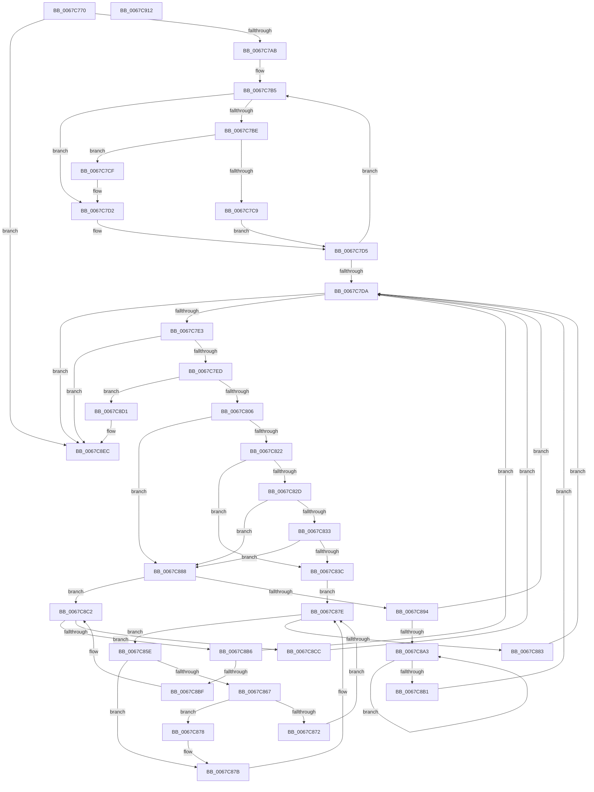

# MiMarkHugeRangeIoPfnDeleted

- RVA: `0x0067C770`–`0x0067C913` (길이 `419` bytes)
- VA: `0x000000014067C770`
- 실행 섹션: `.text`
- PDB 이름 있음: `예`; PDB Function 태그: `아니요`
- unwind 정보 RVA: `0x00084C9C`
- 디코드: `116`개 명령, `419/419` bytes 표시
- 미해석 바이트: `0` (있으면 어셈블리에 `.byte`로 보존)

> 이 문서는 커널 이미지의 기계어와 PDB 기호를 분석해 생성했습니다. 4번과 5번은 함수 원형과 자료형을 바이너리 사용 방식에서 추정한 C 해석이며 원본 소스 복구 결과는 아닙니다.

## 1. Dependencies

- 직접 호출 지점: **9**; 고유 호출 대상: **7**
- 직접 호출자로 확인된 함수: **1**
- RIP 상대 이미지 참조: **1**

### Outgoing calls
- `0x0067C793` → [MiLockIoPfnTree](../2A/MiLockIoPfnTree_function_002AC8A4.md) (function, `0x002AC8A4`)
- `0x0067C7F7` → [ExAcquireSpinLockExclusiveAtDpcLevel](../24/ExAcquireSpinLockExclusiveAtDpcLevel_function_00248E80.md) (function, `0x00248E80`)
- `0x0067C80D` → [ExReleaseSpinLockExclusiveFromDpcLevel](../24/ExReleaseSpinLockExclusiveFromDpcLevel_function_002497E0.md) (function, `0x002497E0`)
- `0x0067C824` → [MiIoPfnTreeLockContended](../49/MiIoPfnTreeLockContended_function_0049D06C.md) (function, `0x0049D06C`)
- `0x0067C833` → [KeShouldYieldProcessor](../27/KeShouldYieldProcessor_function_002773E0.md) (function, `0x002773E0`)
- `0x0067C844` → [MiUnlockIoPfnTree](../2A/MiUnlockIoPfnTree_function_002AC7F8.md) (function, `0x002AC7F8`)
- `0x0067C84E` → [MiLockIoPfnTree](../2A/MiLockIoPfnTree_function_002AC8A4.md) (function, `0x002AC8A4`)
- `0x0067C8E6` → [KeBugCheckEx](../4F/KeBugCheckEx_function_004FD660.md) (function, `0x004FD660`)
- `0x0067C8F4` → [MiUnlockIoPfnTree](../2A/MiUnlockIoPfnTree_function_002AC7F8.md) (function, `0x002AC7F8`)

### Direct callers
- [MiHotRemoveHugeRange](MiHotRemoveHugeRange_function_00675DD0.md) at `0x00675F3C`

### Static image references
- `0x0067C798` → RVA `0x00E372C0` (`.data`; read)

## 2. Other-region calls and transfers

- 다른 실행 섹션으로 향하는 call: **0**
- 별도 외부 분기/꼬리 이동을 확인하지 못했습니다.

## 3. Assembly (complete function range)

```asm
0067C770  48 89 5C 24 08                  mov qword ptr [rsp + 8], rbx
0067C775  48 89 6C 24 10                  mov qword ptr [rsp + 0x10], rbp
0067C77A  48 89 74 24 18                  mov qword ptr [rsp + 0x18], rsi
0067C77F  57                              push rdi
0067C780  41 56                           push r14
0067C782  41 57                           push r15
0067C784  48 83 EC 30                     sub rsp, 0x30
0067C788  48 8B F1                        mov rsi, rcx
0067C78B  48 8B DA                        mov rbx, rdx
0067C78E  B9 01 00 00 00                  mov ecx, 1
0067C793  E8 0C 01 C3 FF                  call 0x1402ac8a4
0067C798  48 8B 0D 21 AB 7B 00            mov rcx, qword ptr [rip + 0x7bab21]
0067C79F  44 8A F0                        mov r14b, al
0067C7A2  48 85 C9                        test rcx, rcx
0067C7A5  0F 84 41 01 00 00               je 0x14067c8ec
0067C7AB  4C 8D 3C 1E                     lea r15, [rsi + rbx]
0067C7AF  33 DB                           xor ebx, ebx
0067C7B1  49 8D 6F FF                     lea rbp, [r15 - 1]
0067C7B5  48 8B 41 18                     mov rax, qword ptr [rcx + 0x18]
0067C7B9  48 3B E8                        cmp rbp, rax
0067C7BC  72 14                           jb 0x14067c7d2
0067C7BE  48 05 00 02 00 00               add rax, 0x200
0067C7C4  48 3B F0                        cmp rsi, rax
0067C7C7  72 06                           jb 0x14067c7cf
0067C7C9  48 8B 49 08                     mov rcx, qword ptr [rcx + 8]
0067C7CD  EB 06                           jmp 0x14067c7d5
0067C7CF  48 8B D9                        mov rbx, rcx
0067C7D2  48 8B 09                        mov rcx, qword ptr [rcx]
0067C7D5  48 85 C9                        test rcx, rcx
0067C7D8  75 DB                           jne 0x14067c7b5
0067C7DA  48 85 DB                        test rbx, rbx
0067C7DD  0F 84 09 01 00 00               je 0x14067c8ec
0067C7E3  48 3B 6B 18                     cmp rbp, qword ptr [rbx + 0x18]
0067C7E7  0F 82 FF 00 00 00               jb 0x14067c8ec
0067C7ED  48 8D BB AC 00 00 00            lea rdi, [rbx + 0xac]
0067C7F4  48 8B CF                        mov rcx, rdi
0067C7F7  E8 84 C6 BC FF                  call 0x140248e80
0067C7FC  83 7B 20 00                     cmp dword ptr [rbx + 0x20], 0
0067C800  0F 85 CB 00 00 00               jne 0x14067c8d1
0067C806  48 8B CF                        mov rcx, rdi
0067C809  C6 43 28 00                     mov byte ptr [rbx + 0x28], 0
0067C80D  E8 CE CF BC FF                  call 0x1402497e0
0067C812  48 8B 73 18                     mov rsi, qword ptr [rbx + 0x18]
0067C816  48 81 C6 00 02 00 00            add rsi, 0x200
0067C81D  4C 3B FE                        cmp r15, rsi
0067C820  76 66                           jbe 0x14067c888
0067C822  33 C9                           xor ecx, ecx
0067C824  E8 43 08 E2 FF                  call 0x14049d06c
0067C829  85 C0                           test eax, eax
0067C82B  75 0F                           jne 0x14067c83c
0067C82D  41 80 FE 11                     cmp r14b, 0x11
0067C831  74 55                           je 0x14067c888
0067C833  E8 A8 AB BF FF                  call 0x1402773e0
0067C838  85 C0                           test eax, eax
0067C83A  74 4C                           je 0x14067c888
0067C83C  BA 01 00 00 00                  mov edx, 1
0067C841  41 8A CE                        mov cl, r14b
0067C844  E8 AF FF C2 FF                  call 0x1402ac7f8
0067C849  B9 01 00 00 00                  mov ecx, 1
0067C84E  E8 51 00 C3 FF                  call 0x1402ac8a4
0067C853  48 8B 0D 66 AA 7B 00            mov rcx, qword ptr [rip + 0x7baa66]
0067C85A  33 DB                           xor ebx, ebx
0067C85C  EB 20                           jmp 0x14067c87e
0067C85E  48 8B 41 18                     mov rax, qword ptr [rcx + 0x18]
0067C862  48 3B E8                        cmp rbp, rax
0067C865  72 14                           jb 0x14067c87b
0067C867  48 05 00 02 00 00               add rax, 0x200
0067C86D  48 3B F0                        cmp rsi, rax
0067C870  72 06                           jb 0x14067c878
0067C872  48 8B 49 08                     mov rcx, qword ptr [rcx + 8]
0067C876  EB 06                           jmp 0x14067c87e
0067C878  48 8B D9                        mov rbx, rcx
0067C87B  48 8B 09                        mov rcx, qword ptr [rcx]
0067C87E  48 85 C9                        test rcx, rcx
0067C881  75 DB                           jne 0x14067c85e
0067C883  E9 52 FF FF FF                  jmp 0x14067c7da
0067C888  48 8B 43 08                     mov rax, qword ptr [rbx + 8]
0067C88C  48 8B CB                        mov rcx, rbx
0067C88F  48 85 C0                        test rax, rax
0067C892  74 2E                           je 0x14067c8c2
0067C894  48 8B 08                        mov rcx, qword ptr [rax]
0067C897  48 8B D8                        mov rbx, rax
0067C89A  48 85 C9                        test rcx, rcx
0067C89D  0F 84 37 FF FF FF               je 0x14067c7da
0067C8A3  48 8B 01                        mov rax, qword ptr [rcx]
0067C8A6  48 8B D9                        mov rbx, rcx
0067C8A9  48 8B C8                        mov rcx, rax
0067C8AC  48 85 C0                        test rax, rax
0067C8AF  75 F2                           jne 0x14067c8a3
0067C8B1  E9 24 FF FF FF                  jmp 0x14067c7da
0067C8B6  48 39 0B                        cmp qword ptr [rbx], rcx
0067C8B9  0F 84 1B FF FF FF               je 0x14067c7da
0067C8BF  48 8B CB                        mov rcx, rbx
0067C8C2  48 8B 5B 10                     mov rbx, qword ptr [rbx + 0x10]
0067C8C6  48 83 E3 FC                     and rbx, 0xfffffffffffffffc
0067C8CA  75 EA                           jne 0x14067c8b6
0067C8CC  E9 09 FF FF FF                  jmp 0x14067c7da
0067C8D1  4C 8B CD                        mov r9, rbp
0067C8D4  48 89 5C 24 20                  mov qword ptr [rsp + 0x20], rbx
0067C8D9  4C 8B C6                        mov r8, rsi
0067C8DC  BA 4C 19 06 00                  mov edx, 0x6194c
0067C8E1  B9 1A 00 00 00                  mov ecx, 0x1a
0067C8E6  E8 75 0D E8 FF                  call 0x1404fd660
0067C8EB  CC                              int3
0067C8EC  BA 01 00 00 00                  mov edx, 1
0067C8F1  41 8A CE                        mov cl, r14b
0067C8F4  E8 FF FE C2 FF                  call 0x1402ac7f8
0067C8F9  48 8B 5C 24 50                  mov rbx, qword ptr [rsp + 0x50]
0067C8FE  48 8B 6C 24 58                  mov rbp, qword ptr [rsp + 0x58]
0067C903  48 8B 74 24 60                  mov rsi, qword ptr [rsp + 0x60]
0067C908  48 83 C4 30                     add rsp, 0x30
0067C90C  41 5F                           pop r15
0067C90E  41 5E                           pop r14
0067C910  5F                              pop rdi
0067C911  C3                              ret
0067C912  CC                              int3
```

## 4. C-style interpretation (structured pseudocode)

```c
__int64 __fastcall MiMarkHugeRangeIoPfnDeleted(__int64 a1, __int64 a2)
{
    __int64 result;
    __int64 v_rbx;
    __int64 v_rsi;
    __int64 v_rsp;
    unsigned __int64 v_stack_m28;
    unsigned __int64 v_stack_p10;
    unsigned __int64 v_stack_p18;
    unsigned __int64 v_stack_p8;

    v_stack_p8 = v_rbx;
    v_stack_p10 = v_rbp;
    v_stack_p18 = v_rsi;
    v_rsp = (v_rsp) - (48);
    result = MiLockIoPfnTree(1, a2, a3, a4);
    if (*(unsigned __int64 *)(v_rip + 8104737) == 0) goto loc_0067C8EC;
    v_rbx = 0;
loc_0067C7B5:
    if ((a1 + a2 * 1 - 1) < (*(unsigned __int64 *)(*(unsigned __int64 *)(v_rip + 8104737) + 24))) goto loc_0067C7D2;
    result = (*(unsigned __int64 *)(*(unsigned __int64 *)(v_rip + 8104737) + 24)) + (512);
    if (a1 < result) goto loc_0067C7CF;
    goto loc_0067C7D5;
loc_0067C7CF:
loc_0067C7D2:
loc_0067C7D5:
    if (*(unsigned __int64 *)(*(unsigned __int64 *)(*(unsigned __int64 *)(v_rip + 8104737) + 8)) != 0) goto loc_0067C7B5;
loc_0067C7DA:
    if (*(unsigned __int64 *)(*(unsigned __int64 *)(v_rip + 8104737) + 8) == 0) goto loc_0067C8EC;
    if ((a1 + a2 * 1 - 1) < (*(unsigned __int64 *)(*(unsigned __int64 *)(*(unsigned __int64 *)(v_rip + 8104737) + 8) + 24))) goto loc_0067C8EC;
    result = ExAcquireSpinLockExclusiveAtDpcLevel(*(unsigned __int64 *)(*(unsigned __int64 *)(v_rip + 8104737) + 8) + 172, a2, a3, a4);
    if ((*(unsigned int *)(*(unsigned __int64 *)(*(unsigned __int64 *)(v_rip + 8104737) + 8) + 32)) != 0) goto loc_0067C8D1;
    *(unsigned __int8 *)(*(unsigned __int64 *)(*(unsigned __int64 *)(v_rip + 8104737) + 8) + 40) = 0;
    result = ExReleaseSpinLockExclusiveFromDpcLevel(*(unsigned __int64 *)(*(unsigned __int64 *)(v_rip + 8104737) + 8) + 172, a2, a3, a4);
    v_rsi = (*(unsigned __int64 *)(*(unsigned __int64 *)(*(unsigned __int64 *)(v_rip + 8104737) + 8) + 24)) + (512);
    if ((a1 + a2 * 1) <= v_rsi) goto loc_0067C888;
    a1 = 0;
    result = MiIoPfnTreeLockContended(a1, a2, a3, a4);
    if ((unsigned int)(result) != 0) goto loc_0067C83C;
    if (((unsigned __int8)((unsigned __int8)(result))) == 17) goto loc_0067C888;
    result = KeShouldYieldProcessor(a1, a2, a3, a4);
    if ((unsigned int)(result) == 0) goto loc_0067C888;
loc_0067C83C:
    result = MiUnlockIoPfnTree((unsigned __int8)((unsigned __int8)(result)), 1, a3, a4);
    result = MiLockIoPfnTree(1, 1, a3, a4);
    v_rbx = 0;
    goto loc_0067C87E;
loc_0067C85E:
    if ((a1 + a2 * 1 - 1) < (*(unsigned __int64 *)(*(unsigned __int64 *)(v_rip + 8104550) + 24))) goto loc_0067C87B;
    result = (*(unsigned __int64 *)(*(unsigned __int64 *)(v_rip + 8104550) + 24)) + (512);
    if (v_rsi < result) goto loc_0067C878;
    goto loc_0067C87E;
loc_0067C878:
loc_0067C87B:
loc_0067C87E:
    if (*(unsigned __int64 *)(*(unsigned __int64 *)(*(unsigned __int64 *)(v_rip + 8104550) + 8)) != 0) goto loc_0067C85E;
    goto loc_0067C7DA;
loc_0067C888:
    if (*(unsigned __int64 *)(*(unsigned __int64 *)(*(unsigned __int64 *)(v_rip + 8104550) + 8) + 8) == 0) goto loc_0067C8C2;
    if (*(unsigned __int64 *)(*(unsigned __int64 *)(*(unsigned __int64 *)(*(unsigned __int64 *)(v_rip + 8104550) + 8) + 8)) == 0) goto loc_0067C7DA;
loc_0067C8A3:
    if (*(unsigned __int64 *)(*(unsigned __int64 *)(*(unsigned __int64 *)(*(unsigned __int64 *)(*(unsigned __int64 *)(v_rip + 8104550) + 8) + 8))) != 0) goto loc_0067C8A3;
    goto loc_0067C7DA;
loc_0067C8B6:
    if ((*(unsigned __int64 *)(*(unsigned __int64 *)(*(unsigned __int64 *)(*(unsigned __int64 *)(*(unsigned __int64 *)(v_rip + 8104550) + 8) + 8)))) == (*(unsigned __int64 *)(*(unsigned __int64 *)(*(unsigned __int64 *)(*(unsigned __int64 *)(*(unsigned __int64 *)(v_rip + 8104550) + 8) + 8))))) goto loc_0067C7DA;
loc_0067C8C2:
    v_rbx = (*(unsigned __int64 *)(*(unsigned __int64 *)(*(unsigned __int64 *)(*(unsigned __int64 *)(*(unsigned __int64 *)(v_rip + 8104550) + 8) + 8)) + 16)) & (-4);
    if (condition_is_not_equal) goto loc_0067C8B6;
    goto loc_0067C7DA;
loc_0067C8D1:
    v_stack_m28 = v_rbx;
    result = KeBugCheckEx(26, (unsigned int)(0x6194CULL), v_rsi, a1 + a2 * 1 - 1);
loc_0067C8EC:
    result = MiUnlockIoPfnTree((unsigned __int8)((unsigned __int8)(result)), 1, v_rsi, a1 + a2 * 1 - 1);
    v_rsp = (v_rsp) + (48);
    return result;
}
```

## 5. (Beta) C Style

```c
int64_t MiMarkHugeRangeIoPfnDeleted(void *Arg1, int64_t Arg2)
{
    uint8_t *arg1 = (uint8_t *)Arg1;

    int64_t result;
    int64_t local_rbx;
    int64_t local_rsi;
    int64_t local_rsp;
    uint64_t v_stack_m28;
    uint64_t v_stack_p10;
    uint64_t v_stack_p18;
    uint64_t v_stack_p8;

    v_stack_p8 = local_rbx;
    v_stack_p10 = local_rbp;
    v_stack_p18 = local_rsi;
    local_rsp = (local_rsp) - (48);
    result = MiLockIoPfnTree(1, Arg2, a3, a4);
    if (*(uint64_t *)(v_rip + 0x7BAB21) == 0) goto loc_0067C8EC;
    local_rbx = 0;
loc_0067C7B5:
    if ((Arg1 + Arg2 * 1 - 1) < (*(uint64_t *)(*(uint64_t *)(v_rip + 0x7BAB21) + 0x18))) goto loc_0067C7D2;
    result = (*(uint64_t *)(*(uint64_t *)(v_rip + 0x7BAB21) + 0x18)) + (512);
    if (Arg1 < result) goto loc_0067C7CF;
    goto loc_0067C7D5;
loc_0067C7CF:
loc_0067C7D2:
loc_0067C7D5:
    if (*(uint64_t *)(*(uint64_t *)(*(uint64_t *)(v_rip + 0x7BAB21) + 0x8)) != 0) goto loc_0067C7B5;
loc_0067C7DA:
    if (*(uint64_t *)(*(uint64_t *)(v_rip + 0x7BAB21) + 0x8) == 0) goto loc_0067C8EC;
    if ((Arg1 + Arg2 * 1 - 1) < (*(uint64_t *)(*(uint64_t *)(*(uint64_t *)(v_rip + 0x7BAB21) + 0x8) + 0x18))) goto loc_0067C8EC;
    result = ExAcquireSpinLockExclusiveAtDpcLevel(*(uint64_t *)(*(uint64_t *)(v_rip + 0x7BAB21) + 0x8) + 172, Arg2, a3, a4);
    if ((*(uint32_t *)(*(uint64_t *)(*(uint64_t *)(v_rip + 0x7BAB21) + 0x8) + 0x20)) != 0) goto loc_0067C8D1;
    *(uint8_t *)(*(uint64_t *)(*(uint64_t *)(v_rip + 0x7BAB21) + 0x8) + 0x28) = 0;
    result = ExReleaseSpinLockExclusiveFromDpcLevel(*(uint64_t *)(*(uint64_t *)(v_rip + 0x7BAB21) + 0x8) + 172, Arg2, a3, a4);
    local_rsi = (*(uint64_t *)(*(uint64_t *)(*(uint64_t *)(v_rip + 0x7BAB21) + 0x8) + 0x18)) + (512);
    if ((Arg1 + Arg2 * 1) <= local_rsi) goto loc_0067C888;
    Arg1 = 0;
    result = MiIoPfnTreeLockContended(Arg1, Arg2, a3, a4);
    if ((uint32_t)(result) != 0) goto loc_0067C83C;
    if (((uint8_t)((uint8_t)(result))) == 17) goto loc_0067C888;
    result = KeShouldYieldProcessor(Arg1, Arg2, a3, a4);
    if ((uint32_t)(result) == 0) goto loc_0067C888;
loc_0067C83C:
    result = MiUnlockIoPfnTree((uint8_t)((uint8_t)(result)), 1, a3, a4);
    result = MiLockIoPfnTree(1, 1, a3, a4);
    local_rbx = 0;
    goto loc_0067C87E;
loc_0067C85E:
    if ((Arg1 + Arg2 * 1 - 1) < (*(uint64_t *)(*(uint64_t *)(v_rip + 0x7BAA66) + 0x18))) goto loc_0067C87B;
    result = (*(uint64_t *)(*(uint64_t *)(v_rip + 0x7BAA66) + 0x18)) + (512);
    if (local_rsi < result) goto loc_0067C878;
    goto loc_0067C87E;
loc_0067C878:
loc_0067C87B:
loc_0067C87E:
    if (*(uint64_t *)(*(uint64_t *)(*(uint64_t *)(v_rip + 0x7BAA66) + 0x8)) != 0) goto loc_0067C85E;
    goto loc_0067C7DA;
loc_0067C888:
    if (*(uint64_t *)(*(uint64_t *)(*(uint64_t *)(v_rip + 0x7BAA66) + 0x8) + 0x8) == 0) goto loc_0067C8C2;
    if (*(uint64_t *)(*(uint64_t *)(*(uint64_t *)(*(uint64_t *)(v_rip + 0x7BAA66) + 0x8) + 0x8)) == 0) goto loc_0067C7DA;
loc_0067C8A3:
    if (*(uint64_t *)(*(uint64_t *)(*(uint64_t *)(*(uint64_t *)(*(uint64_t *)(v_rip + 0x7BAA66) + 0x8) + 0x8))) != 0) goto loc_0067C8A3;
    goto loc_0067C7DA;
loc_0067C8B6:
    if ((*(uint64_t *)(*(uint64_t *)(*(uint64_t *)(*(uint64_t *)(*(uint64_t *)(v_rip + 0x7BAA66) + 0x8) + 0x8)))) == (*(uint64_t *)(*(uint64_t *)(*(uint64_t *)(*(uint64_t *)(*(uint64_t *)(v_rip + 0x7BAA66) + 0x8) + 0x8))))) goto loc_0067C7DA;
loc_0067C8C2:
    local_rbx = (*(uint64_t *)(*(uint64_t *)(*(uint64_t *)(*(uint64_t *)(*(uint64_t *)(v_rip + 0x7BAA66) + 0x8) + 0x8)) + 0x10)) & (-4);
    if (condition_is_not_equal) goto loc_0067C8B6;
    goto loc_0067C7DA;
loc_0067C8D1:
    v_stack_m28 = local_rbx;
    result = KeBugCheckEx(26, (uint32_t)(0x6194CULL), local_rsi, Arg1 + Arg2 * 1 - 1);
loc_0067C8EC:
    result = MiUnlockIoPfnTree((uint8_t)((uint8_t)(result)), 1, local_rsi, Arg1 + Arg2 * 1 - 1);
    local_rsp = (local_rsp) + (48);
    return result;
}
```

### 관측된 메모리 오프셋

구조체 형식이 확인되지 않은 접근은 인자 기준의 오프셋으로만 기록했습니다.

| 기준 인자 | 오프셋 표현 | 폭 (bit) | 접근 |
|---|---:|---:|---|
| `Arg1` | `- 0x1` | `64` | `R` |
| `Arg1` | `+ 0x0 + rbx*1` | `64` | `R` |

## 6. Execution-region graph

[열기: 2D/3D 그래프와 함수 탐색 컨트롤 패널](../../../control-panel.html?section=text&rva=0x0067C770&view=graph)

- 2D 그래프는 위에서 아래로 흐르고, 3D 그래프는 빈 공간을 드래그해 회전합니다. Shift+드래그는 이동, 휠은 확대·축소, 함수 노드 선택은 대상 보고서 이동입니다.

### Static fallback


