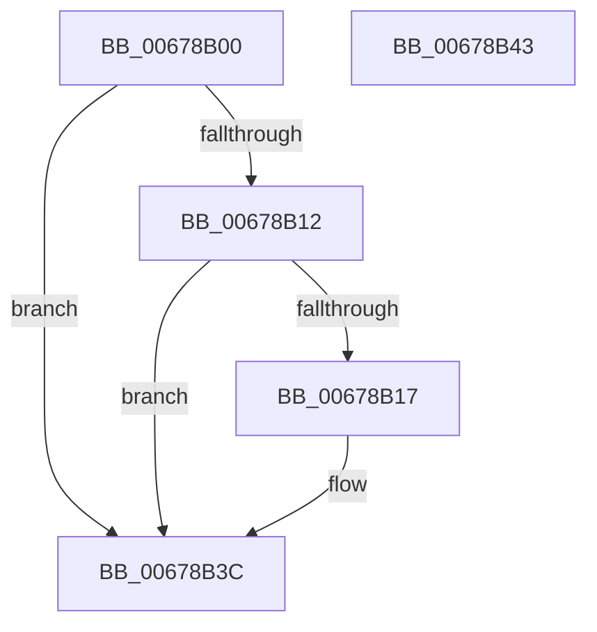

# MiMarkKernelPageTablePte

- RVA: `0x00678B00`–`0x00678B44` (길이 `68` bytes)
- VA: `0x0000000140678B00`
- 실행 섹션: `.text`
- PDB 이름 있음: `예`; PDB Function 태그: `아니요`
- unwind 정보 RVA: `0x0005D2F4`
- 디코드: `18`개 명령, `68/68` bytes 표시
- 미해석 바이트: `0` (있으면 어셈블리에 `.byte`로 보존)

> 이 문서는 커널 이미지의 기계어와 PDB 기호를 분석해 생성했습니다. 4번과 5번은 함수 원형과 자료형을 바이너리 사용 방식에서 추정한 C 해석이며 원본 소스 복구 결과는 아닙니다.

## 1. Dependencies

- 직접 호출 지점: **1**; 고유 호출 대상: **1**
- 직접 호출자로 확인된 함수: **0**
- RIP 상대 이미지 참조: **0**

### Outgoing calls
- `0x00678B37` → [PoSetHiberRange](../47/PoSetHiberRange_function_0047C580.md) (function, `0x0047C580`)

### Direct callers
- 이 함수 시작 RVA로 연결되는 직접 call은 확인되지 않았습니다. 간접 호출은 완전히 역산할 수 없습니다.

### Static image references
- 디코드된 RIP-relative 메모리 참조가 없습니다.

## 2. Other-region calls and transfers

- 다른 실행 섹션으로 향하는 call: **0**
- 별도 외부 분기/꼬리 이동을 확인하지 못했습니다.

## 3. Assembly (complete function range)

```asm
00678B00  48 83 EC 38                     sub rsp, 0x38
00678B04  4C 8B 02                        mov r8, qword ptr [rdx]
00678B07  41 B9 01 00 00 00               mov r9d, 1
00678B0D  45 84 C1                        test r9b, r8b
00678B10  74 2A                           je 0x140678b3c
00678B12  45 84 C0                        test r8b, r8b
00678B15  78 25                           js 0x140678b3c
00678B17  49 C1 E8 0C                     shr r8, 0xc
00678B1B  48 B8 FF FF FF FF FF 00 00 00   movabs rax, 0xffffffffff
00678B25  4C 23 C0                        and r8, rax
00678B28  C7 44 24 20 4D 6D 6B 70         mov dword ptr [rsp + 0x20], 0x706b6d4d
00678B30  BA 00 40 01 00                  mov edx, 0x14000
00678B35  33 C9                           xor ecx, ecx
00678B37  E8 44 3A E0 FF                  call 0x14047c580
00678B3C  33 C0                           xor eax, eax
00678B3E  48 83 C4 38                     add rsp, 0x38
00678B42  C3                              ret
00678B43  CC                              int3
```

## 4. C-style interpretation (structured pseudocode)

```c
__int64 __fastcall MiMarkKernelPageTablePte(int a1, __int64 a2)
{
    __int64 result;
    __int64 v_rsp;
    unsigned int v_stack_m18;

    v_rsp = (v_rsp) - (56);
    if (((1) & ((unsigned __int8)(*(unsigned __int64 *)(a2)))) == 0) goto loc_00678B3C;
    if (!(sign_flag)) {
        a3 = (*(unsigned __int64 *)(a2)) >> (12);
        a3 = (a3) & (result);
        v_stack_m18 = 0x706B6D4DULL;
        a2 = 0x14000ULL;
        a1 = 0;
        result = PoSetHiberRange(a1, a2, a3, 1);
    }
    result = 0;
    v_rsp = (v_rsp) + (56);
    return result;
}
```

## 5. (Beta) C Style

```c
int64_t MiMarkKernelPageTablePte(int32_t Arg1, void *Arg2)
{
    uint8_t *arg2 = (uint8_t *)Arg2;

    int64_t result;
    int64_t local_rsp;
    uint32_t v_stack_m18;

    local_rsp = (local_rsp) - (56);
    if (((1) & ((uint8_t)(*(uint64_t *)(arg2)))) == 0) goto loc_00678B3C;
    if (!(sign_flag)) {
        a3 = (*(uint64_t *)(arg2)) >> (12);
        a3 = (a3) & (result);
        v_stack_m18 = 0x706B6D4DULL;
        Arg2 = 0x14000ULL;
        Arg1 = 0;
        result = PoSetHiberRange(Arg1, Arg2, a3, 1);
    }
    result = 0;
    local_rsp = (local_rsp) + (56);
    return result;
}
```

### 관측된 메모리 오프셋

구조체 형식이 확인되지 않은 접근은 인자 기준의 오프셋으로만 기록했습니다.

| 기준 인자 | 오프셋 표현 | 폭 (bit) | 접근 |
|---|---:|---:|---|
| `Arg2` | `+ 0x0` | `64` | `R` |

## 6. Execution-region graph

[열기: 2D/3D 그래프와 함수 탐색 컨트롤 패널](../../../control-panel.html?section=text&rva=0x00678B00&view=graph)

- 2D 그래프는 위에서 아래로 흐르고, 3D 그래프는 빈 공간을 드래그해 회전합니다. Shift+드래그는 이동, 휠은 확대·축소, 함수 노드 선택은 대상 보고서 이동입니다.

### Static fallback


