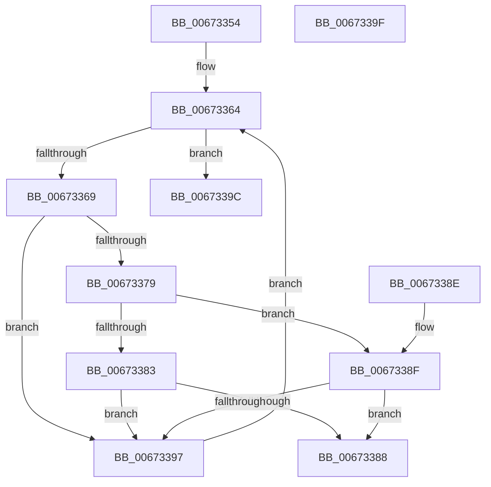

# MiMemoryRangeAlreadyExists

- RVA: `0x00673354`–`0x006733A0` (길이 `76` bytes)
- VA: `0x0000000140673354`
- 실행 섹션: `.text`
- PDB 이름 있음: `예`; PDB Function 태그: `아니요`
- unwind 정보 RVA: `0x000DB714`
- 디코드: `27`개 명령, `76/76` bytes 표시
- 미해석 바이트: `0` (있으면 어셈블리에 `.byte`로 보존)

> 이 문서는 커널 이미지의 기계어와 PDB 기호를 분석해 생성했습니다. 4번과 5번은 함수 원형과 자료형을 바이너리 사용 방식에서 추정한 C 해석이며 원본 소스 복구 결과는 아닙니다.

## 1. Dependencies

- 직접 호출 지점: **0**; 고유 호출 대상: **0**
- 직접 호출자로 확인된 함수: **2**
- RIP 상대 이미지 참조: **1**

### Outgoing calls
- 직접 디코드된 call 명령이 없습니다.

### Direct callers
- [MiAddPartitionHugeRange](MiAddPartitionHugeRange_function_006750D8.md) at `0x00675133`
- [MiAddPhysicalMemory](../../page/7F/MiAddPhysicalMemory_function_007F95FC.md) at `0x007F96E9`
- [MiAddPhysicalMemory](../../page/7F/MiAddPhysicalMemory_function_007F95FC.md) at `0x007F97EB`

### Static image references
- `0x00673354` → RVA `0x00FC6B88` (`ALMOSTRO`; read)

## 2. Other-region calls and transfers

- 다른 실행 섹션으로 향하는 call: **0**
- 별도 외부 분기/꼬리 이동을 확인하지 못했습니다.

## 3. Assembly (complete function range)

```asm
00673354  4C 8B 0D 2D 38 95 00            mov r9, qword ptr [rip + 0x95382d]
0067335B  4C 8B D1                        mov r10, rcx
0067335E  45 33 C0                        xor r8d, r8d
00673361  45 8B 19                        mov r11d, dword ptr [r9]
00673364  45 3B C3                        cmp r8d, r11d
00673367  73 33                           jae 0x14067339c
00673369  41 8B C0                        mov eax, r8d
0067336C  48 03 C0                        add rax, rax
0067336F  49 8B 4C C1 18                  mov rcx, qword ptr [r9 + rax*8 + 0x18]
00673374  48 85 C9                        test rcx, rcx
00673377  74 1E                           je 0x140673397
00673379  49 8B 44 C1 10                  mov rax, qword ptr [r9 + rax*8 + 0x10]
0067337E  4C 3B D0                        cmp r10, rax
00673381  73 0C                           jae 0x14067338f
00673383  48 3B D0                        cmp rdx, rax
00673386  76 0F                           jbe 0x140673397
00673388  B8 01 00 00 00                  mov eax, 1
0067338D  C3                              ret
0067338E  CC                              int3
0067338F  48 03 C1                        add rax, rcx
00673392  4C 3B D0                        cmp r10, rax
00673395  72 F1                           jb 0x140673388
00673397  41 FF C0                        inc r8d
0067339A  EB C8                           jmp 0x140673364
0067339C  33 C0                           xor eax, eax
0067339E  C3                              ret
0067339F  CC                              int3
```

## 4. C-style interpretation (structured pseudocode)

```c
__int64 __fastcall MiMemoryRangeAlreadyExists(__int64 a1, __int64 a2, int a3)
{
    __int64 result;

    a3 = 0;
loc_00673364:
    if (0 >= ((unsigned int)((unsigned int)(*(unsigned int *)(*(unsigned __int64 *)(v_rip + 9779245)))))) goto loc_0067339C;
    result = (0) + (0);
    if (*(unsigned __int64 *)(*(unsigned __int64 *)(v_rip + 9779245) + result * 8 + 24) == 0) goto loc_00673397;
    if (a1 >= (*(unsigned __int64 *)(*(unsigned __int64 *)(v_rip + 9779245) + result * 8 + 16))) goto loc_0067338F;
    if (a2 <= (*(unsigned __int64 *)(*(unsigned __int64 *)(v_rip + 9779245) + result * 8 + 16))) goto loc_00673397;
loc_00673388:
    return 1;
loc_0067338F:
    result = (1) + (*(unsigned __int64 *)(*(unsigned __int64 *)(v_rip + 9779245) + result * 8 + 24));
    if (a1 < result) goto loc_00673388;
loc_00673397:
    a3 = (unsigned int)((a3) + 1);
    goto loc_00673364;
loc_0067339C:
    result = 0;
    return result;
}
```

## 5. (Beta) C Style

```c
int64_t MiMemoryRangeAlreadyExists(int64_t Arg1, int64_t Arg2, int32_t Arg3)
{
    int64_t result;

    Arg3 = 0;
loc_00673364:
    if (0 >= ((uint32_t)((uint32_t)(*(uint32_t *)(*(uint64_t *)(v_rip + 0x95382D)))))) goto loc_0067339C;
    result = (0) + (0);
    if (*(uint64_t *)(*(uint64_t *)(v_rip + 0x95382D) + result * 8 + 0x18) == 0) goto loc_00673397;
    if (Arg1 >= (*(uint64_t *)(*(uint64_t *)(v_rip + 0x95382D) + result * 8 + 0x10))) goto loc_0067338F;
    if (Arg2 <= (*(uint64_t *)(*(uint64_t *)(v_rip + 0x95382D) + result * 8 + 0x10))) goto loc_00673397;
loc_00673388:
    return 1;
loc_0067338F:
    result = (1) + (*(uint64_t *)(*(uint64_t *)(v_rip + 0x95382D) + result * 8 + 0x18));
    if (Arg1 < result) goto loc_00673388;
loc_00673397:
    Arg3 = (uint32_t)((Arg3) + 1);
    goto loc_00673364;
loc_0067339C:
    result = 0;
    return result;
}
```

## 6. Execution-region graph

[열기: 2D/3D 그래프와 함수 탐색 컨트롤 패널](../../../control-panel.html?section=text&rva=0x00673354&view=graph)

- 2D 그래프는 위에서 아래로 흐르고, 3D 그래프는 빈 공간을 드래그해 회전합니다. Shift+드래그는 이동, 휠은 확대·축소, 함수 노드 선택은 대상 보고서 이동입니다.

### Static fallback


