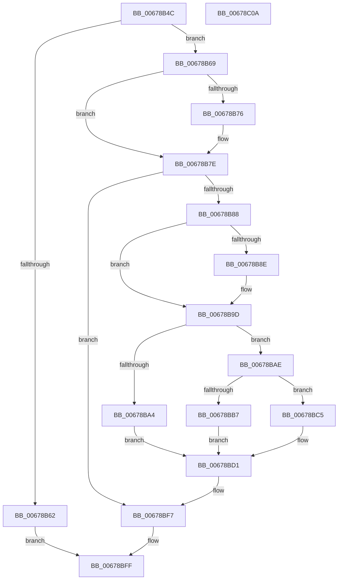

# MiMirrorBlackPhase

- RVA: `0x00678B4C`–`0x00678C0B` (길이 `191` bytes)
- VA: `0x0000000140678B4C`
- 실행 섹션: `.text`
- PDB 이름 있음: `예`; PDB Function 태그: `아니요`
- unwind 정보 RVA: `0x0005CAAC`
- 디코드: `49`개 명령, `191/191` bytes 표시
- 미해석 바이트: `0` (있으면 어셈블리에 `.byte`로 보존)

> 이 문서는 커널 이미지의 기계어와 PDB 기호를 분석해 생성했습니다. 4번과 5번은 함수 원형과 자료형을 바이너리 사용 방식에서 추정한 C 해석이며 원본 소스 복구 결과는 아닙니다.

## 1. Dependencies

- 직접 호출 지점: **9**; 고유 호출 대상: **6**
- 직접 호출자로 확인된 함수: **1**
- RIP 상대 이미지 참조: **7**

### Outgoing calls
- `0x00678B79` → [MiRemoveEnclavePagesFromMirror](../../pagelk/B7/MiRemoveEnclavePagesFromMirror_function_00B74F48.md) (function, `0x00B74F48`)
- `0x00678B98` → [MiIterateOverPartitions](../47/MiIterateOverPartitions_function_0047FC14.md) (function, `0x0047FC14`)
- `0x00678BA7` → [MiMirrorReduceBlackToActiveAndPrivatePages](../4A/MiMirrorReduceBlackToActiveAndPrivatePages_function_004AC018.md) (function, `0x004AC018`)
- `0x00678BBE` → [MiMirrorReduceBlackWrites](../2B/MiMirrorReduceBlackWrites_function_002B7C50.md) (function, `0x002B7C50`)
- `0x00678BCC` → [MiIterateOverPartitions](../47/MiIterateOverPartitions_function_0047FC14.md) (function, `0x0047FC14`)
- `0x00678BD8` → [MiMirrorDiscardTreePageContents](../4F/MiMirrorDiscardTreePageContents_function_004F61D4.md) (function, `0x004F61D4`)
- `0x00678BE4` → [MiMirrorDiscardTreePageContents](../4F/MiMirrorDiscardTreePageContents_function_004F61D4.md) (function, `0x004F61D4`)
- `0x00678BF2` → [MiIterateOverPartitions](../47/MiIterateOverPartitions_function_0047FC14.md) (function, `0x0047FC14`)
- `0x00678BFA` → [MiMirrorPerformBlackWrites](../43/MiMirrorPerformBlackWrites_function_00432EF0.md) (function, `0x00432EF0`)

### Direct callers
- [MmDuplicateMemory](../../pagelk/B7/MmDuplicateMemory_function_00B74158.md) at `0x00B74412`

### Static image references
- `0x00678B69` → RVA `0x00E375B8` (`.data`; read)
- `0x00678B91` → RVA `0x00678C20` (`MiMirrorRemoveBlackChildPartitionPages`; read)
- `0x00678BB7` → RVA `0x00E38D00` (`.data`; read)
- `0x00678BC5` → RVA `0x002B7C50` (`MiMirrorReduceBlackWrites`; read)
- `0x00678BD1` → RVA `0x00E2FF38` (`.data`; read)
- `0x00678BDD` → RVA `0x00E2FF28` (`.data`; read)
- `0x00678BE9` → RVA `0x00696000` (`MiFailInProgressZeroing`; read)

## 2. Other-region calls and transfers

- 다른 실행 섹션으로 향하는 call: **1**
  - `0x00678B79` → [MiRemoveEnclavePagesFromMirror](../../pagelk/B7/MiRemoveEnclavePagesFromMirror_function_00B74F48.md) (`.text` → `PAGELK`)
- 별도 외부 분기/꼬리 이동을 확인하지 못했습니다.

## 3. Assembly (complete function range)

```asm
00678B4C  48 89 5C 24 08                  mov qword ptr [rsp + 8], rbx
00678B51  57                              push rdi
00678B52  48 83 EC 20                     sub rsp, 0x20
00678B56  F7 41 08 00 08 00 00            test dword ptr [rcx + 8], 0x800
00678B5D  48 8B D9                        mov rbx, rcx
00678B60  74 07                           je 0x140678b69
00678B62  33 C0                           xor eax, eax
00678B64  E9 96 00 00 00                  jmp 0x140678bff
00678B69  48 83 3D 47 EA 7B 00 00         cmp qword ptr [rip + 0x7bea47], 0
00678B71  48 8B 39                        mov rdi, qword ptr [rcx]
00678B74  74 08                           je 0x140678b7e
00678B76  48 8B CF                        mov rcx, rdi
00678B79  E8 CA C3 4F 00                  call 0x140b74f48
00678B7E  8B 43 08                        mov eax, dword ptr [rbx + 8]
00678B81  A9 0D 04 00 00                  test eax, 0x40d
00678B86  74 6F                           je 0x140678bf7
00678B88  0F BA E0 08                     bt eax, 8
00678B8C  73 0F                           jae 0x140678b9d
00678B8E  48 8B D3                        mov rdx, rbx
00678B91  48 8D 0D 88 00 00 00            lea rcx, [rip + 0x88]
00678B98  E8 77 70 E0 FF                  call 0x14047fc14
00678B9D  8B 43 08                        mov eax, dword ptr [rbx + 8]
00678BA0  A8 C0                           test al, 0xc0
00678BA2  74 0A                           je 0x140678bae
00678BA4  48 8B CB                        mov rcx, rbx
00678BA7  E8 6C 34 E3 FF                  call 0x1404ac018
00678BAC  EB 23                           jmp 0x140678bd1
00678BAE  48 8B D3                        mov rdx, rbx
00678BB1  0F BA E0 08                     bt eax, 8
00678BB5  73 0E                           jae 0x140678bc5
00678BB7  48 8D 0D 42 01 7C 00            lea rcx, [rip + 0x7c0142]
00678BBE  E8 8D F0 C3 FF                  call 0x1402b7c50
00678BC3  EB 0C                           jmp 0x140678bd1
00678BC5  48 8D 0D 84 F0 C3 FF            lea rcx, [rip - 0x3c0f7c]
00678BCC  E8 43 70 E0 FF                  call 0x14047fc14
00678BD1  48 8D 0D 60 73 7B 00            lea rcx, [rip + 0x7b7360]
00678BD8  E8 F7 D5 E7 FF                  call 0x1404f61d4
00678BDD  48 8D 0D 44 73 7B 00            lea rcx, [rip + 0x7b7344]
00678BE4  E8 EB D5 E7 FF                  call 0x1404f61d4
00678BE9  48 8D 0D 10 D4 01 00            lea rcx, [rip + 0x1d410]
00678BF0  33 D2                           xor edx, edx
00678BF2  E8 1D 70 E0 FF                  call 0x14047fc14
00678BF7  48 8B CF                        mov rcx, rdi
00678BFA  E8 F1 A2 DB FF                  call 0x140432ef0
00678BFF  48 8B 5C 24 30                  mov rbx, qword ptr [rsp + 0x30]
00678C04  48 83 C4 20                     add rsp, 0x20
00678C08  5F                              pop rdi
00678C09  C3                              ret
00678C0A  CC                              int3
```

## 4. C-style interpretation (structured pseudocode)

```c
__int64 __fastcall MiMirrorBlackPhase(__int64 a1)
{
    __int64 result;
    __int64 v_rsp;
    unsigned __int64 v_stack_p8;

    v_stack_p8 = v_rbx;
    v_rsp = (v_rsp) - (32);
    if (((*(unsigned int *)(a1 + 8)) & (0x800ULL)) == 0) goto loc_00678B69;
    result = 0;
    goto loc_00678BFF;
loc_00678B69:
    if ((*(unsigned __int64 *)(v_rip + 8120903)) != 0) {
        a1 = *(unsigned __int64 *)(a1);
        result = MiRemoveEnclavePagesFromMirror(a1, a2, a3, a4);
    }
    if ((((unsigned int)((unsigned int)(*(unsigned int *)(a1 + 8)))) & (0x40DULL)) == 0) goto loc_00678BF7;
    result = (unsigned int)(*(unsigned int *)(a1 + 8));
    if (!(condition_is_above_or_equal)) {
        a2 = a1;
        a1 = v_rip + 136;
        result = MiIterateOverPartitions(a1, a2, a3, a4);
    }
    if ((((unsigned __int8)((unsigned int)(*(unsigned int *)(a1 + 8)))) & (192)) == 0) goto loc_00678BAE;
    result = MiMirrorReduceBlackToActiveAndPrivatePages(a1, a2, a3, a4);
    goto loc_00678BD1;
loc_00678BAE:
    if (condition_is_above_or_equal) goto loc_00678BC5;
    result = MiMirrorReduceBlackWrites(v_rip + 8126786, a1, a3, a4);
    goto loc_00678BD1;
loc_00678BC5:
    result = MiIterateOverPartitions(v_rip - 3936124, a1, a3, a4);
loc_00678BD1:
    result = MiMirrorDiscardTreePageContents(v_rip + 8090464, a1, a3, a4);
    result = MiMirrorDiscardTreePageContents(v_rip + 8090436, a1, a3, a4);
    a2 = 0;
    result = MiIterateOverPartitions(v_rip + 119824, a2, a3, a4);
loc_00678BF7:
    result = MiMirrorPerformBlackWrites(*(unsigned __int64 *)(a1), a2, a3, a4);
loc_00678BFF:
    v_rsp = (v_rsp) + (32);
    return result;
}
```

## 5. (Beta) C Style

```c
int64_t MiMirrorBlackPhase(void *Arg1)
{
    uint8_t *arg1 = (uint8_t *)Arg1;

    int64_t result;
    int64_t local_rsp;
    uint64_t v_stack_p8;

    v_stack_p8 = local_rbx;
    local_rsp = (local_rsp) - (32);
    if (((*(uint32_t *)(arg1 + 0x8)) & (0x800ULL)) == 0) goto loc_00678B69;
    result = 0;
    goto loc_00678BFF;
loc_00678B69:
    if ((*(uint64_t *)(v_rip + 0x7BEA47)) != 0) {
        Arg1 = *(uint64_t *)(arg1);
        result = MiRemoveEnclavePagesFromMirror(Arg1, a2, a3, a4);
    }
    if ((((uint32_t)((uint32_t)(*(uint32_t *)(arg1 + 0x8)))) & (0x40DULL)) == 0) goto loc_00678BF7;
    result = (uint32_t)(*(uint32_t *)(arg1 + 0x8));
    if (!(condition_is_above_or_equal)) {
        a2 = Arg1;
        Arg1 = v_rip + 136;
        result = MiIterateOverPartitions(Arg1, a2, a3, a4);
    }
    if ((((uint8_t)((uint32_t)(*(uint32_t *)(arg1 + 0x8)))) & (192)) == 0) goto loc_00678BAE;
    result = MiMirrorReduceBlackToActiveAndPrivatePages(Arg1, a2, a3, a4);
    goto loc_00678BD1;
loc_00678BAE:
    if (condition_is_above_or_equal) goto loc_00678BC5;
    result = MiMirrorReduceBlackWrites(v_rip + 8126786, Arg1, a3, a4);
    goto loc_00678BD1;
loc_00678BC5:
    result = MiIterateOverPartitions(v_rip - 3936124, Arg1, a3, a4);
loc_00678BD1:
    result = MiMirrorDiscardTreePageContents(v_rip + 8090464, Arg1, a3, a4);
    result = MiMirrorDiscardTreePageContents(v_rip + 8090436, Arg1, a3, a4);
    a2 = 0;
    result = MiIterateOverPartitions(v_rip + 119824, a2, a3, a4);
loc_00678BF7:
    result = MiMirrorPerformBlackWrites(*(uint64_t *)(arg1), a2, a3, a4);
loc_00678BFF:
    local_rsp = (local_rsp) + (32);
    return result;
}
```

### 관측된 메모리 오프셋

구조체 형식이 확인되지 않은 접근은 인자 기준의 오프셋으로만 기록했습니다.

| 기준 인자 | 오프셋 표현 | 폭 (bit) | 접근 |
|---|---:|---:|---|
| `Arg1` | `+ 0x0` | `64` | `R` |
| `Arg1` | `+ 0x8` | `32` | `R` |

## 6. Execution-region graph

[열기: 2D/3D 그래프와 함수 탐색 컨트롤 패널](../../../control-panel.html?section=text&rva=0x00678B4C&view=graph)

- 2D 그래프는 위에서 아래로 흐르고, 3D 그래프는 빈 공간을 드래그해 회전합니다. Shift+드래그는 이동, 휠은 확대·축소, 함수 노드 선택은 대상 보고서 이동입니다.

### Static fallback


