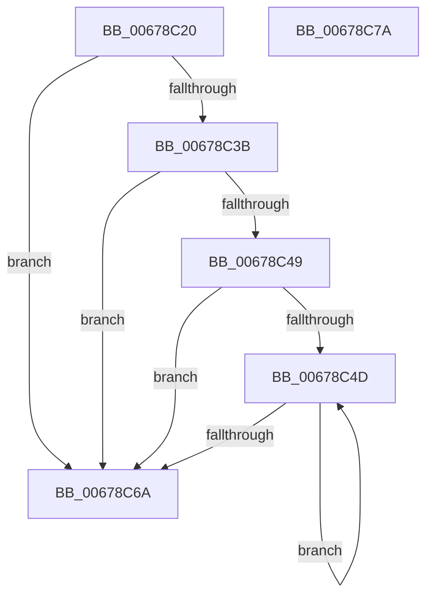

# MiMirrorRemoveBlackChildPartitionPages

- RVA: `0x00678C20`–`0x00678C7B` (길이 `91` bytes)
- VA: `0x0000000140678C20`
- 실행 섹션: `.text`
- PDB 이름 있음: `예`; PDB Function 태그: `아니요`
- unwind 정보 RVA: `0x00060BC4`
- 디코드: `29`개 명령, `91/91` bytes 표시
- 미해석 바이트: `0` (있으면 어셈블리에 `.byte`로 보존)

> 이 문서는 커널 이미지의 기계어와 PDB 기호를 분석해 생성했습니다. 4번과 5번은 함수 원형과 자료형을 바이너리 사용 방식에서 추정한 C 해석이며 원본 소스 복구 결과는 아닙니다.

## 1. Dependencies

- 직접 호출 지점: **1**; 고유 호출 대상: **1**
- 직접 호출자로 확인된 함수: **0**
- RIP 상대 이미지 참조: **1**

### Outgoing calls
- `0x00678C5F` → [MiMirrorOmitPagesFromCopy](../2B/MiMirrorOmitPagesFromCopy_function_002B7AF0.md) (function, `0x002B7AF0`)

### Direct callers
- 이 함수 시작 RVA로 연결되는 직접 call은 확인되지 않았습니다. 간접 호출은 완전히 역산할 수 없습니다.

### Static image references
- `0x00678C2F` → RVA `0x00E38D00` (`.data`; read)

## 2. Other-region calls and transfers

- 다른 실행 섹션으로 향하는 call: **0**
- 별도 외부 분기/꼬리 이동을 확인하지 못했습니다.

## 3. Assembly (complete function range)

```asm
00678C20  48 89 5C 24 08                  mov qword ptr [rsp + 8], rbx
00678C25  48 89 74 24 10                  mov qword ptr [rsp + 0x10], rsi
00678C2A  57                              push rdi
00678C2B  48 83 EC 20                     sub rsp, 0x20
00678C2F  48 8D 05 CA 00 7C 00            lea rax, [rip + 0x7c00ca]
00678C36  48 3B C8                        cmp rcx, rax
00678C39  74 2F                           je 0x140678c6a
00678C3B  48 8B 79 50                     mov rdi, qword ptr [rcx + 0x50]
00678C3F  33 DB                           xor ebx, ebx
00678C41  48 8B 32                        mov rsi, qword ptr [rdx]
00678C44  48 85 FF                        test rdi, rdi
00678C47  74 21                           je 0x140678c6a
00678C49  39 1F                           cmp dword ptr [rdi], ebx
00678C4B  76 1D                           jbe 0x140678c6a
00678C4D  8B D3                           mov edx, ebx
00678C4F  48 8B CE                        mov rcx, rsi
00678C52  48 03 D2                        add rdx, rdx
00678C55  4C 8B 44 D7 18                  mov r8, qword ptr [rdi + rdx*8 + 0x18]
00678C5A  48 8B 54 D7 10                  mov rdx, qword ptr [rdi + rdx*8 + 0x10]
00678C5F  E8 8C EE C3 FF                  call 0x1402b7af0
00678C64  FF C3                           inc ebx
00678C66  3B 1F                           cmp ebx, dword ptr [rdi]
00678C68  72 E3                           jb 0x140678c4d
00678C6A  48 8B 5C 24 30                  mov rbx, qword ptr [rsp + 0x30]
00678C6F  48 8B 74 24 38                  mov rsi, qword ptr [rsp + 0x38]
00678C74  48 83 C4 20                     add rsp, 0x20
00678C78  5F                              pop rdi
00678C79  C3                              ret
00678C7A  CC                              int3
```

## 4. C-style interpretation (structured pseudocode)

```c
__int64 __fastcall MiMirrorRemoveBlackChildPartitionPages(__int64 a1, __int64 a2)
{
    __int64 result;
    __int64 v_rbx;
    __int64 v_rsp;
    unsigned __int64 v_stack_p10;
    unsigned __int64 v_stack_p8;

    v_stack_p8 = v_rbx;
    v_stack_p10 = v_rsi;
    v_rsp = (v_rsp) - (32);
    if (a1 == (v_rip + 8126666)) goto loc_00678C6A;
    v_rbx = 0;
    if (*(unsigned __int64 *)(a1 + 80) == 0) goto loc_00678C6A;
    if ((*(unsigned int *)(*(unsigned __int64 *)(a1 + 80))) <= 0) goto loc_00678C6A;
loc_00678C4D:
    a2 = (0) + (0);
    result = MiMirrorOmitPagesFromCopy(*(unsigned __int64 *)(a2), *(unsigned __int64 *)(*(unsigned __int64 *)(a1 + 80) + a2 * 8 + 16), *(unsigned __int64 *)(*(unsigned __int64 *)(a1 + 80) + a2 * 8 + 24), a4);
    v_rbx = (unsigned int)((v_rbx) + 1);
    if (((unsigned int)(v_rbx)) < (*(unsigned int *)(*(unsigned __int64 *)(a1 + 80)))) goto loc_00678C4D;
loc_00678C6A:
    v_rsp = (v_rsp) + (32);
    return result;
}
```

## 5. (Beta) C Style

```c
int64_t MiMirrorRemoveBlackChildPartitionPages(int64_t Arg1, void *Arg2)
{
    uint8_t *arg2 = (uint8_t *)Arg2;

    int64_t result;
    int64_t local_rbx;
    int64_t local_rsp;
    uint64_t v_stack_p10;
    uint64_t v_stack_p8;

    v_stack_p8 = local_rbx;
    v_stack_p10 = local_rsi;
    local_rsp = (local_rsp) - (32);
    if (Arg1 == (v_rip + 8126666)) goto loc_00678C6A;
    local_rbx = 0;
    if (*(uint64_t *)(Arg1 + 0x50) == 0) goto loc_00678C6A;
    if ((*(uint32_t *)(*(uint64_t *)(Arg1 + 0x50))) <= 0) goto loc_00678C6A;
loc_00678C4D:
    Arg2 = (0) + (0);
    result = MiMirrorOmitPagesFromCopy(*(uint64_t *)(arg2), *(uint64_t *)(*(uint64_t *)(Arg1 + 0x50) + arg2 * 8 + 0x10), *(uint64_t *)(*(uint64_t *)(Arg1 + 0x50) + arg2 * 8 + 0x18), a4);
    local_rbx = (uint32_t)((local_rbx) + 1);
    if (((uint32_t)(local_rbx)) < (*(uint32_t *)(*(uint64_t *)(Arg1 + 0x50)))) goto loc_00678C4D;
loc_00678C6A:
    local_rsp = (local_rsp) + (32);
    return result;
}
```

### 관측된 메모리 오프셋

구조체 형식이 확인되지 않은 접근은 인자 기준의 오프셋으로만 기록했습니다.

| 기준 인자 | 오프셋 표현 | 폭 (bit) | 접근 |
|---|---:|---:|---|
| `Arg2` | `+ 0x0` | `64` | `R` |

## 6. Execution-region graph

[열기: 2D/3D 그래프와 함수 탐색 컨트롤 패널](../../../control-panel.html?section=text&rva=0x00678C20&view=graph)

- 2D 그래프는 위에서 아래로 흐르고, 3D 그래프는 빈 공간을 드래그해 회전합니다. Shift+드래그는 이동, 휠은 확대·축소, 함수 노드 선택은 대상 보고서 이동입니다.

### Static fallback


