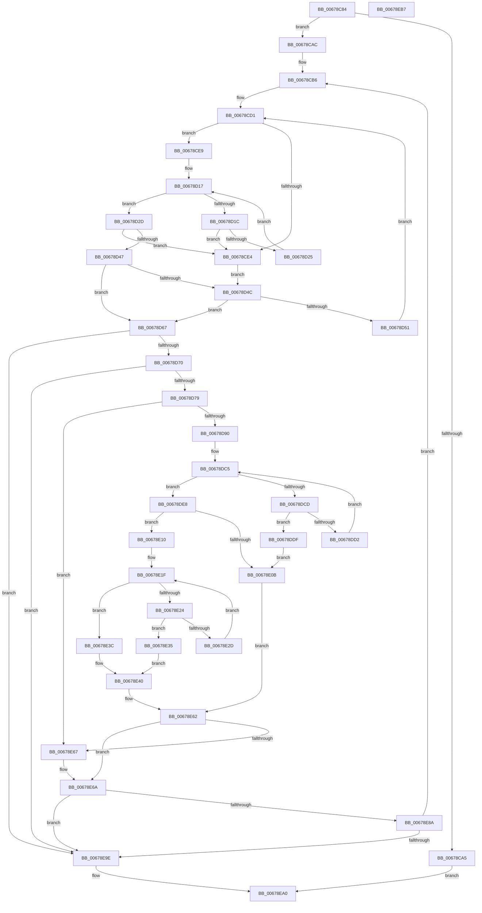

# MiMirrorVerify

- RVA: `0x00678C84`–`0x00678EB8` (길이 `564` bytes)
- VA: `0x0000000140678C84`
- 실행 섹션: `.text`
- PDB 이름 있음: `예`; PDB Function 태그: `아니요`
- unwind 정보 RVA: `0x000CB3F0`
- 디코드: `171`개 명령, `564/564` bytes 표시
- 미해석 바이트: `0` (있으면 어셈블리에 `.byte`로 보존)

> 이 문서는 커널 이미지의 기계어와 PDB 기호를 분석해 생성했습니다. 4번과 5번은 함수 원형과 자료형을 바이너리 사용 방식에서 추정한 C 해석이며 원본 소스 복구 결과는 아닙니다.

## 1. Dependencies

- 직접 호출 지점: **1**; 고유 호출 대상: **1**
- 직접 호출자로 확인된 함수: **1**
- RIP 상대 이미지 참조: **2**

### Outgoing calls
- `0x00678E7F` → [guard_dispatch_icall](../6B/guard_dispatch_icall_function_006BAAD0.md) (function, `0x006BAAD0`)

### Direct callers
- [MmDuplicateMemory](../../pagelk/B7/MmDuplicateMemory_function_00B74158.md) at `0x00B74422`

### Static image references
- `0x00678CB6` → RVA `0x00E30190` (`.data`; read)
- `0x00678CBD` → RVA `0x00E30198` (`.data`; read)

## 2. Other-region calls and transfers

- 다른 실행 섹션으로 향하는 call: **0**
- 별도 외부 분기/꼬리 이동을 확인하지 못했습니다.

## 3. Assembly (complete function range)

```asm
00678C84  48 89 5C 24 10                  mov qword ptr [rsp + 0x10], rbx
00678C89  48 89 6C 24 18                  mov qword ptr [rsp + 0x18], rbp
00678C8E  56                              push rsi
00678C8F  57                              push rdi
00678C90  41 54                           push r12
00678C92  41 55                           push r13
00678C94  41 56                           push r14
00678C96  48 83 EC 20                     sub rsp, 0x20
00678C9A  33 ED                           xor ebp, ebp
00678C9C  4C 8B F1                        mov r14, rcx
00678C9F  48 39 69 18                     cmp qword ptr [rcx + 0x18], rbp
00678CA3  75 07                           jne 0x140678cac
00678CA5  33 C0                           xor eax, eax
00678CA7  E9 F4 01 00 00                  jmp 0x140678ea0
00678CAC  33 D2                           xor edx, edx
00678CAE  49 83 CC FF                     or r12, 0xffffffffffffffff
00678CB2  44 8D 6A 01                     lea r13d, [rdx + 1]
00678CB6  4C 8B 1D D3 74 7B 00            mov r11, qword ptr [rip + 0x7b74d3]
00678CBD  48 8B 35 D4 74 7B 00            mov rsi, qword ptr [rip + 0x7b74d4]
00678CC4  49 3B D3                        cmp rdx, r11
00678CC7  4D 1B D2                        sbb r10, r10
00678CCA  4C 23 D2                        and r10, rdx
00678CCD  4D 8D 43 FF                     lea r8, [r11 - 1]
00678CD1  83 64 24 50 00                  and dword ptr [rsp + 0x50], 0
00678CD6  49 8B C0                        mov rax, r8
00678CD9  49 2B C2                        sub rax, r10
00678CDC  49 03 C5                        add rax, r13
00678CDF  49 3B C5                        cmp rax, r13
00678CE2  73 05                           jae 0x140678ce9
00678CE4  49 8B DC                        mov rbx, r12
00678CE7  EB 63                           jmp 0x140678d4c
00678CE9  49 8B C0                        mov rax, r8
00678CEC  41 8A CA                        mov cl, r10b
00678CEF  48 C1 E8 06                     shr rax, 6
00678CF3  80 E1 3F                        and cl, 0x3f
00678CF6  4D 8B CD                        mov r9, r13
00678CF9  49 D3 E1                        shl r9, cl
00678CFC  4D 2B CD                        sub r9, r13
00678CFF  48 8D 3C C6                     lea rdi, [rsi + rax*8]
00678D03  49 8B C2                        mov rax, r10
00678D06  48 C1 E8 06                     shr rax, 6
00678D0A  48 8D 1C C6                     lea rbx, [rsi + rax*8]
00678D0E  48 8B 03                        mov rax, qword ptr [rbx]
00678D11  48 F7 D0                        not rax
00678D14  4C 0B C8                        or r9, rax
00678D17  4D 3B CC                        cmp r9, r12
00678D1A  75 11                           jne 0x140678d2d
00678D1C  48 83 C3 08                     add rbx, 8
00678D20  48 3B DF                        cmp rbx, rdi
00678D23  77 BF                           ja 0x140678ce4
00678D25  4C 8B 0B                        mov r9, qword ptr [rbx]
00678D28  49 F7 D1                        not r9
00678D2B  EB EA                           jmp 0x140678d17
00678D2D  48 2B DE                        sub rbx, rsi
00678D30  49 F7 D1                        not r9
00678D33  48 C1 FB 03                     sar rbx, 3
00678D37  49 0F BC C1                     bsf rax, r9
00678D3B  48 C1 E3 06                     shl rbx, 6
00678D3F  48 03 D8                        add rbx, rax
00678D42  49 3B D8                        cmp rbx, r8
00678D45  77 9D                           ja 0x140678ce4
00678D47  49 3B DC                        cmp rbx, r12
00678D4A  75 1B                           jne 0x140678d67
00678D4C  4D 85 D2                        test r10, r10
00678D4F  74 16                           je 0x140678d67
00678D51  4C 8D 42 01                     lea r8, [rdx + 1]
00678D55  4D 3B C3                        cmp r8, r11
00678D58  4D 0F 47 C3                     cmova r8, r11
00678D5C  4D 2B C5                        sub r8, r13
00678D5F  45 33 D2                        xor r10d, r10d
00678D62  E9 6A FF FF FF                  jmp 0x140678cd1
00678D67  48 3B DA                        cmp rbx, rdx
00678D6A  0F 82 2E 01 00 00               jb 0x140678e9e
00678D70  49 3B DC                        cmp rbx, r12
00678D73  0F 84 25 01 00 00               je 0x140678e9e
00678D79  83 64 24 50 00                  and dword ptr [rsp + 0x50], 0
00678D7E  33 F6                           xor esi, esi
00678D80  48 8B 05 09 74 7B 00            mov rax, qword ptr [rip + 0x7b7409]
00678D87  48 3B C3                        cmp rax, rbx
00678D8A  0F 86 D7 00 00 00               jbe 0x140678e67
00678D90  4C 8B 15 01 74 7B 00            mov r10, qword ptr [rip + 0x7b7401]
00678D97  48 FF C8                        dec rax
00678D9A  48 C1 E8 06                     shr rax, 6
00678D9E  8A CB                           mov cl, bl
00678DA0  80 E1 3F                        and cl, 0x3f
00678DA3  4D 8D 0C C2                     lea r9, [r10 + rax*8]
00678DA7  48 8B C3                        mov rax, rbx
00678DAA  48 C1 E8 06                     shr rax, 6
00678DAE  49 8D 14 C2                     lea rdx, [r10 + rax*8]
00678DB2  49 8B C5                        mov rax, r13
00678DB5  4C 8B 02                        mov r8, qword ptr [rdx]
00678DB8  48 D3 E0                        shl rax, cl
00678DBB  49 2B C5                        sub rax, r13
00678DBE  4C 0B C0                        or r8, rax
00678DC1  48 8D 42 08                     lea rax, [rdx + 8]
00678DC5  49 F7 D0                        not r8
00678DC8  4D 85 C0                        test r8, r8
00678DCB  75 1B                           jne 0x140678de8
00678DCD  49 3B C1                        cmp rax, r9
00678DD0  77 0D                           ja 0x140678ddf
00678DD2  48 83 C2 08                     add rdx, 8
00678DD6  48 83 C0 08                     add rax, 8
00678DDA  4C 8B 02                        mov r8, qword ptr [rdx]
00678DDD  EB E6                           jmp 0x140678dc5
00678DDF  48 8B 05 AA 73 7B 00            mov rax, qword ptr [rip + 0x7b73aa]
00678DE6  EB 23                           jmp 0x140678e0b
00678DE8  49 0F BC C8                     bsf rcx, r8
00678DEC  48 8B FA                        mov rdi, rdx
00678DEF  49 2B FA                        sub rdi, r10
00678DF2  8B C1                           mov eax, ecx
00678DF4  48 C1 FF 03                     sar rdi, 3
00678DF8  48 C1 E7 06                     shl rdi, 6
00678DFC  48 03 F8                        add rdi, rax
00678DFF  48 8B 05 8A 73 7B 00            mov rax, qword ptr [rip + 0x7b738a]
00678E06  48 3B F8                        cmp rdi, rax
00678E09  76 05                           jbe 0x140678e10
00678E0B  48 8B F8                        mov rdi, rax
00678E0E  EB 52                           jmp 0x140678e62
00678E10  49 8B C5                        mov rax, r13
00678E13  48 D3 E0                        shl rax, cl
00678E16  49 2B C5                        sub rax, r13
00678E19  49 0B C0                        or rax, r8
00678E1C  48 F7 D0                        not rax
00678E1F  48 85 C0                        test rax, rax
00678E22  75 18                           jne 0x140678e3c
00678E24  48 8D 42 08                     lea rax, [rdx + 8]
00678E28  49 3B C1                        cmp rax, r9
00678E2B  77 08                           ja 0x140678e35
00678E2D  48 8B D0                        mov rdx, rax
00678E30  48 8B 00                        mov rax, qword ptr [rax]
00678E33  EB EA                           jmp 0x140678e1f
00678E35  B8 40 00 00 00                  mov eax, 0x40
00678E3A  EB 04                           jmp 0x140678e40
00678E3C  48 0F BC C0                     bsf rax, rax
00678E40  48 8B F2                        mov rsi, rdx
00678E43  49 2B F2                        sub rsi, r10
00678E46  48 C1 FE 03                     sar rsi, 3
00678E4A  48 C1 E6 06                     shl rsi, 6
00678E4E  48 03 F0                        add rsi, rax
00678E51  48 8B 05 38 73 7B 00            mov rax, qword ptr [rip + 0x7b7338]
00678E58  48 3B F0                        cmp rsi, rax
00678E5B  48 0F 47 F0                     cmova rsi, rax
00678E5F  48 2B F7                        sub rsi, rdi
00678E62  48 85 F6                        test rsi, rsi
00678E65  75 03                           jne 0x140678e6a
00678E67  48 8B F8                        mov rdi, rax
00678E6A  49 8B 46 18                     mov rax, qword ptr [r14 + 0x18]
00678E6E  48 2B FB                        sub rdi, rbx
00678E71  48 8B D7                        mov rdx, rdi
00678E74  48 8B CB                        mov rcx, rbx
00678E77  48 C1 E2 0C                     shl rdx, 0xc
00678E7B  48 C1 E1 0C                     shl rcx, 0xc
00678E7F  E8 4C 1C 04 00                  call 0x1406baad0
00678E84  8B E8                           mov ebp, eax
00678E86  85 C0                           test eax, eax
00678E88  78 14                           js 0x140678e9e
00678E8A  48 8D 14 1E                     lea rdx, [rsi + rbx]
00678E8E  48 03 D7                        add rdx, rdi
00678E91  48 3B 15 F8 72 7B 00            cmp rdx, qword ptr [rip + 0x7b72f8]
00678E98  0F 82 18 FE FF FF               jb 0x140678cb6
00678E9E  8B C5                           mov eax, ebp
00678EA0  48 8B 5C 24 58                  mov rbx, qword ptr [rsp + 0x58]
00678EA5  48 8B 6C 24 60                  mov rbp, qword ptr [rsp + 0x60]
00678EAA  48 83 C4 20                     add rsp, 0x20
00678EAE  41 5E                           pop r14
00678EB0  41 5D                           pop r13
00678EB2  41 5C                           pop r12
00678EB4  5F                              pop rdi
00678EB5  5E                              pop rsi
00678EB6  C3                              ret
00678EB7  CC                              int3
```

## 4. C-style interpretation (structured pseudocode)

```c
__int64 __fastcall MiMirrorVerify(__int64 a1, int a2)
{
    __int64 result;
    __int64 v_r10;
    __int64 v_r12;
    __int64 v_rbp;
    __int64 v_rbx;
    __int64 v_rdi;
    __int64 v_rsi;
    __int64 v_rsp;
    unsigned __int64 v_stack_p10;
    unsigned __int64 v_stack_p18;
    unsigned int v_stack_p8;

    v_stack_p10 = v_rbx;
    v_stack_p18 = v_rbp;
    v_rsp = (v_rsp) - (32);
    v_rbp = 0;
    if ((*(unsigned __int64 *)(a1 + 24)) != 0) goto loc_00678CAC;
    result = 0;
    goto loc_00678EA0;
loc_00678CAC:
    a2 = 0;
    v_r12 = (v_r12) | (-1);
loc_00678CB6:
    v_r10 = (v_r10) & (0);
loc_00678CD1:
    result = (*(unsigned __int64 *)(v_rip + 8090835) - 1) - (v_r10);
    result = (result) + (a2 + 1);
    if (result >= (a2 + 1)) goto loc_00678CE9;
loc_00678CE4:
    goto loc_00678D4C;
loc_00678CE9:
    result = (*(unsigned __int64 *)(v_rip + 8090835) - 1) >> (6);
    a1 = (unsigned __int8)(((unsigned __int8)(v_r10)) & (63));
    a4 = (a2 + 1) << ((unsigned __int8)(a1));
    a4 = (a4) - (a2 + 1);
    result = (v_r10) >> (6);
    result = ~(*(unsigned __int64 *)(*(unsigned __int64 *)(v_rip + 8090836) + result * 8));
    a4 = (a4) | (result);
loc_00678D17:
    if (a4 != v_r12) goto loc_00678D2D;
    v_rbx = (*(unsigned __int64 *)(v_rip + 8090836) + result * 8) + (8);
    if (v_rbx > (*(unsigned __int64 *)(v_rip + 8090836) + result * 8)) goto loc_00678CE4;
    a4 = ~(*(unsigned __int64 *)(v_rbx));
    goto loc_00678D17;
loc_00678D2D:
    v_rbx = (v_rbx) - (*(unsigned __int64 *)(v_rip + 8090836));
    a4 = ~(a4);
    v_rbx = (v_rbx) >> (3);
    v_rbx = (v_rbx) << (6);
    v_rbx = (v_rbx) + (result);
    if (v_rbx > (*(unsigned __int64 *)(v_rip + 8090835) - 1)) goto loc_00678CE4;
    if (v_rbx != v_r12) goto loc_00678D67;
loc_00678D4C:
    if (v_r10 == 0) goto loc_00678D67;
    a3 = a2 + 1;
    if ((a2 + 1) > (*(unsigned __int64 *)(v_rip + 8090835))) { a3 = *(unsigned __int64 *)(v_rip + 8090835); }
    a3 = (a3) - (a2 + 1);
    v_r10 = 0;
    goto loc_00678CD1;
loc_00678D67:
    if (v_rbx < 0) goto loc_00678E9E;
    if (v_rbx == v_r12) goto loc_00678E9E;
    v_rsi = 0;
    if ((*(unsigned __int64 *)(v_rip + 8090633)) <= v_rbx) goto loc_00678E67;
    result = (*(unsigned __int64 *)(v_rip + 8090633)) - 1;
    result = (result) >> (6);
    a1 = (unsigned __int8)(((unsigned __int8)(v_rbx)) & (63));
    result = (v_rbx) >> (6);
    result = (a2 + 1) << ((unsigned __int8)(a1));
    result = (result) - (a2 + 1);
    a3 = (*(unsigned __int64 *)(*(unsigned __int64 *)(v_rip + 8090625) + result * 8)) | (result);
loc_00678DC5:
    a3 = ~(a3);
    if (a3 != 0) goto loc_00678DE8;
    if ((*(unsigned __int64 *)(v_rip + 8090625) + result * 8 + 8) > (*(unsigned __int64 *)(v_rip + 8090625) + result * 8)) goto loc_00678DDF;
    a2 = (*(unsigned __int64 *)(v_rip + 8090625) + result * 8) + (8);
    result = (*(unsigned __int64 *)(v_rip + 8090625) + result * 8 + 8) + (8);
    goto loc_00678DC5;
loc_00678DDF:
    goto loc_00678E0B;
loc_00678DE8:
    v_rdi = (a2) - (*(unsigned __int64 *)(v_rip + 8090625));
    v_rdi = (v_rdi) >> (3);
    v_rdi = (v_rdi) << (6);
    v_rdi = (v_rdi) + ((unsigned int)((unsigned int)(a1)));
    if (v_rdi <= (*(unsigned __int64 *)(v_rip + 8090506))) goto loc_00678E10;
loc_00678E0B:
    goto loc_00678E62;
loc_00678E10:
    result = (a2 + 1) << ((unsigned __int8)(a1));
    result = (result) - (a2 + 1);
    result = (result) | (*(unsigned __int64 *)(a2));
    result = ~(result);
loc_00678E1F:
    if (result != 0) goto loc_00678E3C;
    if ((a2 + 8) > (*(unsigned __int64 *)(v_rip + 8090625) + result * 8)) goto loc_00678E35;
    goto loc_00678E1F;
loc_00678E35:
    goto loc_00678E40;
loc_00678E3C:
loc_00678E40:
    v_rsi = (a2 + 8) - (*(unsigned __int64 *)(v_rip + 8090625));
    v_rsi = (v_rsi) >> (3);
    v_rsi = (v_rsi) << (6);
    v_rsi = (v_rsi) + (64);
    if (v_rsi > (*(unsigned __int64 *)(v_rip + 8090424))) { v_rsi = *(unsigned __int64 *)(v_rip + 8090424); }
    v_rsi = (v_rsi) - (*(unsigned __int64 *)(v_rip + 8090506));
loc_00678E62:
    v_rdi = *(unsigned __int64 *)(v_rip + 8090506);
    if (v_rsi == 0) {
        v_rdi = *(unsigned __int64 *)(v_rip + 8090424);
    }
    v_rdi = (v_rdi) - (v_rbx);
    a2 = (v_rdi) << (12);
    a1 = (v_rbx) << (12);
    result = guard_dispatch_icall(a1, a2, *(unsigned __int64 *)(a2), *(unsigned __int64 *)(v_rip + 8090625) + result * 8);
    if (sign_flag) goto loc_00678E9E;
    a2 = (v_rsi + v_rbx * 1) + (v_rdi);
    if (a2 < (*(unsigned __int64 *)(v_rip + 8090360))) goto loc_00678CB6;
loc_00678E9E:
loc_00678EA0:
    v_rsp = (v_rsp) + (32);
    return (unsigned int)((unsigned int)((unsigned int)((unsigned int)(result))));
}
```

## 5. (Beta) C Style

```c
int64_t MiMirrorVerify(void *Arg1, int32_t Arg2)
{
    uint8_t *arg1 = (uint8_t *)Arg1;

    int64_t result;
    int64_t local_r10;
    int64_t local_r12;
    int64_t local_rbp;
    int64_t local_rbx;
    int64_t local_rdi;
    int64_t local_rsi;
    int64_t local_rsp;
    uint64_t v_stack_p10;
    uint64_t v_stack_p18;
    uint32_t v_stack_p8;

    v_stack_p10 = local_rbx;
    v_stack_p18 = local_rbp;
    local_rsp = (local_rsp) - (32);
    local_rbp = 0;
    if ((*(uint64_t *)(arg1 + 0x18)) != 0) goto loc_00678CAC;
    result = 0;
    goto loc_00678EA0;
loc_00678CAC:
    Arg2 = 0;
    local_r12 = (local_r12) | (-1);
loc_00678CB6:
    local_r10 = (local_r10) & (0);
loc_00678CD1:
    result = (*(uint64_t *)(v_rip + 0x7B74D3) - 1) - (local_r10);
    result = (result) + (Arg2 + 1);
    if (result >= (Arg2 + 1)) goto loc_00678CE9;
loc_00678CE4:
    goto loc_00678D4C;
loc_00678CE9:
    result = (*(uint64_t *)(v_rip + 0x7B74D3) - 1) >> (6);
    Arg1 = (uint8_t)(((uint8_t)(local_r10)) & (63));
    a4 = (Arg2 + 1) << ((uint8_t)(Arg1));
    a4 = (a4) - (Arg2 + 1);
    result = (local_r10) >> (6);
    result = ~(*(uint64_t *)(*(uint64_t *)(v_rip + 0x7B74D4) + result * 8));
    a4 = (a4) | (result);
loc_00678D17:
    if (a4 != local_r12) goto loc_00678D2D;
    local_rbx = (*(uint64_t *)(v_rip + 0x7B74D4) + result * 8) + (8);
    if (local_rbx > (*(uint64_t *)(v_rip + 0x7B74D4) + result * 8)) goto loc_00678CE4;
    a4 = ~(*(uint64_t *)(local_rbx));
    goto loc_00678D17;
loc_00678D2D:
    local_rbx = (local_rbx) - (*(uint64_t *)(v_rip + 0x7B74D4));
    a4 = ~(a4);
    local_rbx = (local_rbx) >> (3);
    local_rbx = (local_rbx) << (6);
    local_rbx = (local_rbx) + (result);
    if (local_rbx > (*(uint64_t *)(v_rip + 0x7B74D3) - 1)) goto loc_00678CE4;
    if (local_rbx != local_r12) goto loc_00678D67;
loc_00678D4C:
    if (local_r10 == 0) goto loc_00678D67;
    a3 = Arg2 + 1;
    if ((Arg2 + 1) > (*(uint64_t *)(v_rip + 0x7B74D3))) { a3 = *(uint64_t *)(v_rip + 0x7B74D3); }
    a3 = (a3) - (Arg2 + 1);
    local_r10 = 0;
    goto loc_00678CD1;
loc_00678D67:
    if (local_rbx < 0) goto loc_00678E9E;
    if (local_rbx == local_r12) goto loc_00678E9E;
    local_rsi = 0;
    if ((*(uint64_t *)(v_rip + 0x7B7409)) <= local_rbx) goto loc_00678E67;
    result = (*(uint64_t *)(v_rip + 0x7B7409)) - 1;
    result = (result) >> (6);
    Arg1 = (uint8_t)(((uint8_t)(local_rbx)) & (63));
    result = (local_rbx) >> (6);
    result = (Arg2 + 1) << ((uint8_t)(Arg1));
    result = (result) - (Arg2 + 1);
    a3 = (*(uint64_t *)(*(uint64_t *)(v_rip + 0x7B7401) + result * 8)) | (result);
loc_00678DC5:
    a3 = ~(a3);
    if (a3 != 0) goto loc_00678DE8;
    if ((*(uint64_t *)(v_rip + 0x7B7401) + result * 8 + 8) > (*(uint64_t *)(v_rip + 0x7B7401) + result * 8)) goto loc_00678DDF;
    Arg2 = (*(uint64_t *)(v_rip + 0x7B7401) + result * 8) + (8);
    result = (*(uint64_t *)(v_rip + 0x7B7401) + result * 8 + 8) + (8);
    goto loc_00678DC5;
loc_00678DDF:
    goto loc_00678E0B;
loc_00678DE8:
    local_rdi = (Arg2) - (*(uint64_t *)(v_rip + 0x7B7401));
    local_rdi = (local_rdi) >> (3);
    local_rdi = (local_rdi) << (6);
    local_rdi = (local_rdi) + ((uint32_t)((uint32_t)(Arg1)));
    if (local_rdi <= (*(uint64_t *)(v_rip + 0x7B738A))) goto loc_00678E10;
loc_00678E0B:
    goto loc_00678E62;
loc_00678E10:
    result = (Arg2 + 1) << ((uint8_t)(Arg1));
    result = (result) - (Arg2 + 1);
    result = (result) | (*(uint64_t *)(Arg2));
    result = ~(result);
loc_00678E1F:
    if (result != 0) goto loc_00678E3C;
    if ((Arg2 + 8) > (*(uint64_t *)(v_rip + 0x7B7401) + result * 8)) goto loc_00678E35;
    goto loc_00678E1F;
loc_00678E35:
    goto loc_00678E40;
loc_00678E3C:
loc_00678E40:
    local_rsi = (Arg2 + 8) - (*(uint64_t *)(v_rip + 0x7B7401));
    local_rsi = (local_rsi) >> (3);
    local_rsi = (local_rsi) << (6);
    local_rsi = (local_rsi) + (64);
    if (local_rsi > (*(uint64_t *)(v_rip + 0x7B7338))) { local_rsi = *(uint64_t *)(v_rip + 0x7B7338); }
    local_rsi = (local_rsi) - (*(uint64_t *)(v_rip + 0x7B738A));
loc_00678E62:
    local_rdi = *(uint64_t *)(v_rip + 0x7B738A);
    if (local_rsi == 0) {
        local_rdi = *(uint64_t *)(v_rip + 0x7B7338);
    }
    local_rdi = (local_rdi) - (local_rbx);
    Arg2 = (local_rdi) << (12);
    Arg1 = (local_rbx) << (12);
    result = guard_dispatch_icall(Arg1, Arg2, *(uint64_t *)(Arg2), *(uint64_t *)(v_rip + 0x7B7401) + result * 8);
    if (sign_flag) goto loc_00678E9E;
    Arg2 = (local_rsi + local_rbx * 1) + (local_rdi);
    if (Arg2 < (*(uint64_t *)(v_rip + 0x7B72F8))) goto loc_00678CB6;
loc_00678E9E:
loc_00678EA0:
    local_rsp = (local_rsp) + (32);
    return (uint32_t)((uint32_t)((uint32_t)((uint32_t)(result))));
}
```

### 관측된 메모리 오프셋

구조체 형식이 확인되지 않은 접근은 인자 기준의 오프셋으로만 기록했습니다.

| 기준 인자 | 오프셋 표현 | 폭 (bit) | 접근 |
|---|---:|---:|---|
| `Arg1` | `+ 0x18` | `64` | `R` |

## 6. Execution-region graph

[열기: 2D/3D 그래프와 함수 탐색 컨트롤 패널](../../../control-panel.html?section=text&rva=0x00678C84&view=graph)

- 2D 그래프는 위에서 아래로 흐르고, 3D 그래프는 빈 공간을 드래그해 회전합니다. Shift+드래그는 이동, 휠은 확대·축소, 함수 노드 선택은 대상 보고서 이동입니다.

### Static fallback


