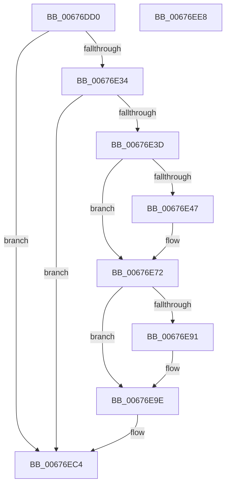

# MiMoveBadHugeRangeCrossPartition

- RVA: `0x00676DD0`–`0x00676EE9` (길이 `281` bytes)
- VA: `0x0000000140676DD0`
- 실행 섹션: `.text`
- PDB 이름 있음: `예`; PDB Function 태그: `아니요`
- unwind 정보 RVA: `0x00060300`
- 디코드: `77`개 명령, `281/281` bytes 표시
- 미해석 바이트: `0` (있으면 어셈블리에 `.byte`로 보존)

> 이 문서는 커널 이미지의 기계어와 PDB 기호를 분석해 생성했습니다. 4번과 5번은 함수 원형과 자료형을 바이너리 사용 방식에서 추정한 C 해석이며 원본 소스 복구 결과는 아닙니다.

## 1. Dependencies

- 직접 호출 지점: **9**; 고유 호출 대상: **8**
- 직접 호출자로 확인된 함수: **1**
- RIP 상대 이미지 참조: **2**

### Outgoing calls
- `0x00676E06` → [MiPageToNode](../33/MiPageToNode_function_00338CD0.md) (function, `0x00338CD0`)
- `0x00676E0E` → [MiLockHugePfn](MiLockHugePfn_function_006765FC.md) (function, `0x006765FC`)
- `0x00676E53` → [ExAcquireSpinLockExclusiveAtDpcLevel](../24/ExAcquireSpinLockExclusiveAtDpcLevel_function_00248E80.md) (function, `0x00248E80`)
- `0x00676E5E` → [MiUnlinkHugeRange](../43/MiUnlinkHugeRange_function_00436EF0.md) (function, `0x00436EF0`)
- `0x00676E6A` → [ExReleaseSpinLockExclusiveFromDpcLevel](../24/ExReleaseSpinLockExclusiveFromDpcLevel_function_002497E0.md) (function, `0x002497E0`)
- `0x00676E99` → [MiInsertHugeRangeInList](../43/MiInsertHugeRangeInList_function_004371E8.md) (function, `0x004371E8`)
- `0x00676EAE` → [MiUpdateHugePageCounts](MiUpdateHugePageCounts_function_00677530.md) (function, `0x00677530`)
- `0x00676EBF` → [MiUpdateHugePageCounts](MiUpdateHugePageCounts_function_00677530.md) (function, `0x00677530`)
- `0x00676ECA` → [MiUnlockHugePfn](../4D/MiUnlockHugePfn_function_004D90E4.md) (function, `0x004D90E4`)

### Direct callers
- [MiReleasePartitionHugeIoSpace](MiReleasePartitionHugeIoSpace_function_00677038.md) at `0x00677122`

### Static image references
- `0x00676DE8` → RVA `0x00E300C0` (`.data`; read)
- `0x00676E47` → RVA `0x00E2FFD0` (`.data`; read)

## 2. Other-region calls and transfers

- 다른 실행 섹션으로 향하는 call: **0**
- 별도 외부 분기/꼬리 이동을 확인하지 못했습니다.

## 3. Assembly (complete function range)

```asm
00676DD0  48 89 5C 24 08                  mov qword ptr [rsp + 8], rbx
00676DD5  48 89 6C 24 10                  mov qword ptr [rsp + 0x10], rbp
00676DDA  48 89 74 24 18                  mov qword ptr [rsp + 0x18], rsi
00676DDF  57                              push rdi
00676DE0  41 56                           push r14
00676DE2  41 57                           push r15
00676DE4  48 83 EC 20                     sub rsp, 0x20
00676DE8  48 8B 05 D1 92 7B 00            mov rax, qword ptr [rip + 0x7b92d1]
00676DEF  48 8B F9                        mov rdi, rcx
00676DF2  81 E1 FF FF 3F 00               and ecx, 0x3fffff
00676DF8  4D 8B F0                        mov r14, r8
00676DFB  48 8B EA                        mov rbp, rdx
00676DFE  48 8D 34 C8                     lea rsi, [rax + rcx*8]
00676E02  48 C1 E1 12                     shl rcx, 0x12
00676E06  E8 C5 1E CC FF                  call 0x140338cd0
00676E0B  48 8B CE                        mov rcx, rsi
00676E0E  E8 E9 F7 FF FF                  call 0x1406765fc
00676E13  48 8B 16                        mov rdx, qword ptr [rsi]
00676E16  44 8A F8                        mov r15b, al
00676E19  0F B7 4D 00                     movzx ecx, word ptr [rbp]
00676E1D  4C 8B C2                        mov r8, rdx
00676E20  49 C1 E8 04                     shr r8, 4
00676E24  41 81 E0 FF 07 00 00            and r8d, 0x7ff
00676E2B  4C 3B C1                        cmp r8, rcx
00676E2E  0F 85 90 00 00 00               jne 0x140676ec4
00676E34  F6 C2 08                        test dl, 8
00676E37  0F 84 87 00 00 00               je 0x140676ec4
00676E3D  8A C2                           mov al, dl
00676E3F  33 DB                           xor ebx, ebx
00676E41  24 07                           and al, 7
00676E43  3C 04                           cmp al, 4
00676E45  75 2B                           jne 0x140676e72
00676E47  48 8D 0D 82 91 7B 00            lea rcx, [rip + 0x7b9182]
00676E4E  BB 04 00 00 00                  mov ebx, 4
00676E53  E8 28 20 BD FF                  call 0x140248e80
00676E58  48 8B D7                        mov rdx, rdi
00676E5B  48 8B CD                        mov rcx, rbp
00676E5E  E8 8D 00 DC FF                  call 0x140436ef0
00676E63  48 8D 0D 66 91 7B 00            lea rcx, [rip + 0x7b9166]
00676E6A  E8 71 29 BD FF                  call 0x1402497e0
00676E6F  48 8B 16                        mov rdx, qword ptr [rsi]
00676E72  41 0F B7 0E                     movzx ecx, word ptr [r14]
00676E76  48 C1 E1 04                     shl rcx, 4
00676E7A  48 8B C1                        mov rax, rcx
00676E7D  48 33 C2                        xor rax, rdx
00676E80  48 25 0F 80 FF FF               and rax, 0xffffffffffff800f
00676E86  48 33 C1                        xor rax, rcx
00676E89  48 89 06                        mov qword ptr [rsi], rax
00676E8C  83 FB 04                        cmp ebx, 4
00676E8F  75 0D                           jne 0x140676e9e
00676E91  44 8B C3                        mov r8d, ebx
00676E94  48 8B D7                        mov rdx, rdi
00676E97  33 C9                           xor ecx, ecx
00676E99  E8 4A 03 DC FF                  call 0x1404371e8
00676E9E  45 33 C9                        xor r9d, r9d
00676EA1  48 8B D7                        mov rdx, rdi
00676EA4  48 8B CD                        mov rcx, rbp
00676EA7  41 8D 59 01                     lea ebx, [r9 + 1]
00676EAB  44 8B C3                        mov r8d, ebx
00676EAE  E8 7D 06 00 00                  call 0x140677530
00676EB3  44 8B CB                        mov r9d, ebx
00676EB6  44 8B C3                        mov r8d, ebx
00676EB9  48 8B D7                        mov rdx, rdi
00676EBC  49 8B CE                        mov rcx, r14
00676EBF  E8 6C 06 00 00                  call 0x140677530
00676EC4  41 8A D7                        mov dl, r15b
00676EC7  48 8B CE                        mov rcx, rsi
00676ECA  E8 15 22 E6 FF                  call 0x1404d90e4
00676ECF  48 8B 5C 24 40                  mov rbx, qword ptr [rsp + 0x40]
00676ED4  48 8B 6C 24 48                  mov rbp, qword ptr [rsp + 0x48]
00676ED9  48 8B 74 24 50                  mov rsi, qword ptr [rsp + 0x50]
00676EDE  48 83 C4 20                     add rsp, 0x20
00676EE2  41 5F                           pop r15
00676EE4  41 5E                           pop r14
00676EE6  5F                              pop rdi
00676EE7  C3                              ret
00676EE8  CC                              int3
```

## 4. C-style interpretation (structured pseudocode)

```c
__int64 __fastcall MiMoveBadHugeRangeCrossPartition(__int64 a1, __int64 a2, __int64 a3, int a4)
{
    __int64 result;
    __int64 v_rbx;
    __int64 v_rsp;
    unsigned __int64 v_stack_p10;
    unsigned __int64 v_stack_p18;
    unsigned __int64 v_stack_p8;

    v_stack_p8 = v_rbx;
    v_stack_p10 = v_rbp;
    v_stack_p18 = v_rsi;
    v_rsp = (v_rsp) - (32);
    a1 = (unsigned int)((a1) & (0x3FFFFFULL));
    a1 = (a1) << (18);
    result = MiPageToNode(a1, a2, a3, a4);
    result = MiLockHugePfn(*(unsigned __int64 *)(v_rip + 8098513) + a1 * 8, a2, a3, a4);
    a3 = (*(unsigned __int64 *)(*(unsigned __int64 *)(v_rip + 8098513) + a1 * 8)) >> (4);
    a3 = (unsigned int)((a3) & (0x7FFULL));
    if (a3 != (*(unsigned __int16 *)(a2))) goto loc_00676EC4;
    if ((((unsigned __int8)(*(unsigned __int64 *)(*(unsigned __int64 *)(v_rip + 8098513) + a1 * 8))) & (8)) == 0) goto loc_00676EC4;
    v_rbx = 0;
    result = (unsigned __int8)(((unsigned __int8)(*(unsigned __int64 *)(*(unsigned __int64 *)(v_rip + 8098513) + a1 * 8))) & (7));
    if (((unsigned __int8)(result)) == 4) {
        a1 = v_rip + 8098178;
        v_rbx = 4;
        result = ExAcquireSpinLockExclusiveAtDpcLevel(a1, *(unsigned __int64 *)(*(unsigned __int64 *)(v_rip + 8098513) + a1 * 8), a3, a4);
        a2 = a1;
        a1 = a2;
        result = MiUnlinkHugeRange(a1, a2, a3, a4);
        a1 = v_rip + 8098150;
        result = ExReleaseSpinLockExclusiveFromDpcLevel(a1, a2, a3, a4);
        a2 = *(unsigned __int64 *)(*(unsigned __int64 *)(v_rip + 8098513) + a1 * 8);
    }
    a1 = (*(unsigned __int16 *)(a3)) << (4);
    result = (a1) ^ (a2);
    result = (result) & (0xFFFFFFFFFFFF800FULL);
    result = (result) ^ (a1);
    *(unsigned __int64 *)(*(unsigned __int64 *)(v_rip + 8098513) + a1 * 8) = result;
    if (((unsigned int)(v_rbx)) == 4) {
        a3 = (unsigned int)(v_rbx);
        a2 = a1;
        a1 = 0;
        result = MiInsertHugeRangeInList(a1, a2, a3, a4);
    }
    a4 = 0;
    result = MiUpdateHugePageCounts(a2, 0, (unsigned int)((unsigned int)(a4 + 1)), a4);
    result = MiUpdateHugePageCounts(a3, 0, (unsigned int)((unsigned int)(a4 + 1)), (unsigned int)((unsigned int)(a4 + 1)));
loc_00676EC4:
    result = MiUnlockHugePfn(*(unsigned __int64 *)(v_rip + 8098513) + a1 * 8, (unsigned __int8)((unsigned __int8)(result)), (unsigned int)((unsigned int)(a4 + 1)), (unsigned int)((unsigned int)(a4 + 1)));
    v_rsp = (v_rsp) + (32);
    return result;
}
```

## 5. (Beta) C Style

```c
int64_t MiMoveBadHugeRangeCrossPartition(int64_t Arg1, void *Arg2, void *Arg3, int32_t Arg4)
{
    uint8_t *arg2 = (uint8_t *)Arg2;
    uint8_t *arg3 = (uint8_t *)Arg3;

    int64_t result;
    int64_t local_rbx;
    int64_t local_rsp;
    uint64_t v_stack_p10;
    uint64_t v_stack_p18;
    uint64_t v_stack_p8;

    v_stack_p8 = local_rbx;
    v_stack_p10 = local_rbp;
    v_stack_p18 = local_rsi;
    local_rsp = (local_rsp) - (32);
    Arg1 = (uint32_t)((Arg1) & (0x3FFFFFULL));
    Arg1 = (Arg1) << (18);
    result = MiPageToNode(Arg1, Arg2, Arg3, Arg4);
    result = MiLockHugePfn(*(uint64_t *)(v_rip + 0x7B92D1) + Arg1 * 8, Arg2, Arg3, Arg4);
    Arg3 = (*(uint64_t *)(*(uint64_t *)(v_rip + 0x7B92D1) + Arg1 * 8)) >> (4);
    Arg3 = (uint32_t)((Arg3) & (0x7FFULL));
    if (Arg3 != (*(uint16_t *)(arg2))) goto loc_00676EC4;
    if ((((uint8_t)(*(uint64_t *)(*(uint64_t *)(v_rip + 0x7B92D1) + Arg1 * 8))) & (8)) == 0) goto loc_00676EC4;
    local_rbx = 0;
    result = (uint8_t)(((uint8_t)(*(uint64_t *)(*(uint64_t *)(v_rip + 0x7B92D1) + Arg1 * 8))) & (7));
    if (((uint8_t)(result)) == 4) {
        Arg1 = v_rip + 8098178;
        local_rbx = 4;
        result = ExAcquireSpinLockExclusiveAtDpcLevel(Arg1, *(uint64_t *)(*(uint64_t *)(v_rip + 0x7B92D1) + Arg1 * 8), Arg3, Arg4);
        Arg2 = Arg1;
        Arg1 = Arg2;
        result = MiUnlinkHugeRange(Arg1, Arg2, Arg3, Arg4);
        Arg1 = v_rip + 8098150;
        result = ExReleaseSpinLockExclusiveFromDpcLevel(Arg1, Arg2, Arg3, Arg4);
        Arg2 = *(uint64_t *)(*(uint64_t *)(v_rip + 0x7B92D1) + Arg1 * 8);
    }
    Arg1 = (*(uint16_t *)(arg3)) << (4);
    result = (Arg1) ^ (Arg2);
    result = (result) & (0xFFFFFFFFFFFF800FULL);
    result = (result) ^ (Arg1);
    *(uint64_t *)(*(uint64_t *)(v_rip + 0x7B92D1) + Arg1 * 8) = result;
    if (((uint32_t)(local_rbx)) == 4) {
        Arg3 = (uint32_t)(local_rbx);
        Arg2 = Arg1;
        Arg1 = 0;
        result = MiInsertHugeRangeInList(Arg1, Arg2, Arg3, Arg4);
    }
    Arg4 = 0;
    result = MiUpdateHugePageCounts(Arg2, 0, (uint32_t)((uint32_t)(Arg4 + 1)), Arg4);
    result = MiUpdateHugePageCounts(Arg3, 0, (uint32_t)((uint32_t)(Arg4 + 1)), (uint32_t)((uint32_t)(Arg4 + 1)));
loc_00676EC4:
    result = MiUnlockHugePfn(*(uint64_t *)(v_rip + 0x7B92D1) + Arg1 * 8, (uint8_t)((uint8_t)(result)), (uint32_t)((uint32_t)(Arg4 + 1)), (uint32_t)((uint32_t)(Arg4 + 1)));
    local_rsp = (local_rsp) + (32);
    return result;
}
```

### 관측된 메모리 오프셋

구조체 형식이 확인되지 않은 접근은 인자 기준의 오프셋으로만 기록했습니다.

| 기준 인자 | 오프셋 표현 | 폭 (bit) | 접근 |
|---|---:|---:|---|
| `Arg2` | `+ 0x0` | `16` | `R` |
| `Arg3` | `+ 0x0` | `16` | `R` |

## 6. Execution-region graph

[열기: 2D/3D 그래프와 함수 탐색 컨트롤 패널](../../../control-panel.html?section=text&rva=0x00676DD0&view=graph)

- 2D 그래프는 위에서 아래로 흐르고, 3D 그래프는 빈 공간을 드래그해 회전합니다. Shift+드래그는 이동, 휠은 확대·축소, 함수 노드 선택은 대상 보고서 이동입니다.

### Static fallback


