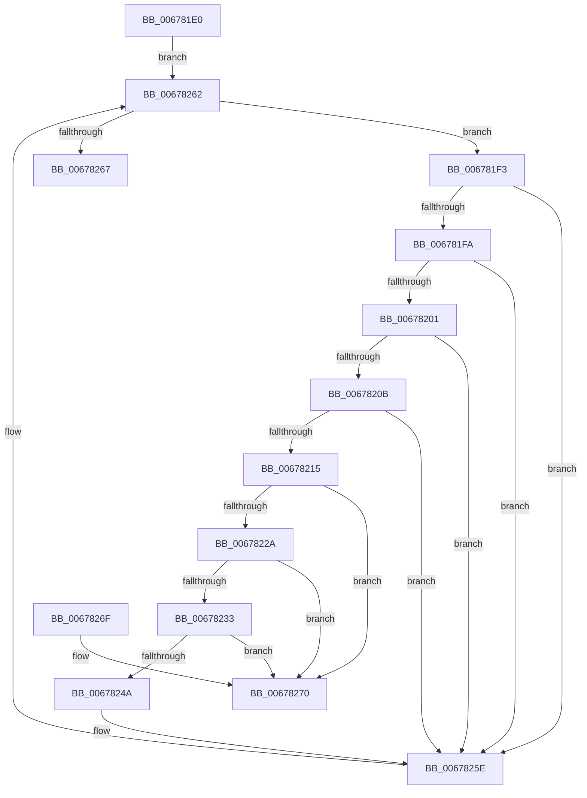

# MiMoveUnusedSubsectionsToDeleteOnClose

- RVA: `0x006781E0`–`0x00678277` (길이 `151` bytes)
- VA: `0x00000001406781E0`
- 실행 섹션: `.text`
- PDB 이름 있음: `예`; PDB Function 태그: `아니요`
- unwind 정보 RVA: `0x0005CEE8`
- 디코드: `44`개 명령, `151/151` bytes 표시
- 미해석 바이트: `0` (있으면 어셈블리에 `.byte`로 보존)

> 이 문서는 커널 이미지의 기계어와 PDB 기호를 분석해 생성했습니다. 4번과 5번은 함수 원형과 자료형을 바이너리 사용 방식에서 추정한 C 해석이며 원본 소스 복구 결과는 아닙니다.

## 1. Dependencies

- 직접 호출 지점: **1**; 고유 호출 대상: **1**
- 직접 호출자로 확인된 함수: **2**
- RIP 상대 이미지 참조: **0**

### Outgoing calls
- `0x0067821C` → [MiAdjustUnusedSegmentWalkers](MiAdjustUnusedSegmentWalkers_function_006779FC.md) (function, `0x006779FC`)

### Direct callers
- [MiPrepareDeleteOnClose](MiPrepareDeleteOnClose_function_0067835C.md) at `0x0067839F`
- [MiProcessDeleteOnClose](MiProcessDeleteOnClose_function_006783D8.md) at `0x00678457`

### Static image references
- 디코드된 RIP-relative 메모리 참조가 없습니다.

## 2. Other-region calls and transfers

- 다른 실행 섹션으로 향하는 call: **0**
- 별도 외부 분기/꼬리 이동을 확인하지 못했습니다.

## 3. Assembly (complete function range)

```asm
006781E0  48 83 EC 28                     sub rsp, 0x28
006781E4  4C 8B D9                        mov r11, rcx
006781E7  4C 8D 8A 80 00 00 00            lea r9, [rdx + 0x80]
006781EE  45 33 C0                        xor r8d, r8d
006781F1  EB 6F                           jmp 0x140678262
006781F3  49 83 79 08 00                  cmp qword ptr [r9 + 8], 0
006781F8  74 64                           je 0x14067825e
006781FA  49 83 79 50 00                  cmp qword ptr [r9 + 0x50], 0
006781FF  75 5D                           jne 0x14067825e
00678201  41 8B 41 20                     mov eax, dword ptr [r9 + 0x20]
00678205  0F BA E0 10                     bt eax, 0x10
00678209  72 53                           jb 0x14067825e
0067820B  41 8B 41 20                     mov eax, dword ptr [r9 + 0x20]
0067820F  0F BA E0 13                     bt eax, 0x13
00678213  73 49                           jae 0x14067825e
00678215  49 8D 51 58                     lea rdx, [r9 + 0x58]
00678219  49 8B CB                        mov rcx, r11
0067821C  E8 DB F7 FF FF                  call 0x1406779fc
00678221  4C 8B 12                        mov r10, qword ptr [rdx]
00678224  49 39 52 08                     cmp qword ptr [r10 + 8], rdx
00678228  75 46                           jne 0x140678270
0067822A  48 8B 42 08                     mov rax, qword ptr [rdx + 8]
0067822E  48 39 10                        cmp qword ptr [rax], rdx
00678231  75 3D                           jne 0x140678270
00678233  4C 89 10                        mov qword ptr [rax], r10
00678236  49 89 42 08                     mov qword ptr [r10 + 8], rax
0067823A  49 8D 83 D8 07 00 00            lea rax, [r11 + 0x7d8]
00678241  48 8B 08                        mov rcx, qword ptr [rax]
00678244  48 39 41 08                     cmp qword ptr [rcx + 8], rax
00678248  75 26                           jne 0x140678270
0067824A  48 89 0A                        mov qword ptr [rdx], rcx
0067824D  41 B8 01 00 00 00               mov r8d, 1
00678253  48 89 42 08                     mov qword ptr [rdx + 8], rax
00678257  48 89 51 08                     mov qword ptr [rcx + 8], rdx
0067825B  48 89 10                        mov qword ptr [rax], rdx
0067825E  4D 8B 49 10                     mov r9, qword ptr [r9 + 0x10]
00678262  4D 85 C9                        test r9, r9
00678265  75 8C                           jne 0x1406781f3
00678267  41 8B C0                        mov eax, r8d
0067826A  48 83 C4 28                     add rsp, 0x28
0067826E  C3                              ret
0067826F  CC                              int3
00678270  B9 03 00 00 00                  mov ecx, 3
00678275  CD 29                           int 0x29
```

## 4. C-style interpretation (structured pseudocode)

```c
__int64 __fastcall MiMoveUnusedSubsectionsToDeleteOnClose(__int64 a1, __int64 a2, int a3)
{
    __int64 result;
    __int64 v_rsp;

    v_rsp = (v_rsp) - (40);
    a3 = 0;
    goto loc_00678262;
loc_006781F3:
    if ((*(unsigned __int64 *)(a2 + 128 + 8)) == 0) goto loc_0067825E;
    if ((*(unsigned __int64 *)(a2 + 128 + 80)) != 0) goto loc_0067825E;
    if ((*(unsigned __int64 *)(a2 + 128 + 80)) < 0) goto loc_0067825E;
    if ((*(unsigned __int64 *)(a2 + 128 + 80)) >= 0) goto loc_0067825E;
    result = MiAdjustUnusedSegmentWalkers(a1, a2 + 128 + 88, a3, a2 + 128);
    if ((*(unsigned __int64 *)(*(unsigned __int64 *)(a2 + 128 + 88) + 8)) != (a2 + 128 + 88)) goto loc_00678270;
    if ((*(unsigned __int64 *)(*(unsigned __int64 *)(a2 + 128 + 88 + 8))) != (a2 + 128 + 88)) goto loc_00678270;
    *(unsigned __int64 *)(*(unsigned __int64 *)(a2 + 128 + 88 + 8)) = *(unsigned __int64 *)(a2 + 128 + 88);
    *(unsigned __int64 *)(*(unsigned __int64 *)(a2 + 128 + 88) + 8) = *(unsigned __int64 *)(a2 + 128 + 88 + 8);
    if ((*(unsigned __int64 *)(*(unsigned __int64 *)(a1 + 2008) + 8)) != (a1 + 2008)) goto loc_00678270;
    *(unsigned __int64 *)(a2 + 128 + 88) = *(unsigned __int64 *)(a1 + 2008);
    *(unsigned __int64 *)(a2 + 128 + 88 + 8) = a1 + 2008;
    *(unsigned __int64 *)(*(unsigned __int64 *)(a1 + 2008) + 8) = a2 + 128 + 88;
    *(unsigned __int64 *)(a1 + 2008) = a2 + 128 + 88;
loc_0067825E:
loc_00678262:
    if (*(unsigned __int64 *)(a2 + 128 + 16) != 0) goto loc_006781F3;
    v_rsp = (v_rsp) + (40);
    return 1;
loc_00678270:
    return 1;
}
```

## 5. (Beta) C Style

```c
int64_t MiMoveUnusedSubsectionsToDeleteOnClose(int64_t Arg1, void *Arg2, int32_t Arg3)
{
    uint8_t *arg2 = (uint8_t *)Arg2;

    int64_t result;
    int64_t local_rsp;

    local_rsp = (local_rsp) - (40);
    Arg3 = 0;
    goto loc_00678262;
loc_006781F3:
    if ((*(uint64_t *)(arg2 + 0x80 + 0x8)) == 0) goto loc_0067825E;
    if ((*(uint64_t *)(arg2 + 0x80 + 0x50)) != 0) goto loc_0067825E;
    if ((*(uint64_t *)(arg2 + 0x80 + 0x50)) < 0) goto loc_0067825E;
    if ((*(uint64_t *)(arg2 + 0x80 + 0x50)) >= 0) goto loc_0067825E;
    result = MiAdjustUnusedSegmentWalkers(Arg1, Arg2 + 128 + 88, Arg3, Arg2 + 128);
    if ((*(uint64_t *)(*(uint64_t *)(arg2 + 0x80 + 0x58) + 0x8)) != (Arg2 + 128 + 88)) goto loc_00678270;
    if ((*(uint64_t *)(*(uint64_t *)(arg2 + 0x80 + 0x58 + 0x8))) != (Arg2 + 128 + 88)) goto loc_00678270;
    *(uint64_t *)(*(uint64_t *)(arg2 + 0x80 + 0x58 + 0x8)) = *(uint64_t *)(arg2 + 0x80 + 0x58);
    *(uint64_t *)(*(uint64_t *)(arg2 + 0x80 + 0x58) + 0x8) = *(uint64_t *)(arg2 + 0x80 + 0x58 + 0x8);
    if ((*(uint64_t *)(*(uint64_t *)(Arg1 + 0x7D8) + 0x8)) != (Arg1 + 2008)) goto loc_00678270;
    *(uint64_t *)(arg2 + 0x80 + 0x58) = *(uint64_t *)(Arg1 + 0x7D8);
    *(uint64_t *)(arg2 + 0x80 + 0x58 + 0x8) = Arg1 + 2008;
    *(void **)(*(uint64_t *)(Arg1 + 0x7D8) + 0x8) = Arg2 + 128 + 88;
    *(void **)(Arg1 + 0x7D8) = Arg2 + 128 + 88;
loc_0067825E:
loc_00678262:
    if (*(uint64_t *)(arg2 + 0x80 + 0x10) != 0) goto loc_006781F3;
    local_rsp = (local_rsp) + (40);
    return 1;
loc_00678270:
    return 1;
}
```

### 관측된 메모리 오프셋

구조체 형식이 확인되지 않은 접근은 인자 기준의 오프셋으로만 기록했습니다.

| 기준 인자 | 오프셋 표현 | 폭 (bit) | 접근 |
|---|---:|---:|---|
| `Arg2` | `+ 0x80` | `64` | `R` |

## 6. Execution-region graph

[열기: 2D/3D 그래프와 함수 탐색 컨트롤 패널](../../../control-panel.html?section=text&rva=0x006781E0&view=graph)

- 2D 그래프는 위에서 아래로 흐르고, 3D 그래프는 빈 공간을 드래그해 회전합니다. Shift+드래그는 이동, 휠은 확대·축소, 함수 노드 선택은 대상 보고서 이동입니다.

### Static fallback


