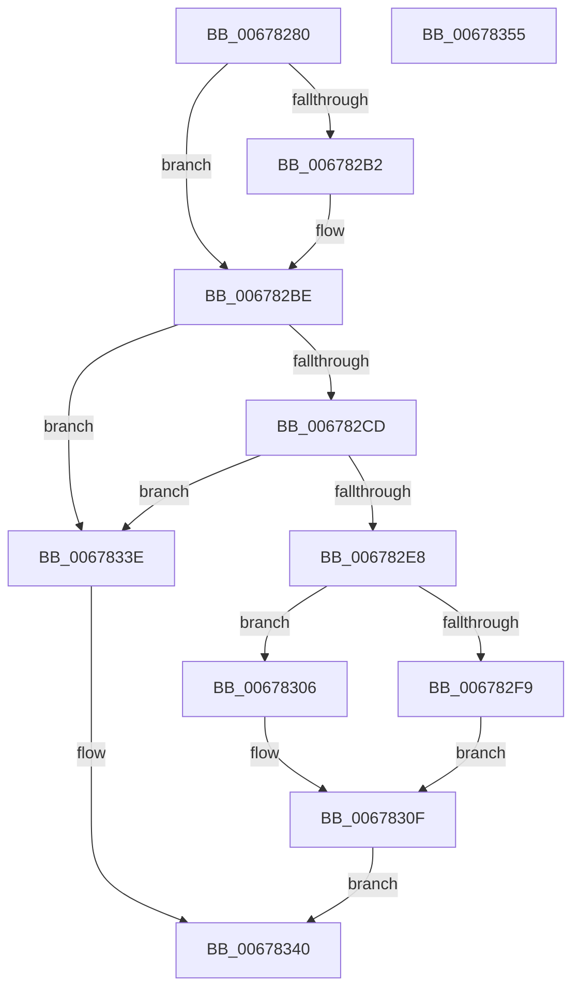

# MiNotifyUserOfLostData

- RVA: `0x00678280`–`0x00678356` (길이 `214` bytes)
- VA: `0x0000000140678280`
- 실행 섹션: `.text`
- PDB 이름 있음: `예`; PDB Function 태그: `아니요`
- unwind 정보 RVA: `0x0005C954`
- 디코드: `59`개 명령, `214/214` bytes 표시
- 미해석 바이트: `0` (있으면 어셈블리에 `.byte`로 보존)

> 이 문서는 커널 이미지의 기계어와 PDB 기호를 분석해 생성했습니다. 4번과 5번은 함수 원형과 자료형을 바이너리 사용 방식에서 추정한 C 해석이며 원본 소스 복구 결과는 아닙니다.

## 1. Dependencies

- 직접 호출 지점: **7**; 고유 호출 대상: **7**
- 직접 호출자로 확인된 함수: **2**
- RIP 상대 이미지 참조: **1**

### Outgoing calls
- `0x0067829F` → [ExAcquireSpinLockExclusive](../24/ExAcquireSpinLockExclusive_function_00248690.md) (function, `0x00248690`)
- `0x006782C4` → [MiReleaseSpinLockExclusive](../24/MiReleaseSpinLockExclusive_function_002482C0.md) (function, `0x002482C0`)
- `0x006782DB` → [MiAllocatePool](../35/MiAllocatePool_function_0035B540.md) (function, `0x0035B540`)
- `0x006782EB` → [Feature_1992713530__private_IsEnabledDeviceUsageNoInline](Feature_1992713530__private_IsEnabledDeviceUsageNoInline_function_006779A8.md) (function, `0x006779A8`)
- `0x006782FF` → [MiReferenceControlAreaFileWithTag](../34/MiReferenceControlAreaFileWithTag_function_00348390.md) (function, `0x00348390`)
- `0x0067830A` → [ObFastReferenceObjectLocked](../38/ObFastReferenceObjectLocked_function_00381DA0.md) (function, `0x00381DA0`)
- `0x00678332` → [ExQueueWorkItem](../2F/ExQueueWorkItem_function_002F9520.md) (function, `0x002F9520`)

### Direct callers
- [MiDeleteCachedSubsection](../29/MiDeleteCachedSubsection_function_00297888.md) at `0x00297B4B`
- [MiWriteComplete](../40/MiWriteComplete_function_004069B0.md) at `0x00406F1D`

### Static image references
- `0x00678313` → RVA `0x007FCFF0` (`MiLdwPopupWorker`; read)

## 2. Other-region calls and transfers

- 다른 실행 섹션으로 향하는 call: **0**
- 별도 외부 분기/꼬리 이동을 확인하지 못했습니다.

## 3. Assembly (complete function range)

```asm
00678280  48 89 5C 24 08                  mov qword ptr [rsp + 8], rbx
00678285  48 89 6C 24 10                  mov qword ptr [rsp + 0x10], rbp
0067828A  48 89 74 24 18                  mov qword ptr [rsp + 0x18], rsi
0067828F  57                              push rdi
00678290  48 83 EC 20                     sub rsp, 0x20
00678294  48 8B F9                        mov rdi, rcx
00678297  8B EA                           mov ebp, edx
00678299  48 83 C1 48                     add rcx, 0x48
0067829D  33 DB                           xor ebx, ebx
0067829F  E8 EC 03 BD FF                  call 0x140248690
006782A4  44 8B 47 38                     mov r8d, dword ptr [rdi + 0x38]
006782A8  B9 00 08 00 00                  mov ecx, 0x800
006782AD  44 85 C1                        test ecx, r8d
006782B0  75 0C                           jne 0x1406782be
006782B2  44 0B C1                        or r8d, ecx
006782B5  BB 01 00 00 00                  mov ebx, 1
006782BA  44 89 47 38                     mov dword ptr [rdi + 0x38], r8d
006782BE  8A D0                           mov dl, al
006782C0  48 8D 4F 48                     lea rcx, [rdi + 0x48]
006782C4  E8 F7 FF BC FF                  call 0x1402482c0
006782C9  85 DB                           test ebx, ebx
006782CB  74 71                           je 0x14067833e
006782CD  BA 38 00 00 00                  mov edx, 0x38
006782D2  41 B8 4D 6D 64 70               mov r8d, 0x70646d4d
006782D8  8D 4A 08                        lea ecx, [rdx + 8]
006782DB  E8 60 32 CE FF                  call 0x14035b540
006782E0  48 8B D8                        mov rbx, rax
006782E3  48 85 C0                        test rax, rax
006782E6  74 56                           je 0x14067833e
006782E8  89 68 28                        mov dword ptr [rax + 0x28], ebp
006782EB  E8 B8 F6 FF FF                  call 0x1406779a8
006782F0  BA 4D 6D 53 63                  mov edx, 0x63536d4d
006782F5  85 C0                           test eax, eax
006782F7  74 0D                           je 0x140678306
006782F9  45 33 C0                        xor r8d, r8d
006782FC  48 8B CF                        mov rcx, rdi
006782FF  E8 8C 00 CD FF                  call 0x140348390
00678304  EB 09                           jmp 0x14067830f
00678306  48 8D 4F 40                     lea rcx, [rdi + 0x40]
0067830A  E8 91 9A D0 FF                  call 0x140381da0
0067830F  48 83 23 00                     and qword ptr [rbx], 0
00678313  48 8D 0D D6 4C 18 00            lea rcx, [rip + 0x184cd6]
0067831A  48 89 4B 10                     mov qword ptr [rbx + 0x10], rcx
0067831E  BA 01 00 00 00                  mov edx, 1
00678323  48 8B CB                        mov rcx, rbx
00678326  48 89 43 20                     mov qword ptr [rbx + 0x20], rax
0067832A  C6 43 30 01                     mov byte ptr [rbx + 0x30], 1
0067832E  48 89 5B 18                     mov qword ptr [rbx + 0x18], rbx
00678332  E8 E9 11 C8 FF                  call 0x1402f9520
00678337  B8 01 00 00 00                  mov eax, 1
0067833C  EB 02                           jmp 0x140678340
0067833E  33 C0                           xor eax, eax
00678340  48 8B 5C 24 30                  mov rbx, qword ptr [rsp + 0x30]
00678345  48 8B 6C 24 38                  mov rbp, qword ptr [rsp + 0x38]
0067834A  48 8B 74 24 40                  mov rsi, qword ptr [rsp + 0x40]
0067834F  48 83 C4 20                     add rsp, 0x20
00678353  5F                              pop rdi
00678354  C3                              ret
00678355  CC                              int3
```

## 4. C-style interpretation (structured pseudocode)

```c
__int64 __fastcall MiNotifyUserOfLostData(__int64 a1, int a2)
{
    __int64 result;
    __int64 v_rbx;
    __int64 v_rsp;
    unsigned __int64 v_stack_p10;
    unsigned __int64 v_stack_p18;
    unsigned __int64 v_stack_p8;

    v_stack_p8 = v_rbx;
    v_stack_p10 = v_rbp;
    v_stack_p18 = v_rsi;
    v_rsp = (v_rsp) - (32);
    a1 = (a1) + (72);
    v_rbx = 0;
    result = ExAcquireSpinLockExclusive(a1, a2, a3, a4);
    if ((((unsigned int)((unsigned int)(0x800ULL))) & ((unsigned int)((unsigned int)(*(unsigned int *)(a1 + 56))))) == 0) {
        a3 = (unsigned int)(((unsigned int)(*(unsigned int *)(a1 + 56))) | ((unsigned int)((unsigned int)(0x800ULL))));
        v_rbx = 1;
        *(unsigned int *)(a1 + 56) = (unsigned int)(a3);
    }
    result = MiReleaseSpinLockExclusive(a1 + 72, (unsigned __int8)(result), a3, a4);
    if ((unsigned int)(v_rbx) == 0) goto loc_0067833E;
    result = MiAllocatePool(56 + 8, 56, (unsigned int)(0x70646D4DULL), a4);
    if (result == 0) goto loc_0067833E;
    *(unsigned int *)(result + 40) = (unsigned int)((unsigned int)(a2));
    result = Feature_1992713530__private_IsEnabledDeviceUsageNoInline(56 + 8, 56, (unsigned int)(0x70646D4DULL), a4);
    if ((unsigned int)(result) == 0) goto loc_00678306;
    a3 = 0;
    result = MiReferenceControlAreaFileWithTag(a1, (unsigned int)(0x63536D4DULL), a3, a4);
    goto loc_0067830F;
loc_00678306:
    result = ObFastReferenceObjectLocked(a1 + 64, (unsigned int)(0x63536D4DULL), a3, a4);
loc_0067830F:
    *(unsigned __int64 *)(result + 16) = v_rip + 1592534;
    *(unsigned __int64 *)(result + 32) = result;
    *(unsigned __int8 *)(result + 48) = 1;
    *(unsigned __int64 *)(result + 24) = result;
    result = ExQueueWorkItem(result, 1, a3, a4);
    goto loc_00678340;
loc_0067833E:
    result = 0;
loc_00678340:
    v_rsp = (v_rsp) + (32);
    return result;
}
```

## 5. (Beta) C Style

```c
int64_t MiNotifyUserOfLostData(void *Arg1, int32_t Arg2)
{
    uint8_t *arg1 = (uint8_t *)Arg1;

    int64_t result;
    int64_t local_rbx;
    int64_t local_rsp;
    uint64_t v_stack_p10;
    uint64_t v_stack_p18;
    uint64_t v_stack_p8;

    v_stack_p8 = local_rbx;
    v_stack_p10 = local_rbp;
    v_stack_p18 = local_rsi;
    local_rsp = (local_rsp) - (32);
    Arg1 = (Arg1) + (72);
    local_rbx = 0;
    result = ExAcquireSpinLockExclusive(Arg1, Arg2, a3, a4);
    if ((((uint32_t)((uint32_t)(0x800ULL))) & ((uint32_t)((uint32_t)(*(uint32_t *)(arg1 + 0x38))))) == 0) {
        a3 = (uint32_t)(((uint32_t)(*(uint32_t *)(arg1 + 0x38))) | ((uint32_t)((uint32_t)(0x800ULL))));
        local_rbx = 1;
        *(uint32_t *)(arg1 + 0x38) = (uint32_t)(a3);
    }
    result = MiReleaseSpinLockExclusive(Arg1 + 72, (uint8_t)(result), a3, a4);
    if ((uint32_t)(local_rbx) == 0) goto loc_0067833E;
    result = MiAllocatePool(56 + 8, 56, (uint32_t)(0x70646D4DULL), a4);
    if (result == 0) goto loc_0067833E;
    *(uint32_t *)(result + 0x28) = (uint32_t)((uint32_t)(Arg2));
    result = Feature_1992713530__private_IsEnabledDeviceUsageNoInline(56 + 8, 56, (uint32_t)(0x70646D4DULL), a4);
    if ((uint32_t)(result) == 0) goto loc_00678306;
    a3 = 0;
    result = MiReferenceControlAreaFileWithTag(Arg1, (uint32_t)(0x63536D4DULL), a3, a4);
    goto loc_0067830F;
loc_00678306:
    result = ObFastReferenceObjectLocked(Arg1 + 64, (uint32_t)(0x63536D4DULL), a3, a4);
loc_0067830F:
    *(uint64_t *)(result + 0x10) = v_rip + 1592534;
    *(uint64_t *)(result + 0x20) = result;
    *(uint8_t *)(result + 0x30) = 1;
    *(uint64_t *)(result + 0x18) = result;
    result = ExQueueWorkItem(result, 1, a3, a4);
    goto loc_00678340;
loc_0067833E:
    result = 0;
loc_00678340:
    local_rsp = (local_rsp) + (32);
    return result;
}
```

### 관측된 메모리 오프셋

구조체 형식이 확인되지 않은 접근은 인자 기준의 오프셋으로만 기록했습니다.

| 기준 인자 | 오프셋 표현 | 폭 (bit) | 접근 |
|---|---:|---:|---|
| `Arg1` | `+ 0x38` | `32` | `R` |
| `Arg1` | `+ 0x38` | `32` | `W` |
| `Arg1` | `+ 0x40` | `64` | `R` |
| `Arg1` | `+ 0x48` | `64` | `R` |

## 6. Execution-region graph

[열기: 2D/3D 그래프와 함수 탐색 컨트롤 패널](../../../control-panel.html?section=text&rva=0x00678280&view=graph)

- 2D 그래프는 위에서 아래로 흐르고, 3D 그래프는 빈 공간을 드래그해 회전합니다. Shift+드래그는 이동, 휠은 확대·축소, 함수 노드 선택은 대상 보고서 이동입니다.

### Static fallback


