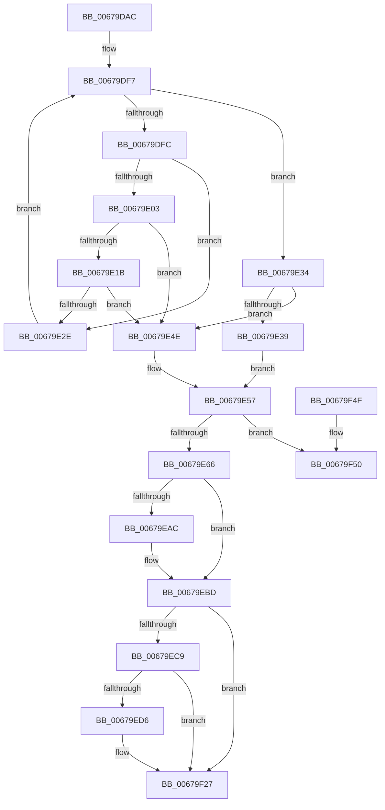

# MiPageNotZero

- RVA: `0x00679DAC`–`0x00679F64` (길이 `440` bytes)
- VA: `0x0000000140679DAC`
- 실행 섹션: `.text`
- PDB 이름 있음: `예`; PDB Function 태그: `아니요`
- unwind 정보 RVA: `0x000D7DA8`
- 디코드: `113`개 명령, `440/440` bytes 표시
- 미해석 바이트: `0` (있으면 어셈블리에 `.byte`로 보존)

> 이 문서는 커널 이미지의 기계어와 PDB 기호를 분석해 생성했습니다. 4번과 5번은 함수 원형과 자료형을 바이너리 사용 방식에서 추정한 C 해석이며 원본 소스 복구 결과는 아닙니다.

## 1. Dependencies

- 직접 호출 지점: **5**; 고유 호출 대상: **4**
- 직접 호출자로 확인된 함수: **1**
- RIP 상대 이미지 참조: **17**

### Outgoing calls
- `0x00679E9B` → [KeSetEvent](../33/KeSetEvent_function_0033F310.md) (function, `0x0033F310`)
- `0x00679EB8` → [KeSetEvent](../33/KeSetEvent_function_0033F310.md) (function, `0x0033F310`)
- `0x00679F22` → [ExQueueWorkItem](../2F/ExQueueWorkItem_function_002F9520.md) (function, `0x002F9520`)
- `0x00679F2D` → [KeZeroPages](../6B/KeZeroPages_function_006BA070.md) (function, `0x006BA070`)
- `0x00679F5E` → [KeBugCheckEx](../4F/KeBugCheckEx_function_004FD660.md) (function, `0x004FD660`)

### Direct callers
- [MiArePageContentsZero](../4D/MiArePageContentsZero_function_004D4278.md) at `0x004D4350`

### Static image references
- `0x00679DD4` → RVA `0x00E30278` (`.data`; read/write)
- `0x00679E42` → RVA `0x00E30274` (`.data`; read/write)
- `0x00679E57` → RVA `0x00FC52F4` (`ALMOSTRO`; read)
- `0x00679E7E` → RVA `0x00E30088` (`.data`; read)
- `0x00679EA0` → RVA `0x00E38D00` (`.data`; read)
- `0x00679EAC` → RVA `0x00E38E40` (`.data`; read)
- `0x00679EBD` → RVA `0x00FC6A88` (`ALMOSTRO`; read)
- `0x00679ECB` → RVA `0x00E301CC` (`.data`; read)
- `0x00679ED6` → RVA `0x00E301E0` (`.data`; read/write)
- `0x00679EDE` → RVA `0x00E301E0` (`.data`; read)
- `0x00679EF1` → RVA `0x00E301D0` (`.data`; write)
- `0x00679EF8` → RVA `0x00679460` (`MiBadMemoryLogger`; read)
- `0x00679EFF` → RVA `0x00E301D8` (`.data`; write)
- `0x00679F06` → RVA `0x00E301F0` (`.data`; write)
- `0x00679F0D` → RVA `0x00E301C8` (`.data`; read)
- `0x00679F14` → RVA `0x00E301F8` (`.data`; write)
- `0x00679F1B` → RVA `0x00E301C8` (`.data`; write)

## 2. Other-region calls and transfers

- 다른 실행 섹션으로 향하는 call: **0**
- 별도 외부 분기/꼬리 이동을 확인하지 못했습니다.

## 3. Assembly (complete function range)

```asm
00679DAC  48 89 5C 24 08                  mov qword ptr [rsp + 8], rbx
00679DB1  48 89 6C 24 10                  mov qword ptr [rsp + 0x10], rbp
00679DB6  48 89 74 24 18                  mov qword ptr [rsp + 0x18], rsi
00679DBB  57                              push rdi
00679DBC  41 54                           push r12
00679DBE  41 55                           push r13
00679DC0  41 56                           push r14
00679DC2  41 57                           push r15
00679DC4  48 83 EC 30                     sub rsp, 0x30
00679DC8  48 8B FA                        mov rdi, rdx
00679DCB  48 8B E9                        mov rbp, rcx
00679DCE  41 BC 01 00 00 00               mov r12d, 1
00679DD4  F0 44 01 25 9C 64 7B 00         lock add dword ptr [rip + 0x7b649c], r12d
00679DDC  41 BD 00 10 00 00               mov r13d, 0x1000
00679DE2  4C 8D 99 00 10 00 00            lea r11, [rcx + 0x1000]
00679DE9  45 33 D2                        xor r10d, r10d
00679DEC  33 F6                           xor esi, esi
00679DEE  45 8B CD                        mov r9d, r13d
00679DF1  45 33 F6                        xor r14d, r14d
00679DF4  4C 8B C1                        mov r8, rcx
00679DF7  4D 3B C3                        cmp r8, r11
00679DFA  73 38                           jae 0x140679e34
00679DFC  41 8B 08                        mov ecx, dword ptr [r8]
00679DFF  85 C9                           test ecx, ecx
00679E01  74 2B                           je 0x140679e2e
00679E03  49 8B C0                        mov rax, r8
00679E06  48 2B C5                        sub rax, rbp
00679E09  4D 3B CD                        cmp r9, r13
00679E0C  49 0F 45 C1                     cmovne rax, r9
00679E10  45 03 D4                        add r10d, r12d
00679E13  4C 8B C8                        mov r9, rax
00679E16  45 3B D4                        cmp r10d, r12d
00679E19  75 33                           jne 0x140679e4e
00679E1B  41 8B F0                        mov esi, r8d
00679E1E  8D 41 FF                        lea eax, [rcx - 1]
00679E21  81 E6 FF 0F 00 00               and esi, 0xfff
00679E27  44 8B F1                        mov r14d, ecx
00679E2A  85 C1                           test ecx, eax
00679E2C  75 20                           jne 0x140679e4e
00679E2E  49 83 C0 04                     add r8, 4
00679E32  EB C3                           jmp 0x140679df7
00679E34  45 3B D4                        cmp r10d, r12d
00679E37  75 15                           jne 0x140679e4e
00679E39  41 BF 2B 01 00 00               mov r15d, 0x12b
00679E3F  45 33 C9                        xor r9d, r9d
00679E42  F0 44 01 25 2A 64 7B 00         lock add dword ptr [rip + 0x7b642a], r12d
00679E4A  33 C9                           xor ecx, ecx
00679E4C  EB 09                           jmp 0x140679e57
00679E4E  41 BF 27 01 00 00               mov r15d, 0x127
00679E54  49 8B CD                        mov rcx, r13
00679E57  8B 05 97 B4 94 00               mov eax, dword ptr [rip + 0x94b497]
00679E5D  41 84 C4                        test r12b, al
00679E60  0F 85 EA 00 00 00               jne 0x140679f50
00679E66  48 8D 04 52                     lea rax, [rdx + rdx*2]
00679E6A  48 03 C0                        add rax, rax
00679E6D  48 B9 28 00 00 00 00 DE FF FF   movabs rcx, 0xffffde0000000028
00679E77  48 8B 04 C1                     mov rax, qword ptr [rcx + rax*8]
00679E7B  45 33 C0                        xor r8d, r8d
00679E7E  48 8B 0D 03 62 7B 00            mov rcx, qword ptr [rip + 0x7b6203]
00679E85  33 D2                           xor edx, edx
00679E87  48 C1 E8 2B                     shr rax, 0x2b
00679E8B  25 FF 03 00 00                  and eax, 0x3ff
00679E90  48 8B 1C C1                     mov rbx, qword ptr [rcx + rax*8]
00679E94  48 8B 8B 40 01 00 00            mov rcx, qword ptr [rbx + 0x140]
00679E9B  E8 70 54 CC FF                  call 0x14033f310
00679EA0  48 8D 05 59 EE 7B 00            lea rax, [rip + 0x7bee59]
00679EA7  48 3B D8                        cmp rbx, rax
00679EAA  74 11                           je 0x140679ebd
00679EAC  48 8B 0D 8D EF 7B 00            mov rcx, qword ptr [rip + 0x7bef8d]
00679EB3  45 33 C0                        xor r8d, r8d
00679EB6  33 D2                           xor edx, edx
00679EB8  E8 53 54 CC FF                  call 0x14033f310
00679EBD  8A 05 C5 CB 94 00               mov al, byte ptr [rip + 0x94cbc5]
00679EC3  24 30                           and al, 0x30
00679EC5  3C 20                           cmp al, 0x20
00679EC7  75 5E                           jne 0x140679f27
00679EC9  33 C0                           xor eax, eax
00679ECB  F0 44 0F B1 25 F8 62 7B 00      lock cmpxchg dword ptr [rip + 0x7b62f8], r12d
00679ED4  75 51                           jne 0x140679f27
00679ED6  48 83 25 02 63 7B 00 00         and qword ptr [rip + 0x7b6302], 0
00679EDE  48 8D 0D FB 62 7B 00            lea rcx, [rip + 0x7b62fb]
00679EE5  48 C1 E7 0C                     shl rdi, 0xc
00679EE9  41 8B D4                        mov edx, r12d
00679EEC  8B C6                           mov eax, esi
00679EEE  48 03 F8                        add rdi, rax
00679EF1  44 89 35 D8 62 7B 00            mov dword ptr [rip + 0x7b62d8], r14d
00679EF8  48 8D 05 61 F5 FF FF            lea rax, [rip - 0xa9f]
00679EFF  48 89 3D D2 62 7B 00            mov qword ptr [rip + 0x7b62d2], rdi
00679F06  48 89 05 E3 62 7B 00            mov qword ptr [rip + 0x7b62e3], rax
00679F0D  48 8D 05 B4 62 7B 00            lea rax, [rip + 0x7b62b4]
00679F14  48 89 05 DD 62 7B 00            mov qword ptr [rip + 0x7b62dd], rax
00679F1B  44 89 3D A6 62 7B 00            mov dword ptr [rip + 0x7b62a6], r15d
00679F22  E8 F9 F5 C7 FF                  call 0x1402f9520
00679F27  49 8B D5                        mov rdx, r13
00679F2A  48 8B CD                        mov rcx, rbp
00679F2D  E8 3E 01 04 00                  call 0x1406ba070
00679F32  48 8B 5C 24 60                  mov rbx, qword ptr [rsp + 0x60]
00679F37  48 8B 6C 24 68                  mov rbp, qword ptr [rsp + 0x68]
00679F3C  48 8B 74 24 70                  mov rsi, qword ptr [rsp + 0x70]
00679F41  48 83 C4 30                     add rsp, 0x30
00679F45  41 5F                           pop r15
00679F47  41 5E                           pop r14
00679F49  41 5D                           pop r13
00679F4B  41 5C                           pop r12
00679F4D  5F                              pop rdi
00679F4E  C3                              ret
00679F4F  CC                              int3
00679F50  48 89 4C 24 20                  mov qword ptr [rsp + 0x20], rcx
00679F55  4C 8B C7                        mov r8, rdi
00679F58  41 8B CF                        mov ecx, r15d
00679F5B  48 8B D5                        mov rdx, rbp
00679F5E  E8 FD 36 E8 FF                  call 0x1404fd660
00679F63  CC                              int3
```

## 4. C-style interpretation (structured pseudocode)

```c
__int64 __fastcall MiPageNotZero(__int64 a1, __int64 a2)
{
    __int64 result;
    __int64 v_r10;
    __int64 v_r14;
    __int64 v_rdi;
    __int64 v_rsi;
    __int64 v_rsp;
    unsigned __int64 v_stack_p10;
    unsigned __int64 v_stack_p18;
    unsigned __int64 v_stack_p20;
    unsigned __int64 v_stack_p8;

    v_stack_p8 = v_rbx;
    v_stack_p10 = v_rbp;
    v_stack_p18 = v_rsi;
    v_rsp = (v_rsp) - (48);
    v_r10 = 0;
    v_rsi = 0;
    v_r14 = 0;
loc_00679DF7:
    if (a1 >= (a1 + 4096)) goto loc_00679E34;
    if ((unsigned int)((unsigned int)(*(unsigned int *)(a1))) == 0) goto loc_00679E2E;
    result = (a1) - (a1);
    if (((unsigned int)((unsigned int)((unsigned int)(0x1000ULL)))) != ((unsigned int)(0x1000ULL))) { result = (unsigned int)((unsigned int)((unsigned int)(0x1000ULL))); }
    v_r10 = (unsigned int)((v_r10) + (1));
    if (((unsigned int)(v_r10)) != 1) goto loc_00679E4E;
    v_rsi = (unsigned int)(((unsigned int)((unsigned int)(a1))) & (0xFFFULL));
    if ((((unsigned int)((unsigned int)(*(unsigned int *)(a1)))) & ((unsigned int)((unsigned int)(*(unsigned int *)(a1)) - 1))) != 0) goto loc_00679E4E;
loc_00679E2E:
    a3 = (a1) + (4);
    goto loc_00679DF7;
loc_00679E34:
    if (((unsigned int)(v_r10)) != 1) goto loc_00679E4E;
    a4 = 0;
    a1 = 0;
    goto loc_00679E57;
loc_00679E4E:
loc_00679E57:
    if (((1) & ((unsigned __int8)((unsigned int)(*(unsigned int *)(v_rip + 9745559))))) != 0) goto loc_00679F50;
    result = (a2 + a2 * 2) + (a2 + a2 * 2);
    a3 = 0;
    a2 = 0;
    result = (*(unsigned __int64 *)((unsigned int)(0x1000ULL) + result * 8)) >> (43);
    result = (unsigned int)((result) & (0x3FFULL));
    result = KeSetEvent(*(unsigned __int64 *)(*(unsigned __int64 *)(*(unsigned __int64 *)(v_rip + 8086019) + result * 8) + 320), a2, a3, a4);
    result = v_rip + 8121945;
    if ((*(unsigned __int64 *)(*(unsigned __int64 *)(v_rip + 8086019) + result * 8)) != (v_rip + 8121945)) {
        a1 = *(unsigned __int64 *)(v_rip + 8122253);
        a3 = 0;
        a2 = 0;
        result = KeSetEvent(a1, a2, a3, a4);
    }
    result = (unsigned __int8)((*(unsigned __int8 *)(v_rip + 9751493)) & (48));
    if (((unsigned __int8)(result)) != 32) goto loc_00679F27;
    result = 0;
    v_rdi = a2;
    if (!(condition_is_not_equal)) {
        a1 = v_rip + 8086267;
        v_rdi = (a2) << (12);
        a2 = 1;
        result = (unsigned int)(v_rsi);
        v_rdi = (v_rdi) + (result);
        *(unsigned int *)(v_rip + 8086232) = (unsigned int)((unsigned int)((unsigned int)((unsigned int)(*(unsigned int *)(a1)))));
        result = v_rip - 2719;
        *(unsigned __int64 *)(v_rip + 8086226) = v_rdi;
        *(unsigned __int64 *)(v_rip + 8086243) = result;
        result = v_rip + 8086196;
        *(unsigned __int64 *)(v_rip + 8086237) = result;
        *(unsigned int *)(v_rip + 8086182) = 295;
        result = ExQueueWorkItem(a1, a2, a3, a4);
    }
    result = KeZeroPages(a1, (unsigned int)(0x1000ULL), a3, a4);
    v_rsp = (v_rsp) + (48);
    return result;
loc_00679F50:
    v_stack_p20 = a1;
    result = KeBugCheckEx(295, v_stack_p10, v_rdi, a4);
    return result;
}
```

## 5. (Beta) C Style

```c
int64_t MiPageNotZero(void *Arg1, void *Arg2)
{
    uint8_t *arg1 = (uint8_t *)Arg1;
    uint8_t *arg2 = (uint8_t *)Arg2;

    int64_t result;
    int64_t local_r10;
    int64_t local_r14;
    int64_t local_rdi;
    int64_t local_rsi;
    int64_t local_rsp;
    uint64_t v_stack_p10;
    uint64_t v_stack_p18;
    uint64_t v_stack_p20;
    uint64_t v_stack_p8;

    v_stack_p8 = local_rbx;
    v_stack_p10 = local_rbp;
    v_stack_p18 = local_rsi;
    local_rsp = (local_rsp) - (48);
    local_r10 = 0;
    local_rsi = 0;
    local_r14 = 0;
loc_00679DF7:
    if (Arg1 >= (Arg1 + 4096)) goto loc_00679E34;
    if ((uint32_t)((uint32_t)(*(uint32_t *)(arg1))) == 0) goto loc_00679E2E;
    result = (Arg1) - (Arg1);
    if (((uint32_t)((uint32_t)((uint32_t)(0x1000ULL)))) != ((uint32_t)(0x1000ULL))) { result = (uint32_t)((uint32_t)((uint32_t)(0x1000ULL))); }
    local_r10 = (uint32_t)((local_r10) + (1));
    if (((uint32_t)(local_r10)) != 1) goto loc_00679E4E;
    local_rsi = (uint32_t)(((uint32_t)((uint32_t)(Arg1))) & (0xFFFULL));
    if ((((uint32_t)((uint32_t)(*(uint32_t *)(arg1)))) & ((uint32_t)((uint32_t)(*(uint32_t *)(arg1)) - 1))) != 0) goto loc_00679E4E;
loc_00679E2E:
    a3 = (Arg1) + (4);
    goto loc_00679DF7;
loc_00679E34:
    if (((uint32_t)(local_r10)) != 1) goto loc_00679E4E;
    a4 = 0;
    Arg1 = 0;
    goto loc_00679E57;
loc_00679E4E:
loc_00679E57:
    if (((1) & ((uint8_t)((uint32_t)(*(uint32_t *)(v_rip + 0x94B497))))) != 0) goto loc_00679F50;
    result = (Arg2 + Arg2 * 2) + (Arg2 + Arg2 * 2);
    a3 = 0;
    Arg2 = 0;
    result = (*(uint64_t *)((uint32_t)(0x1000ULL) + result * 8)) >> (43);
    result = (uint32_t)((result) & (0x3FFULL));
    result = KeSetEvent(*(uint64_t *)(*(uint64_t *)(*(uint64_t *)(v_rip + 0x7B6203) + result * 8) + 0x140), Arg2, a3, a4);
    result = v_rip + 8121945;
    if ((*(uint64_t *)(*(uint64_t *)(v_rip + 0x7B6203) + result * 8)) != (v_rip + 8121945)) {
        Arg1 = *(uint64_t *)(v_rip + 0x7BEF8D);
        a3 = 0;
        Arg2 = 0;
        result = KeSetEvent(Arg1, Arg2, a3, a4);
    }
    result = (uint8_t)((*(uint8_t *)(v_rip + 0x94CBC5)) & (48));
    if (((uint8_t)(result)) != 32) goto loc_00679F27;
    result = 0;
    local_rdi = Arg2;
    if (!(condition_is_not_equal)) {
        Arg1 = v_rip + 8086267;
        local_rdi = (Arg2) << (12);
        Arg2 = 1;
        result = (uint32_t)(local_rsi);
        local_rdi = (local_rdi) + (result);
        *(uint32_t *)(v_rip + 0x7B62D8) = (uint32_t)((uint32_t)((uint32_t)((uint32_t)(*(uint32_t *)(arg1)))));
        result = v_rip - 2719;
        *(uint64_t *)(v_rip + 0x7B62D2) = local_rdi;
        *(uint64_t *)(v_rip + 0x7B62E3) = result;
        result = v_rip + 8086196;
        *(uint64_t *)(v_rip + 0x7B62DD) = result;
        *(uint32_t *)(v_rip + 0x7B62A6) = 295;
        result = ExQueueWorkItem(Arg1, Arg2, a3, a4);
    }
    result = KeZeroPages(Arg1, (uint32_t)(0x1000ULL), a3, a4);
    local_rsp = (local_rsp) + (48);
    return result;
loc_00679F50:
    v_stack_p20 = Arg1;
    result = KeBugCheckEx(295, v_stack_p10, local_rdi, a4);
    return result;
}
```

### 관측된 메모리 오프셋

구조체 형식이 확인되지 않은 접근은 인자 기준의 오프셋으로만 기록했습니다.

| 기준 인자 | 오프셋 표현 | 폭 (bit) | 접근 |
|---|---:|---:|---|
| `Arg1` | `+ 0x1000` | `64` | `R` |
| `Arg2` | `+ 0x0 + rdx*2` | `64` | `R` |

## 6. Execution-region graph

[열기: 2D/3D 그래프와 함수 탐색 컨트롤 패널](../../../control-panel.html?section=text&rva=0x00679DAC&view=graph)

- 2D 그래프는 위에서 아래로 흐르고, 3D 그래프는 빈 공간을 드래그해 회전합니다. Shift+드래그는 이동, 휠은 확대·축소, 함수 노드 선택은 대상 보고서 이동입니다.

### Static fallback


