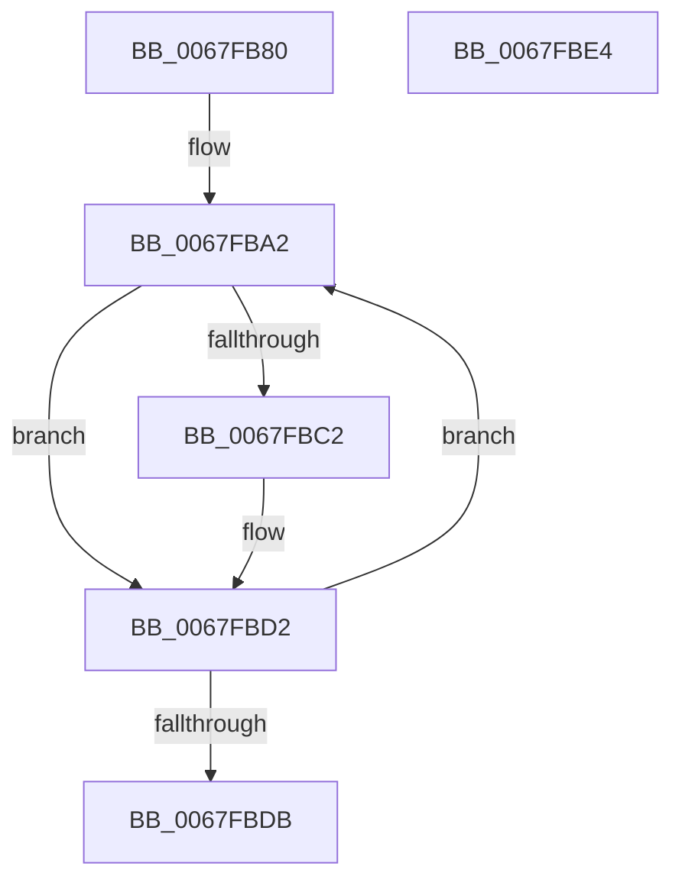

# MiPageTablesNeeded

- RVA: `0x0067FB80`–`0x0067FBE5` (길이 `101` bytes)
- VA: `0x000000014067FB80`
- 실행 섹션: `.text`
- PDB 이름 있음: `예`; PDB Function 태그: `아니요`
- unwind 정보 RVA: `0x00071750`
- 디코드: `28`개 명령, `101/101` bytes 표시
- 미해석 바이트: `0` (있으면 어셈블리에 `.byte`로 보존)

> 이 문서는 커널 이미지의 기계어와 PDB 기호를 분석해 생성했습니다. 4번과 5번은 함수 원형과 자료형을 바이너리 사용 방식에서 추정한 C 해석이며 원본 소스 복구 결과는 아닙니다.

## 1. Dependencies

- 직접 호출 지점: **0**; 고유 호출 대상: **0**
- 직접 호출자로 확인된 함수: **1**
- RIP 상대 이미지 참조: **0**

### Outgoing calls
- 직접 디코드된 call 명령이 없습니다.

### Direct callers
- [MmCreateShadowMapping](../../page/80/MmCreateShadowMapping_function_00807AB0.md) at `0x00807B55`

### Static image references
- 디코드된 RIP-relative 메모리 참조가 없습니다.

## 2. Other-region calls and transfers

- 다른 실행 섹션으로 향하는 call: **0**
- 별도 외부 분기/꼬리 이동을 확인하지 못했습니다.

## 3. Assembly (complete function range)

```asm
0067FB80  48 89 5C 24 08                  mov qword ptr [rsp + 8], rbx
0067FB85  45 33 C0                        xor r8d, r8d
0067FB88  49 BB 00 00 00 00 80 F6 FF FF   movabs r11, 0xfffff68000000000
0067FB92  45 8B C8                        mov r9d, r8d
0067FB95  4C 8B D1                        mov r10, rcx
0067FB98  48 BB F8 FF FF FF 7F 00 00 00   movabs rbx, 0x7ffffffff8
0067FBA2  49 C1 EA 09                     shr r10, 9
0067FBA6  4C 23 D3                        and r10, rbx
0067FBA9  49 8B C3                        mov rax, r11
0067FBAC  48 C1 EA 09                     shr rdx, 9
0067FBB0  4C 03 D0                        add r10, rax
0067FBB3  48 23 D3                        and rdx, rbx
0067FBB6  49 8B C3                        mov rax, r11
0067FBB9  48 03 D0                        add rdx, rax
0067FBBC  41 83 F9 01                     cmp r9d, 1
0067FBC0  72 10                           jb 0x14067fbd2
0067FBC2  48 8B CA                        mov rcx, rdx
0067FBC5  49 FF C0                        inc r8
0067FBC8  49 2B CA                        sub rcx, r10
0067FBCB  48 C1 F9 03                     sar rcx, 3
0067FBCF  4C 03 C1                        add r8, rcx
0067FBD2  41 FF C1                        inc r9d
0067FBD5  41 83 F9 03                     cmp r9d, 3
0067FBD9  7E C7                           jle 0x14067fba2
0067FBDB  48 8B 5C 24 08                  mov rbx, qword ptr [rsp + 8]
0067FBE0  49 8B C0                        mov rax, r8
0067FBE3  C3                              ret
0067FBE4  CC                              int3
```

## 4. C-style interpretation (structured pseudocode)

```c
__int64 __fastcall MiPageTablesNeeded(__int64 a1, __int64 a2, int a3)
{
    __int64 v_r10;
    unsigned __int64 v_stack_p8;

    v_stack_p8 = v_rbx;
    a3 = 0;
loc_0067FBA2:
    v_r10 = (a1) >> (9);
    v_r10 = (v_r10) & (v_rbx);
    a2 = (a2) >> (9);
    v_r10 = (v_r10) + (v_r11);
    a2 = (a2) & (v_rbx);
    a2 = (a2) + (v_r11);
    if (0 >= 1) {
        a1 = a2;
        a3 = (a3) + 1;
        a1 = (a1) - (v_r10);
        a1 = (a1) >> (3);
        a3 = (a3) + (a1);
    }
    a4 = (unsigned int)((0) + 1);
    if (((unsigned int)(a4)) <= 3) goto loc_0067FBA2;
    return a3;
}
```

## 5. (Beta) C Style

```c
int64_t MiPageTablesNeeded(int64_t Arg1, int64_t Arg2, int32_t Arg3)
{
    int64_t local_r10;
    uint64_t v_stack_p8;

    v_stack_p8 = local_rbx;
    Arg3 = 0;
loc_0067FBA2:
    local_r10 = (Arg1) >> (9);
    local_r10 = (local_r10) & (local_rbx);
    Arg2 = (Arg2) >> (9);
    local_r10 = (local_r10) + (local_r11);
    Arg2 = (Arg2) & (local_rbx);
    Arg2 = (Arg2) + (local_r11);
    if (0 >= 1) {
        Arg1 = Arg2;
        Arg3 = (Arg3) + 1;
        Arg1 = (Arg1) - (local_r10);
        Arg1 = (Arg1) >> (3);
        Arg3 = (Arg3) + (Arg1);
    }
    a4 = (uint32_t)((0) + 1);
    if (((uint32_t)(a4)) <= 3) goto loc_0067FBA2;
    return Arg3;
}
```

## 6. Execution-region graph

[열기: 2D/3D 그래프와 함수 탐색 컨트롤 패널](../../../control-panel.html?section=text&rva=0x0067FB80&view=graph)

- 2D 그래프는 위에서 아래로 흐르고, 3D 그래프는 빈 공간을 드래그해 회전합니다. Shift+드래그는 이동, 휠은 확대·축소, 함수 노드 선택은 대상 보고서 이동입니다.

### Static fallback


