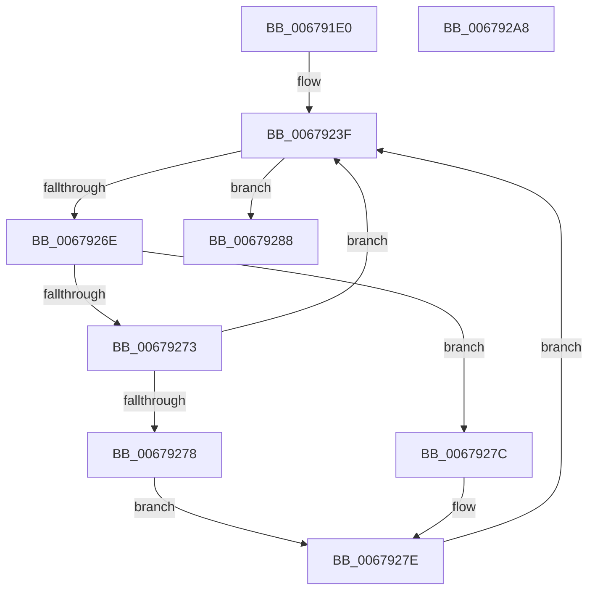

# MiPartitionWorkingSetManager

- RVA: `0x006791E0`–`0x006792A9` (길이 `201` bytes)
- VA: `0x00000001406791E0`
- 실행 섹션: `.text`
- PDB 이름 있음: `예`; PDB Function 태그: `아니요`
- unwind 정보 RVA: `0x000BD714`
- 디코드: `49`개 명령, `201/201` bytes 표시
- 미해석 바이트: `0` (있으면 어셈블리에 `.byte`로 보존)

> 이 문서는 커널 이미지의 기계어와 PDB 기호를 분석해 생성했습니다. 4번과 5번은 함수 원형과 자료형을 바이너리 사용 방식에서 추정한 C 해석이며 원본 소스 복구 결과는 아닙니다.

## 1. Dependencies

- 직접 호출 지점: **4**; 고유 호출 대상: **4**
- 직접 호출자로 확인된 함수: **0**
- RIP 상대 이미지 참조: **2**

### Outgoing calls
- `0x00679215` → [KeSetPriorityThread](../2C/KeSetPriorityThread_function_002C76E0.md) (function, `0x002C76E0`)
- `0x00679265` → [KeWaitForMultipleObjects](../20/KeWaitForMultipleObjects_function_0020D110.md) (function, `0x0020D110`)
- `0x00679281` → [MiWorkingSetManager](../2D/MiWorkingSetManager_function_002DA7E0.md) (function, `0x002DA7E0`)
- `0x00679298` → [_security_check_cookie](../6A/_security_check_cookie_function_006AC640.md) (function, `0x006AC640`)

### Direct callers
- 이 함수 시작 RVA로 연결되는 직접 call은 확인되지 않았습니다. 간접 호출은 완전히 역산할 수 없습니다.

### Static image references
- `0x006791EA` → RVA `0x00E0A740` (`.data`; read)
- `0x00679223` → RVA `0x00E374C8` (`.data`; read)

## 2. Other-region calls and transfers

- 다른 실행 섹션으로 향하는 call: **0**
- 별도 외부 분기/꼬리 이동을 확인하지 못했습니다.

## 3. Assembly (complete function range)

```asm
006791E0  48 89 5C 24 10                  mov qword ptr [rsp + 0x10], rbx
006791E5  57                              push rdi
006791E6  48 83 EC 60                     sub rsp, 0x60
006791EA  48 8B 05 4F 15 79 00            mov rax, qword ptr [rip + 0x79154f]
006791F1  48 33 C4                        xor rax, rsp
006791F4  48 89 44 24 58                  mov qword ptr [rsp + 0x58], rax
006791F9  65 48 8B 1C 25 88 01 00 00      mov rbx, qword ptr gs:[0x188]
00679202  48 8B F9                        mov rdi, rcx
00679205  BA 11 00 00 00                  mov edx, 0x11
0067920A  48 8B CB                        mov rcx, rbx
0067920D  0F BA AB A4 05 00 00 0D         bts dword ptr [rbx + 0x5a4], 0xd
00679215  E8 C6 E4 C4 FF                  call 0x1402c76e0
0067921A  48 8D 47 58                     lea rax, [rdi + 0x58]
0067921E  48 89 44 24 40                  mov qword ptr [rsp + 0x40], rax
00679223  48 8D 05 9E E2 7B 00            lea rax, [rip + 0x7be29e]
0067922A  48 89 44 24 48                  mov qword ptr [rsp + 0x48], rax
0067922F  48 8B 87 C0 44 00 00            mov rax, qword ptr [rdi + 0x44c0]
00679236  48 83 C0 60                     add rax, 0x60
0067923A  48 89 44 24 50                  mov qword ptr [rsp + 0x50], rax
0067923F  48 83 64 24 38 00               and qword ptr [rsp + 0x38], 0
00679245  48 8D 54 24 40                  lea rdx, [rsp + 0x40]
0067924A  48 83 64 24 30 00               and qword ptr [rsp + 0x30], 0
00679250  45 33 C9                        xor r9d, r9d
00679253  C6 44 24 28 00                  mov byte ptr [rsp + 0x28], 0
00679258  C6 44 24 20 00                  mov byte ptr [rsp + 0x20], 0
0067925D  45 8D 41 01                     lea r8d, [r9 + 1]
00679261  41 8D 49 03                     lea ecx, [r9 + 3]
00679265  E8 A6 3E B9 FF                  call 0x14020d110
0067926A  85 C0                           test eax, eax
0067926C  74 1A                           je 0x140679288
0067926E  83 E8 01                        sub eax, 1
00679271  74 09                           je 0x14067927c
00679273  83 F8 01                        cmp eax, 1
00679276  75 C7                           jne 0x14067923f
00679278  8B D0                           mov edx, eax
0067927A  EB 02                           jmp 0x14067927e
0067927C  33 D2                           xor edx, edx
0067927E  48 8B CF                        mov rcx, rdi
00679281  E8 5A 15 C6 FF                  call 0x1402da7e0
00679286  EB B7                           jmp 0x14067923f
00679288  0F BA B3 A4 05 00 00 0D         btr dword ptr [rbx + 0x5a4], 0xd
00679290  48 8B 4C 24 58                  mov rcx, qword ptr [rsp + 0x58]
00679295  48 33 CC                        xor rcx, rsp
00679298  E8 A3 33 03 00                  call 0x1406ac640
0067929D  48 8B 5C 24 78                  mov rbx, qword ptr [rsp + 0x78]
006792A2  48 83 C4 60                     add rsp, 0x60
006792A6  5F                              pop rdi
006792A7  C3                              ret
006792A8  CC                              int3
```

## 4. C-style interpretation (structured pseudocode)

```c
__int64 __fastcall MiPartitionWorkingSetManager(__int64 a1, __int64 a2, __int64 a3, int a4)
{
    __int64 result;
    __int64 v_rsp;
    unsigned __int64 v_stack_m10;
    unsigned __int64 v_stack_m18;
    unsigned __int64 v_stack_m20;
    unsigned __int64 v_stack_m28;
    unsigned __int64 v_stack_m30;
    unsigned __int64 v_stack_m38;
    unsigned __int8 v_stack_m40;
    unsigned __int8 v_stack_m48;
    unsigned __int64 v_stack_p10;

    v_stack_p10 = v_rbx;
    v_rsp = (v_rsp) - (96);
    result = (*(unsigned __int64 *)(v_rip + 7935311)) ^ (v_rsp);
    v_stack_m10 = result;
    result = KeSetPriorityThread(*(unsigned __int64 *)(gs_base + (0 + 392)), 17, a3, a4);
    v_stack_m28 = a1 + 88;
    v_stack_m20 = v_rip + 8118942;
    result = (*(unsigned __int64 *)(a1 + 17600)) + (96);
    v_stack_m18 = result;
loc_0067923F:
    a4 = 0;
    v_stack_m40 = 0;
    v_stack_m48 = 0;
    result = KeWaitForMultipleObjects(a4 + 3, v_stack_m28, a4 + 1, a4);
    if ((unsigned int)(result) == 0) goto loc_00679288;
    result = (unsigned int)((result) - (1));
    if (condition_is_equal) goto loc_0067927C;
    if (((unsigned int)(result)) != 1) goto loc_0067923F;
    goto loc_0067927E;
loc_0067927C:
    a2 = 0;
loc_0067927E:
    result = MiWorkingSetManager(a1, a2, a4 + 1, a4);
    goto loc_0067923F;
loc_00679288:
    a1 = (v_stack_m10) ^ (v_rsp);
    result = _security_check_cookie(a1, a2, a4 + 1, a4);
    v_rsp = (v_rsp) + (96);
    return result;
}
```

## 5. (Beta) C Style

```c
int64_t MiPartitionWorkingSetManager(void *Arg1, int64_t Arg2, int64_t Arg3, int32_t Arg4)
{
    uint8_t *arg1 = (uint8_t *)Arg1;

    int64_t result;
    int64_t local_rsp;
    uint64_t v_stack_m10;
    uint64_t v_stack_m18;
    uint64_t v_stack_m20;
    uint64_t v_stack_m28;
    uint64_t v_stack_m30;
    uint64_t v_stack_m38;
    uint8_t v_stack_m40;
    uint8_t v_stack_m48;
    uint64_t v_stack_p10;

    v_stack_p10 = local_rbx;
    local_rsp = (local_rsp) - (96);
    result = (*(uint64_t *)(v_rip + 0x79154F)) ^ (local_rsp);
    v_stack_m10 = result;
    result = KeSetPriorityThread(*(uint64_t *)(gs_base + (0 + 0x188)), 17, Arg3, Arg4);
    v_stack_m28 = Arg1 + 88;
    v_stack_m20 = v_rip + 8118942;
    result = (*(uint64_t *)(arg1 + 0x44C0)) + (96);
    v_stack_m18 = result;
loc_0067923F:
    Arg4 = 0;
    v_stack_m40 = 0;
    v_stack_m48 = 0;
    result = KeWaitForMultipleObjects(Arg4 + 3, v_stack_m28, Arg4 + 1, Arg4);
    if ((uint32_t)(result) == 0) goto loc_00679288;
    result = (uint32_t)((result) - (1));
    if (condition_is_equal) goto loc_0067927C;
    if (((uint32_t)(result)) != 1) goto loc_0067923F;
    goto loc_0067927E;
loc_0067927C:
    Arg2 = 0;
loc_0067927E:
    result = MiWorkingSetManager(Arg1, Arg2, Arg4 + 1, Arg4);
    goto loc_0067923F;
loc_00679288:
    Arg1 = (v_stack_m10) ^ (local_rsp);
    result = _security_check_cookie(Arg1, Arg2, Arg4 + 1, Arg4);
    local_rsp = (local_rsp) + (96);
    return result;
}
```

### 관측된 메모리 오프셋

구조체 형식이 확인되지 않은 접근은 인자 기준의 오프셋으로만 기록했습니다.

| 기준 인자 | 오프셋 표현 | 폭 (bit) | 접근 |
|---|---:|---:|---|
| `Arg1` | `+ 0x58` | `64` | `R` |
| `Arg1` | `+ 0x44C0` | `64` | `R` |

## 6. Execution-region graph

[열기: 2D/3D 그래프와 함수 탐색 컨트롤 패널](../../../control-panel.html?section=text&rva=0x006791E0&view=graph)

- 2D 그래프는 위에서 아래로 흐르고, 3D 그래프는 빈 공간을 드래그해 회전합니다. Shift+드래그는 이동, 휠은 확대·축소, 함수 노드 선택은 대상 보고서 이동입니다.

### Static fallback


