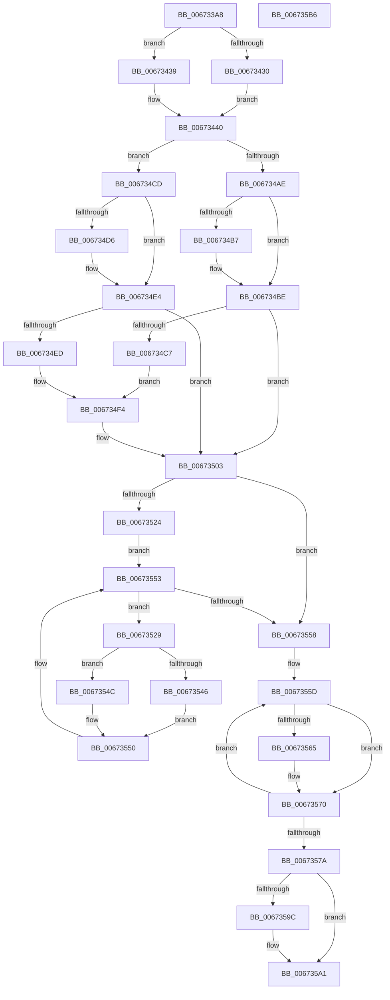

# MiPerformMemoryChange

- RVA: `0x006733A8`–`0x006735B7` (길이 `527` bytes)
- VA: `0x00000001406733A8`
- 실행 섹션: `.text`
- PDB 이름 있음: `예`; PDB Function 태그: `아니요`
- unwind 정보 RVA: `0x0007D3C0`
- 디코드: `124`개 명령, `527/527` bytes 표시
- 미해석 바이트: `0` (있으면 어셈블리에 `.byte`로 보존)

> 이 문서는 커널 이미지의 기계어와 PDB 기호를 분석해 생성했습니다. 4번과 5번은 함수 원형과 자료형을 바이너리 사용 방식에서 추정한 C 해석이며 원본 소스 복구 결과는 아닙니다.

## 1. Dependencies

- 직접 호출 지점: **11**; 고유 호출 대상: **10**
- 직접 호출자로 확인된 함수: **2**
- RIP 상대 이미지 참조: **9**

### Outgoing calls
- `0x006733E2` → [MiMergeMemoryBlocks](../../page/7F/MiMergeMemoryBlocks_function_007FA84C.md) (function, `0x007FA84C`)
- `0x0067340E` → [MiMergeMemoryBlocks](../../page/7F/MiMergeMemoryBlocks_function_007FA84C.md) (function, `0x007FA84C`)
- `0x00673416` → [MiUnlinkHotAddFlight](../../page/7F/MiUnlinkHotAddFlight_function_007FB05C.md) (function, `0x007FB05C`)
- `0x00673432` → [ExAcquireSpinLockExclusiveAtDpcLevel](../24/ExAcquireSpinLockExclusiveAtDpcLevel_function_00248E80.md) (function, `0x00248E80`)
- `0x00673439` → [ExAcquireSpinLockExclusive](../24/ExAcquireSpinLockExclusive_function_00248690.md) (function, `0x00248690`)
- `0x006734FE` → [MiUpdatePhysicalPages](../69/MiUpdatePhysicalPages_function_0069232C.md) (function, `0x0069232C`)
- `0x00673508` → [MiInitializeNonPagedPoolThresholds](MiInitializeNonPagedPoolThresholds_function_0067CA64.md) (function, `0x0067CA64`)
- `0x00673516` → [MiReleaseSpinLockExclusive](../24/MiReleaseSpinLockExclusive_function_002482C0.md) (function, `0x002482C0`)
- `0x0067356B` → [ExFreePoolWithTag](../../poolcode/B8/ExFreePoolWithTag_function_00B82870.md) (function, `0x00B82870`)
- `0x0067358E` → [MiComputeNodeMemory](MiComputeNodeMemory_function_00671AA4.md) (function, `0x00671AA4`)
- `0x0067359C` → [MiUpdateSharedUserDataNumberOfPages](../../page/7F/MiUpdateSharedUserDataNumberOfPages_function_007FB160.md) (function, `0x007FB160`)

### Direct callers
- [MiCompleteMemoryAddition](../../page/7F/MiCompleteMemoryAddition_function_007F9FAC.md) at `0x007F9FB9`
- [MiRemovePhysicalMemory](../../page/7F/MiRemovePhysicalMemory_function_007FAD3C.md) at `0x007FAF90`

### Static image references
- `0x006733C3` → RVA `0x00FC6B88` (`ALMOSTRO`; read)
- `0x006733E7` → RVA `0x00E38D20` (`.data`; read)
- `0x00673424` → RVA `0x00E38DC8` (`.data`; read)
- `0x0067346B` → RVA `0x00FC6B88` (`ALMOSTRO`; write)
- `0x00673494` → RVA `0x00E38D20` (`.data`; write)
- `0x006734AE` → RVA `0x00E3D548` (`.data`; read)
- `0x006734B7` → RVA `0x00E3D548` (`.data`; write)
- `0x006734F7` → RVA `0x00E38D00` (`.data`; read)
- `0x00673539` → RVA `0x00E37900` (`.data`; read)

## 2. Other-region calls and transfers

- 다른 실행 섹션으로 향하는 call: **5**
  - `0x006733E2` → [MiMergeMemoryBlocks](../../page/7F/MiMergeMemoryBlocks_function_007FA84C.md) (`.text` → `PAGE`)
  - `0x0067340E` → [MiMergeMemoryBlocks](../../page/7F/MiMergeMemoryBlocks_function_007FA84C.md) (`.text` → `PAGE`)
  - `0x00673416` → [MiUnlinkHotAddFlight](../../page/7F/MiUnlinkHotAddFlight_function_007FB05C.md) (`.text` → `PAGE`)
  - `0x0067356B` → [ExFreePoolWithTag](../../poolcode/B8/ExFreePoolWithTag_function_00B82870.md) (`.text` → `POOLCODE`)
  - `0x0067359C` → [MiUpdateSharedUserDataNumberOfPages](../../page/7F/MiUpdateSharedUserDataNumberOfPages_function_007FB160.md) (`.text` → `PAGE`)
- 별도 외부 분기/꼬리 이동을 확인하지 못했습니다.

## 3. Assembly (complete function range)

```asm
006733A8  48 8B C4                        mov rax, rsp
006733AB  48 89 58 08                     mov qword ptr [rax + 8], rbx
006733AF  48 89 68 10                     mov qword ptr [rax + 0x10], rbp
006733B3  48 89 70 18                     mov qword ptr [rax + 0x18], rsi
006733B7  57                              push rdi
006733B8  48 83 EC 40                     sub rsp, 0x40
006733BC  8B 59 28                        mov ebx, dword ptr [rcx + 0x28]
006733BF  4C 8D 41 70                     lea r8, [rcx + 0x70]
006733C3  48 8B 15 BE 37 95 00            mov rdx, qword ptr [rip + 0x9537be]
006733CA  48 8B F9                        mov rdi, rcx
006733CD  48 8B 89 A0 00 00 00            mov rcx, qword ptr [rcx + 0xa0]
006733D4  83 E3 01                        and ebx, 1
006733D7  83 60 D8 00                     and dword ptr [rax - 0x28], 0
006733DB  44 8B CB                        mov r9d, ebx
006733DE  48 83 C2 F0                     add rdx, -0x10
006733E2  E8 65 74 18 00                  call 0x1407fa84c
006733E7  48 8B 15 32 59 7C 00            mov rdx, qword ptr [rip + 0x7c5932]
006733EE  48 8D B7 88 00 00 00            lea rsi, [rdi + 0x88]
006733F5  48 8B 8F A8 00 00 00            mov rcx, qword ptr [rdi + 0xa8]
006733FC  48 83 C2 F0                     add rdx, -0x10
00673400  44 8B CB                        mov r9d, ebx
00673403  C7 44 24 20 01 00 00 00         mov dword ptr [rsp + 0x20], 1
0067340B  4C 8B C6                        mov r8, rsi
0067340E  E8 39 74 18 00                  call 0x1407fa84c
00673413  48 8B CF                        mov rcx, rdi
00673416  E8 41 7C 18 00                  call 0x1407fb05c
0067341B  45 0F 20 C0                     mov r8, cr8
0067341F  BD 02 00 00 00                  mov ebp, 2
00673424  48 8D 0D 9D 59 7C 00            lea rcx, [rip + 0x7c599d]
0067342B  44 3A C5                        cmp r8b, bpl
0067342E  75 09                           jne 0x140673439
00673430  B3 11                           mov bl, 0x11
00673432  E8 49 5A BD FF                  call 0x140248e80
00673437  EB 07                           jmp 0x140673440
00673439  E8 52 52 BD FF                  call 0x140248690
0067343E  8A D8                           mov bl, al
00673440  48 8B 0D 41 37 95 00            mov rcx, qword ptr [rip + 0x953741]
00673447  BA 00 00 00 00                  mov edx, 0
0067344C  48 83 41 F8 FF                  add qword ptr [rcx - 8], -1
00673451  48 8B 8F A0 00 00 00            mov rcx, qword ptr [rdi + 0xa0]
00673458  48 0F 44 15 28 37 95 00         cmove rdx, qword ptr [rip + 0x953728]
00673460  48 83 C1 10                     add rcx, 0x10
00673464  48 8B 05 B5 58 7C 00            mov rax, qword ptr [rip + 0x7c58b5]
0067346B  48 89 0D 16 37 95 00            mov qword ptr [rip + 0x953716], rcx
00673472  B9 00 00 00 00                  mov ecx, 0
00673477  48 89 54 24 30                  mov qword ptr [rsp + 0x30], rdx
0067347C  48 83 40 F8 FF                  add qword ptr [rax - 8], -1
00673481  48 8B 87 A8 00 00 00            mov rax, qword ptr [rdi + 0xa8]
00673488  48 0F 44 0D 90 58 7C 00         cmove rcx, qword ptr [rip + 0x7c5890]
00673490  48 83 C0 10                     add rax, 0x10
00673494  48 89 05 85 58 7C 00            mov qword ptr [rip + 0x7c5885], rax
0067349B  8B 47 28                        mov eax, dword ptr [rdi + 0x28]
0067349E  48 89 4C 24 38                  mov qword ptr [rsp + 0x38], rcx
006734A3  48 8B 4F 18                     mov rcx, qword ptr [rdi + 0x18]
006734A7  48 FF C9                        dec rcx
006734AA  A8 01                           test al, 1
006734AC  74 1F                           je 0x1406734cd
006734AE  48 3B 0D 93 A0 7C 00            cmp rcx, qword ptr [rip + 0x7ca093]
006734B5  76 07                           jbe 0x1406734be
006734B7  48 89 0D 8A A0 7C 00            mov qword ptr [rip + 0x7ca08a], rcx
006734BE  F7 47 28 08 00 08 00            test dword ptr [rdi + 0x28], 0x80008
006734C5  75 3C                           jne 0x140673503
006734C7  48 8B 57 20                     mov rdx, qword ptr [rdi + 0x20]
006734CB  EB 27                           jmp 0x1406734f4
006734CD  48 3B 0D 74 A0 7C 00            cmp rcx, qword ptr [rip + 0x7ca074]
006734D4  75 0E                           jne 0x1406734e4
006734D6  48 8B 47 10                     mov rax, qword ptr [rdi + 0x10]
006734DA  48 FF C8                        dec rax
006734DD  48 89 05 64 A0 7C 00            mov qword ptr [rip + 0x7ca064], rax
006734E4  F7 47 28 00 00 08 00            test dword ptr [rdi + 0x28], 0x80000
006734EB  75 16                           jne 0x140673503
006734ED  48 8B 57 20                     mov rdx, qword ptr [rdi + 0x20]
006734F1  48 F7 DA                        neg rdx
006734F4  45 33 C0                        xor r8d, r8d
006734F7  48 8D 0D 02 58 7C 00            lea rcx, [rip + 0x7c5802]
006734FE  E8 29 EE 01 00                  call 0x14069232c
00673503  B9 01 00 00 00                  mov ecx, 1
00673508  E8 57 95 00 00                  call 0x14067ca64
0067350D  8A D3                           mov dl, bl
0067350F  48 8D 0D B2 58 7C 00            lea rcx, [rip + 0x7c58b2]
00673516  E8 A5 4D BD FF                  call 0x1402482c0
0067351B  F7 47 28 00 00 08 00            test dword ptr [rdi + 0x28], 0x80000
00673522  74 34                           je 0x140673558
00673524  48 8B 16                        mov rdx, qword ptr [rsi]
00673527  EB 2A                           jmp 0x140673553
00673529  0F B6 42 24                     movzx eax, byte ptr [rdx + 0x24]
0067352D  8B 4A 20                        mov ecx, dword ptr [rdx + 0x20]
00673530  4C 8D 04 48                     lea r8, [rax + rcx*2]
00673534  8B 47 28                        mov eax, dword ptr [rdi + 0x28]
00673537  A8 01                           test al, 1
00673539  48 8D 0D C0 43 7C 00            lea rcx, [rip + 0x7c43c0]
00673540  48 8B 42 18                     mov rax, qword ptr [rdx + 0x18]
00673544  74 06                           je 0x14067354c
00673546  4A 01 04 C1                     add qword ptr [rcx + r8*8], rax
0067354A  EB 04                           jmp 0x140673550
0067354C  4A 29 04 C1                     sub qword ptr [rcx + r8*8], rax
00673550  48 8B 12                        mov rdx, qword ptr [rdx]
00673553  48 3B D6                        cmp rdx, rsi
00673556  75 D1                           jne 0x140673529
00673558  48 8D 5C 24 30                  lea rbx, [rsp + 0x30]
0067355D  48 8B 0B                        mov rcx, qword ptr [rbx]
00673560  48 85 C9                        test rcx, rcx
00673563  74 0B                           je 0x140673570
00673565  48 83 C1 F0                     add rcx, -0x10
00673569  33 D2                           xor edx, edx
0067356B  E8 00 F3 50 00                  call 0x140b82870
00673570  48 83 C3 08                     add rbx, 8
00673574  48 83 ED 01                     sub rbp, 1
00673578  75 E3                           jne 0x14067355d
0067357A  0F 57 C0                        xorps xmm0, xmm0
0067357D  8D 55 01                        lea edx, [rbp + 1]
00673580  48 8D 0D 79 57 7C 00            lea rcx, [rip + 0x7c5779]
00673587  0F 11 87 A0 00 00 00            movups xmmword ptr [rdi + 0xa0], xmm0
0067358E  E8 11 E5 FF FF                  call 0x140671aa4
00673593  F7 47 28 00 00 08 00            test dword ptr [rdi + 0x28], 0x80000
0067359A  75 05                           jne 0x1406735a1
0067359C  E8 BF 7B 18 00                  call 0x1407fb160
006735A1  48 8B 5C 24 50                  mov rbx, qword ptr [rsp + 0x50]
006735A6  48 8B 6C 24 58                  mov rbp, qword ptr [rsp + 0x58]
006735AB  48 8B 74 24 60                  mov rsi, qword ptr [rsp + 0x60]
006735B0  48 83 C4 40                     add rsp, 0x40
006735B4  5F                              pop rdi
006735B5  C3                              ret
006735B6  CC                              int3
```

## 4. C-style interpretation (structured pseudocode)

```c
__int64 __fastcall MiPerformMemoryChange(__int64 a1)
{
    __int64 result;
    __int64 v_rbp;
    __int64 v_rbx;
    __int64 v_rsp;
    unsigned __int64 v_stack_m10;
    unsigned __int64 v_stack_m18;
    unsigned int v_stack_m28;
    unsigned __int64 v_stack_p10;
    unsigned __int64 v_stack_p18;
    unsigned __int64 v_stack_p8;

    *(unsigned __int64 *)(v_rsp + 8) = v_rbx;
    *(unsigned __int64 *)(v_rsp + 16) = v_rbp;
    *(unsigned __int64 *)(v_rsp + 24) = v_rsi;
    v_rsp = (v_rsp) - (64);
    v_rbx = (unsigned int)(((unsigned int)(*(unsigned int *)(a1 + 40))) & (1));
    a2 = (*(unsigned __int64 *)(v_rip + 9779134)) + (-16);
    result = MiMergeMemoryBlocks(*(unsigned __int64 *)(a1 + 160), a2, a1 + 112, (unsigned int)((unsigned int)(v_rbx)));
    a2 = (*(unsigned __int64 *)(v_rip + 8149298)) + (-16);
    v_stack_m28 = 1;
    result = MiMergeMemoryBlocks(*(unsigned __int64 *)(a1 + 168), a2, a1 + 136, (unsigned int)((unsigned int)(v_rbx)));
    result = MiUnlinkHotAddFlight(a1, a2, a1 + 136, (unsigned int)((unsigned int)(v_rbx)));
    if (((unsigned __int8)(v_cr8)) != 2) goto loc_00673439;
    result = ExAcquireSpinLockExclusiveAtDpcLevel(v_rip + 8149405, a2, v_cr8, (unsigned int)((unsigned int)(v_rbx)));
    goto loc_00673440;
loc_00673439:
    result = ExAcquireSpinLockExclusive(v_rip + 8149405, a2, v_cr8, (unsigned int)((unsigned int)(v_rbx)));
loc_00673440:
    a2 = 0;
    if (((unsigned __int8)(v_cr8)) == 2) { a2 = *(unsigned __int64 *)(v_rip + 9778984); }
    a1 = (*(unsigned __int64 *)(a1 + 160)) + (16);
    *(unsigned __int64 *)(v_rip + 9778966) = a1;
    v_stack_m18 = a2;
    a1 = 0;
    if (condition_is_equal) { a1 = *(unsigned __int64 *)(v_rip + 8149136); }
    result = (*(unsigned __int64 *)(a1 + 168)) + (16);
    *(unsigned __int64 *)(v_rip + 8149125) = result;
    v_stack_m10 = a1;
    a1 = (*(unsigned __int64 *)(a1 + 24)) - 1;
    if ((((unsigned __int8)((unsigned int)(*(unsigned int *)(a1 + 40)))) & (1)) == 0) goto loc_006734CD;
    if (a1 >= = (*(unsigned __int64 *)(v_rip + 8167571))) {
        *(unsigned __int64 *)(v_rip + 8167562) = a1;
    }
    if (((*(unsigned int *)(a1 + 40)) & (0x80008ULL)) != 0) goto loc_00673503;
    goto loc_006734F4;
loc_006734CD:
    result = (unsigned int)(*(unsigned int *)(a1 + 40));
    if (a1 == (*(unsigned __int64 *)(v_rip + 8167540))) {
        result = *(unsigned __int64 *)(a1 + 16);
        result = (result) - 1;
        *(unsigned __int64 *)(v_rip + 8167524) = result;
    }
    if (((*(unsigned int *)(a1 + 40)) & (0x80000ULL)) != 0) goto loc_00673503;
    a2 = -(*(unsigned __int64 *)(a1 + 32));
loc_006734F4:
    a3 = 0;
    result = MiUpdatePhysicalPages(v_rip + 8148994, a2, a3, (unsigned int)((unsigned int)(v_rbx)));
loc_00673503:
    result = MiInitializeNonPagedPoolThresholds(1, a2, a3, (unsigned int)((unsigned int)(v_rbx)));
    result = MiReleaseSpinLockExclusive(v_rip + 8149170, (unsigned __int8)((unsigned __int8)(result)), a3, (unsigned int)((unsigned int)(v_rbx)));
    if (((*(unsigned int *)(a1 + 40)) & (0x80000ULL)) == 0) goto loc_00673558;
    goto loc_00673553;
loc_00673529:
    if ((((unsigned __int8)((unsigned int)(*(unsigned int *)(a1 + 40)))) & (1)) == 0) goto loc_0067354C;
    goto loc_00673550;
loc_0067354C:
loc_00673550:
loc_00673553:
    if ((*(unsigned __int64 *)(*(unsigned __int64 *)(a1 + 136))) != (a1 + 136)) goto loc_00673529;
loc_00673558:
loc_0067355D:
    result = *(unsigned __int64 *)(*(unsigned __int64 *)(a1 + 136) + 24);
    if (*(unsigned __int64 *)(v_stack_m18) != 0) {
        a1 = (*(unsigned __int64 *)(v_stack_m18)) + (-16);
        a2 = 0;
        result = ExFreePoolWithTag(a1, a2, *(unsigned __int8 *)(*(unsigned __int64 *)(a1 + 136) + 36) + (unsigned int)(*(unsigned int *)(*(unsigned __int64 *)(a1 + 136) + 32)) * 2, (unsigned int)((unsigned int)(v_rbx)));
    }
    v_rbx = (v_stack_m18) + (8);
    v_rbp = (2) - (1);
    if (condition_is_not_equal) goto loc_0067355D;
    *(unsigned __int64 *)(a1 + 160) = v_xmm0;
    result = MiComputeNodeMemory(v_rip + 8148857, v_rbp + 1, *(unsigned __int8 *)(*(unsigned __int64 *)(a1 + 136) + 36) + (unsigned int)(*(unsigned int *)(*(unsigned __int64 *)(a1 + 136) + 32)) * 2, (unsigned int)((unsigned int)(v_rbx)));
    if (((*(unsigned int *)(a1 + 40)) & (0x80000ULL)) == 0) {
        result = MiUpdateSharedUserDataNumberOfPages(v_rip + 8148857, v_rbp + 1, *(unsigned __int8 *)(*(unsigned __int64 *)(a1 + 136) + 36) + (unsigned int)(*(unsigned int *)(*(unsigned __int64 *)(a1 + 136) + 32)) * 2, (unsigned int)((unsigned int)(v_rbx)));
    }
    v_rsp = (v_rsp) + (64);
    return result;
}
```

## 5. (Beta) C Style

```c
int64_t MiPerformMemoryChange(void *Arg1)
{
    uint8_t *arg1 = (uint8_t *)Arg1;

    int64_t result;
    int64_t local_rbp;
    int64_t local_rbx;
    int64_t local_rsp;
    uint64_t v_stack_m10;
    uint64_t v_stack_m18;
    uint32_t v_stack_m28;
    uint64_t v_stack_p10;
    uint64_t v_stack_p18;
    uint64_t v_stack_p8;

    *(uint64_t *)(local_rsp + 0x8) = local_rbx;
    *(uint64_t *)(local_rsp + 0x10) = local_rbp;
    *(uint64_t *)(local_rsp + 0x18) = local_rsi;
    local_rsp = (local_rsp) - (64);
    local_rbx = (uint32_t)(((uint32_t)(*(uint32_t *)(arg1 + 0x28))) & (1));
    a2 = (*(uint64_t *)(v_rip + 0x9537BE)) + (-16);
    result = MiMergeMemoryBlocks(*(uint64_t *)(arg1 + 0xA0), a2, Arg1 + 112, (uint32_t)((uint32_t)(local_rbx)));
    a2 = (*(uint64_t *)(v_rip + 0x7C5932)) + (-16);
    v_stack_m28 = 1;
    result = MiMergeMemoryBlocks(*(uint64_t *)(arg1 + 0xA8), a2, Arg1 + 136, (uint32_t)((uint32_t)(local_rbx)));
    result = MiUnlinkHotAddFlight(Arg1, a2, Arg1 + 136, (uint32_t)((uint32_t)(local_rbx)));
    if (((uint8_t)(v_cr8)) != 2) goto loc_00673439;
    result = ExAcquireSpinLockExclusiveAtDpcLevel(v_rip + 8149405, a2, v_cr8, (uint32_t)((uint32_t)(local_rbx)));
    goto loc_00673440;
loc_00673439:
    result = ExAcquireSpinLockExclusive(v_rip + 8149405, a2, v_cr8, (uint32_t)((uint32_t)(local_rbx)));
loc_00673440:
    a2 = 0;
    if (((uint8_t)(v_cr8)) == 2) { a2 = *(uint64_t *)(v_rip + 0x953728); }
    Arg1 = (*(uint64_t *)(arg1 + 0xA0)) + (16);
    *(void **)(v_rip + 0x953716) = Arg1;
    v_stack_m18 = a2;
    Arg1 = 0;
    if (condition_is_equal) { Arg1 = *(uint64_t *)(v_rip + 0x7C5890); }
    result = (*(uint64_t *)(arg1 + 0xA8)) + (16);
    *(uint64_t *)(v_rip + 0x7C5885) = result;
    v_stack_m10 = Arg1;
    Arg1 = (*(uint64_t *)(arg1 + 0x18)) - 1;
    if ((((uint8_t)((uint32_t)(*(uint32_t *)(arg1 + 0x28)))) & (1)) == 0) goto loc_006734CD;
    if (Arg1 >= = (*(uint64_t *)(v_rip + 0x7CA093))) {
        *(void **)(v_rip + 0x7CA08A) = Arg1;
    }
    if (((*(uint32_t *)(arg1 + 0x28)) & (0x80008ULL)) != 0) goto loc_00673503;
    goto loc_006734F4;
loc_006734CD:
    result = (uint32_t)(*(uint32_t *)(arg1 + 0x28));
    if (Arg1 == (*(uint64_t *)(v_rip + 0x7CA074))) {
        result = *(uint64_t *)(arg1 + 0x10);
        result = (result) - 1;
        *(uint64_t *)(v_rip + 0x7CA064) = result;
    }
    if (((*(uint32_t *)(arg1 + 0x28)) & (0x80000ULL)) != 0) goto loc_00673503;
    a2 = -(*(uint64_t *)(arg1 + 0x20));
loc_006734F4:
    a3 = 0;
    result = MiUpdatePhysicalPages(v_rip + 8148994, a2, a3, (uint32_t)((uint32_t)(local_rbx)));
loc_00673503:
    result = MiInitializeNonPagedPoolThresholds(1, a2, a3, (uint32_t)((uint32_t)(local_rbx)));
    result = MiReleaseSpinLockExclusive(v_rip + 8149170, (uint8_t)((uint8_t)(result)), a3, (uint32_t)((uint32_t)(local_rbx)));
    if (((*(uint32_t *)(arg1 + 0x28)) & (0x80000ULL)) == 0) goto loc_00673558;
    goto loc_00673553;
loc_00673529:
    if ((((uint8_t)((uint32_t)(*(uint32_t *)(arg1 + 0x28)))) & (1)) == 0) goto loc_0067354C;
    goto loc_00673550;
loc_0067354C:
loc_00673550:
loc_00673553:
    if ((*(uint64_t *)(*(uint64_t *)(arg1 + 0x88))) != (Arg1 + 136)) goto loc_00673529;
loc_00673558:
loc_0067355D:
    result = *(uint64_t *)(*(uint64_t *)(arg1 + 0x88) + 0x18);
    if (*(uint64_t *)(v_stack_m18) != 0) {
        Arg1 = (*(uint64_t *)(v_stack_m18)) + (-16);
        a2 = 0;
        result = ExFreePoolWithTag(Arg1, a2, *(uint8_t *)(*(uint64_t *)(arg1 + 0x88) + 0x24) + (uint32_t)(*(uint32_t *)(*(uint64_t *)(arg1 + 0x88) + 0x20)) * 2, (uint32_t)((uint32_t)(local_rbx)));
    }
    local_rbx = (v_stack_m18) + (8);
    local_rbp = (2) - (1);
    if (condition_is_not_equal) goto loc_0067355D;
    *(uint64_t *)(arg1 + 0xA0) = v_xmm0;
    result = MiComputeNodeMemory(v_rip + 8148857, local_rbp + 1, *(uint8_t *)(*(uint64_t *)(arg1 + 0x88) + 0x24) + (uint32_t)(*(uint32_t *)(*(uint64_t *)(arg1 + 0x88) + 0x20)) * 2, (uint32_t)((uint32_t)(local_rbx)));
    if (((*(uint32_t *)(arg1 + 0x28)) & (0x80000ULL)) == 0) {
        result = MiUpdateSharedUserDataNumberOfPages(v_rip + 8148857, local_rbp + 1, *(uint8_t *)(*(uint64_t *)(arg1 + 0x88) + 0x24) + (uint32_t)(*(uint32_t *)(*(uint64_t *)(arg1 + 0x88) + 0x20)) * 2, (uint32_t)((uint32_t)(local_rbx)));
    }
    local_rsp = (local_rsp) + (64);
    return result;
}
```

### 관측된 메모리 오프셋

구조체 형식이 확인되지 않은 접근은 인자 기준의 오프셋으로만 기록했습니다.

| 기준 인자 | 오프셋 표현 | 폭 (bit) | 접근 |
|---|---:|---:|---|
| `Arg1` | `+ 0x0` | `64` | `R` |
| `Arg1` | `+ 0x10` | `64` | `R` |
| `Arg1` | `+ 0x18` | `64` | `R` |
| `Arg1` | `+ 0x20` | `64` | `R` |
| `Arg1` | `+ 0x28` | `32` | `R` |
| `Arg1` | `+ 0x70` | `64` | `R` |
| `Arg1` | `+ 0x88` | `64` | `R` |
| `Arg1` | `+ 0xA0` | `64` | `R` |
| `Arg1` | `+ 0xA0` | `128` | `R` |
| `Arg1` | `+ 0xA8` | `64` | `R` |

## 6. Execution-region graph

[열기: 2D/3D 그래프와 함수 탐색 컨트롤 패널](../../../control-panel.html?section=text&rva=0x006733A8&view=graph)

- 2D 그래프는 위에서 아래로 흐르고, 3D 그래프는 빈 공간을 드래그해 회전합니다. Shift+드래그는 이동, 휠은 확대·축소, 함수 노드 선택은 대상 보고서 이동입니다.

### Static fallback


