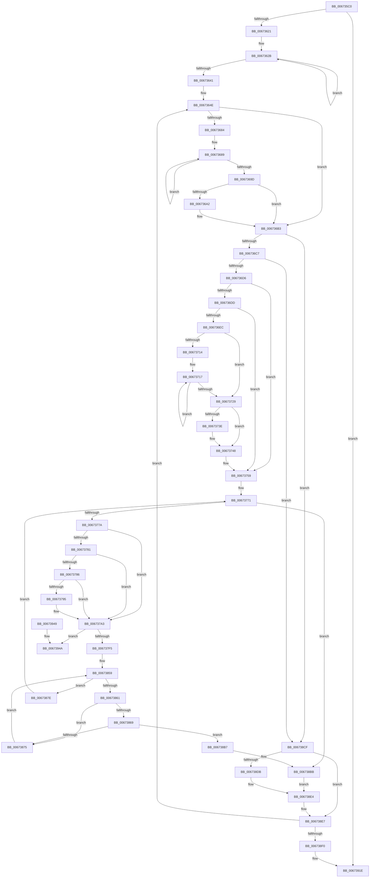

# MiPfnRangeIsZero

- RVA: `0x006735C0`–`0x00673951` (길이 `913` bytes)
- VA: `0x00000001406735C0`
- 실행 섹션: `.text`
- PDB 이름 있음: `예`; PDB Function 태그: `아니요`
- unwind 정보 RVA: `0x000D7A08`
- 디코드: `241`개 명령, `913/913` bytes 표시
- 미해석 바이트: `0` (있으면 어셈블리에 `.byte`로 보존)

> 이 문서는 커널 이미지의 기계어와 PDB 기호를 분석해 생성했습니다. 4번과 5번은 함수 원형과 자료형을 바이너리 사용 방식에서 추정한 C 해석이며 원본 소스 복구 결과는 아닙니다.

## 1. Dependencies

- 직접 호출 지점: **13**; 고유 호출 대상: **11**
- 직접 호출자로 확인된 함수: **1**
- RIP 상대 이미지 참조: **7**

### Outgoing calls
- `0x006735FA` → [memset](../6C/memset_function_006C6C40.md) (function, `0x006C6C40`)
- `0x00673651` → [MI_IS_PHYSICAL_ADDRESS](../23/MI_IS_PHYSICAL_ADDRESS_function_0023B3A0.md) (function, `0x0023B3A0`)
- `0x0067374E` → [MiClearSystemAccessBits](../68/MiClearSystemAccessBits_function_0068A2A0.md) (function, `0x0068A2A0`)
- `0x0067379E` → [MiClearSystemAccessBits](../68/MiClearSystemAccessBits_function_0068A2A0.md) (function, `0x0068A2A0`)
- `0x006737AB` → [MiPreparePfnDatabasePageForFree](MiPreparePfnDatabasePageForFree_function_00673AA8.md) (function, `0x00673AA8`)
- `0x0067381F` → [MiMakeValidPte](../2C/MiMakeValidPte_function_002C5590.md) (function, `0x002C5590`)
- `0x00673840` → [MiTransformValidPteInPlace](../37/MiTransformValidPteInPlace_function_003765E0.md) (function, `0x003765E0`)
- `0x006738BE` → [MiGetLeafVa](../27/MiGetLeafVa_function_0027C0A0.md) (function, `0x0027C0A0`)
- `0x006738D2` → [MiDemoteValidLargePageOneLevel](../68/MiDemoteValidLargePageOneLevel_function_0068A3F4.md) (function, `0x0068A3F4`)
- `0x006738DF` → [MiGetLeafVa](../27/MiGetLeafVa_function_0027C0A0.md) (function, `0x0027C0A0`)
- `0x006738FF` → [MiFreeLargeZeroPages](../3B/MiFreeLargeZeroPages_function_003B5F0C.md) (function, `0x003B5F0C`)
- `0x0067390E` → [MiReleaseNonPagedResources](../32/MiReleaseNonPagedResources_function_0032299C.md) (function, `0x0032299C`)
- `0x00673929` → [_security_check_cookie](../6A/_security_check_cookie_function_006AC640.md) (function, `0x006AC640`)

### Direct callers
- [MiFreedUnusedPfnPagesDpc](MiFreedUnusedPfnPagesDpc_function_00672378.md) at `0x006725FC`

### Static image references
- `0x006735D7` → RVA `0x00E0A740` (`.data`; read)
- `0x006735FF` → RVA `0x00FC6DE0` (`ALMOSTRO`; read)
- `0x0067360A` → RVA `0x00FC6C38` (`ALMOSTRO`; read)
- `0x006736A4` → RVA `0x00000000` (`image boundary/outside`; read)
- `0x006736E4` → RVA `0x00E2DBC9` (`.data`; reference)
- `0x006738F8` → RVA `0x00E38D00` (`.data`; read)
- `0x00673916` → RVA `0x00E376F8` (`.data`; read/write)

## 2. Other-region calls and transfers

- 다른 실행 섹션으로 향하는 call: **0**
- 별도 외부 분기/꼬리 이동을 확인하지 못했습니다.

## 3. Assembly (complete function range)

```asm
006735C0  48 89 5C 24 18                  mov qword ptr [rsp + 0x18], rbx
006735C5  55                              push rbp
006735C6  56                              push rsi
006735C7  57                              push rdi
006735C8  41 54                           push r12
006735CA  41 55                           push r13
006735CC  41 56                           push r14
006735CE  41 57                           push r15
006735D0  48 81 EC B0 00 00 00            sub rsp, 0xb0
006735D7  48 8B 05 62 71 79 00            mov rax, qword ptr [rip + 0x797162]
006735DE  48 33 C4                        xor rax, rsp
006735E1  48 89 84 24 A0 00 00 00         mov qword ptr [rsp + 0xa0], rax
006735E9  4C 8B F2                        mov r14, rdx
006735EC  48 8B D9                        mov rbx, rcx
006735EF  33 D2                           xor edx, edx
006735F1  48 8D 4C 24 40                  lea rcx, [rsp + 0x40]
006735F6  44 8D 42 60                     lea r8d, [rdx + 0x60]
006735FA  E8 41 36 05 00                  call 0x1406c6c40
006735FF  48 8B 05 DA 37 95 00            mov rax, qword ptr [rip + 0x9537da]
00673606  48 C1 E0 0C                     shl rax, 0xc
0067360A  48 03 05 27 36 95 00            add rax, qword ptr [rip + 0x953627]
00673611  4C 3B F0                        cmp r14, rax
00673614  4C 0F 47 F0                     cmova r14, rax
00673618  49 3B DE                        cmp rbx, r14
0067361B  0F 83 FD 02 00 00               jae 0x14067391e
00673621  48 8D 44 24 40                  lea rax, [rsp + 0x40]
00673626  B9 04 00 00 00                  mov ecx, 4
0067362B  48 83 60 10 00                  and qword ptr [rax + 0x10], 0
00673630  48 89 40 08                     mov qword ptr [rax + 8], rax
00673634  48 89 00                        mov qword ptr [rax], rax
00673637  48 83 C0 18                     add rax, 0x18
0067363B  48 83 E9 01                     sub rcx, 1
0067363F  75 EA                           jne 0x14067362b
00673641  45 33 FF                        xor r15d, r15d
00673644  49 BC 00 00 00 00 80 F6 FF FF   movabs r12, 0xfffff68000000000
0067364E  48 8B CB                        mov rcx, rbx
00673651  E8 4A 7D BC FF                  call 0x14023b3a0
00673656  48 8B FB                        mov rdi, rbx
00673659  48 63 F0                        movsxd rsi, eax
0067365C  48 C1 EF 09                     shr rdi, 9
00673660  49 BA F8 FF FF FF 7F 00 00 00   movabs r10, 0x7ffffffff8
0067366A  49 23 FA                        and rdi, r10
0067366D  49 8B C4                        mov rax, r12
00673670  41 B9 01 00 00 00               mov r9d, 1
00673676  48 03 F8                        add rdi, rax
00673679  45 8B E9                        mov r13d, r9d
0067367C  41 8D 69 02                     lea ebp, [r9 + 2]
00673680  85 F6                           test esi, esi
00673682  7E 2F                           jle 0x1406736b3
00673684  8B CE                           mov ecx, esi
00673686  83 CA FF                        or edx, 0xffffffff
00673689  48 C1 EF 09                     shr rdi, 9
0067368D  03 EA                           add ebp, edx
0067368F  49 23 FA                        and rdi, r10
00673692  49 8B C4                        mov rax, r12
00673695  48 03 F8                        add rdi, rax
00673698  49 2B C9                        sub rcx, r9
0067369B  75 EC                           jne 0x140673689
0067369D  83 FD 03                        cmp ebp, 3
006736A0  74 11                           je 0x1406736b3
006736A2  03 EA                           add ebp, edx
006736A4  48 8D 0D 55 C9 98 FF            lea rcx, [rip - 0x6736ab]
006736AB  4C 8B AC E9 60 1C 01 00         mov r13, qword ptr [rcx + rbp*8 + 0x11c60]
006736B3  49 8B CD                        mov rcx, r13
006736B6  48 C1 E1 0C                     shl rcx, 0xc
006736BA  48 8D 41 FF                     lea rax, [rcx - 1]
006736BE  48 85 C3                        test rbx, rax
006736C1  0F 85 08 02 00 00               jne 0x1406738cf
006736C7  49 8B C6                        mov rax, r14
006736CA  48 2B C3                        sub rax, rbx
006736CD  48 3B C1                        cmp rax, rcx
006736D0  0F 82 F9 01 00 00               jb 0x1406738cf
006736D6  48 8B 07                        mov rax, qword ptr [rdi]
006736D9  A8 20                           test al, 0x20
006736DB  74 7C                           je 0x140673759
006736DD  8B CE                           mov ecx, esi
006736DF  41 8B D1                        mov edx, r9d
006736E2  D3 E2                           shl edx, cl
006736E4  84 15 DF A4 7B 00               test byte ptr [rip + 0x7ba4df], dl
006736EA  74 6D                           je 0x140673759
006736EC  48 8B C7                        mov rax, rdi
006736EF  49 8B CE                        mov rcx, r14
006736F2  48 C1 E8 03                     shr rax, 3
006736F6  BA 00 02 00 00                  mov edx, 0x200
006736FB  25 FF 01 00 00                  and eax, 0x1ff
00673700  48 C1 E9 09                     shr rcx, 9
00673704  48 2B D0                        sub rdx, rax
00673707  49 23 CA                        and rcx, r10
0067370A  49 8B C4                        mov rax, r12
0067370D  48 03 C8                        add rcx, rax
00673710  85 F6                           test esi, esi
00673712  7E 15                           jle 0x140673729
00673714  44 8B C6                        mov r8d, esi
00673717  48 C1 E9 09                     shr rcx, 9
0067371B  49 23 CA                        and rcx, r10
0067371E  49 8B C4                        mov rax, r12
00673721  48 03 C8                        add rcx, rax
00673724  4D 2B C1                        sub r8, r9
00673727  75 EE                           jne 0x140673717
00673729  48 8B C7                        mov rax, rdi
0067372C  49 B8 00 F0 FF FF FF FF 00 00   movabs r8, 0xfffffffff000
00673736  48 33 C1                        xor rax, rcx
00673739  49 85 C0                        test r8, rax
0067373C  75 0A                           jne 0x140673748
0067373E  48 8B D1                        mov rdx, rcx
00673741  48 2B D7                        sub rdx, rdi
00673744  48 C1 FA 03                     sar rdx, 3
00673748  44 8B C6                        mov r8d, esi
0067374B  48 8B CF                        mov rcx, rdi
0067374E  E8 4D 6B 01 00                  call 0x14068a2a0
00673753  41 B9 01 00 00 00               mov r9d, 1
00673759  48 8D 15 A0 C8 98 FF            lea rdx, [rip - 0x673760]
00673760  8B CE                           mov ecx, esi
00673762  4C 8D A2 40 74 E3 00            lea r12, [rdx + 0xe37440]
00673769  89 4C 24 30                     mov dword ptr [rsp + 0x30], ecx
0067376D  4D 8D 24 F4                     lea r12, [r12 + rsi*8]
00673771  83 FE 03                        cmp esi, 3
00673774  0F 8D 41 01 00 00               jge 0x1406738bb
0067377A  48 8B 1F                        mov rbx, qword ptr [rdi]
0067377D  3B F1                           cmp esi, ecx
0067377F  74 22                           je 0x1406737a3
00673781  F6 C3 20                        test bl, 0x20
00673784  74 1D                           je 0x1406737a3
00673786  8B CE                           mov ecx, esi
00673788  41 8B D1                        mov edx, r9d
0067378B  D3 E2                           shl edx, cl
0067378D  84 15 36 A4 7B 00               test byte ptr [rip + 0x7ba436], dl
00673793  74 0E                           je 0x1406737a3
00673795  45 33 C0                        xor r8d, r8d
00673798  49 8B D1                        mov rdx, r9
0067379B  48 8B CF                        mov rcx, rdi
0067379E  E8 FD 6A 01 00                  call 0x14068a2a0
006737A3  44 8B C5                        mov r8d, ebp
006737A6  8B D6                           mov edx, esi
006737A8  48 8B CF                        mov rcx, rdi
006737AB  E8 F8 02 00 00                  call 0x140673aa8
006737B0  4D 03 FD                        add r15, r13
006737B3  48 C1 EB 0C                     shr rbx, 0xc
006737B7  49 BD FF FF FF FF FF 00 00 00   movabs r13, 0xffffffffff
006737C1  49 23 DD                        and rbx, r13
006737C4  48 8D 14 5B                     lea rdx, [rbx + rbx*2]
006737C8  48 C1 E2 04                     shl rdx, 4
006737CC  48 B8 00 00 00 00 00 DE FF FF   movabs rax, 0xffffde0000000000
006737D6  48 03 D0                        add rdx, rax
006737D9  8B C5                           mov eax, ebp
006737DB  48 8D 0C 40                     lea rcx, [rax + rax*2]
006737DF  48 8D 44 24 40                  lea rax, [rsp + 0x40]
006737E4  48 8D 04 C8                     lea rax, [rax + rcx*8]
006737E8  48 8B 48 08                     mov rcx, qword ptr [rax + 8]
006737EC  48 39 01                        cmp qword ptr [rcx], rax
006737EF  0F 85 55 01 00 00               jne 0x14067394a
006737F5  48 89 02                        mov qword ptr [rdx], rax
006737F8  48 89 4A 08                     mov qword ptr [rdx + 8], rcx
006737FC  48 89 11                        mov qword ptr [rcx], rdx
006737FF  48 8B CF                        mov rcx, rdi
00673802  48 89 50 08                     mov qword ptr [rax + 8], rdx
00673806  8B C6                           mov eax, esi
00673808  49 8B 14 24                     mov rdx, qword ptr [r12]
0067380C  F7 D8                           neg eax
0067380E  45 1B C0                        sbb r8d, r8d
00673811  41 81 E0 03 00 00 88            and r8d, 0x88000003
00673818  41 81 C0 01 00 00 20            add r8d, 0x20000001
0067381F  E8 6C 1D C5 FF                  call 0x1402c5590
00673824  8B CE                           mov ecx, esi
00673826  89 74 24 20                     mov dword ptr [rsp + 0x20], esi
0067382A  F7 D9                           neg ecx
0067382C  4C 8B C0                        mov r8, rax
0067382F  48 8B D7                        mov rdx, rdi
00673832  48 8B CF                        mov rcx, rdi
00673835  45 1B C9                        sbb r9d, r9d
00673838  41 83 E1 30                     and r9d, 0x30
0067383C  41 83 C1 44                     add r9d, 0x44
00673840  E8 9B 2D D0 FF                  call 0x1403765e0
00673845  4D 8B 04 24                     mov r8, qword ptr [r12]
00673849  48 8B CF                        mov rcx, rdi
0067384C  48 81 E1 00 F0 FF FF            and rcx, 0xfffffffffffff000
00673853  33 D2                           xor edx, edx
00673855  44 8D 4A 01                     lea r9d, [rdx + 1]
00673859  81 FA 00 02 00 00               cmp edx, 0x200
0067385F  73 1D                           jae 0x14067387e
00673861  48 8B 01                        mov rax, qword ptr [rcx]
00673864  48 85 C0                        test rax, rax
00673867  74 0C                           je 0x140673875
00673869  48 C1 E8 0C                     shr rax, 0xc
0067386D  49 23 C5                        and rax, r13
00673870  49 3B C0                        cmp rax, r8
00673873  75 42                           jne 0x1406738b7
00673875  48 83 C1 08                     add rcx, 8
00673879  41 03 D1                        add edx, r9d
0067387C  EB DB                           jmp 0x140673859
0067387E  48 B8 F8 FF FF FF 7F 00 00 00   movabs rax, 0x7ffffffff8
00673888  48 C1 EF 09                     shr rdi, 9
0067388C  48 23 F8                        and rdi, rax
0067388F  4D 8B E9                        mov r13, r9
00673892  48 B8 00 00 00 00 80 F6 FF FF   movabs rax, 0xfffff68000000000
0067389C  BD 03 00 00 00                  mov ebp, 3
006738A1  48 8B C0                        mov rax, rax
006738A4  8B 4C 24 30                     mov ecx, dword ptr [rsp + 0x30]
006738A8  48 03 F8                        add rdi, rax
006738AB  41 03 F1                        add esi, r9d
006738AE  49 83 C4 08                     add r12, 8
006738B2  E9 BA FE FF FF                  jmp 0x140673771
006738B7  48 83 C7 08                     add rdi, 8
006738BB  48 8B CF                        mov rcx, rdi
006738BE  E8 DD 87 C0 FF                  call 0x14027c0a0
006738C3  49 BC 00 00 00 00 80 F6 FF FF   movabs r12, 0xfffff68000000000
006738CD  EB 15                           jmp 0x1406738e4
006738CF  48 8B CB                        mov rcx, rbx
006738D2  E8 1D 6B 01 00                  call 0x14068a3f4
006738D7  85 C0                           test eax, eax
006738D9  75 0C                           jne 0x1406738e7
006738DB  48 8D 4F 08                     lea rcx, [rdi + 8]
006738DF  E8 BC 87 C0 FF                  call 0x14027c0a0
006738E4  48 8B D8                        mov rbx, rax
006738E7  49 3B DE                        cmp rbx, r14
006738EA  0F 82 5E FD FF FF               jb 0x14067364e
006738F0  45 33 C0                        xor r8d, r8d
006738F3  48 8D 54 24 40                  lea rdx, [rsp + 0x40]
006738F8  48 8D 0D 01 54 7C 00            lea rcx, [rip + 0x7c5401]
006738FF  E8 08 26 D4 FF                  call 0x1403b5f0c
00673904  49 8B D7                        mov rdx, r15
00673907  48 8D 0D F2 53 7C 00            lea rcx, [rip + 0x7c53f2]
0067390E  E8 89 F0 CA FF                  call 0x14032299c
00673913  49 F7 DF                        neg r15
00673916  F0 4C 01 3D DA 3D 7C 00         lock add qword ptr [rip + 0x7c3dda], r15
0067391E  48 8B 8C 24 A0 00 00 00         mov rcx, qword ptr [rsp + 0xa0]
00673926  48 33 CC                        xor rcx, rsp
00673929  E8 12 8D 03 00                  call 0x1406ac640
0067392E  48 8B 9C 24 00 01 00 00         mov rbx, qword ptr [rsp + 0x100]
00673936  48 81 C4 B0 00 00 00            add rsp, 0xb0
0067393D  41 5F                           pop r15
0067393F  41 5E                           pop r14
00673941  41 5D                           pop r13
00673943  41 5C                           pop r12
00673945  5F                              pop rdi
00673946  5E                              pop rsi
00673947  5D                              pop rbp
00673948  C3                              ret
00673949  CC                              int3
0067394A  B9 03 00 00 00                  mov ecx, 3
0067394F  CD 29                           int 0x29
```

## 4. C-style interpretation (structured pseudocode)

```c
__int64 __fastcall MiPfnRangeIsZero(__int64 a1, __int64 a2)
{
    __int64 result;
    __int64 v_r12;
    __int64 v_r13;
    __int64 v_r15;
    __int64 v_rbp;
    __int64 v_rbx;
    __int64 v_rdi;
    __int64 v_rsi;
    __int64 v_rsp;
    unsigned __int64 v_stack_m48;
    unsigned __int64 v_stack_mA8;
    unsigned int v_stack_mB8;
    unsigned int v_stack_mC8;
    unsigned __int64 v_stack_p18;

    v_stack_p18 = v_rbx;
    v_rsp = (v_rsp) - (176);
    result = (*(unsigned __int64 *)(v_rip + 7958882)) ^ (v_rsp);
    v_stack_m48 = result;
    a2 = 0;
    result = memset(v_stack_mA8, a2, a2 + 96, a4);
    result = (*(unsigned __int64 *)(v_rip + 9779162)) << (12);
    result = (result) + (*(unsigned __int64 *)(v_rip + 9778727));
    if (0 > result) { a2 = result; }
    if (a1 >= a2) goto loc_0067391E;
loc_0067362B:
    *(unsigned __int64 *)(v_stack_mA8 + 8) = v_stack_mA8;
    *(unsigned __int64 *)(v_stack_mA8) = v_stack_mA8;
    result = (v_stack_mA8) + (24);
    a1 = (4) - (1);
    if (condition_is_not_equal) goto loc_0067362B;
    v_r15 = 0;
loc_0067364E:
    result = MI_IS_PHYSICAL_ADDRESS(a1, a2, a2 + 96, a4);
    v_rdi = (a1) >> (9);
    v_rdi = (v_rdi) & (v_r10);
    v_rdi = (v_rdi) + (v_r12);
    if (condition_is_less_or_equal) goto loc_006736B3;
    a2 = (unsigned int)((a2) | (0xFFFFFFFFULL));
loc_00673689:
    v_rdi = (v_rdi) >> (9);
    v_rbp = (unsigned int)((1 + 2) + ((unsigned int)(a2)));
    v_rdi = (v_rdi) & (v_r10);
    v_rdi = (v_rdi) + (v_r12);
    a1 = ((unsigned int)((unsigned int)((int)((unsigned int)(result))))) - (1);
    if (condition_is_not_equal) goto loc_00673689;
    v_r13 = 1;
    if (((unsigned int)(v_rbp)) != 3) {
        v_rbp = (unsigned int)((v_rbp) + ((unsigned int)(a2)));
        a1 = v_rip - 6764203;
        v_r13 = *(unsigned __int64 *)(a1 + v_rbp * 8 + 72800);
    }
    a1 = (v_r13) << (12);
    if (((a1) & (a1 - 1)) != 0) goto loc_006738CF;
    result = (a2) - (a1);
    if (result < a1) goto loc_006738CF;
    if ((((unsigned __int8)(*(unsigned __int64 *)(v_rdi))) & (32)) == 0) goto loc_00673759;
    a2 = (unsigned int)((1) << ((unsigned __int8)((unsigned int)((unsigned int)((int)((unsigned int)(result)))))));
    if (((*(unsigned __int8 *)(v_rip + 8103135)) & ((unsigned __int8)(a2))) == 0) goto loc_00673759;
    result = (v_rdi) >> (3);
    result = (unsigned int)((result) & (511));
    a1 = (a2) >> (9);
    a2 = (512) - (result);
    a1 = (a1) & (v_r10);
    a1 = (a1) + (v_r12);
    if (condition_is_less_or_equal) goto loc_00673729;
loc_00673717:
    a1 = (a1) >> (9);
    a1 = (a1) & (v_r10);
    a1 = (a1) + (v_r12);
    a3 = ((unsigned int)((unsigned int)((int)((unsigned int)(result))))) - (1);
    if (condition_is_not_equal) goto loc_00673717;
loc_00673729:
    result = (v_rdi) ^ (a1);
    if (((a3) & (result)) == 0) {
        a2 = a1;
        a2 = (a2) - (v_rdi);
        a2 = (a2) >> (3);
    }
    result = MiClearSystemAccessBits(v_rdi, a2, (unsigned int)((unsigned int)((int)((unsigned int)(result)))), 1);
loc_00673759:
    v_stack_mB8 = (unsigned int)((unsigned int)((unsigned int)((int)((unsigned int)(result)))));
loc_00673771:
    if (((unsigned int)((int)((unsigned int)(result)))) >= 3) goto loc_006738BB;
    if (((unsigned int)((int)((unsigned int)(result)))) == ((unsigned int)((unsigned int)((unsigned int)((int)((unsigned int)(result))))))) goto loc_006737A3;
    if ((((unsigned __int8)(*(unsigned __int64 *)(v_rdi))) & (32)) == 0) goto loc_006737A3;
    a2 = (unsigned int)((1) << ((unsigned __int8)((unsigned int)((unsigned int)((int)((unsigned int)(result)))))));
    if (((*(unsigned __int8 *)(v_rip + 8102966)) & ((unsigned __int8)(a2))) != 0) {
        a3 = 0;
        a2 = 1;
        a1 = v_rdi;
        result = MiClearSystemAccessBits(a1, a2, a3, 1);
    }
    result = MiPreparePfnDatabasePageForFree(v_rdi, (unsigned int)((unsigned int)((int)((unsigned int)(result)))), (unsigned int)((unsigned int)(v_rbp)), 1);
    v_r15 = (v_r15) + (v_r13);
    v_rbx = (*(unsigned __int64 *)(v_rdi)) >> (12);
    v_rbx = (v_rbx) & (v_r13);
    a2 = (v_rbx + v_rbx * 2) << (4);
    a2 = (a2) + (result);
    if ((*(unsigned __int64 *)(*(unsigned __int64 *)(v_stack_mA8 + (unsigned int)((unsigned int)(v_rbp)) + (unsigned int)((unsigned int)(v_rbp)) * 2 * 8 + 8))) != (v_stack_mA8 + (unsigned int)((unsigned int)(v_rbp)) + (unsigned int)((unsigned int)(v_rbp)) * 2 * 8)) goto loc_0067394A;
    *(unsigned __int64 *)(a2) = v_stack_mA8 + (unsigned int)((unsigned int)(v_rbp)) + (unsigned int)((unsigned int)(v_rbp)) * 2 * 8;
    *(unsigned __int64 *)(a2 + 8) = *(unsigned __int64 *)(v_stack_mA8 + (unsigned int)((unsigned int)(v_rbp)) + (unsigned int)((unsigned int)(v_rbp)) * 2 * 8 + 8);
    *(unsigned __int64 *)(*(unsigned __int64 *)(v_stack_mA8 + (unsigned int)((unsigned int)(v_rbp)) + (unsigned int)((unsigned int)(v_rbp)) * 2 * 8 + 8)) = a2;
    *(unsigned __int64 *)(v_stack_mA8 + (unsigned int)((unsigned int)(v_rbp)) + (unsigned int)((unsigned int)(v_rbp)) * 2 * 8 + 8) = a2;
    result = (unsigned int)(-((unsigned int)((unsigned int)((int)((unsigned int)(result))))));
    a3 = (unsigned int)(((unsigned int)((unsigned int)(v_rbp))) & (0x88000003ULL));
    a3 = (unsigned int)((a3) + (0x20000001ULL));
    result = MiMakeValidPte(v_rdi, *(unsigned __int64 *)(v_rip - 6764384 + 14906432 + (int)((unsigned int)(result)) * 8), a3, 1);
    v_stack_mC8 = (unsigned int)((int)((unsigned int)(result)));
    a1 = (unsigned int)(-((unsigned int)((unsigned int)((int)((unsigned int)(result))))));
    a4 = (unsigned int)((1) & (48));
    a4 = (unsigned int)((a4) + (68));
    result = MiTransformValidPteInPlace(v_rdi, v_rdi, result, a4);
    a1 = (v_rdi) & (0xFFFFFFFFFFFFF000ULL);
    a2 = 0;
loc_00673859:
    if (0 >= 512) goto loc_0067387E;
    if (*(unsigned __int64 *)(a1) == 0) goto loc_00673875;
    result = (*(unsigned __int64 *)(a1)) >> (12);
    result = (result) & (v_r13);
    if (result != (*(unsigned __int64 *)(v_rip - 6764384 + 14906432 + (int)((unsigned int)(result)) * 8))) goto loc_006738B7;
loc_00673875:
    a1 = (a1) + (8);
    a2 = (unsigned int)((a2) + ((unsigned int)(a2 + 1)));
    goto loc_00673859;
loc_0067387E:
    v_rdi = (v_rdi) >> (9);
    v_rdi = (v_rdi) & (result);
    v_rdi = (v_rdi) + (result);
    v_rsi = (unsigned int)(((int)((unsigned int)(result))) + ((unsigned int)(a2 + 1)));
    v_r12 = (v_rip - 6764384 + 14906432 + (int)((unsigned int)(result)) * 8) + (8);
    goto loc_00673771;
loc_006738B7:
    v_rdi = (v_rdi) + (8);
loc_006738BB:
    result = MiGetLeafVa(v_rdi, a2, *(unsigned __int64 *)(v_rip - 6764384 + 14906432 + (int)((unsigned int)(result)) * 8), a2 + 1);
    goto loc_006738E4;
loc_006738CF:
    result = MiDemoteValidLargePageOneLevel(v_rbx, a2, *(unsigned __int64 *)(v_rip - 6764384 + 14906432 + (int)((unsigned int)(result)) * 8), a2 + 1);
    if ((unsigned int)(result) != 0) goto loc_006738E7;
    result = MiGetLeafVa(v_rdi + 8, a2, *(unsigned __int64 *)(v_rip - 6764384 + 14906432 + (int)((unsigned int)(result)) * 8), a2 + 1);
loc_006738E4:
loc_006738E7:
    if (result < a2) goto loc_0067364E;
    a3 = 0;
    result = MiFreeLargeZeroPages(v_rip + 8147969, v_stack_mA8, a3, a2 + 1);
    result = MiReleaseNonPagedResources(v_rip + 8147954, v_r15, a3, a2 + 1);
    v_r15 = -(v_r15);
loc_0067391E:
    a1 = (v_stack_m48) ^ (v_rsp);
    result = _security_check_cookie(a1, v_r15, a3, a2 + 1);
    v_rsp = (v_rsp) + (176);
    return result;
loc_0067394A:
    return result;
}
```

## 5. (Beta) C Style

```c
int64_t MiPfnRangeIsZero(int64_t Arg1, int64_t Arg2)
{
    int64_t result;
    int64_t local_r12;
    int64_t local_r13;
    int64_t local_r15;
    int64_t local_rbp;
    int64_t local_rbx;
    int64_t local_rdi;
    int64_t local_rsi;
    int64_t local_rsp;
    uint64_t v_stack_m48;
    uint64_t v_stack_mA8;
    uint32_t v_stack_mB8;
    uint32_t v_stack_mC8;
    uint64_t v_stack_p18;

    v_stack_p18 = local_rbx;
    local_rsp = (local_rsp) - (176);
    result = (*(uint64_t *)(v_rip + 0x797162)) ^ (local_rsp);
    v_stack_m48 = result;
    Arg2 = 0;
    result = memset(v_stack_mA8, Arg2, Arg2 + 96, a4);
    result = (*(uint64_t *)(v_rip + 0x9537DA)) << (12);
    result = (result) + (*(uint64_t *)(v_rip + 0x953627));
    if (0 > result) { Arg2 = result; }
    if (Arg1 >= Arg2) goto loc_0067391E;
loc_0067362B:
    *(uint64_t *)(v_stack_mA8 + 0x8) = v_stack_mA8;
    *(uint64_t *)(v_stack_mA8) = v_stack_mA8;
    result = (v_stack_mA8) + (24);
    Arg1 = (4) - (1);
    if (condition_is_not_equal) goto loc_0067362B;
    local_r15 = 0;
loc_0067364E:
    result = MI_IS_PHYSICAL_ADDRESS(Arg1, Arg2, Arg2 + 96, a4);
    local_rdi = (Arg1) >> (9);
    local_rdi = (local_rdi) & (local_r10);
    local_rdi = (local_rdi) + (local_r12);
    if (condition_is_less_or_equal) goto loc_006736B3;
    Arg2 = (uint32_t)((Arg2) | (0xFFFFFFFFULL));
loc_00673689:
    local_rdi = (local_rdi) >> (9);
    local_rbp = (uint32_t)((1 + 2) + ((uint32_t)(Arg2)));
    local_rdi = (local_rdi) & (local_r10);
    local_rdi = (local_rdi) + (local_r12);
    Arg1 = ((uint32_t)((uint32_t)((int32_t)((uint32_t)(result))))) - (1);
    if (condition_is_not_equal) goto loc_00673689;
    local_r13 = 1;
    if (((uint32_t)(local_rbp)) != 3) {
        local_rbp = (uint32_t)((local_rbp) + ((uint32_t)(Arg2)));
        Arg1 = v_rip - 6764203;
        local_r13 = *(uint64_t *)(Arg1 + local_rbp * 8 + 0x11C60);
    }
    Arg1 = (local_r13) << (12);
    if (((Arg1) & (Arg1 - 1)) != 0) goto loc_006738CF;
    result = (Arg2) - (Arg1);
    if (result < Arg1) goto loc_006738CF;
    if ((((uint8_t)(*(uint64_t *)(local_rdi))) & (32)) == 0) goto loc_00673759;
    Arg2 = (uint32_t)((1) << ((uint8_t)((uint32_t)((uint32_t)((int32_t)((uint32_t)(result)))))));
    if (((*(uint8_t *)(v_rip + 0x7BA4DF)) & ((uint8_t)(Arg2))) == 0) goto loc_00673759;
    result = (local_rdi) >> (3);
    result = (uint32_t)((result) & (511));
    Arg1 = (Arg2) >> (9);
    Arg2 = (512) - (result);
    Arg1 = (Arg1) & (local_r10);
    Arg1 = (Arg1) + (local_r12);
    if (condition_is_less_or_equal) goto loc_00673729;
loc_00673717:
    Arg1 = (Arg1) >> (9);
    Arg1 = (Arg1) & (local_r10);
    Arg1 = (Arg1) + (local_r12);
    a3 = ((uint32_t)((uint32_t)((int32_t)((uint32_t)(result))))) - (1);
    if (condition_is_not_equal) goto loc_00673717;
loc_00673729:
    result = (local_rdi) ^ (Arg1);
    if (((a3) & (result)) == 0) {
        Arg2 = Arg1;
        Arg2 = (Arg2) - (local_rdi);
        Arg2 = (Arg2) >> (3);
    }
    result = MiClearSystemAccessBits(local_rdi, Arg2, (uint32_t)((uint32_t)((int32_t)((uint32_t)(result)))), 1);
loc_00673759:
    v_stack_mB8 = (uint32_t)((uint32_t)((uint32_t)((int32_t)((uint32_t)(result)))));
loc_00673771:
    if (((uint32_t)((int32_t)((uint32_t)(result)))) >= 3) goto loc_006738BB;
    if (((uint32_t)((int32_t)((uint32_t)(result)))) == ((uint32_t)((uint32_t)((uint32_t)((int32_t)((uint32_t)(result))))))) goto loc_006737A3;
    if ((((uint8_t)(*(uint64_t *)(local_rdi))) & (32)) == 0) goto loc_006737A3;
    Arg2 = (uint32_t)((1) << ((uint8_t)((uint32_t)((uint32_t)((int32_t)((uint32_t)(result)))))));
    if (((*(uint8_t *)(v_rip + 0x7BA436)) & ((uint8_t)(Arg2))) != 0) {
        a3 = 0;
        Arg2 = 1;
        Arg1 = local_rdi;
        result = MiClearSystemAccessBits(Arg1, Arg2, a3, 1);
    }
    result = MiPreparePfnDatabasePageForFree(local_rdi, (uint32_t)((uint32_t)((int32_t)((uint32_t)(result)))), (uint32_t)((uint32_t)(local_rbp)), 1);
    local_r15 = (local_r15) + (local_r13);
    local_rbx = (*(uint64_t *)(local_rdi)) >> (12);
    local_rbx = (local_rbx) & (local_r13);
    Arg2 = (local_rbx + local_rbx * 2) << (4);
    Arg2 = (Arg2) + (result);
    if ((*(uint64_t *)(*(uint64_t *)(v_stack_mA8 + (uint32_t)((uint32_t)(local_rbp)) + (uint32_t)((uint32_t)(local_rbp)) * 2 * 8 + 0x8))) != (v_stack_mA8 + (uint32_t)((uint32_t)(local_rbp)) + (uint32_t)((uint32_t)(local_rbp)) * 2 * 8)) goto loc_0067394A;
    *(uint64_t *)(Arg2) = v_stack_mA8 + (uint32_t)((uint32_t)(local_rbp)) + (uint32_t)((uint32_t)(local_rbp)) * 2 * 8;
    *(uint64_t *)(Arg2 + 0x8) = *(uint64_t *)(v_stack_mA8 + (uint32_t)((uint32_t)(local_rbp)) + (uint32_t)((uint32_t)(local_rbp)) * 2 * 8 + 0x8);
    *(uint64_t *)(*(uint64_t *)(v_stack_mA8 + (uint32_t)((uint32_t)(local_rbp)) + (uint32_t)((uint32_t)(local_rbp)) * 2 * 8 + 0x8)) = Arg2;
    *(uint64_t *)(v_stack_mA8 + (uint32_t)((uint32_t)(local_rbp)) + (uint32_t)((uint32_t)(local_rbp)) * 2 * 8 + 0x8) = Arg2;
    result = (uint32_t)(-((uint32_t)((uint32_t)((int32_t)((uint32_t)(result))))));
    a3 = (uint32_t)(((uint32_t)((uint32_t)(local_rbp))) & (0x88000003ULL));
    a3 = (uint32_t)((a3) + (0x20000001ULL));
    result = MiMakeValidPte(local_rdi, *(uint64_t *)(v_rip - 0x673760 + 0xE37440 + (int32_t)((uint32_t)(result)) * 8), a3, 1);
    v_stack_mC8 = (uint32_t)((int32_t)((uint32_t)(result)));
    Arg1 = (uint32_t)(-((uint32_t)((uint32_t)((int32_t)((uint32_t)(result))))));
    a4 = (uint32_t)((1) & (48));
    a4 = (uint32_t)((a4) + (68));
    result = MiTransformValidPteInPlace(local_rdi, local_rdi, result, a4);
    Arg1 = (local_rdi) & (0xFFFFFFFFFFFFF000ULL);
    Arg2 = 0;
loc_00673859:
    if (0 >= 512) goto loc_0067387E;
    if (*(uint64_t *)(Arg1) == 0) goto loc_00673875;
    result = (*(uint64_t *)(Arg1)) >> (12);
    result = (result) & (local_r13);
    if (result != (*(uint64_t *)(v_rip - 0x673760 + 0xE37440 + (int32_t)((uint32_t)(result)) * 8))) goto loc_006738B7;
loc_00673875:
    Arg1 = (Arg1) + (8);
    Arg2 = (uint32_t)((Arg2) + ((uint32_t)(Arg2 + 1)));
    goto loc_00673859;
loc_0067387E:
    local_rdi = (local_rdi) >> (9);
    local_rdi = (local_rdi) & (result);
    local_rdi = (local_rdi) + (result);
    local_rsi = (uint32_t)(((int32_t)((uint32_t)(result))) + ((uint32_t)(Arg2 + 1)));
    local_r12 = (v_rip - 6764384 + 14906432 + (int32_t)((uint32_t)(result)) * 8) + (8);
    goto loc_00673771;
loc_006738B7:
    local_rdi = (local_rdi) + (8);
loc_006738BB:
    result = MiGetLeafVa(local_rdi, Arg2, *(uint64_t *)(v_rip - 0x673760 + 0xE37440 + (int32_t)((uint32_t)(result)) * 8), Arg2 + 1);
    goto loc_006738E4;
loc_006738CF:
    result = MiDemoteValidLargePageOneLevel(local_rbx, Arg2, *(uint64_t *)(v_rip - 0x673760 + 0xE37440 + (int32_t)((uint32_t)(result)) * 8), Arg2 + 1);
    if ((uint32_t)(result) != 0) goto loc_006738E7;
    result = MiGetLeafVa(local_rdi + 8, Arg2, *(uint64_t *)(v_rip - 0x673760 + 0xE37440 + (int32_t)((uint32_t)(result)) * 8), Arg2 + 1);
loc_006738E4:
loc_006738E7:
    if (result < Arg2) goto loc_0067364E;
    a3 = 0;
    result = MiFreeLargeZeroPages(v_rip + 8147969, v_stack_mA8, a3, Arg2 + 1);
    result = MiReleaseNonPagedResources(v_rip + 8147954, local_r15, a3, Arg2 + 1);
    local_r15 = -(local_r15);
loc_0067391E:
    Arg1 = (v_stack_m48) ^ (local_rsp);
    result = _security_check_cookie(Arg1, local_r15, a3, Arg2 + 1);
    local_rsp = (local_rsp) + (176);
    return result;
loc_0067394A:
    return result;
}
```

## 6. Execution-region graph

[열기: 2D/3D 그래프와 함수 탐색 컨트롤 패널](../../../control-panel.html?section=text&rva=0x006735C0&view=graph)

- 2D 그래프는 위에서 아래로 흐르고, 3D 그래프는 빈 공간을 드래그해 회전합니다. Shift+드래그는 이동, 휠은 확대·축소, 함수 노드 선택은 대상 보고서 이동입니다.

### Static fallback


