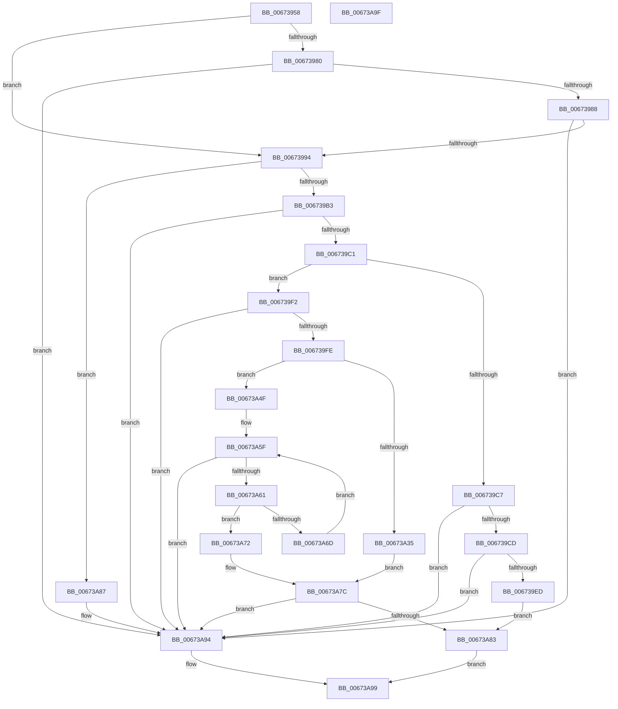

# MiPhysicalMemoryEverRemoved

- RVA: `0x00673958`–`0x00673AA0` (길이 `328` bytes)
- VA: `0x0000000140673958`
- 실행 섹션: `.text`
- PDB 이름 있음: `예`; PDB Function 태그: `아니요`
- unwind 정보 RVA: `0x00064C80`
- 디코드: `89`개 명령, `328/328` bytes 표시
- 미해석 바이트: `0` (있으면 어셈블리에 `.byte`로 보존)

> 이 문서는 커널 이미지의 기계어와 PDB 기호를 분석해 생성했습니다. 4번과 5번은 함수 원형과 자료형을 바이너리 사용 방식에서 추정한 C 해석이며 원본 소스 복구 결과는 아닙니다.

## 1. Dependencies

- 직접 호출 지점: **1**; 고유 호출 대상: **1**
- 직접 호출자로 확인된 함수: **2**
- RIP 상대 이미지 참조: **2**

### Outgoing calls
- `0x00673A8F` → [RtlSetBitsEx](../3B/RtlSetBitsEx_function_003B6570.md) (function, `0x003B6570`)

### Direct callers
- [MiMapNewPfns](../../page/7F/MiMapNewPfns_function_007FA63C.md) at `0x007FA7DC`
- [MiUnmapPfns](../../page/7F/MiUnmapPfns_function_007FB0A0.md) at `0x007FB0E7`

### Static image references
- `0x0067399F` → RVA `0x00E2DCF0` (`.data`; read)
- `0x006739D0` → RVA `0x00E2CB40` (`.data`; read)

## 2. Other-region calls and transfers

- 다른 실행 섹션으로 향하는 call: **0**
- 별도 외부 분기/꼬리 이동을 확인하지 못했습니다.

## 3. Assembly (complete function range)

```asm
00673958  40 53                           push rbx
0067395A  48 83 EC 30                     sub rsp, 0x30
0067395E  4C 8D 91 FF FF 03 00            lea r10, [rcx + 0x3ffff]
00673965  4C 8B C9                        mov r9, rcx
00673968  4C 03 D2                        add r10, rdx
0067396B  49 C1 E9 12                     shr r9, 0x12
0067396F  49 C1 EA 12                     shr r10, 0x12
00673973  B9 00 80 00 00                  mov ecx, 0x8000
00673978  41 8B C0                        mov eax, r8d
0067397B  4C 3B D1                        cmp r10, rcx
0067397E  76 14                           jbe 0x140673994
00673980  85 C0                           test eax, eax
00673982  0F 85 0C 01 00 00               jne 0x140673a94
00673988  44 8B D1                        mov r10d, ecx
0067398B  4C 3B C9                        cmp r9, rcx
0067398E  0F 83 00 01 00 00               jae 0x140673a94
00673994  4D 8B C2                        mov r8, r10
00673997  48 89 4C 24 20                  mov qword ptr [rsp + 0x20], rcx
0067399C  4D 2B C1                        sub r8, r9
0067399F  48 8D 0D 4A A3 7B 00            lea rcx, [rip + 0x7ba34a]
006739A6  48 89 4C 24 28                  mov qword ptr [rsp + 0x28], rcx
006739AB  85 C0                           test eax, eax
006739AD  0F 84 D4 00 00 00               je 0x140673a87
006739B3  48 8B 44 24 20                  mov rax, qword ptr [rsp + 0x20]
006739B8  4C 3B C8                        cmp r9, rax
006739BB  0F 83 D3 00 00 00               jae 0x140673a94
006739C1  49 83 F8 01                     cmp r8, 1
006739C5  77 2B                           ja 0x1406739f2
006739C7  0F 85 C7 00 00 00               jne 0x140673a94
006739CD  49 8B C1                        mov rax, r9
006739D0  48 8D 0D 69 91 7B 00            lea rcx, [rip + 0x7b9169]
006739D7  49 C1 E9 06                     shr r9, 6
006739DB  83 E0 3F                        and eax, 0x3f
006739DE  4A 0F A3 84 C9 B0 11 00 00      bt qword ptr [rcx + r9*8 + 0x11b0], rax
006739E7  0F 82 A7 00 00 00               jb 0x140673a94
006739ED  E9 91 00 00 00                  jmp 0x140673a83
006739F2  49 2B C1                        sub rax, r9
006739F5  49 3B C0                        cmp rax, r8
006739F8  0F 82 96 00 00 00               jb 0x140673a94
006739FE  49 8D 5A FF                     lea rbx, [r10 - 1]
00673A02  49 8B D1                        mov rdx, r9
00673A05  48 C1 EA 06                     shr rdx, 6
00673A09  48 8D 0D 30 91 7B 00            lea rcx, [rip + 0x7b9130]
00673A10  48 81 C2 36 02 00 00            add rdx, 0x236
00673A17  4C 8B DB                        mov r11, rbx
00673A1A  49 C1 EB 06                     shr r11, 6
00673A1E  49 81 C3 36 02 00 00            add r11, 0x236
00673A25  48 8D 14 D1                     lea rdx, [rcx + rdx*8]
00673A29  4C 8B 12                        mov r10, qword ptr [rdx]
00673A2C  4E 8D 1C D9                     lea r11, [rcx + r11*8]
00673A30  49 3B D3                        cmp rdx, r11
00673A33  75 1A                           jne 0x140673a4f
00673A35  B9 40 00 00 00                  mov ecx, 0x40
00673A3A  41 2A C8                        sub cl, r8b
00673A3D  49 83 C8 FF                     or r8, 0xffffffffffffffff
00673A41  49 D3 E8                        shr r8, cl
00673A44  49 8B C9                        mov rcx, r9
00673A47  49 D3 E0                        shl r8, cl
00673A4A  4D 85 D0                        test r8, r10
00673A4D  EB 2D                           jmp 0x140673a7c
00673A4F  49 83 C8 FF                     or r8, 0xffffffffffffffff
00673A53  49 8B C9                        mov rcx, r9
00673A56  49 8B C0                        mov rax, r8
00673A59  48 D3 E0                        shl rax, cl
00673A5C  4C 85 D0                        test rax, r10
00673A5F  75 33                           jne 0x140673a94
00673A61  48 83 C2 08                     add rdx, 8
00673A65  48 8B 02                        mov rax, qword ptr [rdx]
00673A68  49 3B D3                        cmp rdx, r11
00673A6B  74 05                           je 0x140673a72
00673A6D  48 85 C0                        test rax, rax
00673A70  EB ED                           jmp 0x140673a5f
00673A72  8A CB                           mov cl, bl
00673A74  F6 D1                           not cl
00673A76  49 D3 E8                        shr r8, cl
00673A79  49 85 C0                        test r8, rax
00673A7C  0F 94 C0                        sete al
00673A7F  84 C0                           test al, al
00673A81  74 11                           je 0x140673a94
00673A83  33 C0                           xor eax, eax
00673A85  EB 12                           jmp 0x140673a99
00673A87  49 8B D1                        mov rdx, r9
00673A8A  48 8D 4C 24 20                  lea rcx, [rsp + 0x20]
00673A8F  E8 DC 2A D4 FF                  call 0x1403b6570
00673A94  B8 01 00 00 00                  mov eax, 1
00673A99  48 83 C4 30                     add rsp, 0x30
00673A9D  5B                              pop rbx
00673A9E  C3                              ret
00673A9F  CC                              int3
```

## 4. C-style interpretation (structured pseudocode)

```c
__int64 __fastcall MiPhysicalMemoryEverRemoved(__int64 a1, __int64 a2, int a3)
{
    __int64 result;
    __int64 v_r10;
    __int64 v_r11;
    __int64 v_rsp;
    unsigned __int64 v_stack_m10;
    unsigned __int64 v_stack_m18;

    v_rsp = (v_rsp) - (48);
    v_r10 = (a1 + 262143) + (a2);
    a4 = (a1) >> (18);
    v_r10 = (v_r10) >> (18);
    if (v_r10 <= ((unsigned int)(0x8000ULL))) goto loc_00673994;
    if ((unsigned int)((unsigned int)(a3)) != 0) goto loc_00673A94;
    if (a4 >= ((unsigned int)(0x8000ULL))) goto loc_00673A94;
loc_00673994:
    v_stack_m18 = (unsigned int)(0x8000ULL);
    a3 = ((unsigned int)((unsigned int)((unsigned int)(0x8000ULL)))) - (a4);
    v_stack_m10 = v_rip + 8102730;
    if ((unsigned int)((unsigned int)(a3)) == 0) goto loc_00673A87;
    if (a4 >= v_stack_m18) goto loc_00673A94;
    if (a3 > 1) goto loc_006739F2;
    if (a3 != 1) goto loc_00673A94;
    a4 = (a4) >> (6);
    result = (unsigned int)((a4) & (63));
    if (condition_is_below) goto loc_00673A94;
    goto loc_00673A83;
loc_006739F2:
    result = (result) - (a4);
    if (result < a3) goto loc_00673A94;
    a2 = (a4) >> (6);
    a2 = (a2) + (566);
    v_r11 = ((unsigned int)((unsigned int)((unsigned int)(0x8000ULL))) - 1) >> (6);
    v_r11 = (v_r11) + (566);
    if ((v_rip + 8098096 + a2 * 8) != (v_rip + 8098096 + v_r11 * 8)) goto loc_00673A4F;
    a1 = (unsigned __int8)((64) - ((unsigned __int8)(a3)));
    a3 = (a3) | (-1);
    a3 = (a3) >> ((unsigned __int8)(a1));
    a3 = (a3) << ((unsigned __int8)(a4));
    goto loc_00673A7C;
loc_00673A4F:
    a3 = (a3) | (-1);
    result = (a3) << ((unsigned __int8)(a4));
loc_00673A5F:
    if (((result) & (*(unsigned __int64 *)(v_rip + 8098096 + a2 * 8))) != 0) goto loc_00673A94;
    a2 = (v_rip + 8098096 + a2 * 8) + (8);
    if (a2 == (v_rip + 8098096 + v_r11 * 8)) goto loc_00673A72;
    goto loc_00673A5F;
loc_00673A72:
    a1 = (unsigned __int8)(~((unsigned __int8)((unsigned int)((unsigned int)((unsigned int)(0x8000ULL))) - 1)));
    a3 = (a3) >> ((unsigned __int8)(a1));
loc_00673A7C:
    result = (((a3) & (*(unsigned __int64 *)(a2))) == 0) ? 1 : 0;
    if ((unsigned __int8)(result) == 0) goto loc_00673A94;
loc_00673A83:
    result = 0;
    goto loc_00673A99;
loc_00673A87:
    result = RtlSetBitsEx(v_stack_m18, a4, a3, a4);
loc_00673A94:
loc_00673A99:
    v_rsp = (v_rsp) + (48);
    return 1;
}
```

## 5. (Beta) C Style

```c
int64_t MiPhysicalMemoryEverRemoved(void *Arg1, int64_t Arg2, int32_t Arg3)
{
    uint8_t *arg1 = (uint8_t *)Arg1;

    int64_t result;
    int64_t local_r10;
    int64_t local_r11;
    int64_t local_rsp;
    uint64_t v_stack_m10;
    uint64_t v_stack_m18;

    local_rsp = (local_rsp) - (48);
    local_r10 = (Arg1 + 262143) + (Arg2);
    a4 = (Arg1) >> (18);
    local_r10 = (local_r10) >> (18);
    if (local_r10 <= ((uint32_t)(0x8000ULL))) goto loc_00673994;
    if ((uint32_t)((uint32_t)(Arg3)) != 0) goto loc_00673A94;
    if (a4 >= ((uint32_t)(0x8000ULL))) goto loc_00673A94;
loc_00673994:
    v_stack_m18 = (uint32_t)(0x8000ULL);
    Arg3 = ((uint32_t)((uint32_t)((uint32_t)(0x8000ULL)))) - (a4);
    v_stack_m10 = v_rip + 8102730;
    if ((uint32_t)((uint32_t)(Arg3)) == 0) goto loc_00673A87;
    if (a4 >= v_stack_m18) goto loc_00673A94;
    if (Arg3 > 1) goto loc_006739F2;
    if (Arg3 != 1) goto loc_00673A94;
    a4 = (a4) >> (6);
    result = (uint32_t)((a4) & (63));
    if (condition_is_below) goto loc_00673A94;
    goto loc_00673A83;
loc_006739F2:
    result = (result) - (a4);
    if (result < Arg3) goto loc_00673A94;
    Arg2 = (a4) >> (6);
    Arg2 = (Arg2) + (566);
    local_r11 = ((uint32_t)((uint32_t)((uint32_t)(0x8000ULL))) - 1) >> (6);
    local_r11 = (local_r11) + (566);
    if ((v_rip + 8098096 + Arg2 * 8) != (v_rip + 8098096 + local_r11 * 8)) goto loc_00673A4F;
    Arg1 = (uint8_t)((64) - ((uint8_t)(Arg3)));
    Arg3 = (Arg3) | (-1);
    Arg3 = (Arg3) >> ((uint8_t)(Arg1));
    Arg3 = (Arg3) << ((uint8_t)(a4));
    goto loc_00673A7C;
loc_00673A4F:
    Arg3 = (Arg3) | (-1);
    result = (Arg3) << ((uint8_t)(a4));
loc_00673A5F:
    if (((result) & (*(uint64_t *)(v_rip + 0x7B9130 + Arg2 * 8))) != 0) goto loc_00673A94;
    Arg2 = (v_rip + 8098096 + Arg2 * 8) + (8);
    if (Arg2 == (v_rip + 8098096 + local_r11 * 8)) goto loc_00673A72;
    goto loc_00673A5F;
loc_00673A72:
    Arg1 = (uint8_t)(~((uint8_t)((uint32_t)((uint32_t)((uint32_t)(0x8000ULL))) - 1)));
    Arg3 = (Arg3) >> ((uint8_t)(Arg1));
loc_00673A7C:
    result = (((Arg3) & (*(uint64_t *)(Arg2))) == 0) ? 1 : 0;
    if ((uint8_t)(result) == 0) goto loc_00673A94;
loc_00673A83:
    result = 0;
    goto loc_00673A99;
loc_00673A87:
    result = RtlSetBitsEx(v_stack_m18, a4, Arg3, a4);
loc_00673A94:
loc_00673A99:
    local_rsp = (local_rsp) + (48);
    return 1;
}
```

### 관측된 메모리 오프셋

구조체 형식이 확인되지 않은 접근은 인자 기준의 오프셋으로만 기록했습니다.

| 기준 인자 | 오프셋 표현 | 폭 (bit) | 접근 |
|---|---:|---:|---|
| `Arg1` | `+ 0x3FFFF` | `64` | `R` |

## 6. Execution-region graph

[열기: 2D/3D 그래프와 함수 탐색 컨트롤 패널](../../../control-panel.html?section=text&rva=0x00673958&view=graph)

- 2D 그래프는 위에서 아래로 흐르고, 3D 그래프는 빈 공간을 드래그해 회전합니다. Shift+드래그는 이동, 휠은 확대·축소, 함수 노드 선택은 대상 보고서 이동입니다.

### Static fallback


