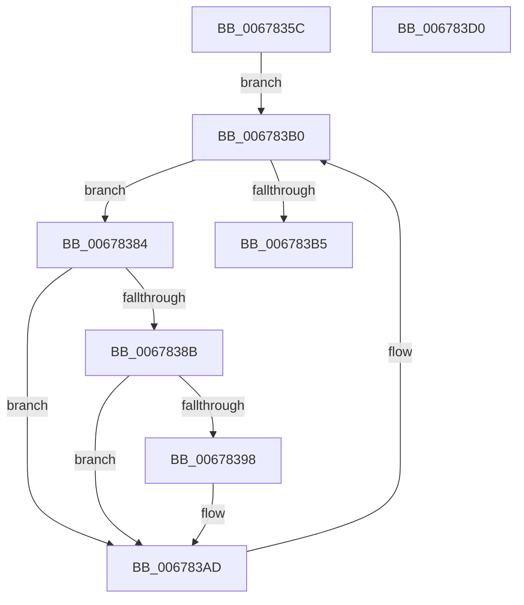

# MiPrepareDeleteOnClose

- RVA: `0x0067835C`–`0x006783D1` (길이 `117` bytes)
- VA: `0x000000014067835C`
- 실행 섹션: `.text`
- PDB 이름 있음: `예`; PDB Function 태그: `아니요`
- unwind 정보 RVA: `0x0005E6B4`
- 디코드: `34`개 명령, `117/117` bytes 표시
- 미해석 바이트: `0` (있으면 어셈블리에 `.byte`로 보존)

> 이 문서는 커널 이미지의 기계어와 PDB 기호를 분석해 생성했습니다. 4번과 5번은 함수 원형과 자료형을 바이너리 사용 방식에서 추정한 C 해석이며 원본 소스 복구 결과는 아닙니다.

## 1. Dependencies

- 직접 호출 지점: **3**; 고유 호출 대상: **3**
- 직접 호출자로 확인된 함수: **1**
- RIP 상대 이미지 참조: **0**

### Outgoing calls
- `0x0067838F` → [ExTryAcquireSpinLockExclusiveAtDpcLevel](../2B/ExTryAcquireSpinLockExclusiveAtDpcLevel_function_002BB800.md) (function, `0x002BB800`)
- `0x0067839F` → [MiMoveUnusedSubsectionsToDeleteOnClose](MiMoveUnusedSubsectionsToDeleteOnClose_function_006781E0.md) (function, `0x006781E0`)
- `0x006783A8` → [ExReleaseSpinLockExclusiveFromDpcLevel](../24/ExReleaseSpinLockExclusiveFromDpcLevel_function_002497E0.md) (function, `0x002497E0`)

### Direct callers
- [MiIssueSegmentDereferenceWork](../46/MiIssueSegmentDereferenceWork_function_00464AB0.md) at `0x00464D1F`

### Static image references
- 디코드된 RIP-relative 메모리 참조가 없습니다.

## 2. Other-region calls and transfers

- 다른 실행 섹션으로 향하는 call: **0**
- 별도 외부 분기/꼬리 이동을 확인하지 못했습니다.

## 3. Assembly (complete function range)

```asm
0067835C  48 8B C4                        mov rax, rsp
0067835F  48 89 58 08                     mov qword ptr [rax + 8], rbx
00678363  48 89 68 10                     mov qword ptr [rax + 0x10], rbp
00678367  48 89 70 18                     mov qword ptr [rax + 0x18], rsi
0067836B  48 89 78 20                     mov qword ptr [rax + 0x20], rdi
0067836F  41 56                           push r14
00678371  48 83 EC 20                     sub rsp, 0x20
00678375  48 8D B9 C8 07 00 00            lea rdi, [rcx + 0x7c8]
0067837C  48 8B E9                        mov rbp, rcx
0067837F  48 8B 1F                        mov rbx, qword ptr [rdi]
00678382  EB 2C                           jmp 0x1406783b0
00678384  8B 43 30                        mov eax, dword ptr [rbx + 0x30]
00678387  A8 20                           test al, 0x20
00678389  75 22                           jne 0x1406783ad
0067838B  48 8D 4B 40                     lea rcx, [rbx + 0x40]
0067838F  E8 6C 34 C4 FF                  call 0x1402bb800
00678394  85 C0                           test eax, eax
00678396  74 15                           je 0x1406783ad
00678398  48 8D 53 F8                     lea rdx, [rbx - 8]
0067839C  48 8B CD                        mov rcx, rbp
0067839F  E8 3C FE FF FF                  call 0x1406781e0
006783A4  48 8D 4B 40                     lea rcx, [rbx + 0x40]
006783A8  E8 33 14 BD FF                  call 0x1402497e0
006783AD  48 8B 1B                        mov rbx, qword ptr [rbx]
006783B0  48 3B DF                        cmp rbx, rdi
006783B3  75 CF                           jne 0x140678384
006783B5  48 8B 5C 24 30                  mov rbx, qword ptr [rsp + 0x30]
006783BA  48 8B 6C 24 38                  mov rbp, qword ptr [rsp + 0x38]
006783BF  48 8B 74 24 40                  mov rsi, qword ptr [rsp + 0x40]
006783C4  48 8B 7C 24 48                  mov rdi, qword ptr [rsp + 0x48]
006783C9  48 83 C4 20                     add rsp, 0x20
006783CD  41 5E                           pop r14
006783CF  C3                              ret
006783D0  CC                              int3
```

## 4. C-style interpretation (structured pseudocode)

```c
__int64 __fastcall MiPrepareDeleteOnClose(__int64 a1)
{
    __int64 result;
    __int64 v_rsp;
    unsigned __int64 v_stack_p10;
    unsigned __int64 v_stack_p18;
    unsigned __int64 v_stack_p20;
    unsigned __int64 v_stack_p8;

    *(unsigned __int64 *)(v_rsp + 8) = v_rbx;
    *(unsigned __int64 *)(v_rsp + 16) = v_rbp;
    *(unsigned __int64 *)(v_rsp + 24) = v_rsi;
    *(unsigned __int64 *)(v_rsp + 32) = v_rdi;
    v_rsp = (v_rsp) - (32);
    goto loc_006783B0;
loc_00678384:
    if ((((unsigned __int8)((unsigned int)(*(unsigned int *)(*(unsigned __int64 *)(a1 + 1992) + 48)))) & (32)) != 0) goto loc_006783AD;
    result = ExTryAcquireSpinLockExclusiveAtDpcLevel(*(unsigned __int64 *)(a1 + 1992) + 64, a2, a3, a4);
    if ((unsigned int)(result) != 0) {
        a2 = *(unsigned __int64 *)(a1 + 1992) - 8;
        a1 = a1;
        result = MiMoveUnusedSubsectionsToDeleteOnClose(a1, a2, a3, a4);
        a1 = *(unsigned __int64 *)(a1 + 1992) + 64;
        result = ExReleaseSpinLockExclusiveFromDpcLevel(a1, a2, a3, a4);
    }
loc_006783B0:
    if ((*(unsigned __int64 *)(*(unsigned __int64 *)(a1 + 1992))) != (a1 + 1992)) goto loc_00678384;
    v_rsp = (v_rsp) + (32);
    return result;
}
```

## 5. (Beta) C Style

```c
int64_t MiPrepareDeleteOnClose(void *Arg1)
{
    uint8_t *arg1 = (uint8_t *)Arg1;

    int64_t result;
    int64_t local_rsp;
    uint64_t v_stack_p10;
    uint64_t v_stack_p18;
    uint64_t v_stack_p20;
    uint64_t v_stack_p8;

    *(uint64_t *)(local_rsp + 0x8) = local_rbx;
    *(uint64_t *)(local_rsp + 0x10) = local_rbp;
    *(uint64_t *)(local_rsp + 0x18) = local_rsi;
    *(uint64_t *)(local_rsp + 0x20) = local_rdi;
    local_rsp = (local_rsp) - (32);
    goto loc_006783B0;
loc_00678384:
    if ((((uint8_t)((uint32_t)(*(uint32_t *)(*(uint64_t *)(arg1 + 0x7C8) + 0x30)))) & (32)) != 0) goto loc_006783AD;
    result = ExTryAcquireSpinLockExclusiveAtDpcLevel(*(uint64_t *)(arg1 + 0x7C8) + 64, a2, a3, a4);
    if ((uint32_t)(result) != 0) {
        a2 = *(uint64_t *)(arg1 + 0x7C8) - 8;
        Arg1 = Arg1;
        result = MiMoveUnusedSubsectionsToDeleteOnClose(Arg1, a2, a3, a4);
        Arg1 = *(uint64_t *)(arg1 + 0x7C8) + 64;
        result = ExReleaseSpinLockExclusiveFromDpcLevel(Arg1, a2, a3, a4);
    }
loc_006783B0:
    if ((*(uint64_t *)(*(uint64_t *)(arg1 + 0x7C8))) != (Arg1 + 1992)) goto loc_00678384;
    local_rsp = (local_rsp) + (32);
    return result;
}
```

### 관측된 메모리 오프셋

구조체 형식이 확인되지 않은 접근은 인자 기준의 오프셋으로만 기록했습니다.

| 기준 인자 | 오프셋 표현 | 폭 (bit) | 접근 |
|---|---:|---:|---|
| `Arg1` | `+ 0x0` | `64` | `R` |
| `Arg1` | `+ 0x7C8` | `64` | `R` |

## 6. Execution-region graph

[열기: 2D/3D 그래프와 함수 탐색 컨트롤 패널](../../../control-panel.html?section=text&rva=0x0067835C&view=graph)

- 2D 그래프는 위에서 아래로 흐르고, 3D 그래프는 빈 공간을 드래그해 회전합니다. Shift+드래그는 이동, 휠은 확대·축소, 함수 노드 선택은 대상 보고서 이동입니다.

### Static fallback


