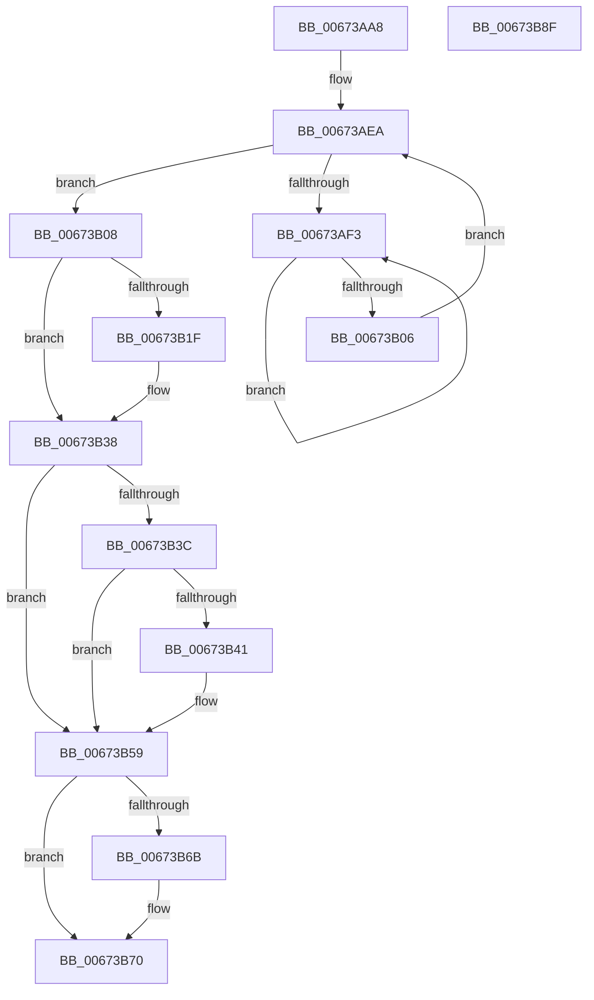

# MiPreparePfnDatabasePageForFree

- RVA: `0x00673AA8`–`0x00673B90` (길이 `232` bytes)
- VA: `0x0000000140673AA8`
- 실행 섹션: `.text`
- PDB 이름 있음: `예`; PDB Function 태그: `아니요`
- unwind 정보 RVA: `0x000D1934`
- 디코드: `57`개 명령, `232/232` bytes 표시
- 미해석 바이트: `0` (있으면 어셈블리에 `.byte`로 보존)

> 이 문서는 커널 이미지의 기계어와 PDB 기호를 분석해 생성했습니다. 4번과 5번은 함수 원형과 자료형을 바이너리 사용 방식에서 추정한 C 해석이며 원본 소스 복구 결과는 아닙니다.

## 1. Dependencies

- 직접 호출 지점: **2**; 고유 호출 대상: **2**
- 직접 호출자로 확인된 함수: **1**
- RIP 상대 이미지 참조: **1**

### Outgoing calls
- `0x00673AF8` → [KeYieldProcessorEx](../3F/KeYieldProcessorEx_function_003FBD00.md) (function, `0x003FBD00`)
- `0x00673B6B` → [MiSetOriginalPtePfnFromFreeList](../28/MiSetOriginalPtePfnFromFreeList_function_0028A99C.md) (function, `0x0028A99C`)

### Direct callers
- [MiPfnRangeIsZero](MiPfnRangeIsZero_function_006735C0.md) at `0x006737AB`

### Static image references
- `0x00673B59` → RVA `0x00010880` (`.rdata`; read)

## 2. Other-region calls and transfers

- 다른 실행 섹션으로 향하는 call: **0**
- 별도 외부 분기/꼬리 이동을 확인하지 못했습니다.

## 3. Assembly (complete function range)

```asm
00673AA8  48 89 5C 24 18                  mov qword ptr [rsp + 0x18], rbx
00673AAD  48 89 74 24 20                  mov qword ptr [rsp + 0x20], rsi
00673AB2  57                              push rdi
00673AB3  48 83 EC 20                     sub rsp, 0x20
00673AB7  48 8B 01                        mov rax, qword ptr [rcx]
00673ABA  41 8B F0                        mov esi, r8d
00673ABD  48 C1 E8 0C                     shr rax, 0xc
00673AC1  48 B9 FF FF FF FF FF 00 00 00   movabs rcx, 0xffffffffff
00673ACB  48 23 C1                        and rax, rcx
00673ACE  8B FA                           mov edi, edx
00673AD0  48 8D 1C 40                     lea rbx, [rax + rax*2]
00673AD4  48 C1 E3 04                     shl rbx, 4
00673AD8  48 B8 00 00 00 00 00 DE FF FF   movabs rax, 0xffffde0000000000
00673AE2  48 03 D8                        add rbx, rax
00673AE5  83 64 24 30 00                  and dword ptr [rsp + 0x30], 0
00673AEA  F0 48 0F BA 6B 18 3F            lock bts qword ptr [rbx + 0x18], 0x3f
00673AF1  73 15                           jae 0x140673b08
00673AF3  48 8D 4C 24 30                  lea rcx, [rsp + 0x30]
00673AF8  E8 03 82 D8 FF                  call 0x1403fbd00
00673AFD  48 8B 43 18                     mov rax, qword ptr [rbx + 0x18]
00673B01  48 85 C0                        test rax, rax
00673B04  78 ED                           js 0x140673af3
00673B06  EB E2                           jmp 0x140673aea
00673B08  48 8B 43 18                     mov rax, qword ptr [rbx + 0x18]
00673B0C  48 B9 FF FF FF FF FF FF FF 3F   movabs rcx, 0x3fffffffffffffff
00673B16  48 23 C1                        and rax, rcx
00673B19  48 83 F8 01                     cmp rax, 1
00673B1D  74 19                           je 0x140673b38
00673B1F  48 8B 43 18                     mov rax, qword ptr [rbx + 0x18]
00673B23  48 B9 01 00 00 00 00 00 00 C0   movabs rcx, 0xc000000000000001
00673B2D  48 23 C1                        and rax, rcx
00673B30  48 83 C8 01                     or rax, 1
00673B34  48 89 43 18                     mov qword ptr [rbx + 0x18], rax
00673B38  85 FF                           test edi, edi
00673B3A  75 1D                           jne 0x140673b59
00673B3C  83 FE 03                        cmp esi, 3
00673B3F  75 18                           jne 0x140673b59
00673B41  8B 43 20                        mov eax, dword ptr [rbx + 0x20]
00673B44  89 44 24 38                     mov dword ptr [rsp + 0x38], eax
00673B48  B8 FF FF 00 00                  mov eax, 0xffff
00673B4D  66 01 44 24 38                  add word ptr [rsp + 0x38], ax
00673B52  8B 44 24 38                     mov eax, dword ptr [rsp + 0x38]
00673B56  89 43 20                        mov dword ptr [rbx + 0x20], eax
00673B59  48 8B 05 20 CD 99 FF            mov rax, qword ptr [rip - 0x6632e0]
00673B60  48 8D 4B 10                     lea rcx, [rbx + 0x10]
00673B64  48 89 01                        mov qword ptr [rcx], rax
00673B67  85 FF                           test edi, edi
00673B69  74 05                           je 0x140673b70
00673B6B  E8 2C 6E C1 FF                  call 0x14028a99c
00673B70  48 B8 FF FF FF FF FF FF FF 7F   movabs rax, 0x7fffffffffffffff
00673B7A  F0 48 21 43 18                  lock and qword ptr [rbx + 0x18], rax
00673B7F  48 8B 5C 24 40                  mov rbx, qword ptr [rsp + 0x40]
00673B84  48 8B 74 24 48                  mov rsi, qword ptr [rsp + 0x48]
00673B89  48 83 C4 20                     add rsp, 0x20
00673B8D  5F                              pop rdi
00673B8E  C3                              ret
00673B8F  CC                              int3
```

## 4. C-style interpretation (structured pseudocode)

```c
__int64 __fastcall MiPreparePfnDatabasePageForFree(__int64 a1, int a2, int a3)
{
    __int64 result;
    __int64 v_rbx;
    __int64 v_rsp;
    unsigned int v_stack_p10;
    unsigned __int64 v_stack_p18;
    unsigned __int64 v_stack_p20;
    unsigned int v_stack_p8;

    v_stack_p18 = v_rbx;
    v_stack_p20 = v_rsi;
    v_rsp = (v_rsp) - (32);
    result = (*(unsigned __int64 *)(a1)) >> (12);
    result = (result) & (a1);
    v_rbx = (result + result * 2) << (4);
    v_rbx = (v_rbx) + (result);
loc_00673AEA:
    if (condition_is_above_or_equal) goto loc_00673B08;
loc_00673AF3:
    result = KeYieldProcessorEx(v_stack_p8, a2, a3, a4);
    if (sign_flag) goto loc_00673AF3;
    goto loc_00673AEA;
loc_00673B08:
    result = (*(unsigned __int64 *)(v_rbx + 24)) & (v_stack_p8);
    if (result != 1) {
        result = *(unsigned __int64 *)(v_rbx + 24);
        result = (result) & (v_stack_p8);
        result = (result) | (1);
        *(unsigned __int64 *)(v_rbx + 24) = result;
    }
    if ((unsigned int)((unsigned int)(a2)) != 0) goto loc_00673B59;
    if (((unsigned int)((unsigned int)(a3))) == 3) {
        result = *(unsigned int *)(v_rbx + 32);
        v_stack_p10 = (unsigned int)(result);
        result = 0xFFFFULL;
        result = v_stack_p10;
        *(unsigned int *)(v_rbx + 32) = (unsigned int)(result);
    }
    *(unsigned __int64 *)(v_rbx + 16) = *(unsigned __int64 *)(v_rip - 6697696);
    result = *(unsigned __int64 *)(v_rip - 6697696);
    if ((unsigned int)((unsigned int)(a2)) != 0) {
        result = MiSetOriginalPtePfnFromFreeList(v_rbx + 16, a2, a3, a4);
    }
    v_rsp = (v_rsp) + (32);
    return result;
}
```

## 5. (Beta) C Style

```c
int64_t MiPreparePfnDatabasePageForFree(void *Arg1, int32_t Arg2, int32_t Arg3)
{
    uint8_t *arg1 = (uint8_t *)Arg1;

    int64_t result;
    int64_t local_rbx;
    int64_t local_rsp;
    uint32_t v_stack_p10;
    uint64_t v_stack_p18;
    uint64_t v_stack_p20;
    uint32_t v_stack_p8;

    v_stack_p18 = local_rbx;
    v_stack_p20 = local_rsi;
    local_rsp = (local_rsp) - (32);
    result = (*(uint64_t *)(arg1)) >> (12);
    result = (result) & (Arg1);
    local_rbx = (result + result * 2) << (4);
    local_rbx = (local_rbx) + (result);
loc_00673AEA:
    if (condition_is_above_or_equal) goto loc_00673B08;
loc_00673AF3:
    result = KeYieldProcessorEx(v_stack_p8, Arg2, Arg3, a4);
    if (sign_flag) goto loc_00673AF3;
    goto loc_00673AEA;
loc_00673B08:
    result = (*(uint64_t *)(local_rbx + 0x18)) & (v_stack_p8);
    if (result != 1) {
        result = *(uint64_t *)(local_rbx + 0x18);
        result = (result) & (v_stack_p8);
        result = (result) | (1);
        *(uint64_t *)(local_rbx + 0x18) = result;
    }
    if ((uint32_t)((uint32_t)(Arg2)) != 0) goto loc_00673B59;
    if (((uint32_t)((uint32_t)(Arg3))) == 3) {
        result = *(uint32_t *)(local_rbx + 0x20);
        v_stack_p10 = (uint32_t)(result);
        result = 0xFFFFULL;
        result = v_stack_p10;
        *(uint32_t *)(local_rbx + 0x20) = (uint32_t)(result);
    }
    *(uint64_t *)(local_rbx + 0x10) = *(uint64_t *)(v_rip - 0x6632E0);
    result = *(uint64_t *)(v_rip - 0x6632E0);
    if ((uint32_t)((uint32_t)(Arg2)) != 0) {
        result = MiSetOriginalPtePfnFromFreeList(local_rbx + 16, Arg2, Arg3, a4);
    }
    local_rsp = (local_rsp) + (32);
    return result;
}
```

### 관측된 메모리 오프셋

구조체 형식이 확인되지 않은 접근은 인자 기준의 오프셋으로만 기록했습니다.

| 기준 인자 | 오프셋 표현 | 폭 (bit) | 접근 |
|---|---:|---:|---|
| `Arg1` | `+ 0x0` | `64` | `R` |

## 6. Execution-region graph

[열기: 2D/3D 그래프와 함수 탐색 컨트롤 패널](../../../control-panel.html?section=text&rva=0x00673AA8&view=graph)

- 2D 그래프는 위에서 아래로 흐르고, 3D 그래프는 빈 공간을 드래그해 회전합니다. Shift+드래그는 이동, 휠은 확대·축소, 함수 노드 선택은 대상 보고서 이동입니다.

### Static fallback


