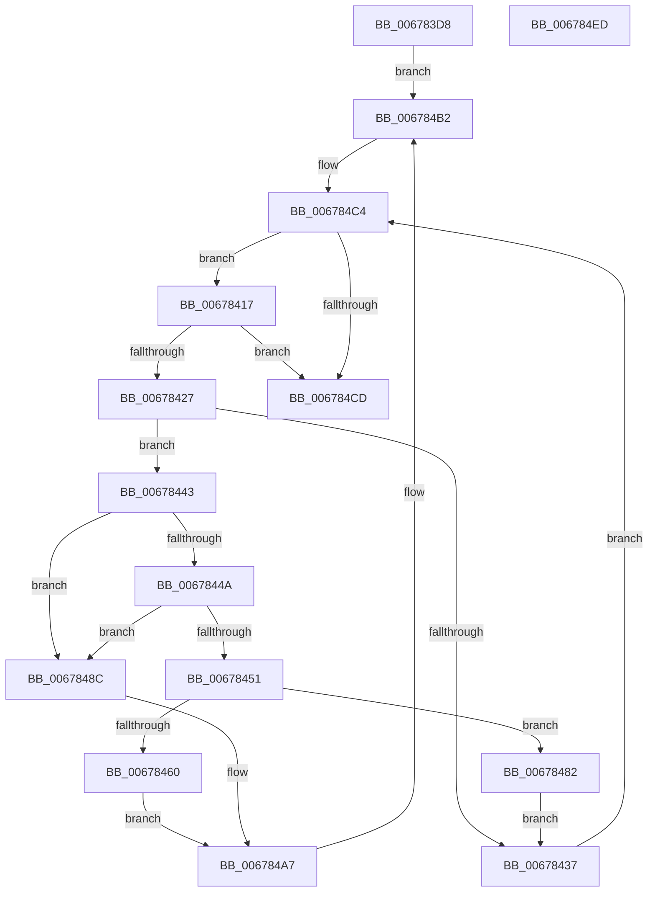

# MiProcessDeleteOnClose

- RVA: `0x006783D8`–`0x006784EE` (길이 `278` bytes)
- VA: `0x00000001406783D8`
- 실행 섹션: `.text`
- PDB 이름 있음: `예`; PDB Function 태그: `아니요`
- unwind 정보 RVA: `0x00068D9C`
- 디코드: `82`개 명령, `278/278` bytes 표시
- 미해석 바이트: `0` (있으면 어셈블리에 `.byte`로 보존)

> 이 문서는 커널 이미지의 기계어와 PDB 기호를 분석해 생성했습니다. 4번과 5번은 함수 원형과 자료형을 바이너리 사용 방식에서 추정한 C 해석이며 원본 소스 복구 결과는 아닙니다.

## 1. Dependencies

- 직접 호출 지점: **13**; 고유 호출 대상: **8**
- 직접 호출자로 확인된 함수: **1**
- RIP 상대 이미지 참조: **0**

### Outgoing calls
- `0x006783F7` → [MiDeleteDeleteOnCloseSubsections](MiDeleteDeleteOnCloseSubsections_function_00677D20.md) (function, `0x00677D20`)
- `0x00678406` → [ExAcquireSpinLockExclusive](../24/ExAcquireSpinLockExclusive_function_00248690.md) (function, `0x00248690`)
- `0x0067842E` → [ExTryAcquireSpinLockExclusiveAtDpcLevel](../2B/ExTryAcquireSpinLockExclusiveAtDpcLevel_function_002BB800.md) (function, `0x002BB800`)
- `0x00678457` → [MiMoveUnusedSubsectionsToDeleteOnClose](MiMoveUnusedSubsectionsToDeleteOnClose_function_006781E0.md) (function, `0x006781E0`)
- `0x00678463` → [ExReleaseSpinLockExclusiveFromDpcLevel](../24/ExReleaseSpinLockExclusiveFromDpcLevel_function_002497E0.md) (function, `0x002497E0`)
- `0x0067846E` → [MiReleaseSpinLockExclusive](../24/MiReleaseSpinLockExclusive_function_002482C0.md) (function, `0x002482C0`)
- `0x0067847B` → [MiDeleteDeleteOnCloseSubsections](MiDeleteDeleteOnCloseSubsections_function_00677D20.md) (function, `0x00677D20`)
- `0x00678485` → [ExReleaseSpinLockExclusiveFromDpcLevel](../24/ExReleaseSpinLockExclusiveFromDpcLevel_function_002497E0.md) (function, `0x002497E0`)
- `0x0067848F` → [MiUnlinkUnusedControlArea](../4E/MiUnlinkUnusedControlArea_function_004ED9F8.md) (function, `0x004ED9F8`)
- `0x00678497` → [ExReleaseSpinLockExclusiveFromDpcLevel](../24/ExReleaseSpinLockExclusiveFromDpcLevel_function_002497E0.md) (function, `0x002497E0`)
- `0x006784A2` → [MiDestroySection](../46/MiDestroySection_function_00462FDC.md) (function, `0x00462FDC`)
- `0x006784AD` → [ExAcquireSpinLockExclusive](../24/ExAcquireSpinLockExclusive_function_00248690.md) (function, `0x00248690`)
- `0x006784D3` → [MiReleaseSpinLockExclusive](../24/MiReleaseSpinLockExclusive_function_002482C0.md) (function, `0x002482C0`)

### Direct callers
- [MiSegmentDereferenceWorker](../46/MiSegmentDereferenceWorker_function_00464D40.md) at `0x00464DCD`
- [MiSegmentDereferenceWorker](../46/MiSegmentDereferenceWorker_function_00464D40.md) at `0x00464E26`

### Static image references
- 디코드된 RIP-relative 메모리 참조가 없습니다.

## 2. Other-region calls and transfers

- 다른 실행 섹션으로 향하는 call: **0**
- 별도 외부 분기/꼬리 이동을 확인하지 못했습니다.

## 3. Assembly (complete function range)

```asm
006783D8  48 89 5C 24 18                  mov qword ptr [rsp + 0x18], rbx
006783DD  48 89 54 24 10                  mov qword ptr [rsp + 0x10], rdx
006783E2  55                              push rbp
006783E3  56                              push rsi
006783E4  57                              push rdi
006783E5  41 54                           push r12
006783E7  41 55                           push r13
006783E9  41 56                           push r14
006783EB  41 57                           push r15
006783ED  48 83 EC 20                     sub rsp, 0x20
006783F1  4C 8B F9                        mov r15, rcx
006783F4  45 33 F6                        xor r14d, r14d
006783F7  E8 24 F9 FF FF                  call 0x140677d20
006783FC  49 8D B7 C0 06 00 00            lea rsi, [r15 + 0x6c0]
00678403  48 8B CE                        mov rcx, rsi
00678406  E8 85 02 BD FF                  call 0x140248690
0067840B  4D 8D AF C8 07 00 00            lea r13, [r15 + 0x7c8]
00678412  E9 9B 00 00 00                  jmp 0x1406784b2
00678417  41 FF C6                        inc r14d
0067841A  48 8D 7B F8                     lea rdi, [rbx - 8]
0067841E  44 3B F0                        cmp r14d, eax
00678421  0F 87 A6 00 00 00               ja 0x1406784cd
00678427  4C 8D 67 48                     lea r12, [rdi + 0x48]
0067842B  49 8B CC                        mov rcx, r12
0067842E  E8 CD 33 C4 FF                  call 0x1402bb800
00678433  85 C0                           test eax, eax
00678435  75 0C                           jne 0x140678443
00678437  48 8B 1B                        mov rbx, qword ptr [rbx]
0067843A  8B 44 24 60                     mov eax, dword ptr [rsp + 0x60]
0067843E  E9 81 00 00 00                  jmp 0x1406784c4
00678443  8B 47 38                        mov eax, dword ptr [rdi + 0x38]
00678446  A8 20                           test al, 0x20
00678448  75 42                           jne 0x14067848c
0067844A  48 83 7F 20 00                  cmp qword ptr [rdi + 0x20], 0
0067844F  74 3B                           je 0x14067848c
00678451  48 8B D7                        mov rdx, rdi
00678454  49 8B CF                        mov rcx, r15
00678457  E8 84 FD FF FF                  call 0x1406781e0
0067845C  85 C0                           test eax, eax
0067845E  74 22                           je 0x140678482
00678460  48 8B CE                        mov rcx, rsi
00678463  E8 78 13 BD FF                  call 0x1402497e0
00678468  40 8A D5                        mov dl, bpl
0067846B  49 8B CC                        mov rcx, r12
0067846E  E8 4D FE BC FF                  call 0x1402482c0
00678473  48 8B 54 24 68                  mov rdx, qword ptr [rsp + 0x68]
00678478  49 8B CF                        mov rcx, r15
0067847B  E8 A0 F8 FF FF                  call 0x140677d20
00678480  EB 25                           jmp 0x1406784a7
00678482  49 8B CC                        mov rcx, r12
00678485  E8 56 13 BD FF                  call 0x1402497e0
0067848A  EB AB                           jmp 0x140678437
0067848C  48 8B CF                        mov rcx, rdi
0067848F  E8 64 55 E7 FF                  call 0x1404ed9f8
00678494  48 8B CE                        mov rcx, rsi
00678497  E8 44 13 BD FF                  call 0x1402497e0
0067849C  40 8A D5                        mov dl, bpl
0067849F  48 8B CF                        mov rcx, rdi
006784A2  E8 35 AB DE FF                  call 0x140462fdc
006784A7  45 33 F6                        xor r14d, r14d
006784AA  48 8B CE                        mov rcx, rsi
006784AD  E8 DE 01 BD FF                  call 0x140248690
006784B2  49 8B 5D 00                     mov rbx, qword ptr [r13]
006784B6  40 8A E8                        mov bpl, al
006784B9  41 8B 87 C4 06 00 00            mov eax, dword ptr [r15 + 0x6c4]
006784C0  89 44 24 60                     mov dword ptr [rsp + 0x60], eax
006784C4  49 3B DD                        cmp rbx, r13
006784C7  0F 85 4A FF FF FF               jne 0x140678417
006784CD  40 8A D5                        mov dl, bpl
006784D0  48 8B CE                        mov rcx, rsi
006784D3  E8 E8 FD BC FF                  call 0x1402482c0
006784D8  48 8B 5C 24 70                  mov rbx, qword ptr [rsp + 0x70]
006784DD  48 83 C4 20                     add rsp, 0x20
006784E1  41 5F                           pop r15
006784E3  41 5E                           pop r14
006784E5  41 5D                           pop r13
006784E7  41 5C                           pop r12
006784E9  5F                              pop rdi
006784EA  5E                              pop rsi
006784EB  5D                              pop rbp
006784EC  C3                              ret
006784ED  CC                              int3
```

## 4. C-style interpretation (structured pseudocode)

```c
__int64 __fastcall MiProcessDeleteOnClose(__int64 a1, __int64 a2)
{
    __int64 result;
    __int64 v_r14;
    __int64 v_rsp;
    unsigned __int64 v_stack_p10;
    unsigned __int64 v_stack_p18;
    unsigned int v_stack_p8;

    v_stack_p18 = v_rbx;
    v_stack_p10 = a2;
    v_rsp = (v_rsp) - (32);
    v_r14 = 0;
    result = MiDeleteDeleteOnCloseSubsections(a1, a2, a3, a4);
    result = ExAcquireSpinLockExclusive(a1 + 1728, a2, a3, a4);
    goto loc_006784B2;
loc_00678417:
    v_r14 = (unsigned int)((v_r14) + 1);
    if (((unsigned int)(v_r14)) > ((unsigned int)(result))) goto loc_006784CD;
    result = ExTryAcquireSpinLockExclusiveAtDpcLevel(v_rbx - 8 + 72, a2, a3, a4);
    if ((unsigned int)(result) != 0) goto loc_00678443;
loc_00678437:
    goto loc_006784C4;
loc_00678443:
    if ((((unsigned __int8)((unsigned int)(*(unsigned int *)(v_rbx - 8 + 56)))) & (32)) != 0) goto loc_0067848C;
    if ((*(unsigned __int64 *)(v_rbx - 8 + 32)) == 0) goto loc_0067848C;
    result = MiMoveUnusedSubsectionsToDeleteOnClose(a1, v_rbx - 8, a3, a4);
    if ((unsigned int)(result) == 0) goto loc_00678482;
    result = ExReleaseSpinLockExclusiveFromDpcLevel(a1 + 1728, v_rbx - 8, a3, a4);
    result = MiReleaseSpinLockExclusive(v_rbx - 8 + 72, (unsigned __int8)(v_rbp), a3, a4);
    result = MiDeleteDeleteOnCloseSubsections(a1, v_stack_p10, a3, a4);
    goto loc_006784A7;
loc_00678482:
    result = ExReleaseSpinLockExclusiveFromDpcLevel(v_rbx - 8 + 72, v_stack_p10, a3, a4);
    goto loc_00678437;
loc_0067848C:
    result = MiUnlinkUnusedControlArea(v_rbx - 8, v_stack_p10, a3, a4);
    result = ExReleaseSpinLockExclusiveFromDpcLevel(a1 + 1728, v_stack_p10, a3, a4);
    result = MiDestroySection(v_rbx - 8, (unsigned __int8)(v_rbp), a3, a4);
loc_006784A7:
    v_r14 = 0;
    result = ExAcquireSpinLockExclusive(a1 + 1728, (unsigned __int8)(v_rbp), a3, a4);
loc_006784B2:
    v_stack_p8 = (unsigned int)((unsigned int)(*(unsigned int *)(a1 + 1732)));
loc_006784C4:
    if ((*(unsigned __int64 *)(a1 + 1992)) != (a1 + 1992)) goto loc_00678417;
loc_006784CD:
    result = MiReleaseSpinLockExclusive(a1 + 1728, (unsigned __int8)((unsigned __int8)(result)), a3, a4);
    v_rsp = (v_rsp) + (32);
    return result;
}
```

## 5. (Beta) C Style

```c
int64_t MiProcessDeleteOnClose(void *Arg1, int64_t Arg2)
{
    uint8_t *arg1 = (uint8_t *)Arg1;

    int64_t result;
    int64_t local_r14;
    int64_t local_rsp;
    uint64_t v_stack_p10;
    uint64_t v_stack_p18;
    uint32_t v_stack_p8;

    v_stack_p18 = local_rbx;
    v_stack_p10 = Arg2;
    local_rsp = (local_rsp) - (32);
    local_r14 = 0;
    result = MiDeleteDeleteOnCloseSubsections(Arg1, Arg2, a3, a4);
    result = ExAcquireSpinLockExclusive(Arg1 + 1728, Arg2, a3, a4);
    goto loc_006784B2;
loc_00678417:
    local_r14 = (uint32_t)((local_r14) + 1);
    if (((uint32_t)(local_r14)) > ((uint32_t)(result))) goto loc_006784CD;
    result = ExTryAcquireSpinLockExclusiveAtDpcLevel(local_rbx - 8 + 72, Arg2, a3, a4);
    if ((uint32_t)(result) != 0) goto loc_00678443;
loc_00678437:
    goto loc_006784C4;
loc_00678443:
    if ((((uint8_t)((uint32_t)(*(uint32_t *)(local_rbx - 0x8 + 0x38)))) & (32)) != 0) goto loc_0067848C;
    if ((*(uint64_t *)(local_rbx - 0x8 + 0x20)) == 0) goto loc_0067848C;
    result = MiMoveUnusedSubsectionsToDeleteOnClose(Arg1, local_rbx - 8, a3, a4);
    if ((uint32_t)(result) == 0) goto loc_00678482;
    result = ExReleaseSpinLockExclusiveFromDpcLevel(Arg1 + 1728, local_rbx - 8, a3, a4);
    result = MiReleaseSpinLockExclusive(local_rbx - 8 + 72, (uint8_t)(local_rbp), a3, a4);
    result = MiDeleteDeleteOnCloseSubsections(Arg1, v_stack_p10, a3, a4);
    goto loc_006784A7;
loc_00678482:
    result = ExReleaseSpinLockExclusiveFromDpcLevel(local_rbx - 8 + 72, v_stack_p10, a3, a4);
    goto loc_00678437;
loc_0067848C:
    result = MiUnlinkUnusedControlArea(local_rbx - 8, v_stack_p10, a3, a4);
    result = ExReleaseSpinLockExclusiveFromDpcLevel(Arg1 + 1728, v_stack_p10, a3, a4);
    result = MiDestroySection(local_rbx - 8, (uint8_t)(local_rbp), a3, a4);
loc_006784A7:
    local_r14 = 0;
    result = ExAcquireSpinLockExclusive(Arg1 + 1728, (uint8_t)(local_rbp), a3, a4);
loc_006784B2:
    v_stack_p8 = (uint32_t)((uint32_t)(*(uint32_t *)(arg1 + 0x6C4)));
loc_006784C4:
    if ((*(uint64_t *)(arg1 + 0x7C8)) != (Arg1 + 1992)) goto loc_00678417;
loc_006784CD:
    result = MiReleaseSpinLockExclusive(Arg1 + 1728, (uint8_t)((uint8_t)(result)), a3, a4);
    local_rsp = (local_rsp) + (32);
    return result;
}
```

### 관측된 메모리 오프셋

구조체 형식이 확인되지 않은 접근은 인자 기준의 오프셋으로만 기록했습니다.

| 기준 인자 | 오프셋 표현 | 폭 (bit) | 접근 |
|---|---:|---:|---|
| `Arg1` | `+ 0x0` | `64` | `R` |
| `Arg1` | `+ 0x6C0` | `64` | `R` |
| `Arg1` | `+ 0x6C4` | `32` | `R` |
| `Arg1` | `+ 0x7C8` | `64` | `R` |

## 6. Execution-region graph

[열기: 2D/3D 그래프와 함수 탐색 컨트롤 패널](../../../control-panel.html?section=text&rva=0x006783D8&view=graph)

- 2D 그래프는 위에서 아래로 흐르고, 3D 그래프는 빈 공간을 드래그해 회전합니다. Shift+드래그는 이동, 휠은 확대·축소, 함수 노드 선택은 대상 보고서 이동입니다.

### Static fallback


