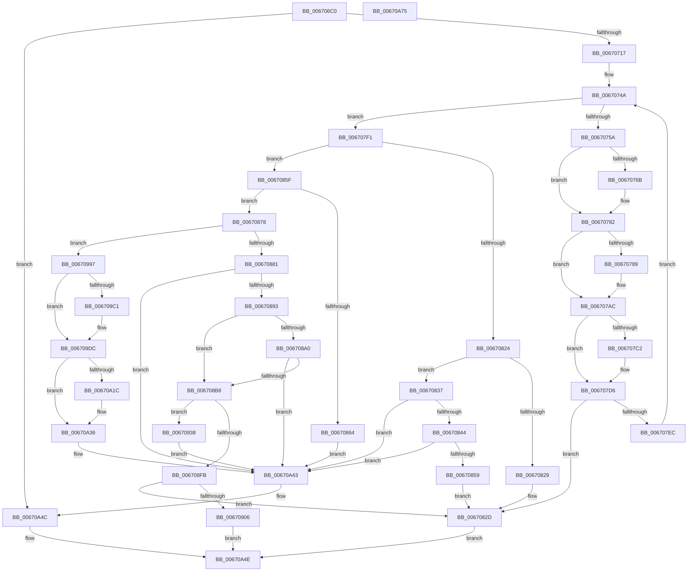

# MiProtectDriverSectionPte

- RVA: `0x006706C0`–`0x00670A76` (길이 `950` bytes)
- VA: `0x00000001406706C0`
- 실행 섹션: `.text`
- PDB 이름 있음: `예`; PDB Function 태그: `아니요`
- unwind 정보 RVA: `0x000B2818`
- 디코드: `243`개 명령, `950/950` bytes 표시
- 미해석 바이트: `0` (있으면 어셈블리에 `.byte`로 보존)

> 이 문서는 커널 이미지의 기계어와 PDB 기호를 분석해 생성했습니다. 4번과 5번은 함수 원형과 자료형을 바이너리 사용 방식에서 추정한 C 해석이며 원본 소스 복구 결과는 아닙니다.

## 1. Dependencies

- 직접 호출 지점: **29**; 고유 호출 대상: **24**
- 직접 호출자로 확인된 함수: **0**
- RIP 상대 이미지 참조: **3**

### Outgoing calls
- `0x00670703` → [memset](../6C/memset_function_006C6C40.md) (function, `0x006C6C40`)
- `0x0067075D` → [MiReleaseWalkLocks](../23/MiReleaseWalkLocks_function_00239FD0.md) (function, `0x00239FD0`)
- `0x00670770` → [MiUnlockLoaderEntry](../2A/MiUnlockLoaderEntry_function_002A3E28.md) (function, `0x002A3E28`)
- `0x00670778` → [MmReleaseLoadLock](../4D/MmReleaseLoadLock_function_004D36D0.md) (function, `0x004D36D0`)
- `0x006707B4` → [MmAccessFault](../27/MmAccessFault_function_0027EE80.md) (function, `0x0027EE80`)
- `0x006707C4` → [MiAcquireLoadLock](../2A/MiAcquireLoadLock_function_002A3950.md) (function, `0x002A3950`)
- `0x006707D1` → [MiLockLoaderEntry](../2A/MiLockLoaderEntry_function_002A3EE0.md) (function, `0x002A3EE0`)
- `0x006707E1` → [MiReacquireWalkLocks](../28/MiReacquireWalkLocks_function_002819A0.md) (function, `0x002819A0`)
- `0x0067084C` → [MiGetPagePrivilege](../28/MiGetPagePrivilege_function_00285420.md) (function, `0x00285420`)
- `0x0067086E` → [MiMakeDriverPageStayResident](../38/MiMakeDriverPageStayResident_function_00385D18.md) (function, `0x00385D18`)
- `0x00670896` → [MiGetPfnSlabType](../28/MiGetPfnSlabType_function_0028E2D0.md) (function, `0x0028E2D0`)
- `0x006708AB` → [MiCheckSlabPage](../34/MiCheckSlabPage_function_00348AC8.md) (function, `0x00348AC8`)
- `0x006708CA` → [MI_PAGE_TO_FULL_COLOR](../33/MI_PAGE_TO_FULL_COLOR_function_00337820.md) (function, `0x00337820`)
- `0x006708F0` → [MiGetSlabPage](../37/MiGetSlabPage_function_00376FBC.md) (function, `0x00376FBC`)
- `0x00670909` → [MiReleaseWalkLocks](../23/MiReleaseWalkLocks_function_00239FD0.md) (function, `0x00239FD0`)
- `0x00670919` → [MiReplenishSlabAllocator](../37/MiReplenishSlabAllocator_function_003788E4.md) (function, `0x003788E4`)
- `0x00670929` → [MiReacquireWalkLocks](../28/MiReacquireWalkLocks_function_002819A0.md) (function, `0x002819A0`)
- `0x00670953` → [MiGetPfnSlabType](../28/MiGetPfnSlabType_function_0028E2D0.md) (function, `0x0028E2D0`)
- `0x00670972` → [MiTradeActivePage](../37/MiTradeActivePage_function_00374424.md) (function, `0x00374424`)
- `0x00670985` → [MiSetOriginalPtePfnFromFreeList](../28/MiSetOriginalPtePfnFromFreeList_function_0028A99C.md) (function, `0x0028A99C`)
- `0x0067098D` → [MiReleaseFreshPage](../33/MiReleaseFreshPage_function_00334AE0.md) (function, `0x00334AE0`)
- `0x006709B8` → [KeSetPagePrivilege](../40/KeSetPagePrivilege_function_00407970.md) (function, `0x00407970`)
- `0x006709D6` → [KeBugCheckEx](../4F/KeBugCheckEx_function_004FD660.md) (function, `0x004FD660`)
- `0x006709E9` → [MiWriteValidPteVolatile](../29/MiWriteValidPteVolatile_function_00292B60.md) (function, `0x00292B60`)
- `0x006709F8` → [memset](../6C/memset_function_006C6C40.md) (function, `0x006C6C40`)
- `0x00670A13` → [VslpEnterIumSecureMode](../23/VslpEnterIumSecureMode_function_00235E50.md) (function, `0x00235E50`)
- `0x00670A30` → [KeBugCheckEx](../4F/KeBugCheckEx_function_004FD660.md) (function, `0x004FD660`)
- `0x00670A3E` → [MiMarkPfnVerified](../38/MiMarkPfnVerified_function_003833C4.md) (function, `0x003833C4`)
- `0x00670A55` → [_security_check_cookie](../6A/_security_check_cookie_function_006AC640.md) (function, `0x006AC640`)

### Direct callers
- 이 함수 시작 RVA로 연결되는 직접 call은 확인되지 않았습니다. 간접 호출은 완전히 역산할 수 없습니다.

### Static image references
- `0x006706DC` → RVA `0x00E0A740` (`.data`; read)
- `0x006708E3` → RVA `0x00E38D00` (`.data`; read)
- `0x00670977` → RVA `0x00010880` (`.rdata`; read)

## 2. Other-region calls and transfers

- 다른 실행 섹션으로 향하는 call: **0**
- 별도 외부 분기/꼬리 이동을 확인하지 못했습니다.

## 3. Assembly (complete function range)

```asm
006706C0  48 89 5C 24 18                  mov qword ptr [rsp + 0x18], rbx
006706C5  55                              push rbp
006706C6  56                              push rsi
006706C7  57                              push rdi
006706C8  41 54                           push r12
006706CA  41 55                           push r13
006706CC  41 56                           push r14
006706CE  41 57                           push r15
006706D0  48 8D 6C 24 B0                  lea rbp, [rsp - 0x50]
006706D5  48 81 EC 50 01 00 00            sub rsp, 0x150
006706DC  48 8B 05 5D A0 79 00            mov rax, qword ptr [rip + 0x79a05d]
006706E3  48 33 C4                        xor rax, rsp
006706E6  48 89 45 40                     mov qword ptr [rbp + 0x40], rax
006706EA  4C 8B F2                        mov r14, rdx
006706ED  48 89 54 24 48                  mov qword ptr [rsp + 0x48], rdx
006706F2  33 D2                           xor edx, edx
006706F4  41 8B D8                        mov ebx, r8d
006706F7  4C 8B E9                        mov r13, rcx
006706FA  48 8D 4C 24 50                  lea rcx, [rsp + 0x50]
006706FF  44 8D 42 78                     lea r8d, [rdx + 0x78]
00670703  E8 38 65 05 00                  call 0x1406c6c40
00670708  33 FF                           xor edi, edi
0067070A  48 89 7C 24 38                  mov qword ptr [rsp + 0x38], rdi
0067070F  85 DB                           test ebx, ebx
00670711  0F 85 35 03 00 00               jne 0x140670a4c
00670717  49 8B 9D B8 00 00 00            mov rbx, qword ptr [r13 + 0xb8]
0067071E  49 8B F6                        mov rsi, r14
00670721  44 8B FF                        mov r15d, edi
00670724  48 C1 E6 19                     shl rsi, 0x19
00670728  4C 8B 63 08                     mov r12, qword ptr [rbx + 8]
0067072C  48 B8 00 00 00 00 80 F6 FF FF   movabs rax, 0xfffff68000000000
00670736  48 C1 E0 19                     shl rax, 0x19
0067073A  48 2B F0                        sub rsi, rax
0067073D  49 8B 45 38                     mov rax, qword ptr [r13 + 0x38]
00670741  48 89 44 24 40                  mov qword ptr [rsp + 0x40], rax
00670746  48 C1 FE 10                     sar rsi, 0x10
0067074A  49 8B 06                        mov rax, qword ptr [r14]
0067074D  B9 01 00 00 00                  mov ecx, 1
00670752  84 C1                           test cl, al
00670754  0F 85 97 00 00 00               jne 0x1406707f1
0067075A  49 8B CD                        mov rcx, r13
0067075D  E8 6E 98 BC FF                  call 0x140239fd0
00670762  B8 01 00 00 00                  mov eax, 1
00670767  39 03                           cmp dword ptr [rbx], eax
00670769  75 17                           jne 0x140670782
0067076B  33 D2                           xor edx, edx
0067076D  49 8B CC                        mov rcx, r12
00670770  E8 B3 36 C3 FF                  call 0x1402a3e28
00670775  49 8B CF                        mov rcx, r15
00670778  E8 53 2F E6 FF                  call 0x1404d36d0
0067077D  B8 01 00 00 00                  mov eax, 1
00670782  4C 8B CF                        mov r9, rdi
00670785  39 3B                           cmp dword ptr [rbx], edi
00670787  75 23                           jne 0x1406707ac
00670789  4C 8D 4C 24 50                  lea r9, [rsp + 0x50]
0067078E  66 C7 44 24 50 06 00            mov word ptr [rsp + 0x50], 6
00670795  4C 0B C8                        or r9, rax
00670798  48 89 7C 24 58                  mov qword ptr [rsp + 0x58], rdi
0067079D  48 89 7C 24 60                  mov qword ptr [rsp + 0x60], rdi
006707A2  48 89 7C 24 68                  mov qword ptr [rsp + 0x68], rdi
006707A7  48 89 7C 24 70                  mov qword ptr [rsp + 0x70], rdi
006707AC  45 33 C0                        xor r8d, r8d
006707AF  48 8B D6                        mov rdx, rsi
006707B2  33 C9                           xor ecx, ecx
006707B4  E8 C7 E6 C0 FF                  call 0x14027ee80
006707B9  83 3B 01                        cmp dword ptr [rbx], 1
006707BC  89 44 24 30                     mov dword ptr [rsp + 0x30], eax
006707C0  75 14                           jne 0x1406707d6
006707C2  33 C9                           xor ecx, ecx
006707C4  E8 87 31 C3 FF                  call 0x1402a3950
006707C9  33 D2                           xor edx, edx
006707CB  49 8B CC                        mov rcx, r12
006707CE  4C 8B F8                        mov r15, rax
006707D1  E8 0A 37 C3 FF                  call 0x1402a3ee0
006707D6  48 8B 54 24 40                  mov rdx, qword ptr [rsp + 0x40]
006707DB  45 33 C0                        xor r8d, r8d
006707DE  49 8B CD                        mov rcx, r13
006707E1  E8 BA 11 C1 FF                  call 0x1402819a0
006707E6  39 7C 24 30                     cmp dword ptr [rsp + 0x30], edi
006707EA  7C 41                           jl 0x14067082d
006707EC  E9 59 FF FF FF                  jmp 0x14067074a
006707F1  48 8B C8                        mov rcx, rax
006707F4  48 BA FF FF FF FF FF 00 00 00   movabs rdx, 0xffffffffff
006707FE  48 C1 E9 0C                     shr rcx, 0xc
00670802  48 23 CA                        and rcx, rdx
00670805  4C 8D 3C 49                     lea r15, [rcx + rcx*2]
00670809  48 B9 00 00 00 00 00 DE FF FF   movabs rcx, 0xffffde0000000000
00670813  49 C1 E7 04                     shl r15, 4
00670817  48 8B C9                        mov rcx, rcx
0067081A  4D 8D 34 0F                     lea r14, [r15 + rcx]
0067081E  8B 0B                           mov ecx, dword ptr [rbx]
00670820  85 C9                           test ecx, ecx
00670822  75 3B                           jne 0x14067085f
00670824  48 85 C0                        test rax, rax
00670827  78 0E                           js 0x140670837
00670829  83 4B 18 01                     or dword ptr [rbx + 0x18], 1
0067082D  B8 05 00 00 00                  mov eax, 5
00670832  E9 17 02 00 00                  jmp 0x140670a4e
00670837  49 8B 46 28                     mov rax, qword ptr [r14 + 0x28]
0067083B  48 85 C0                        test rax, rax
0067083E  0F 88 FF 01 00 00               js 0x140670a43
00670844  45 33 C0                        xor r8d, r8d
00670847  33 D2                           xor edx, edx
00670849  49 8B CE                        mov rcx, r14
0067084C  E8 CF 4B C1 FF                  call 0x140285420
00670851  85 C0                           test eax, eax
00670853  0F 84 EA 01 00 00               je 0x140670a43
00670859  83 4B 18 02                     or dword ptr [rbx + 0x18], 2
0067085D  EB CE                           jmp 0x14067082d
0067085F  83 F9 01                        cmp ecx, 1
00670862  75 14                           jne 0x140670878
00670864  49 8B 55 20                     mov rdx, qword ptr [r13 + 0x20]
00670868  4C 8B C6                        mov r8, rsi
0067086B  49 8B CC                        mov rcx, r12
0067086E  E8 A5 54 D1 FF                  call 0x140385d18
00670873  E9 CB 01 00 00                  jmp 0x140670a43
00670878  83 F9 02                        cmp ecx, 2
0067087B  0F 85 16 01 00 00               jne 0x140670997
00670881  41 8B 46 20                     mov eax, dword ptr [r14 + 0x20]
00670885  44 8D 61 FF                     lea r12d, [rcx - 1]
00670889  66 41 3B C4                     cmp ax, r12w
0067088D  0F 85 B0 01 00 00               jne 0x140670a43
00670893  49 8B CE                        mov rcx, r14
00670896  E8 35 DA C1 FF                  call 0x14028e2d0
0067089B  83 F8 09                        cmp eax, 9
0067089E  74 18                           je 0x1406708b8
006708A0  45 8D 44 24 03                  lea r8d, [r12 + 3]
006708A5  41 8B D4                        mov edx, r12d
006708A8  49 8B CE                        mov rcx, r14
006708AB  E8 18 82 CD FF                  call 0x140348ac8
006708B0  85 C0                           test eax, eax
006708B2  0F 85 8B 01 00 00               jne 0x140670a43
006708B8  49 C1 FF 04                     sar r15, 4
006708BC  48 B9 AB AA AA AA AA AA AA AA   movabs rcx, 0xaaaaaaaaaaaaaaab
006708C6  49 0F AF CF                     imul rcx, r15
006708CA  E8 51 6F CC FF                  call 0x140337820
006708CF  48 8D 4C 24 38                  lea rcx, [rsp + 0x38]
006708D4  89 7C 24 28                     mov dword ptr [rsp + 0x28], edi
006708D8  48 89 4C 24 20                  mov qword ptr [rsp + 0x20], rcx
006708DD  41 B9 12 00 00 00               mov r9d, 0x12
006708E3  48 8D 0D 16 84 7C 00            lea rcx, [rip + 0x7c8416]
006708EA  44 8B C0                        mov r8d, eax
006708ED  41 8B D4                        mov edx, r12d
006708F0  E8 C7 66 D0 FF                  call 0x140376fbc
006708F5  48 83 F8 FF                     cmp rax, -1
006708F9  75 3D                           jne 0x140670938
006708FB  48 39 7C 24 38                  cmp qword ptr [rsp + 0x38], rdi
00670900  0F 84 27 FF FF FF               je 0x14067082d
00670906  49 8B CD                        mov rcx, r13
00670909  E8 C2 96 BC FF                  call 0x140239fd0
0067090E  48 8B 4C 24 38                  mov rcx, qword ptr [rsp + 0x38]
00670913  45 33 C0                        xor r8d, r8d
00670916  49 8B D4                        mov rdx, r12
00670919  E8 C6 7F D0 FF                  call 0x1403788e4
0067091E  48 8B 54 24 40                  mov rdx, qword ptr [rsp + 0x40]
00670923  45 33 C0                        xor r8d, r8d
00670926  49 8B CD                        mov rcx, r13
00670929  E8 72 10 C1 FF                  call 0x1402819a0
0067092E  B8 02 00 00 00                  mov eax, 2
00670933  E9 16 01 00 00                  jmp 0x140670a4e
00670938  4C 8D 14 40                     lea r10, [rax + rax*2]
0067093C  48 B8 00 00 00 00 00 DE FF FF   movabs rax, 0xffffde0000000000
00670946  49 C1 E2 04                     shl r10, 4
0067094A  48 8B C0                        mov rax, rax
0067094D  49 8B CE                        mov rcx, r14
00670950  4C 03 D0                        add r10, rax
00670953  E8 78 D9 C1 FF                  call 0x14028e2d0
00670958  83 F8 09                        cmp eax, 9
0067095B  41 B9 02 00 00 00               mov r9d, 2
00670961  4C 8B C6                        mov r8, rsi
00670964  49 8B D2                        mov rdx, r10
00670967  40 0F 95 C7                     setne dil
0067096B  49 8B CE                        mov rcx, r14
0067096E  89 7C 24 20                     mov dword ptr [rsp + 0x20], edi
00670972  E8 AD 3A D0 FF                  call 0x140374424
00670977  48 8B 05 02 FF 99 FF            mov rax, qword ptr [rip - 0x6600fe]
0067097E  49 8D 4E 10                     lea rcx, [r14 + 0x10]
00670982  48 89 01                        mov qword ptr [rcx], rax
00670985  E8 12 A0 C1 FF                  call 0x14028a99c
0067098A  49 8B CE                        mov rcx, r14
0067098D  E8 4E 41 CC FF                  call 0x140334ae0
00670992  E9 AC 00 00 00                  jmp 0x140670a43
00670997  48 B8 AB AA AA AA AA AA AA AA   movabs rax, 0xaaaaaaaaaaaaaaab
006709A1  49 C1 FF 04                     sar r15, 4
006709A5  4C 0F AF F8                     imul r15, rax
006709A9  41 B9 80 00 00 00               mov r9d, 0x80
006709AF  45 33 C0                        xor r8d, r8d
006709B2  49 8B CF                        mov rcx, r15
006709B5  48 8B D6                        mov rdx, rsi
006709B8  E8 B3 6F D9 FF                  call 0x140407970
006709BD  85 C0                           test eax, eax
006709BF  79 1B                           jns 0x1406709dc
006709C1  4C 8B CE                        mov r9, rsi
006709C4  48 89 7C 24 20                  mov qword ptr [rsp + 0x20], rdi
006709C9  4D 8B C6                        mov r8, r14
006709CC  BA 02 09 00 00                  mov edx, 0x902
006709D1  B9 1A 00 00 00                  mov ecx, 0x1a
006709D6  E8 85 CC E8 FF                  call 0x1404fd660
006709DB  CC                              int3
006709DC  48 8B 4C 24 48                  mov rcx, qword ptr [rsp + 0x48]
006709E1  44 8A C7                        mov r8b, dil
006709E4  BA 01 00 00 00                  mov edx, 1
006709E9  E8 72 21 C2 FF                  call 0x140292b60
006709EE  33 D2                           xor edx, edx
006709F0  48 8D 4D D0                     lea rcx, [rbp - 0x30]
006709F4  44 8D 42 68                     lea r8d, [rdx + 0x68]
006709F8  E8 43 62 05 00                  call 0x1406c6c40
006709FD  BA 03 01 00 00                  mov edx, 0x103
00670A02  4C 89 7D D8                     mov qword ptr [rbp - 0x28], r15
00670A06  4C 8D 4D D0                     lea r9, [rbp - 0x30]
00670A0A  48 89 75 E0                     mov qword ptr [rbp - 0x20], rsi
00670A0E  45 33 C0                        xor r8d, r8d
00670A11  B1 02                           mov cl, 2
00670A13  E8 38 54 BC FF                  call 0x140235e50
00670A18  85 C0                           test eax, eax
00670A1A  79 1A                           jns 0x140670a36
00670A1C  45 33 C9                        xor r9d, r9d
00670A1F  48 89 7C 24 20                  mov qword ptr [rsp + 0x20], rdi
00670A24  4C 8B C6                        mov r8, rsi
00670A27  BA 03 09 00 00                  mov edx, 0x903
00670A2C  41 8D 49 1A                     lea ecx, [r9 + 0x1a]
00670A30  E8 2B CC E8 FF                  call 0x1404fd660
00670A35  CC                              int3
00670A36  BA 40 00 00 00                  mov edx, 0x40
00670A3B  49 8B CE                        mov rcx, r14
00670A3E  E8 81 29 D1 FF                  call 0x1403833c4
00670A43  B8 01 00 00 00                  mov eax, 1
00670A48  48 01 43 10                     add qword ptr [rbx + 0x10], rax
00670A4C  33 C0                           xor eax, eax
00670A4E  48 8B 4D 40                     mov rcx, qword ptr [rbp + 0x40]
00670A52  48 33 CC                        xor rcx, rsp
00670A55  E8 E6 BB 03 00                  call 0x1406ac640
00670A5A  48 8B 9C 24 A0 01 00 00         mov rbx, qword ptr [rsp + 0x1a0]
00670A62  48 81 C4 50 01 00 00            add rsp, 0x150
00670A69  41 5F                           pop r15
00670A6B  41 5E                           pop r14
00670A6D  41 5D                           pop r13
00670A6F  41 5C                           pop r12
00670A71  5F                              pop rdi
00670A72  5E                              pop rsi
00670A73  5D                              pop rbp
00670A74  C3                              ret
00670A75  CC                              int3
```

## 4. C-style interpretation (structured pseudocode)

```c
__int64 __fastcall MiProtectDriverSectionPte(__int64 a1, __int64 a2, int a3)
{
    __int64 result;
    __int64 v_r10;
    __int64 v_r15;
    __int64 v_rdi;
    __int64 v_rsi;
    __int64 v_rsp;
    unsigned __int64 v_stack_m118;
    unsigned __int64 v_stack_m120;
    unsigned __int64 v_stack_m128;
    unsigned __int64 v_stack_m130;
    unsigned __int64 v_stack_m138;
    unsigned __int64 v_stack_m140;
    unsigned __int64 v_stack_m148;
    unsigned __int64 v_stack_m150;
    unsigned int v_stack_m158;
    unsigned int v_stack_m160;
    unsigned __int64 v_stack_m168;
    unsigned __int64 v_stack_m48;
    unsigned __int64 v_stack_m88;
    unsigned __int64 v_stack_mA8;
    unsigned __int64 v_stack_mB0;
    unsigned __int64 v_stack_mB8;
    unsigned __int64 v_stack_p18;

    v_stack_p18 = v_rbx;
    v_rsp = (v_rsp) - (336);
    result = (*(unsigned __int64 *)(v_rip + 7970909)) ^ (v_rsp);
    v_stack_m48 = result;
    v_stack_m140 = a2;
    a2 = 0;
    result = memset(v_stack_m138, a2, a2 + 120, a4);
    v_rdi = 0;
    v_stack_m150 = 0;
    if ((unsigned int)((unsigned int)(a3)) != 0) goto loc_00670A4C;
    v_rsi = (0) << (25);
    result = (result) << (25);
    v_rsi = (v_rsi) - (result);
    v_stack_m148 = *(unsigned __int64 *)(a1 + 56);
    v_rsi = (v_rsi) >> (16);
loc_0067074A:
    if (((1) & ((unsigned __int8)(*(unsigned __int64 *)(a2)))) != 0) goto loc_006707F1;
    result = MiReleaseWalkLocks(a1, a2, a2 + 120, a4);
    result = 1;
    if ((*(unsigned int *)(*(unsigned __int64 *)(a1 + 184))) == 1) {
        a2 = 0;
        a1 = *(unsigned __int64 *)(*(unsigned __int64 *)(a1 + 184) + 8);
        result = MiUnlockLoaderEntry(a1, a2, a2 + 120, a4);
        a1 = 0;
        result = MmReleaseLoadLock(a1, a2, a2 + 120, a4);
        result = 1;
    }
    if ((*(unsigned int *)(*(unsigned __int64 *)(a1 + 184))) == 0) {
        a4 = v_stack_m138;
        v_stack_m138 = 6;
        a4 = (a4) | (result);
        v_stack_m130 = 0;
        v_stack_m128 = 0;
        v_stack_m120 = 0;
        v_stack_m118 = 0;
    }
    a3 = 0;
    a1 = 0;
    result = MmAccessFault(a1, v_rsi, a3, a4);
    v_stack_m158 = (unsigned int)(result);
    v_r15 = 0;
    if ((*(unsigned int *)(*(unsigned __int64 *)(a1 + 184))) == 1) {
        a1 = 0;
        result = MiAcquireLoadLock(a1, v_rsi, a3, a4);
        a2 = 0;
        a1 = *(unsigned __int64 *)(*(unsigned __int64 *)(a1 + 184) + 8);
        v_r15 = result;
        result = MiLockLoaderEntry(a1, a2, a3, a4);
    }
    a3 = 0;
    result = MiReacquireWalkLocks(a1, v_stack_m148, a3, a4);
    if (v_stack_m158 < 0) goto loc_0067082D;
    goto loc_0067074A;
loc_006707F1:
    a1 = (result) >> (12);
    a1 = (a1) & (v_stack_m148);
    v_r15 = (a1 + a1 * 2) << (4);
    if ((unsigned int)((unsigned int)(*(unsigned int *)(*(unsigned __int64 *)(a1 + 184)))) != 0) goto loc_0067085F;
    if (sign_flag) goto loc_00670837;
loc_0067082D:
    goto loc_00670A4E;
loc_00670837:
    if (sign_flag) goto loc_00670A43;
    a3 = 0;
    a2 = 0;
    result = MiGetPagePrivilege(v_r15 + a1 * 1, a2, a3, a4);
    if ((unsigned int)(result) == 0) goto loc_00670A43;
    goto loc_0067082D;
loc_0067085F:
    if (((unsigned int)(v_r15 + a1 * 1)) != 1) goto loc_00670878;
    result = MiMakeDriverPageStayResident(*(unsigned __int64 *)(*(unsigned __int64 *)(a1 + 184) + 8), *(unsigned __int64 *)(a1 + 32), v_rsi, a4);
    goto loc_00670A43;
loc_00670878:
    if (((unsigned int)(*(unsigned __int64 *)(*(unsigned __int64 *)(a1 + 184) + 8))) != 2) goto loc_00670997;
    if (((unsigned __int16)((unsigned int)(*(unsigned int *)(v_r15 + a1 * 1 + 32)))) != ((unsigned __int16)(*(unsigned __int64 *)(*(unsigned __int64 *)(a1 + 184) + 8) - 1))) goto loc_00670A43;
    result = MiGetPfnSlabType(v_r15 + a1 * 1, *(unsigned __int64 *)(a1 + 32), v_rsi, a4);
    if (((unsigned int)(result)) == 9) goto loc_006708B8;
    result = MiCheckSlabPage(v_r15 + a1 * 1, (unsigned int)((unsigned int)(*(unsigned __int64 *)(*(unsigned __int64 *)(a1 + 184) + 8) - 1)), *(unsigned __int64 *)(*(unsigned __int64 *)(a1 + 184) + 8) - 1 + 3, a4);
    if ((unsigned int)(result) != 0) goto loc_00670A43;
loc_006708B8:
    v_r15 = (v_r15) >> (4);
    a1 = (v_r15 + a1 * 1) * (v_r15);
    result = MI_PAGE_TO_FULL_COLOR(a1, (unsigned int)((unsigned int)(*(unsigned __int64 *)(*(unsigned __int64 *)(a1 + 184) + 8) - 1)), *(unsigned __int64 *)(*(unsigned __int64 *)(a1 + 184) + 8) - 1 + 3, a4);
    v_stack_m160 = 0;
    v_stack_m168 = v_stack_m150;
    result = MiGetSlabPage(v_rip + 8160278, (unsigned int)((unsigned int)(*(unsigned __int64 *)(*(unsigned __int64 *)(a1 + 184) + 8) - 1)), (unsigned int)((unsigned int)(result)), 18);
    if (result != -1) goto loc_00670938;
    if (v_stack_m150 == 0) goto loc_0067082D;
    result = MiReleaseWalkLocks(a1, (unsigned int)((unsigned int)(*(unsigned __int64 *)(*(unsigned __int64 *)(a1 + 184) + 8) - 1)), (unsigned int)((unsigned int)(result)), 18);
    a3 = 0;
    result = MiReplenishSlabAllocator(v_stack_m150, *(unsigned __int64 *)(*(unsigned __int64 *)(a1 + 184) + 8) - 1, a3, 18);
    a3 = 0;
    result = MiReacquireWalkLocks(a1, v_stack_m148, a3, 18);
    goto loc_00670A4E;
loc_00670938:
    v_r10 = (2 + 2 * 2) << (4);
    v_r10 = (v_r10) + (2);
    result = MiGetPfnSlabType(v_r15 + a1 * 1, v_stack_m148, a3, 18);
    v_rdi = (((unsigned int)(result)) != 9) ? 1 : 0;
    v_stack_m168 = (unsigned int)(v_rdi);
    result = MiTradeActivePage(v_r15 + a1 * 1, v_r10, v_rsi, 2);
    *(unsigned __int64 *)(v_r15 + a1 * 1 + 16) = *(unsigned __int64 *)(v_rip - 6684926);
    result = MiSetOriginalPtePfnFromFreeList(v_r15 + a1 * 1 + 16, v_r10, v_rsi, 2);
    result = MiReleaseFreshPage(v_r15 + a1 * 1, v_r10, v_rsi, 2);
    goto loc_00670A43;
loc_00670997:
    v_r15 = (v_r15) >> (4);
    v_r15 = (v_r15) * (result);
    a3 = 0;
    result = KeSetPagePrivilege(v_r15, v_rsi, a3, 128);
    if (sign_flag) {
        a4 = v_rsi;
        v_stack_m168 = v_rdi;
        a3 = v_r15 + a1 * 1;
        a2 = 0x902ULL;
        a1 = 26;
        result = KeBugCheckEx(a1, a2, a3, a4);
    }
    result = MiWriteValidPteVolatile(v_stack_m140, 1, (unsigned __int8)(v_rdi), a4);
    a2 = 0;
    result = memset(v_stack_mB8, a2, a2 + 104, a4);
    v_stack_mB0 = v_r15;
    v_stack_mA8 = v_rsi;
    a3 = 0;
    result = VslpEnterIumSecureMode(2, 259, a3, v_stack_mB8);
    if (sign_flag) {
        a4 = 0;
        v_stack_m168 = v_rdi;
        a3 = v_rsi;
        a2 = 0x903ULL;
        a1 = a4 + 26;
        result = KeBugCheckEx(a1, a2, a3, a4);
    }
    result = MiMarkPfnVerified(v_r15 + a1 * 1, 64, a3, a4);
loc_00670A43:
loc_00670A4C:
    result = 0;
loc_00670A4E:
    a1 = (v_stack_m48) ^ (v_rsp);
    result = _security_check_cookie(a1, 64, a3, a4);
    v_rsp = (v_rsp) + (336);
    return result;
}
```

## 5. (Beta) C Style

```c
int64_t MiProtectDriverSectionPte(void *Arg1, void *Arg2, int32_t Arg3)
{
    uint8_t *arg1 = (uint8_t *)Arg1;
    uint8_t *arg2 = (uint8_t *)Arg2;

    int64_t result;
    int64_t local_r10;
    int64_t local_r15;
    int64_t local_rdi;
    int64_t local_rsi;
    int64_t local_rsp;
    uint64_t v_stack_m118;
    uint64_t v_stack_m120;
    uint64_t v_stack_m128;
    uint64_t v_stack_m130;
    uint64_t v_stack_m138;
    uint64_t v_stack_m140;
    uint64_t v_stack_m148;
    uint64_t v_stack_m150;
    uint32_t v_stack_m158;
    uint32_t v_stack_m160;
    uint64_t v_stack_m168;
    uint64_t v_stack_m48;
    uint64_t v_stack_m88;
    uint64_t v_stack_mA8;
    uint64_t v_stack_mB0;
    uint64_t v_stack_mB8;
    uint64_t v_stack_p18;

    v_stack_p18 = local_rbx;
    local_rsp = (local_rsp) - (336);
    result = (*(uint64_t *)(v_rip + 0x79A05D)) ^ (local_rsp);
    v_stack_m48 = result;
    v_stack_m140 = Arg2;
    Arg2 = 0;
    result = memset(v_stack_m138, Arg2, Arg2 + 120, a4);
    local_rdi = 0;
    v_stack_m150 = 0;
    if ((uint32_t)((uint32_t)(Arg3)) != 0) goto loc_00670A4C;
    local_rsi = (0) << (25);
    result = (result) << (25);
    local_rsi = (local_rsi) - (result);
    v_stack_m148 = *(uint64_t *)(arg1 + 0x38);
    local_rsi = (local_rsi) >> (16);
loc_0067074A:
    if (((1) & ((uint8_t)(*(uint64_t *)(arg2)))) != 0) goto loc_006707F1;
    result = MiReleaseWalkLocks(Arg1, Arg2, Arg2 + 120, a4);
    result = 1;
    if ((*(uint32_t *)(*(uint64_t *)(arg1 + 0xB8))) == 1) {
        Arg2 = 0;
        Arg1 = *(uint64_t *)(*(uint64_t *)(arg1 + 0xB8) + 0x8);
        result = MiUnlockLoaderEntry(Arg1, Arg2, Arg2 + 120, a4);
        Arg1 = 0;
        result = MmReleaseLoadLock(Arg1, Arg2, Arg2 + 120, a4);
        result = 1;
    }
    if ((*(uint32_t *)(*(uint64_t *)(arg1 + 0xB8))) == 0) {
        a4 = v_stack_m138;
        v_stack_m138 = 6;
        a4 = (a4) | (result);
        v_stack_m130 = 0;
        v_stack_m128 = 0;
        v_stack_m120 = 0;
        v_stack_m118 = 0;
    }
    Arg3 = 0;
    Arg1 = 0;
    result = MmAccessFault(Arg1, local_rsi, Arg3, a4);
    v_stack_m158 = (uint32_t)(result);
    local_r15 = 0;
    if ((*(uint32_t *)(*(uint64_t *)(arg1 + 0xB8))) == 1) {
        Arg1 = 0;
        result = MiAcquireLoadLock(Arg1, local_rsi, Arg3, a4);
        Arg2 = 0;
        Arg1 = *(uint64_t *)(*(uint64_t *)(arg1 + 0xB8) + 0x8);
        local_r15 = result;
        result = MiLockLoaderEntry(Arg1, Arg2, Arg3, a4);
    }
    Arg3 = 0;
    result = MiReacquireWalkLocks(Arg1, v_stack_m148, Arg3, a4);
    if (v_stack_m158 < 0) goto loc_0067082D;
    goto loc_0067074A;
loc_006707F1:
    Arg1 = (result) >> (12);
    Arg1 = (Arg1) & (v_stack_m148);
    local_r15 = (Arg1 + Arg1 * 2) << (4);
    if ((uint32_t)((uint32_t)(*(uint32_t *)(*(uint64_t *)(arg1 + 0xB8)))) != 0) goto loc_0067085F;
    if (sign_flag) goto loc_00670837;
loc_0067082D:
    goto loc_00670A4E;
loc_00670837:
    if (sign_flag) goto loc_00670A43;
    Arg3 = 0;
    Arg2 = 0;
    result = MiGetPagePrivilege(local_r15 + Arg1 * 1, Arg2, Arg3, a4);
    if ((uint32_t)(result) == 0) goto loc_00670A43;
    goto loc_0067082D;
loc_0067085F:
    if (((uint32_t)(local_r15 + Arg1 * 1)) != 1) goto loc_00670878;
    result = MiMakeDriverPageStayResident(*(uint64_t *)(*(uint64_t *)(arg1 + 0xB8) + 0x8), *(uint64_t *)(arg1 + 0x20), local_rsi, a4);
    goto loc_00670A43;
loc_00670878:
    if (((uint32_t)(*(uint64_t *)(*(uint64_t *)(arg1 + 0xB8) + 0x8))) != 2) goto loc_00670997;
    if (((uint16_t)((uint32_t)(*(uint32_t *)(local_r15 + arg1 * 1 + 0x20)))) != ((uint16_t)(*(uint64_t *)(*(uint64_t *)(arg1 + 0xB8) + 0x8) - 1))) goto loc_00670A43;
    result = MiGetPfnSlabType(local_r15 + Arg1 * 1, *(uint64_t *)(arg1 + 0x20), local_rsi, a4);
    if (((uint32_t)(result)) == 9) goto loc_006708B8;
    result = MiCheckSlabPage(local_r15 + Arg1 * 1, (uint32_t)((uint32_t)(*(uint64_t *)(*(uint64_t *)(arg1 + 0xB8) + 0x8) - 1)), *(uint64_t *)(*(uint64_t *)(arg1 + 0xB8) + 0x8) - 1 + 3, a4);
    if ((uint32_t)(result) != 0) goto loc_00670A43;
loc_006708B8:
    local_r15 = (local_r15) >> (4);
    Arg1 = (local_r15 + Arg1 * 1) * (local_r15);
    result = MI_PAGE_TO_FULL_COLOR(Arg1, (uint32_t)((uint32_t)(*(uint64_t *)(*(uint64_t *)(arg1 + 0xB8) + 0x8) - 1)), *(uint64_t *)(*(uint64_t *)(arg1 + 0xB8) + 0x8) - 1 + 3, a4);
    v_stack_m160 = 0;
    v_stack_m168 = v_stack_m150;
    result = MiGetSlabPage(v_rip + 8160278, (uint32_t)((uint32_t)(*(uint64_t *)(*(uint64_t *)(arg1 + 0xB8) + 0x8) - 1)), (uint32_t)((uint32_t)(result)), 18);
    if (result != -1) goto loc_00670938;
    if (v_stack_m150 == 0) goto loc_0067082D;
    result = MiReleaseWalkLocks(Arg1, (uint32_t)((uint32_t)(*(uint64_t *)(*(uint64_t *)(arg1 + 0xB8) + 0x8) - 1)), (uint32_t)((uint32_t)(result)), 18);
    Arg3 = 0;
    result = MiReplenishSlabAllocator(v_stack_m150, *(uint64_t *)(*(uint64_t *)(arg1 + 0xB8) + 0x8) - 1, Arg3, 18);
    Arg3 = 0;
    result = MiReacquireWalkLocks(Arg1, v_stack_m148, Arg3, 18);
    goto loc_00670A4E;
loc_00670938:
    local_r10 = (2 + 2 * 2) << (4);
    local_r10 = (local_r10) + (2);
    result = MiGetPfnSlabType(local_r15 + Arg1 * 1, v_stack_m148, Arg3, 18);
    local_rdi = (((uint32_t)(result)) != 9) ? 1 : 0;
    v_stack_m168 = (uint32_t)(local_rdi);
    result = MiTradeActivePage(local_r15 + Arg1 * 1, local_r10, local_rsi, 2);
    *(uint64_t *)(local_r15 + arg1 * 1 + 0x10) = *(uint64_t *)(v_rip - 0x6600FE);
    result = MiSetOriginalPtePfnFromFreeList(local_r15 + Arg1 * 1 + 16, local_r10, local_rsi, 2);
    result = MiReleaseFreshPage(local_r15 + Arg1 * 1, local_r10, local_rsi, 2);
    goto loc_00670A43;
loc_00670997:
    local_r15 = (local_r15) >> (4);
    local_r15 = (local_r15) * (result);
    Arg3 = 0;
    result = KeSetPagePrivilege(local_r15, local_rsi, Arg3, 128);
    if (sign_flag) {
        a4 = local_rsi;
        v_stack_m168 = local_rdi;
        Arg3 = local_r15 + Arg1 * 1;
        Arg2 = 0x902ULL;
        Arg1 = 26;
        result = KeBugCheckEx(Arg1, Arg2, Arg3, a4);
    }
    result = MiWriteValidPteVolatile(v_stack_m140, 1, (uint8_t)(local_rdi), a4);
    Arg2 = 0;
    result = memset(v_stack_mB8, Arg2, Arg2 + 104, a4);
    v_stack_mB0 = local_r15;
    v_stack_mA8 = local_rsi;
    Arg3 = 0;
    result = VslpEnterIumSecureMode(2, 259, Arg3, v_stack_mB8);
    if (sign_flag) {
        a4 = 0;
        v_stack_m168 = local_rdi;
        Arg3 = local_rsi;
        Arg2 = 0x903ULL;
        Arg1 = a4 + 26;
        result = KeBugCheckEx(Arg1, Arg2, Arg3, a4);
    }
    result = MiMarkPfnVerified(local_r15 + Arg1 * 1, 64, Arg3, a4);
loc_00670A43:
loc_00670A4C:
    result = 0;
loc_00670A4E:
    Arg1 = (v_stack_m48) ^ (local_rsp);
    result = _security_check_cookie(Arg1, 64, Arg3, a4);
    local_rsp = (local_rsp) + (336);
    return result;
}
```

### 관측된 메모리 오프셋

구조체 형식이 확인되지 않은 접근은 인자 기준의 오프셋으로만 기록했습니다.

| 기준 인자 | 오프셋 표현 | 폭 (bit) | 접근 |
|---|---:|---:|---|
| `Arg1` | `+ 0x20` | `64` | `R` |
| `Arg1` | `+ 0x38` | `64` | `R` |
| `Arg1` | `+ 0xB8` | `64` | `R` |
| `Arg2` | `+ 0x0` | `64` | `R` |

## 6. Execution-region graph

[열기: 2D/3D 그래프와 함수 탐색 컨트롤 패널](../../../control-panel.html?section=text&rva=0x006706C0&view=graph)

- 2D 그래프는 위에서 아래로 흐르고, 3D 그래프는 빈 공간을 드래그해 회전합니다. Shift+드래그는 이동, 휠은 확대·축소, 함수 노드 선택은 대상 보고서 이동입니다.

### Static fallback


