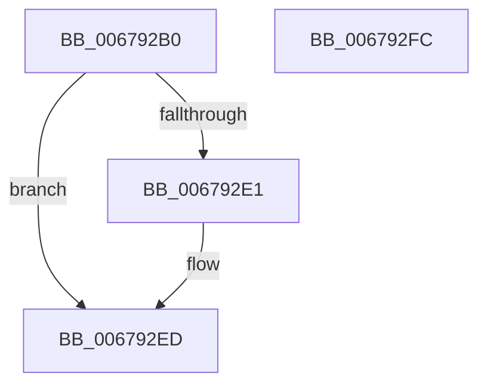

# MiProtectPageListLocks

- RVA: `0x006792B0`–`0x006792FD` (길이 `77` bytes)
- VA: `0x00000001406792B0`
- 실행 섹션: `.text`
- PDB 이름 있음: `예`; PDB Function 태그: `아니요`
- unwind 정보 RVA: `0x0005CAAC`
- 디코드: `20`개 명령, `77/77` bytes 표시
- 미해석 바이트: `0` (있으면 어셈블리에 `.byte`로 보존)

> 이 문서는 커널 이미지의 기계어와 PDB 기호를 분석해 생성했습니다. 4번과 5번은 함수 원형과 자료형을 바이너리 사용 방식에서 추정한 C 해석이며 원본 소스 복구 결과는 아닙니다.

## 1. Dependencies

- 직접 호출 지점: **3**; 고유 호출 대상: **2**
- 직접 호출자로 확인된 함수: **1**
- RIP 상대 이미지 참조: **1**

### Outgoing calls
- `0x006792C4` → [ExAcquireSpinLockExclusive](../24/ExAcquireSpinLockExclusive_function_00248690.md) (function, `0x00248690`)
- `0x006792D3` → [ExAcquireSpinLockExclusive](../24/ExAcquireSpinLockExclusive_function_00248690.md) (function, `0x00248690`)
- `0x006792E8` → [KiLowerIrqlProcessIrqlFlags](../4F/KiLowerIrqlProcessIrqlFlags_function_004F5698.md) (function, `0x004F5698`)

### Direct callers
- [MiInitializePartition](../../page/7F/MiInitializePartition_function_007FD3E8.md) at `0x007FD6B6`

### Static image references
- `0x006792D8` → RVA `0x00FC6D20` (`ALMOSTRO`; read)

## 2. Other-region calls and transfers

- 다른 실행 섹션으로 향하는 call: **0**
- 별도 외부 분기/꼬리 이동을 확인하지 못했습니다.

## 3. Assembly (complete function range)

```asm
006792B0  48 89 5C 24 08                  mov qword ptr [rsp + 8], rbx
006792B5  57                              push rdi
006792B6  48 83 EC 20                     sub rsp, 0x20
006792BA  48 8B D9                        mov rbx, rcx
006792BD  48 81 C1 E0 4B 00 00            add rcx, 0x4be0
006792C4  E8 C7 F3 BC FF                  call 0x140248690
006792C9  48 8D 8B 60 0C 00 00            lea rcx, [rbx + 0xc60]
006792D0  0F B6 F8                        movzx edi, al
006792D3  E8 B8 F3 BC FF                  call 0x140248690
006792D8  83 3D 41 DA 94 00 00            cmp dword ptr [rip + 0x94da41], 0
006792DF  74 0C                           je 0x1406792ed
006792E1  44 0F 20 C1                     mov rcx, cr8
006792E5  40 8A D7                        mov dl, dil
006792E8  E8 AB C3 E7 FF                  call 0x1404f5698
006792ED  44 0F 22 C7                     mov cr8, rdi
006792F1  48 8B 5C 24 30                  mov rbx, qword ptr [rsp + 0x30]
006792F6  48 83 C4 20                     add rsp, 0x20
006792FA  5F                              pop rdi
006792FB  C3                              ret
006792FC  CC                              int3
```

## 4. C-style interpretation (structured pseudocode)

```c
__int64 __fastcall MiProtectPageListLocks(__int64 a1)
{
    __int64 result;
    __int64 v_rsp;
    unsigned __int64 v_stack_p8;

    v_stack_p8 = v_rbx;
    v_rsp = (v_rsp) - (32);
    a1 = (a1) + (0x4BE0ULL);
    result = ExAcquireSpinLockExclusive(a1, a2, a3, a4);
    result = ExAcquireSpinLockExclusive(a1 + 3168, a2, a3, a4);
    if ((*(unsigned int *)(v_rip + 9755201)) != 0) {
        a1 = v_cr8;
        a2 = (unsigned __int8)((unsigned __int8)(result));
        result = KiLowerIrqlProcessIrqlFlags(a1, a2, a3, a4);
    }
    v_rsp = (v_rsp) + (32);
    return result;
}
```

## 5. (Beta) C Style

```c
int64_t MiProtectPageListLocks(void *Arg1)
{
    uint8_t *arg1 = (uint8_t *)Arg1;

    int64_t result;
    int64_t local_rsp;
    uint64_t v_stack_p8;

    v_stack_p8 = local_rbx;
    local_rsp = (local_rsp) - (32);
    Arg1 = (Arg1) + (0x4BE0ULL);
    result = ExAcquireSpinLockExclusive(Arg1, a2, a3, a4);
    result = ExAcquireSpinLockExclusive(Arg1 + 3168, a2, a3, a4);
    if ((*(uint32_t *)(v_rip + 0x94DA41)) != 0) {
        Arg1 = v_cr8;
        a2 = (uint8_t)((uint8_t)(result));
        result = KiLowerIrqlProcessIrqlFlags(Arg1, a2, a3, a4);
    }
    local_rsp = (local_rsp) + (32);
    return result;
}
```

### 관측된 메모리 오프셋

구조체 형식이 확인되지 않은 접근은 인자 기준의 오프셋으로만 기록했습니다.

| 기준 인자 | 오프셋 표현 | 폭 (bit) | 접근 |
|---|---:|---:|---|
| `Arg1` | `+ 0xC60` | `64` | `R` |

## 6. Execution-region graph

[열기: 2D/3D 그래프와 함수 탐색 컨트롤 패널](../../../control-panel.html?section=text&rva=0x006792B0&view=graph)

- 2D 그래프는 위에서 아래로 흐르고, 3D 그래프는 빈 공간을 드래그해 회전합니다. Shift+드래그는 이동, 휠은 확대·축소, 함수 노드 선택은 대상 보고서 이동입니다.

### Static fallback


