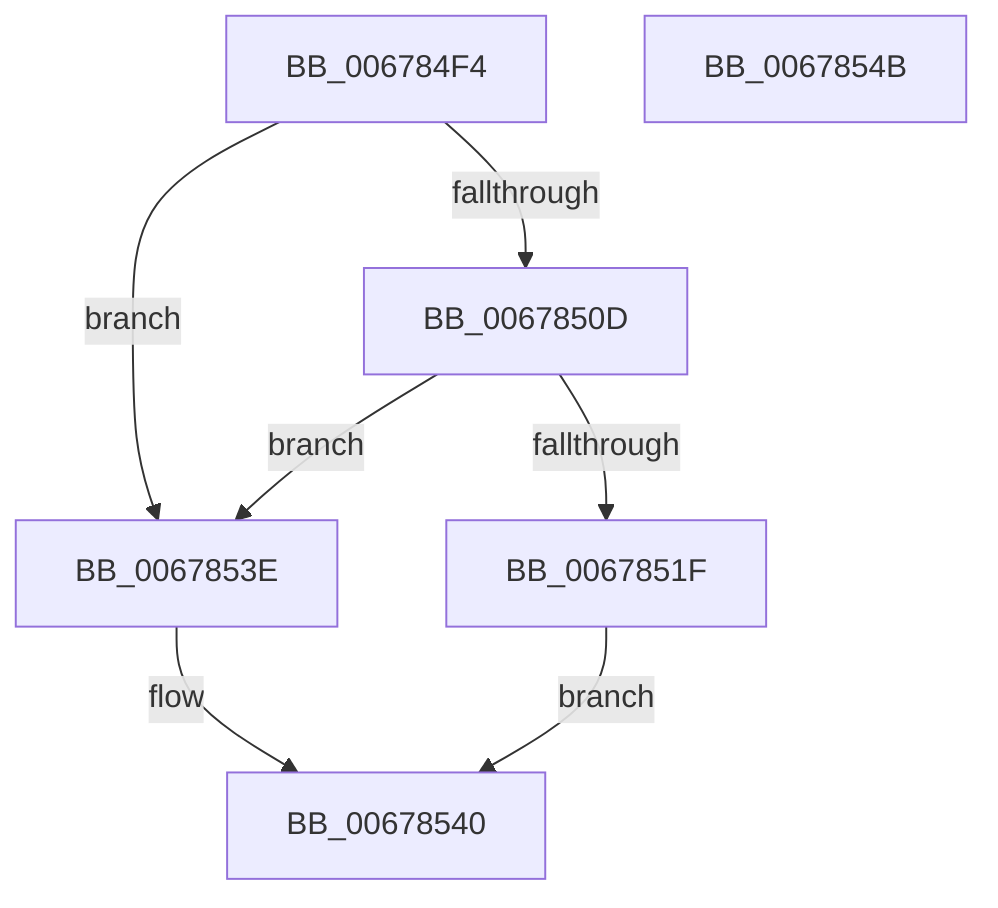

# MiReduceSystemCache

- RVA: `0x006784F4`–`0x0067854C` (길이 `88` bytes)
- VA: `0x00000001406784F4`
- 실행 섹션: `.text`
- PDB 이름 있음: `예`; PDB Function 태그: `아니요`
- unwind 정보 RVA: `0x0005CAAC`
- 디코드: `28`개 명령, `88/88` bytes 표시
- 미해석 바이트: `0` (있으면 어셈블리에 `.byte`로 보존)

> 이 문서는 커널 이미지의 기계어와 PDB 기호를 분석해 생성했습니다. 4번과 5번은 함수 원형과 자료형을 바이너리 사용 방식에서 추정한 C 해석이며 원본 소스 복구 결과는 아닙니다.

## 1. Dependencies

- 직접 호출 지점: **4**; 고유 호출 대상: **3**
- 직접 호출자로 확인된 함수: **1**
- RIP 상대 이미지 참조: **0**

### Outgoing calls
- `0x00678501` → [MiComputeProportionalSystemCacheVaReduction](../4E/MiComputeProportionalSystemCacheVaReduction_function_004EDAC8.md) (function, `0x004EDAC8`)
- `0x0067850D` → [MiDeleteUnmappedSystemCacheViews](MiDeleteUnmappedSystemCacheViews_function_0067C9A0.md) (function, `0x0067C9A0`)
- `0x00678515` → [MiComputeProportionalSystemCacheVaReduction](../4E/MiComputeProportionalSystemCacheVaReduction_function_004EDAC8.md) (function, `0x004EDAC8`)
- `0x0067852F` → [CcUnmapInactiveViews](../4B/CcUnmapInactiveViews_function_004BA2DC.md) (function, `0x004BA2DC`)

### Direct callers
- [MiRemoveUnusedSegments](../4E/MiRemoveUnusedSegments_function_004ED99C.md) at `0x004ED9CC`

### Static image references
- 디코드된 RIP-relative 메모리 참조가 없습니다.

## 2. Other-region calls and transfers

- 다른 실행 섹션으로 향하는 call: **0**
- 별도 외부 분기/꼬리 이동을 확인하지 못했습니다.

## 3. Assembly (complete function range)

```asm
006784F4  48 89 5C 24 08                  mov qword ptr [rsp + 8], rbx
006784F9  57                              push rdi
006784FA  48 83 EC 20                     sub rsp, 0x20
006784FE  48 8B D9                        mov rbx, rcx
00678501  E8 C2 55 E7 FF                  call 0x1404edac8
00678506  33 FF                           xor edi, edi
00678508  48 85 C0                        test rax, rax
0067850B  74 31                           je 0x14067853e
0067850D  E8 8E 44 00 00                  call 0x14067c9a0
00678512  48 8B CB                        mov rcx, rbx
00678515  E8 AE 55 E7 FF                  call 0x1404edac8
0067851A  48 85 C0                        test rax, rax
0067851D  74 1F                           je 0x14067853e
0067851F  48 8B 8B B8 00 00 00            mov rcx, qword ptr [rbx + 0xb8]
00678526  45 33 C9                        xor r9d, r9d
00678529  45 33 C0                        xor r8d, r8d
0067852C  48 8B D0                        mov rdx, rax
0067852F  E8 A8 1D E4 FF                  call 0x1404ba2dc
00678534  85 C0                           test eax, eax
00678536  40 0F 95 C7                     setne dil
0067853A  8B C7                           mov eax, edi
0067853C  EB 02                           jmp 0x140678540
0067853E  33 C0                           xor eax, eax
00678540  48 8B 5C 24 30                  mov rbx, qword ptr [rsp + 0x30]
00678545  48 83 C4 20                     add rsp, 0x20
00678549  5F                              pop rdi
0067854A  C3                              ret
0067854B  CC                              int3
```

## 4. C-style interpretation (structured pseudocode)

```c
__int64 __fastcall MiReduceSystemCache(__int64 a1, __int64 a2, int a3, int a4)
{
    __int64 result;
    __int64 v_rdi;
    __int64 v_rsp;
    unsigned __int64 v_stack_p8;

    v_stack_p8 = v_rbx;
    v_rsp = (v_rsp) - (32);
    result = MiComputeProportionalSystemCacheVaReduction(a1, a2, a3, a4);
    v_rdi = 0;
    if (result == 0) goto loc_0067853E;
    result = MiDeleteUnmappedSystemCacheViews(a1, a2, a3, a4);
    result = MiComputeProportionalSystemCacheVaReduction(a1, a2, a3, a4);
    if (result == 0) goto loc_0067853E;
    a4 = 0;
    a3 = 0;
    result = CcUnmapInactiveViews(*(unsigned __int64 *)(a1 + 184), result, a3, a4);
    v_rdi = ((unsigned int)(result) != 0) ? 1 : 0;
    goto loc_00678540;
loc_0067853E:
    result = 0;
loc_00678540:
    v_rsp = (v_rsp) + (32);
    return result;
}
```

## 5. (Beta) C Style

```c
int64_t MiReduceSystemCache(void *Arg1, int64_t Arg2, int32_t Arg3, int32_t Arg4)
{
    uint8_t *arg1 = (uint8_t *)Arg1;

    int64_t result;
    int64_t local_rdi;
    int64_t local_rsp;
    uint64_t v_stack_p8;

    v_stack_p8 = local_rbx;
    local_rsp = (local_rsp) - (32);
    result = MiComputeProportionalSystemCacheVaReduction(Arg1, Arg2, Arg3, Arg4);
    local_rdi = 0;
    if (result == 0) goto loc_0067853E;
    result = MiDeleteUnmappedSystemCacheViews(Arg1, Arg2, Arg3, Arg4);
    result = MiComputeProportionalSystemCacheVaReduction(Arg1, Arg2, Arg3, Arg4);
    if (result == 0) goto loc_0067853E;
    Arg4 = 0;
    Arg3 = 0;
    result = CcUnmapInactiveViews(*(uint64_t *)(arg1 + 0xB8), result, Arg3, Arg4);
    local_rdi = ((uint32_t)(result) != 0) ? 1 : 0;
    goto loc_00678540;
loc_0067853E:
    result = 0;
loc_00678540:
    local_rsp = (local_rsp) + (32);
    return result;
}
```

### 관측된 메모리 오프셋

구조체 형식이 확인되지 않은 접근은 인자 기준의 오프셋으로만 기록했습니다.

| 기준 인자 | 오프셋 표현 | 폭 (bit) | 접근 |
|---|---:|---:|---|
| `Arg1` | `+ 0xB8` | `64` | `R` |

## 6. Execution-region graph

[열기: 2D/3D 그래프와 함수 탐색 컨트롤 패널](../../../control-panel.html?section=text&rva=0x006784F4&view=graph)

- 2D 그래프는 위에서 아래로 흐르고, 3D 그래프는 빈 공간을 드래그해 회전합니다. Shift+드래그는 이동, 휠은 확대·축소, 함수 노드 선택은 대상 보고서 이동입니다.

### Static fallback


