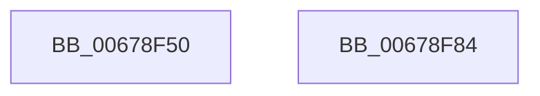

# MiReferenceMappedControlArea

- RVA: `0x00678F50`–`0x00678F85` (길이 `53` bytes)
- VA: `0x0000000140678F50`
- 실행 섹션: `.text`
- PDB 이름 있음: `예`; PDB Function 태그: `아니요`
- unwind 정보 RVA: `0x0005CAAC`
- 디코드: `16`개 명령, `53/53` bytes 표시
- 미해석 바이트: `0` (있으면 어셈블리에 `.byte`로 보존)

> 이 문서는 커널 이미지의 기계어와 PDB 기호를 분석해 생성했습니다. 4번과 5번은 함수 원형과 자료형을 바이너리 사용 방식에서 추정한 C 해석이며 원본 소스 복구 결과는 아닙니다.

## 1. Dependencies

- 직접 호출 지점: **2**; 고유 호출 대상: **2**
- 직접 호출자로 확인된 함수: **1**
- RIP 상대 이미지 참조: **0**

### Outgoing calls
- `0x00678F61` → [ExAcquireSpinLockExclusive](../24/ExAcquireSpinLockExclusive_function_00248690.md) (function, `0x00248690`)
- `0x00678F74` → [MiReleaseSpinLockExclusive](../24/MiReleaseSpinLockExclusive_function_002482C0.md) (function, `0x002482C0`)

### Direct callers
- [MiApplyImageHotPatchRequest](../../page/80/MiApplyImageHotPatchRequest_function_008025AC.md) at `0x008028CC`

### Static image references
- 디코드된 RIP-relative 메모리 참조가 없습니다.

## 2. Other-region calls and transfers

- 다른 실행 섹션으로 향하는 call: **0**
- 별도 외부 분기/꼬리 이동을 확인하지 못했습니다.

## 3. Assembly (complete function range)

```asm
00678F50  48 89 5C 24 08                  mov qword ptr [rsp + 8], rbx
00678F55  57                              push rdi
00678F56  48 83 EC 20                     sub rsp, 0x20
00678F5A  48 8B D9                        mov rbx, rcx
00678F5D  48 83 C1 48                     add rcx, 0x48
00678F61  E8 2A F7 BC FF                  call 0x140248690
00678F66  48 FF 43 18                     inc qword ptr [rbx + 0x18]
00678F6A  48 8D 4B 48                     lea rcx, [rbx + 0x48]
00678F6E  48 FF 43 30                     inc qword ptr [rbx + 0x30]
00678F72  8A D0                           mov dl, al
00678F74  E8 47 F3 BC FF                  call 0x1402482c0
00678F79  48 8B 5C 24 30                  mov rbx, qword ptr [rsp + 0x30]
00678F7E  48 83 C4 20                     add rsp, 0x20
00678F82  5F                              pop rdi
00678F83  C3                              ret
00678F84  CC                              int3
```

## 4. C-style interpretation (structured pseudocode)

```c
__int64 __fastcall MiReferenceMappedControlArea(__int64 a1)
{
    __int64 result;
    __int64 v_rsp;
    unsigned __int64 v_stack_p8;

    v_stack_p8 = v_rbx;
    v_rsp = (v_rsp) - (32);
    a1 = (a1) + (72);
    result = ExAcquireSpinLockExclusive(a1, a2, a3, a4);
    result = MiReleaseSpinLockExclusive(a1 + 72, (unsigned __int8)(result), a3, a4);
    v_rsp = (v_rsp) + (32);
    return result;
}
```

## 5. (Beta) C Style

```c
int64_t MiReferenceMappedControlArea(void *Arg1)
{
    uint8_t *arg1 = (uint8_t *)Arg1;

    int64_t result;
    int64_t local_rsp;
    uint64_t v_stack_p8;

    v_stack_p8 = local_rbx;
    local_rsp = (local_rsp) - (32);
    Arg1 = (Arg1) + (72);
    result = ExAcquireSpinLockExclusive(Arg1, a2, a3, a4);
    result = MiReleaseSpinLockExclusive(Arg1 + 72, (uint8_t)(result), a3, a4);
    local_rsp = (local_rsp) + (32);
    return result;
}
```

### 관측된 메모리 오프셋

구조체 형식이 확인되지 않은 접근은 인자 기준의 오프셋으로만 기록했습니다.

| 기준 인자 | 오프셋 표현 | 폭 (bit) | 접근 |
|---|---:|---:|---|
| `Arg1` | `+ 0x18` | `64` | `R/W` |
| `Arg1` | `+ 0x30` | `64` | `R/W` |
| `Arg1` | `+ 0x48` | `64` | `R` |

## 6. Execution-region graph

[열기: 2D/3D 그래프와 함수 탐색 컨트롤 패널](../../../control-panel.html?section=text&rva=0x00678F50&view=graph)

- 2D 그래프는 위에서 아래로 흐르고, 3D 그래프는 빈 공간을 드래그해 회전합니다. Shift+드래그는 이동, 휠은 확대·축소, 함수 노드 선택은 대상 보고서 이동입니다.

### Static fallback


