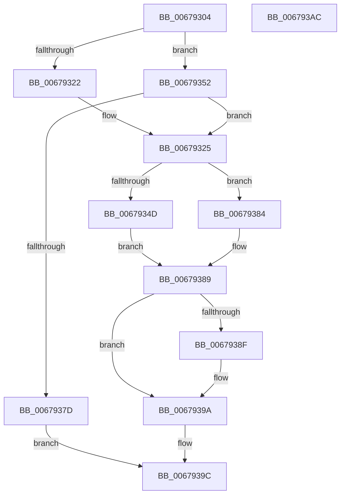

# MiReferencePagePartition

- RVA: `0x00679304`–`0x006793AD` (길이 `169` bytes)
- VA: `0x0000000140679304`
- 실행 섹션: `.text`
- PDB 이름 있음: `예`; PDB Function 태그: `아니요`
- unwind 정보 RVA: `0x00060BC4`
- 디코드: `46`개 명령, `169/169` bytes 표시
- 미해석 바이트: `0` (있으면 어셈블리에 `.byte`로 보존)

> 이 문서는 커널 이미지의 기계어와 PDB 기호를 분석해 생성했습니다. 4번과 5번은 함수 원형과 자료형을 바이너리 사용 방식에서 추정한 C 해석이며 원본 소스 복구 결과는 아닙니다.

## 1. Dependencies

- 직접 호출 지점: **3**; 고유 호출 대상: **3**
- 직접 호출자로 확인된 함수: **3**
- RIP 상대 이미지 참조: **1**

### Outgoing calls
- `0x00679344` → [PsReferencePartitionSafe](../3B/PsReferencePartitionSafe_function_003BA6C0.md) (function, `0x003BA6C0`)
- `0x00679371` → [MiSafeLockPage](../32/MiSafeLockPage_function_00321620.md) (function, `0x00321620`)
- `0x00679395` → [MiUnlockPage](../31/MiUnlockPage_function_0031A3E0.md) (function, `0x0031A3E0`)

### Direct callers
- [MmMarkPhysicalMemoryAsBad](MmMarkPhysicalMemoryAsBad_function_0067AA50.md) at `0x0067ABA0`
- [MmRemovePhysicalMemory](../../page/7F/MmRemovePhysicalMemory_function_007FB560.md) at `0x007FB5EC`
- [MmIdentifyPhysicalMemory](../../page/AA/MmIdentifyPhysicalMemory_function_00AAD05C.md) at `0x00AAD1AC`

### Static image references
- `0x00679329` → RVA `0x00E30088` (`.data`; read)

## 2. Other-region calls and transfers

- 다른 실행 섹션으로 향하는 call: **0**
- 별도 외부 분기/꼬리 이동을 확인하지 못했습니다.

## 3. Assembly (complete function range)

```asm
00679304  48 89 5C 24 08                  mov qword ptr [rsp + 8], rbx
00679309  48 89 74 24 10                  mov qword ptr [rsp + 0x10], rsi
0067930E  57                              push rdi
0067930F  48 83 EC 20                     sub rsp, 0x20
00679313  33 DB                           xor ebx, ebx
00679315  49 8B F0                        mov rsi, r8
00679318  49 89 18                        mov qword ptr [r8], rbx
0067931B  48 8B F9                        mov rdi, rcx
0067931E  85 D2                           test edx, edx
00679320  74 30                           je 0x140679352
00679322  41 B1 11                        mov r9b, 0x11
00679325  48 8B 47 28                     mov rax, qword ptr [rdi + 0x28]
00679329  48 8B 0D 58 6D 7B 00            mov rcx, qword ptr [rip + 0x7b6d58]
00679330  48 C1 E8 2B                     shr rax, 0x2b
00679334  25 FF 03 00 00                  and eax, 0x3ff
00679339  4C 8B 04 C1                     mov r8, qword ptr [rcx + rax*8]
0067933D  49 8B 88 B8 00 00 00            mov rcx, qword ptr [r8 + 0xb8]
00679344  E8 77 13 D4 FF                  call 0x1403ba6c0
00679349  84 C0                           test al, al
0067934B  74 37                           je 0x140679384
0067934D  4C 89 06                        mov qword ptr [rsi], r8
00679350  EB 37                           jmp 0x140679389
00679352  48 B8 00 00 00 00 00 DE FF FF   movabs rax, 0xffffde0000000000
0067935C  48 2B C8                        sub rcx, rax
0067935F  48 B8 AB AA AA AA AA AA AA AA   movabs rax, 0xaaaaaaaaaaaaaaab
00679369  48 C1 F9 04                     sar rcx, 4
0067936D  48 0F AF C8                     imul rcx, rax
00679371  E8 AA 82 CA FF                  call 0x140321620
00679376  44 8A C8                        mov r9b, al
00679379  3C 11                           cmp al, 0x11
0067937B  75 A8                           jne 0x140679325
0067937D  B8 0D 00 00 C0                  mov eax, 0xc000000d
00679382  EB 18                           jmp 0x14067939c
00679384  BB 0A 01 00 C0                  mov ebx, 0xc000010a
00679389  41 80 F9 11                     cmp r9b, 0x11
0067938D  74 0B                           je 0x14067939a
0067938F  41 8A D1                        mov dl, r9b
00679392  48 8B CF                        mov rcx, rdi
00679395  E8 46 10 CA FF                  call 0x14031a3e0
0067939A  8B C3                           mov eax, ebx
0067939C  48 8B 5C 24 30                  mov rbx, qword ptr [rsp + 0x30]
006793A1  48 8B 74 24 38                  mov rsi, qword ptr [rsp + 0x38]
006793A6  48 83 C4 20                     add rsp, 0x20
006793AA  5F                              pop rdi
006793AB  C3                              ret
006793AC  CC                              int3
```

## 4. C-style interpretation (structured pseudocode)

```c
__int64 __fastcall MiReferencePagePartition(__int64 a1, int a2, __int64 a3)
{
    __int64 result;
    __int64 v_rbx;
    __int64 v_rsp;
    unsigned __int64 v_stack_p10;
    unsigned __int64 v_stack_p8;

    v_stack_p8 = v_rbx;
    v_stack_p10 = v_rsi;
    v_rsp = (v_rsp) - (32);
    v_rbx = 0;
    *(unsigned __int64 *)(a3) = 0;
    if (a2 == 0) goto loc_00679352;
loc_00679325:
    result = (*(unsigned __int64 *)(a1 + 40)) >> (43);
    result = (unsigned int)((result) & (0x3FFULL));
    result = PsReferencePartitionSafe(*(unsigned __int64 *)(*(unsigned __int64 *)(*(unsigned __int64 *)(v_rip + 8088920) + result * 8) + 184), a2, *(unsigned __int64 *)(*(unsigned __int64 *)(v_rip + 8088920) + result * 8), 17);
    if ((unsigned __int8)(result) == 0) goto loc_00679384;
    *(unsigned __int64 *)(a3) = *(unsigned __int64 *)(*(unsigned __int64 *)(v_rip + 8088920) + result * 8);
    goto loc_00679389;
loc_00679352:
    a1 = (*(unsigned __int64 *)(*(unsigned __int64 *)(*(unsigned __int64 *)(v_rip + 8088920) + result * 8) + 184)) - (result);
    a1 = (a1) >> (4);
    a1 = (a1) * (result);
    result = MiSafeLockPage(a1, a2, *(unsigned __int64 *)(*(unsigned __int64 *)(v_rip + 8088920) + result * 8), 17);
    if (((unsigned __int8)(result)) != 17) goto loc_00679325;
    goto loc_0067939C;
loc_00679384:
loc_00679389:
    result = (unsigned int)(0xC000000DULL);
    if (((unsigned __int8)((unsigned __int8)(result))) != 17) {
        a2 = (unsigned __int8)((unsigned __int8)(result));
        a1 = a1;
        result = MiUnlockPage(a1, a2, *(unsigned __int64 *)(*(unsigned __int64 *)(v_rip + 8088920) + result * 8), (unsigned __int8)(result));
    }
loc_0067939C:
    v_rsp = (v_rsp) + (32);
    return (unsigned int)((unsigned int)((unsigned int)(0xC000010AULL)));
}
```

## 5. (Beta) C Style

```c
int64_t MiReferencePagePartition(void *Arg1, int32_t Arg2, void *Arg3)
{
    uint8_t *arg1 = (uint8_t *)Arg1;
    uint8_t *arg3 = (uint8_t *)Arg3;

    int64_t result;
    int64_t local_rbx;
    int64_t local_rsp;
    uint64_t v_stack_p10;
    uint64_t v_stack_p8;

    v_stack_p8 = local_rbx;
    v_stack_p10 = local_rsi;
    local_rsp = (local_rsp) - (32);
    local_rbx = 0;
    *(uint64_t *)(arg3) = 0;
    if (Arg2 == 0) goto loc_00679352;
loc_00679325:
    result = (*(uint64_t *)(arg1 + 0x28)) >> (43);
    result = (uint32_t)((result) & (0x3FFULL));
    result = PsReferencePartitionSafe(*(uint64_t *)(*(uint64_t *)(*(uint64_t *)(v_rip + 0x7B6D58) + result * 8) + 0xB8), Arg2, *(uint64_t *)(*(uint64_t *)(v_rip + 0x7B6D58) + result * 8), 17);
    if ((uint8_t)(result) == 0) goto loc_00679384;
    *(uint64_t *)(arg3) = *(uint64_t *)(*(uint64_t *)(v_rip + 0x7B6D58) + result * 8);
    goto loc_00679389;
loc_00679352:
    Arg1 = (*(uint64_t *)(*(uint64_t *)(*(uint64_t *)(v_rip + 0x7B6D58) + result * 8) + 0xB8)) - (result);
    Arg1 = (Arg1) >> (4);
    Arg1 = (Arg1) * (result);
    result = MiSafeLockPage(Arg1, Arg2, *(uint64_t *)(*(uint64_t *)(v_rip + 0x7B6D58) + result * 8), 17);
    if (((uint8_t)(result)) != 17) goto loc_00679325;
    goto loc_0067939C;
loc_00679384:
loc_00679389:
    result = (uint32_t)(0xC000000DULL);
    if (((uint8_t)((uint8_t)(result))) != 17) {
        Arg2 = (uint8_t)((uint8_t)(result));
        Arg1 = Arg1;
        result = MiUnlockPage(Arg1, Arg2, *(uint64_t *)(*(uint64_t *)(v_rip + 0x7B6D58) + result * 8), (uint8_t)(result));
    }
loc_0067939C:
    local_rsp = (local_rsp) + (32);
    return (uint32_t)((uint32_t)((uint32_t)(0xC000010AULL)));
}
```

### 관측된 메모리 오프셋

구조체 형식이 확인되지 않은 접근은 인자 기준의 오프셋으로만 기록했습니다.

| 기준 인자 | 오프셋 표현 | 폭 (bit) | 접근 |
|---|---:|---:|---|
| `Arg1` | `+ 0x28` | `64` | `R` |
| `Arg3` | `+ 0x0` | `64` | `W` |

## 6. Execution-region graph

[열기: 2D/3D 그래프와 함수 탐색 컨트롤 패널](../../../control-panel.html?section=text&rva=0x00679304&view=graph)

- 2D 그래프는 위에서 아래로 흐르고, 3D 그래프는 빈 공간을 드래그해 회전합니다. Shift+드래그는 이동, 휠은 확대·축소, 함수 노드 선택은 대상 보고서 이동입니다.

### Static fallback


