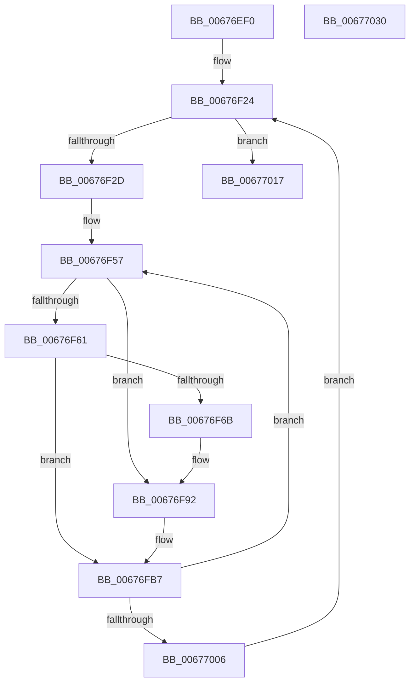

# MiReleaseMemoryRuns

- RVA: `0x00676EF0`–`0x00677031` (길이 `321` bytes)
- VA: `0x0000000140676EF0`
- 실행 섹션: `.text`
- PDB 이름 있음: `예`; PDB Function 태그: `아니요`
- unwind 정보 RVA: `0x000CBFC4`
- 디코드: `91`개 명령, `321/321` bytes 표시
- 미해석 바이트: `0` (있으면 어셈블리에 `.byte`로 보존)

> 이 문서는 커널 이미지의 기계어와 PDB 기호를 분석해 생성했습니다. 4번과 5번은 함수 원형과 자료형을 바이너리 사용 방식에서 추정한 C 해석이며 원본 소스 복구 결과는 아닙니다.

## 1. Dependencies

- 직접 호출 지점: **5**; 고유 호출 대상: **5**
- 직접 호출자로 확인된 함수: **2**
- RIP 상대 이미지 참조: **1**

### Outgoing calls
- `0x00676F8C` → [KeBugCheckEx](../4F/KeBugCheckEx_function_004FD660.md) (function, `0x004FD660`)
- `0x00676F95` → [MiHugePfnPartition](../43/MiHugePfnPartition_function_004371B4.md) (function, `0x004371B4`)
- `0x00676FBA` → [MiLockHugePfn](MiLockHugePfn_function_006765FC.md) (function, `0x006765FC`)
- `0x00676FCA` → [MiInsertHugeRangeInList](../43/MiInsertHugeRangeInList_function_004371E8.md) (function, `0x004371E8`)
- `0x00676FD5` → [MiUnlockHugePfn](../4D/MiUnlockHugePfn_function_004D90E4.md) (function, `0x004D90E4`)

### Direct callers
- [MmAllocateMemoryRanges](../../page/7F/MmAllocateMemoryRanges_function_007FC0C0.md) at `0x007FC27D`
- [MmAllocateMemoryRanges](../../page/7F/MmAllocateMemoryRanges_function_007FC0C0.md) at `0x007FC2A5`
- [MmFreeMemoryRanges](../../page/7F/MmFreeMemoryRanges_function_007FC320.md) at `0x007FC381`

### Static image references
- `0x00676F36` → RVA `0x00E300C0` (`.data`; read)

## 2. Other-region calls and transfers

- 다른 실행 섹션으로 향하는 call: **0**
- 별도 외부 분기/꼬리 이동을 확인하지 못했습니다.

## 3. Assembly (complete function range)

```asm
00676EF0  48 89 5C 24 10                  mov qword ptr [rsp + 0x10], rbx
00676EF5  44 89 44 24 18                  mov dword ptr [rsp + 0x18], r8d
00676EFA  48 89 4C 24 08                  mov qword ptr [rsp + 8], rcx
00676EFF  55                              push rbp
00676F00  56                              push rsi
00676F01  57                              push rdi
00676F02  41 54                           push r12
00676F04  41 55                           push r13
00676F06  41 56                           push r14
00676F08  41 57                           push r15
00676F0A  48 83 EC 30                     sub rsp, 0x30
00676F0E  4C 8B 7A 10                     mov r15, qword ptr [rdx + 0x10]
00676F12  33 DB                           xor ebx, ebx
00676F14  48 8B 2A                        mov rbp, qword ptr [rdx]
00676F17  45 8B C8                        mov r9d, r8d
00676F1A  4C 8B F2                        mov r14, rdx
00676F1D  4C 8B C1                        mov r8, rcx
00676F20  44 8D 53 01                     lea r10d, [rbx + 1]
00676F24  48 85 ED                        test rbp, rbp
00676F27  0F 84 EA 00 00 00               je 0x140677017
00676F2D  49 8B 07                        mov rax, qword ptr [r15]
00676F30  33 D2                           xor edx, edx
00676F32  49 F7 70 18                     div qword ptr [r8 + 0x18]
00676F36  48 8B 0D 83 91 7B 00            mov rcx, qword ptr [rip + 0x7b9183]
00676F3D  48 33 D8                        xor rbx, rax
00676F40  48 81 E3 00 00 C0 FF            and rbx, 0xffffffffffc00000
00676F47  48 33 D8                        xor rbx, rax
00676F4A  25 FF FF 3F 00                  and eax, 0x3fffff
00676F4F  4C 8D 6A 01                     lea r13, [rdx + 1]
00676F53  4C 8D 24 C1                     lea r12, [rcx + rax*8]
00676F57  4D 2B EA                        sub r13, r10
00676F5A  33 FF                           xor edi, edi
00676F5C  45 85 C9                        test r9d, r9d
00676F5F  74 31                           je 0x140676f92
00676F61  49 8B 04 24                     mov rax, qword ptr [r12]
00676F65  24 07                           and al, 7
00676F67  3C 03                           cmp al, 3
00676F69  74 4C                           je 0x140676fb7
00676F6B  49 8B 06                        mov rax, qword ptr [r14]
00676F6E  8D 4F 1A                        lea ecx, [rdi + 0x1a]
00676F71  4C 8B 44 24 70                  mov r8, qword ptr [rsp + 0x70]
00676F76  81 E3 FF FF 3F 00               and ebx, 0x3fffff
00676F7C  48 2B C5                        sub rax, rbp
00676F7F  44 8B CB                        mov r9d, ebx
00676F82  BA 80 0F 04 00                  mov edx, 0x40f80
00676F87  48 89 44 24 20                  mov qword ptr [rsp + 0x20], rax
00676F8C  E8 CF 66 E8 FF                  call 0x1404fd660
00676F91  CC                              int3
00676F92  49 8B CC                        mov rcx, r12
00676F95  E8 1A 02 DC FF                  call 0x1404371b4
00676F9A  48 8B 05 1F 91 7B 00            mov rax, qword ptr [rip + 0x7b911f]
00676FA1  48 8B D3                        mov rdx, rbx
00676FA4  81 E2 FF FF 3F 00               and edx, 0x3fffff
00676FAA  48 8B 04 D0                     mov rax, qword ptr [rax + rdx*8]
00676FAE  48 0F BA E0 10                  bt rax, 0x10
00676FB3  41 0F 43 FA                     cmovae edi, r10d
00676FB7  49 8B CC                        mov rcx, r12
00676FBA  E8 3D F6 FF FF                  call 0x1406765fc
00676FBF  44 8B C7                        mov r8d, edi
00676FC2  48 8B D3                        mov rdx, rbx
00676FC5  33 C9                           xor ecx, ecx
00676FC7  40 8A F0                        mov sil, al
00676FCA  E8 19 02 DC FF                  call 0x1404371e8
00676FCF  40 8A D6                        mov dl, sil
00676FD2  49 8B CC                        mov rcx, r12
00676FD5  E8 0A 21 E6 FF                  call 0x1404d90e4
00676FDA  44 8B 8C 24 80 00 00 00         mov r9d, dword ptr [rsp + 0x80]
00676FE2  48 8D 4B 01                     lea rcx, [rbx + 1]
00676FE6  48 33 D9                        xor rbx, rcx
00676FE9  49 83 C4 08                     add r12, 8
00676FED  48 81 E3 00 00 C0 FF            and rbx, 0xffffffffffc00000
00676FF4  41 BA 01 00 00 00               mov r10d, 1
00676FFA  48 33 D9                        xor rbx, rcx
00676FFD  4D 85 ED                        test r13, r13
00677000  0F 85 51 FF FF FF               jne 0x140676f57
00677006  4C 8B 44 24 70                  mov r8, qword ptr [rsp + 0x70]
0067700B  49 2B EA                        sub rbp, r10
0067700E  49 83 C7 08                     add r15, 8
00677012  E9 0D FF FF FF                  jmp 0x140676f24
00677017  49 83 26 00                     and qword ptr [r14], 0
0067701B  48 8B 5C 24 78                  mov rbx, qword ptr [rsp + 0x78]
00677020  48 83 C4 30                     add rsp, 0x30
00677024  41 5F                           pop r15
00677026  41 5E                           pop r14
00677028  41 5D                           pop r13
0067702A  41 5C                           pop r12
0067702C  5F                              pop rdi
0067702D  5E                              pop rsi
0067702E  5D                              pop rbp
0067702F  C3                              ret
00677030  CC                              int3
```

## 4. C-style interpretation (structured pseudocode)

```c
__int64 __fastcall MiReleaseMemoryRuns(__int64 a1, __int64 a2, int a3)
{
    __int64 result;
    __int64 v_r12;
    __int64 v_r13;
    __int64 v_r15;
    __int64 v_rbp;
    __int64 v_rbx;
    __int64 v_rdi;
    __int64 v_rsp;
    unsigned __int64 v_stack_m48;
    unsigned __int64 v_stack_p10;
    unsigned int v_stack_p18;
    unsigned __int64 v_stack_p8;

    v_stack_p10 = v_rbx;
    v_stack_p18 = a3;
    v_stack_p8 = a1;
    v_rsp = (v_rsp) - (48);
    v_rbx = 0;
loc_00676F24:
    if (*(unsigned __int64 *)(a2) == 0) goto loc_00677017;
    a2 = 0;
    v_rbx = (v_rbx) ^ (*(unsigned __int64 *)(*(unsigned __int64 *)(a2 + 16)));
    v_rbx = (v_rbx) & (0xFFFFFFFFFFC00000ULL);
    v_rbx = (v_rbx) ^ (*(unsigned __int64 *)(*(unsigned __int64 *)(a2 + 16)));
    result = (unsigned int)((*(unsigned __int64 *)(*(unsigned __int64 *)(a2 + 16))) & (0x3FFFFFULL));
loc_00676F57:
    v_r13 = (a2 + 1) - (v_rbx + 1);
    v_rdi = 0;
    if ((unsigned int)((unsigned int)(a3)) == 0) goto loc_00676F92;
    result = (unsigned __int8)((*(unsigned __int64 *)(*(unsigned __int64 *)(v_rip + 8098179) + result * 8)) & (7));
    if (((unsigned __int8)(result)) == 3) goto loc_00676FB7;
    v_rbx = (unsigned int)((v_rbx) & (0x3FFFFFULL));
    result = (*(unsigned __int64 *)(a2)) - (*(unsigned __int64 *)(a2));
    v_stack_m48 = result;
    result = KeBugCheckEx(v_rdi + 26, (unsigned int)(0x40F80ULL), v_stack_p8, (unsigned int)((unsigned int)(v_rbx)));
loc_00676F92:
    result = MiHugePfnPartition(*(unsigned __int64 *)(v_rip + 8098179) + result * 8, (unsigned int)(0x40F80ULL), v_stack_p8, (unsigned int)((unsigned int)(v_rbx)));
    a2 = (unsigned int)((v_rbx) & (0x3FFFFFULL));
    if (condition_is_above_or_equal) { v_rdi = (unsigned int)(v_rbx + 1); }
loc_00676FB7:
    result = MiLockHugePfn(*(unsigned __int64 *)(v_rip + 8098179) + result * 8, a2, v_stack_p8, (unsigned int)((unsigned int)(v_rbx)));
    a1 = 0;
    result = MiInsertHugeRangeInList(a1, v_rbx, (unsigned int)((unsigned int)(v_rdi)), (unsigned int)((unsigned int)(v_rbx)));
    result = MiUnlockHugePfn(*(unsigned __int64 *)(v_rip + 8098179) + result * 8, (unsigned __int8)((unsigned __int8)(result)), (unsigned int)((unsigned int)(v_rdi)), (unsigned int)((unsigned int)(v_rbx)));
    v_rbx = (v_rbx) ^ (v_rbx + 1);
    v_r12 = (*(unsigned __int64 *)(v_rip + 8098179) + result * 8) + (8);
    v_rbx = (v_rbx) & (0xFFFFFFFFFFC00000ULL);
    v_rbx = (v_rbx) ^ (v_rbx + 1);
    if (v_r13 != 0) goto loc_00676F57;
    v_rbp = (*(unsigned __int64 *)(a2)) - (1);
    v_r15 = (*(unsigned __int64 *)(a2 + 16)) + (8);
    goto loc_00676F24;
loc_00677017:
    v_rsp = (v_rsp) + (48);
    return result;
}
```

## 5. (Beta) C Style

```c
int64_t MiReleaseMemoryRuns(int64_t Arg1, void *Arg2, int32_t Arg3)
{
    uint8_t *arg2 = (uint8_t *)Arg2;

    int64_t result;
    int64_t local_r12;
    int64_t local_r13;
    int64_t local_r15;
    int64_t local_rbp;
    int64_t local_rbx;
    int64_t local_rdi;
    int64_t local_rsp;
    uint64_t v_stack_m48;
    uint64_t v_stack_p10;
    uint32_t v_stack_p18;
    uint64_t v_stack_p8;

    v_stack_p10 = local_rbx;
    v_stack_p18 = Arg3;
    v_stack_p8 = Arg1;
    local_rsp = (local_rsp) - (48);
    local_rbx = 0;
loc_00676F24:
    if (*(uint64_t *)(arg2) == 0) goto loc_00677017;
    Arg2 = 0;
    local_rbx = (local_rbx) ^ (*(uint64_t *)(*(uint64_t *)(arg2 + 0x10)));
    local_rbx = (local_rbx) & (0xFFFFFFFFFFC00000ULL);
    local_rbx = (local_rbx) ^ (*(uint64_t *)(*(uint64_t *)(arg2 + 0x10)));
    result = (uint32_t)((*(uint64_t *)(*(uint64_t *)(arg2 + 0x10))) & (0x3FFFFFULL));
loc_00676F57:
    local_r13 = (Arg2 + 1) - (local_rbx + 1);
    local_rdi = 0;
    if ((uint32_t)((uint32_t)(Arg3)) == 0) goto loc_00676F92;
    result = (uint8_t)((*(uint64_t *)(*(uint64_t *)(v_rip + 0x7B9183) + result * 8)) & (7));
    if (((uint8_t)(result)) == 3) goto loc_00676FB7;
    local_rbx = (uint32_t)((local_rbx) & (0x3FFFFFULL));
    result = (*(uint64_t *)(arg2)) - (*(uint64_t *)(arg2));
    v_stack_m48 = result;
    result = KeBugCheckEx(local_rdi + 26, (uint32_t)(0x40F80ULL), v_stack_p8, (uint32_t)((uint32_t)(local_rbx)));
loc_00676F92:
    result = MiHugePfnPartition(*(uint64_t *)(v_rip + 0x7B9183) + result * 8, (uint32_t)(0x40F80ULL), v_stack_p8, (uint32_t)((uint32_t)(local_rbx)));
    Arg2 = (uint32_t)((local_rbx) & (0x3FFFFFULL));
    if (condition_is_above_or_equal) { local_rdi = (uint32_t)(local_rbx + 1); }
loc_00676FB7:
    result = MiLockHugePfn(*(uint64_t *)(v_rip + 0x7B9183) + result * 8, Arg2, v_stack_p8, (uint32_t)((uint32_t)(local_rbx)));
    Arg1 = 0;
    result = MiInsertHugeRangeInList(Arg1, local_rbx, (uint32_t)((uint32_t)(local_rdi)), (uint32_t)((uint32_t)(local_rbx)));
    result = MiUnlockHugePfn(*(uint64_t *)(v_rip + 0x7B9183) + result * 8, (uint8_t)((uint8_t)(result)), (uint32_t)((uint32_t)(local_rdi)), (uint32_t)((uint32_t)(local_rbx)));
    local_rbx = (local_rbx) ^ (local_rbx + 1);
    local_r12 = (*(uint64_t *)(v_rip + 0x7B9183) + result * 8) + (8);
    local_rbx = (local_rbx) & (0xFFFFFFFFFFC00000ULL);
    local_rbx = (local_rbx) ^ (local_rbx + 1);
    if (local_r13 != 0) goto loc_00676F57;
    local_rbp = (*(uint64_t *)(arg2)) - (1);
    local_r15 = (*(uint64_t *)(arg2 + 0x10)) + (8);
    goto loc_00676F24;
loc_00677017:
    local_rsp = (local_rsp) + (48);
    return result;
}
```

### 관측된 메모리 오프셋

구조체 형식이 확인되지 않은 접근은 인자 기준의 오프셋으로만 기록했습니다.

| 기준 인자 | 오프셋 표현 | 폭 (bit) | 접근 |
|---|---:|---:|---|
| `Arg2` | `+ 0x0` | `64` | `R` |
| `Arg2` | `+ 0x0` | `64` | `R/W` |
| `Arg2` | `+ 0x10` | `64` | `R` |

## 6. Execution-region graph

[열기: 2D/3D 그래프와 함수 탐색 컨트롤 패널](../../../control-panel.html?section=text&rva=0x00676EF0&view=graph)

- 2D 그래프는 위에서 아래로 흐르고, 3D 그래프는 빈 공간을 드래그해 회전합니다. Shift+드래그는 이동, 휠은 확대·축소, 함수 노드 선택은 대상 보고서 이동입니다.

### Static fallback


