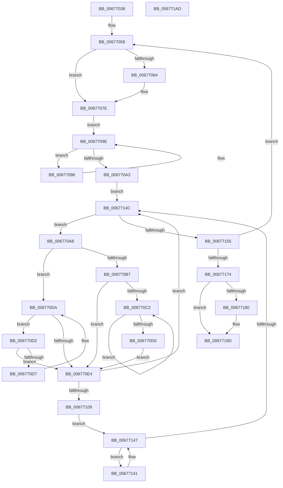

# MiReleasePartitionHugeIoSpace

- RVA: `0x00677038`–`0x006771AE` (길이 `374` bytes)
- VA: `0x0000000140677038`
- 실행 섹션: `.text`
- PDB 이름 있음: `예`; PDB Function 태그: `아니요`
- unwind 정보 RVA: `0x000794E0`
- 디코드: `99`개 명령, `374/374` bytes 표시
- 미해석 바이트: `0` (있으면 어셈블리에 `.byte`로 보존)

> 이 문서는 커널 이미지의 기계어와 PDB 기호를 분석해 생성했습니다. 4번과 5번은 함수 원형과 자료형을 바이너리 사용 방식에서 추정한 C 해석이며 원본 소스 복구 결과는 아닙니다.

## 1. Dependencies

- 직접 호출 지점: **7**; 고유 호출 대상: **5**
- 직접 호출자로 확인된 함수: **1**
- RIP 상대 이미지 참조: **3**

### Outgoing calls
- `0x00677079` → [MiAllocatePartitionPhysicalPages](../../page/80/MiAllocatePartitionPhysicalPages_function_0080C9D4.md) (function, `0x0080C9D4`)
- `0x00677085` → [ExAcquireSpinLockShared](../24/ExAcquireSpinLockShared_function_0024DCE0.md) (function, `0x0024DCE0`)
- `0x00677113` → [MiReleaseSpinLockShared](../34/MiReleaseSpinLockShared_function_00348BF0.md) (function, `0x00348BF0`)
- `0x00677122` → [MiMoveBadHugeRangeCrossPartition](MiMoveBadHugeRangeCrossPartition_function_00676DD0.md) (function, `0x00676DD0`)
- `0x0067712E` → [ExAcquireSpinLockShared](../24/ExAcquireSpinLockShared_function_0024DCE0.md) (function, `0x0024DCE0`)
- `0x00677166` → [MiReleaseSpinLockShared](../34/MiReleaseSpinLockShared_function_00348BF0.md) (function, `0x00348BF0`)
- `0x00677197` → [KeBugCheckEx](../4F/KeBugCheckEx_function_004FD660.md) (function, `0x004FD660`)

### Direct callers
- [MiReturnPartitionPagesToParent](../69/MiReturnPartitionPagesToParent_function_00691B5C.md) at `0x00691D38`

### Static image references
- `0x0067707E` → RVA `0x00E2FFD0` (`.data`; read)
- `0x0067708A` → RVA `0x00E30020` (`.data`; read)
- `0x006770E7` → RVA `0x00E300C0` (`.data`; read)

## 2. Other-region calls and transfers

- 다른 실행 섹션으로 향하는 call: **1**
  - `0x00677079` → [MiAllocatePartitionPhysicalPages](../../page/80/MiAllocatePartitionPhysicalPages_function_0080C9D4.md) (`.text` → `PAGE`)
- 별도 외부 분기/꼬리 이동을 확인하지 못했습니다.

## 3. Assembly (complete function range)

```asm
00677038  48 89 5C 24 08                  mov qword ptr [rsp + 8], rbx
0067703D  48 89 74 24 10                  mov qword ptr [rsp + 0x10], rsi
00677042  57                              push rdi
00677043  48 83 EC 30                     sub rsp, 0x30
00677047  48 8B 81 B8 00 00 00            mov rax, qword ptr [rcx + 0xb8]
0067704E  48 8B F9                        mov rdi, rcx
00677051  48 8B 50 48                     mov rdx, qword ptr [rax + 0x48]
00677055  48 8B 32                        mov rsi, qword ptr [rdx]
00677058  4C 8B 87 18 41 00 00            mov r8, qword ptr [rdi + 0x4118]
0067705F  4D 85 C0                        test r8, r8
00677062  74 1A                           je 0x14067707e
00677064  49 C1 E0 12                     shl r8, 0x12
00677068  45 33 C9                        xor r9d, r9d
0067706B  48 8B D6                        mov rdx, rsi
0067706E  C7 44 24 20 01 03 00 00         mov dword ptr [rsp + 0x20], 0x301
00677076  48 8B CF                        mov rcx, rdi
00677079  E8 56 59 19 00                  call 0x14080c9d4
0067707E  48 8D 0D 4B 8F 7B 00            lea rcx, [rip + 0x7b8f4b]
00677085  E8 56 6C BD FF                  call 0x14024dce0
0067708A  48 8B 0D 8F 8F 7B 00            mov rcx, qword ptr [rip + 0x7b8f8f]
00677091  44 8A C0                        mov r8b, al
00677094  33 D2                           xor edx, edx
00677096  EB 06                           jmp 0x14067709e
00677098  48 8B D1                        mov rdx, rcx
0067709B  48 8B 09                        mov rcx, qword ptr [rcx]
0067709E  48 85 C9                        test rcx, rcx
006770A1  75 F5                           jne 0x140677098
006770A3  E9 A4 00 00 00                  jmp 0x14067714c
006770A8  48 8B 42 08                     mov rax, qword ptr [rdx + 8]
006770AC  48 8B DA                        mov rbx, rdx
006770AF  48 8B CA                        mov rcx, rdx
006770B2  48 85 C0                        test rax, rax
006770B5  74 23                           je 0x1406770da
006770B7  48 8B 08                        mov rcx, qword ptr [rax]
006770BA  48 8B D0                        mov rdx, rax
006770BD  48 85 C9                        test rcx, rcx
006770C0  74 22                           je 0x1406770e4
006770C2  48 8B 01                        mov rax, qword ptr [rcx]
006770C5  48 8B D1                        mov rdx, rcx
006770C8  48 8B C8                        mov rcx, rax
006770CB  48 85 C0                        test rax, rax
006770CE  75 F2                           jne 0x1406770c2
006770D0  EB 12                           jmp 0x1406770e4
006770D2  48 39 0A                        cmp qword ptr [rdx], rcx
006770D5  74 0D                           je 0x1406770e4
006770D7  48 8B CA                        mov rcx, rdx
006770DA  48 8B 52 10                     mov rdx, qword ptr [rdx + 0x10]
006770DE  48 83 E2 FC                     and rdx, 0xfffffffffffffffc
006770E2  75 EE                           jne 0x1406770d2
006770E4  8B 4B 18                        mov ecx, dword ptr [rbx + 0x18]
006770E7  48 8B 05 D2 8F 7B 00            mov rax, qword ptr [rip + 0x7b8fd2]
006770EE  81 E1 FF FF 3F 00               and ecx, 0x3fffff
006770F4  48 8B 04 C8                     mov rax, qword ptr [rax + rcx*8]
006770F8  0F B7 0F                        movzx ecx, word ptr [rdi]
006770FB  48 C1 E8 04                     shr rax, 4
006770FF  25 FF 07 00 00                  and eax, 0x7ff
00677104  48 3B C1                        cmp rax, rcx
00677107  75 43                           jne 0x14067714c
00677109  41 8A D0                        mov dl, r8b
0067710C  48 8D 0D BD 8E 7B 00            lea rcx, [rip + 0x7b8ebd]
00677113  E8 D8 1A CD FF                  call 0x140348bf0
00677118  48 8B 4B 18                     mov rcx, qword ptr [rbx + 0x18]
0067711C  4C 8B C6                        mov r8, rsi
0067711F  48 8B D7                        mov rdx, rdi
00677122  E8 A9 FC FF FF                  call 0x140676dd0
00677127  48 8D 0D A2 8E 7B 00            lea rcx, [rip + 0x7b8ea2]
0067712E  E8 AD 6B BD FF                  call 0x14024dce0
00677133  44 8A C0                        mov r8b, al
00677136  33 D2                           xor edx, edx
00677138  48 8B 05 E1 8E 7B 00            mov rax, qword ptr [rip + 0x7b8ee1]
0067713F  EB 06                           jmp 0x140677147
00677141  48 8B D0                        mov rdx, rax
00677144  48 8B 00                        mov rax, qword ptr [rax]
00677147  48 85 C0                        test rax, rax
0067714A  75 F5                           jne 0x140677141
0067714C  48 85 D2                        test rdx, rdx
0067714F  0F 85 53 FF FF FF               jne 0x1406770a8
00677155  48 8B 9F 18 41 00 00            mov rbx, qword ptr [rdi + 0x4118]
0067715C  48 8D 0D 6D 8E 7B 00            lea rcx, [rip + 0x7b8e6d]
00677163  41 8A D0                        mov dl, r8b
00677166  E8 85 1A CD FF                  call 0x140348bf0
0067716B  48 85 DB                        test rbx, rbx
0067716E  0F 85 E4 FE FF FF               jne 0x140677058
00677174  4C 8B 8F A8 01 00 00            mov r9, qword ptr [rdi + 0x1a8]
0067717B  4D 85 C9                        test r9, r9
0067717E  74 1D                           je 0x14067719d
00677180  48 8B 87 18 41 00 00            mov rax, qword ptr [rdi + 0x4118]
00677187  8D 4B 1A                        lea ecx, [rbx + 0x1a]
0067718A  4C 8B C7                        mov r8, rdi
0067718D  48 89 44 24 20                  mov qword ptr [rsp + 0x20], rax
00677192  BA 0A 10 04 00                  mov edx, 0x4100a
00677197  E8 C4 64 E8 FF                  call 0x1404fd660
0067719C  CC                              int3
0067719D  48 8B 5C 24 40                  mov rbx, qword ptr [rsp + 0x40]
006771A2  48 8B 74 24 48                  mov rsi, qword ptr [rsp + 0x48]
006771A7  48 83 C4 30                     add rsp, 0x30
006771AB  5F                              pop rdi
006771AC  C3                              ret
006771AD  CC                              int3
```

## 4. C-style interpretation (structured pseudocode)

```c
__int64 __fastcall MiReleasePartitionHugeIoSpace(__int64 a1, __int64 a2, __int64 a3, int a4)
{
    __int64 result;
    __int64 v_rsp;
    unsigned int v_stack_m18;
    unsigned __int64 v_stack_p10;
    unsigned __int64 v_stack_p8;

    v_stack_p8 = v_rbx;
    v_stack_p10 = v_rsi;
    v_rsp = (v_rsp) - (48);
loc_00677058:
    result = *(unsigned __int64 *)(a1 + 184);
    if (*(unsigned __int64 *)(a1 + 16664) != 0) {
        a3 = (*(unsigned __int64 *)(a1 + 16664)) << (18);
        a4 = 0;
        a2 = *(unsigned __int64 *)(*(unsigned __int64 *)(*(unsigned __int64 *)(a1 + 184) + 72));
        v_stack_m18 = 769;
        a1 = a1;
        result = MiAllocatePartitionPhysicalPages(a1, a2, a3, a4);
    }
    result = ExAcquireSpinLockShared(v_rip + 8097611, a2, a3, a4);
    a2 = 0;
    goto loc_0067709E;
loc_00677098:
loc_0067709E:
    if (*(unsigned __int64 *)(*(unsigned __int64 *)(v_rip + 8097679)) != 0) goto loc_00677098;
    goto loc_0067714C;
loc_006770A8:
    if (*(unsigned __int64 *)(*(unsigned __int64 *)(v_rip + 8097679) + 8) == 0) goto loc_006770DA;
    if (*(unsigned __int64 *)(*(unsigned __int64 *)(*(unsigned __int64 *)(v_rip + 8097679) + 8)) == 0) goto loc_006770E4;
loc_006770C2:
    if (*(unsigned __int64 *)(*(unsigned __int64 *)(*(unsigned __int64 *)(*(unsigned __int64 *)(v_rip + 8097679) + 8))) != 0) goto loc_006770C2;
    goto loc_006770E4;
loc_006770D2:
    if ((*(unsigned __int64 *)(*(unsigned __int64 *)(*(unsigned __int64 *)(*(unsigned __int64 *)(v_rip + 8097679) + 8)))) == (*(unsigned __int64 *)(*(unsigned __int64 *)(*(unsigned __int64 *)(*(unsigned __int64 *)(v_rip + 8097679) + 8))))) goto loc_006770E4;
loc_006770DA:
    a2 = (*(unsigned __int64 *)(*(unsigned __int64 *)(*(unsigned __int64 *)(*(unsigned __int64 *)(v_rip + 8097679) + 8)) + 16)) & (-4);
    if (condition_is_not_equal) goto loc_006770D2;
loc_006770E4:
    a1 = (unsigned int)(((unsigned int)(*(unsigned int *)(*(unsigned __int64 *)(v_rip + 8097679) + 24))) & (0x3FFFFFULL));
    result = (*(unsigned __int64 *)(*(unsigned __int64 *)(v_rip + 8097746) + a1 * 8)) >> (4);
    result = (unsigned int)((result) & (0x7FFULL));
    if (result != (*(unsigned __int16 *)(a1))) goto loc_0067714C;
    result = MiReleaseSpinLockShared(v_rip + 8097469, (unsigned __int8)((unsigned __int8)(result)), (unsigned __int8)(result), a4);
    result = MiMoveBadHugeRangeCrossPartition(*(unsigned __int64 *)(*(unsigned __int64 *)(v_rip + 8097679) + 24), a1, *(unsigned __int64 *)(*(unsigned __int64 *)(*(unsigned __int64 *)(a1 + 184) + 72)), a4);
    result = ExAcquireSpinLockShared(v_rip + 8097442, a1, *(unsigned __int64 *)(*(unsigned __int64 *)(*(unsigned __int64 *)(a1 + 184) + 72)), a4);
    a2 = 0;
    goto loc_00677147;
loc_00677141:
loc_00677147:
    if (*(unsigned __int64 *)(*(unsigned __int64 *)(v_rip + 8097505)) != 0) goto loc_00677141;
loc_0067714C:
    if (*(unsigned __int64 *)(v_rip + 8097505) != 0) goto loc_006770A8;
    result = MiReleaseSpinLockShared(v_rip + 8097389, (unsigned __int8)((unsigned __int8)(result)), (unsigned __int8)(result), a4);
    if (*(unsigned __int64 *)(a1 + 16664) != 0) goto loc_00677058;
    if (*(unsigned __int64 *)(a1 + 424) != 0) {
        result = *(unsigned __int64 *)(a1 + 16664);
        a1 = *(unsigned __int64 *)(a1 + 16664) + 26;
        a3 = a1;
        v_stack_m18 = result;
        a2 = 0x4100AULL;
        result = KeBugCheckEx(a1, a2, a3, *(unsigned __int64 *)(a1 + 424));
    }
    v_rsp = (v_rsp) + (48);
    return result;
}
```

## 5. (Beta) C Style

```c
int64_t MiReleasePartitionHugeIoSpace(void *Arg1, int64_t Arg2, int64_t Arg3, int32_t Arg4)
{
    uint8_t *arg1 = (uint8_t *)Arg1;

    int64_t result;
    int64_t local_rsp;
    uint32_t v_stack_m18;
    uint64_t v_stack_p10;
    uint64_t v_stack_p8;

    v_stack_p8 = local_rbx;
    v_stack_p10 = local_rsi;
    local_rsp = (local_rsp) - (48);
loc_00677058:
    result = *(uint64_t *)(arg1 + 0xB8);
    if (*(uint64_t *)(arg1 + 0x4118) != 0) {
        Arg3 = (*(uint64_t *)(arg1 + 0x4118)) << (18);
        Arg4 = 0;
        Arg2 = *(uint64_t *)(*(uint64_t *)(*(uint64_t *)(arg1 + 0xB8) + 0x48));
        v_stack_m18 = 769;
        Arg1 = Arg1;
        result = MiAllocatePartitionPhysicalPages(Arg1, Arg2, Arg3, Arg4);
    }
    result = ExAcquireSpinLockShared(v_rip + 8097611, Arg2, Arg3, Arg4);
    Arg2 = 0;
    goto loc_0067709E;
loc_00677098:
loc_0067709E:
    if (*(uint64_t *)(*(uint64_t *)(v_rip + 0x7B8F8F)) != 0) goto loc_00677098;
    goto loc_0067714C;
loc_006770A8:
    if (*(uint64_t *)(*(uint64_t *)(v_rip + 0x7B8F8F) + 0x8) == 0) goto loc_006770DA;
    if (*(uint64_t *)(*(uint64_t *)(*(uint64_t *)(v_rip + 0x7B8F8F) + 0x8)) == 0) goto loc_006770E4;
loc_006770C2:
    if (*(uint64_t *)(*(uint64_t *)(*(uint64_t *)(*(uint64_t *)(v_rip + 0x7B8F8F) + 0x8))) != 0) goto loc_006770C2;
    goto loc_006770E4;
loc_006770D2:
    if ((*(uint64_t *)(*(uint64_t *)(*(uint64_t *)(*(uint64_t *)(v_rip + 0x7B8F8F) + 0x8)))) == (*(uint64_t *)(*(uint64_t *)(*(uint64_t *)(*(uint64_t *)(v_rip + 0x7B8F8F) + 0x8))))) goto loc_006770E4;
loc_006770DA:
    Arg2 = (*(uint64_t *)(*(uint64_t *)(*(uint64_t *)(*(uint64_t *)(v_rip + 0x7B8F8F) + 0x8)) + 0x10)) & (-4);
    if (condition_is_not_equal) goto loc_006770D2;
loc_006770E4:
    Arg1 = (uint32_t)(((uint32_t)(*(uint32_t *)(*(uint64_t *)(v_rip + 0x7B8F8F) + 0x18))) & (0x3FFFFFULL));
    result = (*(uint64_t *)(*(uint64_t *)(v_rip + 0x7B8FD2) + arg1 * 8)) >> (4);
    result = (uint32_t)((result) & (0x7FFULL));
    if (result != (*(uint16_t *)(arg1))) goto loc_0067714C;
    result = MiReleaseSpinLockShared(v_rip + 8097469, (uint8_t)((uint8_t)(result)), (uint8_t)(result), Arg4);
    result = MiMoveBadHugeRangeCrossPartition(*(uint64_t *)(*(uint64_t *)(v_rip + 0x7B8F8F) + 0x18), Arg1, *(uint64_t *)(*(uint64_t *)(*(uint64_t *)(arg1 + 0xB8) + 0x48)), Arg4);
    result = ExAcquireSpinLockShared(v_rip + 8097442, Arg1, *(uint64_t *)(*(uint64_t *)(*(uint64_t *)(arg1 + 0xB8) + 0x48)), Arg4);
    Arg2 = 0;
    goto loc_00677147;
loc_00677141:
loc_00677147:
    if (*(uint64_t *)(*(uint64_t *)(v_rip + 0x7B8EE1)) != 0) goto loc_00677141;
loc_0067714C:
    if (*(uint64_t *)(v_rip + 0x7B8EE1) != 0) goto loc_006770A8;
    result = MiReleaseSpinLockShared(v_rip + 8097389, (uint8_t)((uint8_t)(result)), (uint8_t)(result), Arg4);
    if (*(uint64_t *)(arg1 + 0x4118) != 0) goto loc_00677058;
    if (*(uint64_t *)(arg1 + 0x1A8) != 0) {
        result = *(uint64_t *)(arg1 + 0x4118);
        Arg1 = *(uint64_t *)(arg1 + 0x4118) + 26;
        Arg3 = Arg1;
        v_stack_m18 = result;
        Arg2 = 0x4100AULL;
        result = KeBugCheckEx(Arg1, Arg2, Arg3, *(uint64_t *)(arg1 + 0x1A8));
    }
    local_rsp = (local_rsp) + (48);
    return result;
}
```

### 관측된 메모리 오프셋

구조체 형식이 확인되지 않은 접근은 인자 기준의 오프셋으로만 기록했습니다.

| 기준 인자 | 오프셋 표현 | 폭 (bit) | 접근 |
|---|---:|---:|---|
| `Arg1` | `+ 0x0` | `16` | `R` |
| `Arg1` | `+ 0xB8` | `64` | `R` |
| `Arg1` | `+ 0x1A8` | `64` | `R` |
| `Arg1` | `+ 0x4118` | `64` | `R` |

## 6. Execution-region graph

[열기: 2D/3D 그래프와 함수 탐색 컨트롤 패널](../../../control-panel.html?section=text&rva=0x00677038&view=graph)

- 2D 그래프는 위에서 아래로 흐르고, 3D 그래프는 빈 공간을 드래그해 회전합니다. Shift+드래그는 이동, 휠은 확대·축소, 함수 노드 선택은 대상 보고서 이동입니다.

### Static fallback


