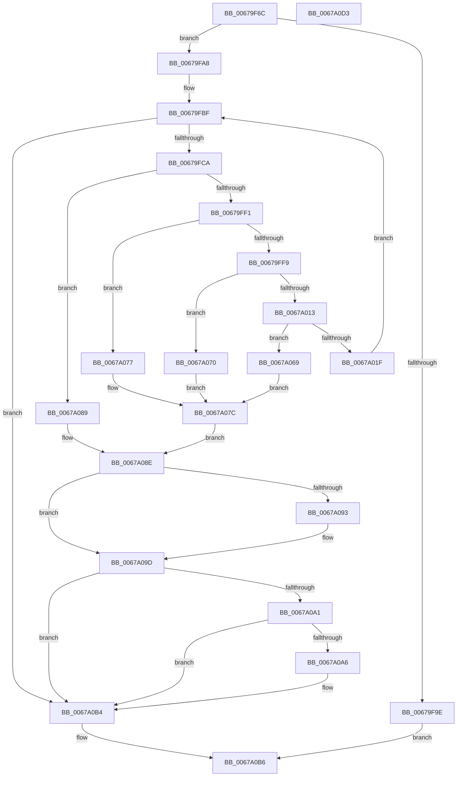

# MiRemoveBadPages

- RVA: `0x00679F6C`–`0x0067A0D4` (길이 `360` bytes)
- VA: `0x0000000140679F6C`
- 실행 섹션: `.text`
- PDB 이름 있음: `예`; PDB Function 태그: `아니요`
- unwind 정보 RVA: `0x00075C18`
- 디코드: `100`개 명령, `360/360` bytes 표시
- 미해석 바이트: `0` (있으면 어셈블리에 `.byte`로 보존)

> 이 문서는 커널 이미지의 기계어와 PDB 기호를 분석해 생성했습니다. 4번과 5번은 함수 원형과 자료형을 바이너리 사용 방식에서 추정한 C 해석이며 원본 소스 복구 결과는 아닙니다.

## 1. Dependencies

- 직접 호출 지점: **9**; 고유 호출 대상: **8**
- 직접 호출자로 확인된 함수: **1**
- RIP 상대 이미지 참조: **2**

### Outgoing calls
- `0x00679FD6` → [MiAllocatePool](../35/MiAllocatePool_function_0035B540.md) (function, `0x0035B540`)
- `0x00679FE1` → [MiSafeLockPage](../32/MiSafeLockPage_function_00321620.md) (function, `0x00321620`)
- `0x0067A016` → [MiIsPageOnBadList](../2B/MiIsPageOnBadList_function_002B1018.md) (function, `0x002B1018`)
- `0x0067A024` → [MiUnlinkPageFromBadList](../3B/MiUnlinkPageFromBadList_function_003BD620.md) (function, `0x003BD620`)
- `0x0067A035` → [MiSetPfnRemovalRequested](MiSetPfnRemovalRequested_function_0067A4D0.md) (function, `0x0067A4D0`)
- `0x0067A055` → [MiUnlockPage](../31/MiUnlockPage_function_0031A3E0.md) (function, `0x0031A3E0`)
- `0x0067A082` → [MiUnlockPage](../31/MiUnlockPage_function_0031A3E0.md) (function, `0x0031A3E0`)
- `0x0067A098` → [ExFreePoolWithTag](../../poolcode/B8/ExFreePoolWithTag_function_00B82870.md) (function, `0x00B82870`)
- `0x0067A0AF` → [MiReturnBadPagesToBadList](MiReturnBadPagesToBadList_function_0067A374.md) (function, `0x0067A374`)

### Direct callers
- [MmRemovePhysicalMemory](../../page/7F/MmRemovePhysicalMemory_function_007FB560.md) at `0x007FB623`

### Static image references
- `0x00679F88` → RVA `0x00FC6A88` (`ALMOSTRO`; read)
- `0x00679FFD` → RVA `0x00E30088` (`.data`; read)

## 2. Other-region calls and transfers

- 다른 실행 섹션으로 향하는 call: **1**
  - `0x0067A098` → [ExFreePoolWithTag](../../poolcode/B8/ExFreePoolWithTag_function_00B82870.md) (`.text` → `POOLCODE`)
- 별도 외부 분기/꼬리 이동을 확인하지 못했습니다.

## 3. Assembly (complete function range)

```asm
00679F6C  48 89 5C 24 08                  mov qword ptr [rsp + 8], rbx
00679F71  48 89 6C 24 10                  mov qword ptr [rsp + 0x10], rbp
00679F76  48 89 74 24 18                  mov qword ptr [rsp + 0x18], rsi
00679F7B  57                              push rdi
00679F7C  41 54                           push r12
00679F7E  41 55                           push r13
00679F80  41 56                           push r14
00679F82  41 57                           push r15
00679F84  48 83 EC 20                     sub rsp, 0x20
00679F88  48 F7 05 F5 CA 94 00 00 00 00 10  test qword ptr [rip + 0x94caf5], 0x10000000
00679F93  4D 8B E0                        mov r12, r8
00679F96  48 8B F2                        mov rsi, rdx
00679F99  4C 8B E9                        mov r13, rcx
00679F9C  75 0A                           jne 0x140679fa8
00679F9E  B8 02 00 00 C0                  mov eax, 0xc0000002
00679FA3  E9 0E 01 00 00                  jmp 0x14067a0b6
00679FA8  48 8D 3C 52                     lea rdi, [rdx + rdx*2]
00679FAC  48 C1 E7 04                     shl rdi, 4
00679FB0  48 B8 00 00 00 00 00 DE FF FF   movabs rax, 0xffffde0000000000
00679FBA  48 03 F8                        add rdi, rax
00679FBD  33 ED                           xor ebp, ebp
00679FBF  33 DB                           xor ebx, ebx
00679FC1  49 3B EC                        cmp rbp, r12
00679FC4  0F 83 EA 00 00 00               jae 0x14067a0b4
00679FCA  8D 53 20                        lea edx, [rbx + 0x20]
00679FCD  41 B8 4D 69 42 6C               mov r8d, 0x6c42694d
00679FD3  8D 4B 40                        lea ecx, [rbx + 0x40]
00679FD6  E8 65 15 CE FF                  call 0x14035b540
00679FDB  48 8B CE                        mov rcx, rsi
00679FDE  4C 8B F0                        mov r14, rax
00679FE1  E8 3A 76 CA FF                  call 0x140321620
00679FE6  44 8A F8                        mov r15b, al
00679FE9  3C 11                           cmp al, 0x11
00679FEB  0F 84 98 00 00 00               je 0x14067a089
00679FF1  48 0F BA 67 28 35               bt qword ptr [rdi + 0x28], 0x35
00679FF7  72 7E                           jb 0x14067a077
00679FF9  48 8B 47 28                     mov rax, qword ptr [rdi + 0x28]
00679FFD  48 8B 0D 84 60 7B 00            mov rcx, qword ptr [rip + 0x7b6084]
0067A004  48 C1 E8 2B                     shr rax, 0x2b
0067A008  25 FF 03 00 00                  and eax, 0x3ff
0067A00D  4C 39 2C C1                     cmp qword ptr [rcx + rax*8], r13
0067A011  75 5D                           jne 0x14067a070
0067A013  48 8B CF                        mov rcx, rdi
0067A016  E8 FD 6F C3 FF                  call 0x1402b1018
0067A01B  85 C0                           test eax, eax
0067A01D  74 4A                           je 0x14067a069
0067A01F  33 D2                           xor edx, edx
0067A021  48 8B CF                        mov rcx, rdi
0067A024  E8 F7 35 D4 FF                  call 0x1403bd620
0067A029  4D 8B CE                        mov r9, r14
0067A02C  8D 53 01                        lea edx, [rbx + 1]
0067A02F  45 33 C0                        xor r8d, r8d
0067A032  48 8B CF                        mov rcx, rdi
0067A035  E8 96 04 00 00                  call 0x14067a4d0
0067A03A  48 8B 47 18                     mov rax, qword ptr [rdi + 0x18]
0067A03E  48 B9 00 00 00 00 00 00 00 40   movabs rcx, 0x4000000000000000
0067A048  48 0B C1                        or rax, rcx
0067A04B  41 8A D7                        mov dl, r15b
0067A04E  48 8B CF                        mov rcx, rdi
0067A051  48 89 47 18                     mov qword ptr [rdi + 0x18], rax
0067A055  E8 86 03 CA FF                  call 0x14031a3e0
0067A05A  48 FF C5                        inc rbp
0067A05D  48 FF C6                        inc rsi
0067A060  48 83 C7 30                     add rdi, 0x30
0067A064  E9 56 FF FF FF                  jmp 0x140679fbf
0067A069  BB 76 04 00 C0                  mov ebx, 0xc0000476
0067A06E  EB 0C                           jmp 0x14067a07c
0067A070  BB 0B 06 00 C0                  mov ebx, 0xc000060b
0067A075  EB 05                           jmp 0x14067a07c
0067A077  BB EF 00 00 C0                  mov ebx, 0xc00000ef
0067A07C  41 8A D7                        mov dl, r15b
0067A07F  48 8B CF                        mov rcx, rdi
0067A082  E8 59 03 CA FF                  call 0x14031a3e0
0067A087  EB 05                           jmp 0x14067a08e
0067A089  BB EF 00 00 C0                  mov ebx, 0xc00000ef
0067A08E  4D 85 F6                        test r14, r14
0067A091  74 0A                           je 0x14067a09d
0067A093  33 D2                           xor edx, edx
0067A095  49 8B CE                        mov rcx, r14
0067A098  E8 D3 87 50 00                  call 0x140b82870
0067A09D  85 DB                           test ebx, ebx
0067A09F  79 13                           jns 0x14067a0b4
0067A0A1  48 85 ED                        test rbp, rbp
0067A0A4  74 0E                           je 0x14067a0b4
0067A0A6  48 2B F5                        sub rsi, rbp
0067A0A9  48 8B D5                        mov rdx, rbp
0067A0AC  48 8B CE                        mov rcx, rsi
0067A0AF  E8 C0 02 00 00                  call 0x14067a374
0067A0B4  8B C3                           mov eax, ebx
0067A0B6  48 8B 5C 24 50                  mov rbx, qword ptr [rsp + 0x50]
0067A0BB  48 8B 6C 24 58                  mov rbp, qword ptr [rsp + 0x58]
0067A0C0  48 8B 74 24 60                  mov rsi, qword ptr [rsp + 0x60]
0067A0C5  48 83 C4 20                     add rsp, 0x20
0067A0C9  41 5F                           pop r15
0067A0CB  41 5E                           pop r14
0067A0CD  41 5D                           pop r13
0067A0CF  41 5C                           pop r12
0067A0D1  5F                              pop rdi
0067A0D2  C3                              ret
0067A0D3  CC                              int3
```

## 4. C-style interpretation (structured pseudocode)

```c
__int64 __fastcall MiRemoveBadPages(__int64 a1, __int64 a2, __int64 a3)
{
    __int64 result;
    __int64 v_rbp;
    __int64 v_rbx;
    __int64 v_rdi;
    __int64 v_rsi;
    __int64 v_rsp;
    unsigned __int64 v_stack_p10;
    unsigned __int64 v_stack_p18;
    unsigned __int64 v_stack_p8;

    v_stack_p8 = v_rbx;
    v_stack_p10 = v_rbp;
    v_stack_p18 = v_rsi;
    v_rsp = (v_rsp) - (32);
    if (((*(unsigned __int64 *)(v_rip + 9751285)) & (0x10000000ULL)) != 0) goto loc_00679FA8;
    goto loc_0067A0B6;
loc_00679FA8:
    v_rdi = (a2 + a2 * 2) << (4);
    v_rdi = (v_rdi) + ((unsigned int)(0xC0000002ULL));
    v_rbp = 0;
loc_00679FBF:
    v_rbx = 0;
    if (0 >= a3) goto loc_0067A0B4;
    result = MiAllocatePool(v_rbx + 64, v_rbx + 32, (unsigned int)(0x6C42694DULL), a4);
    result = MiSafeLockPage(a2, v_rbx + 32, (unsigned int)(0x6C42694DULL), a4);
    if (((unsigned __int8)(result)) == 17) goto loc_0067A089;
    if (((unsigned __int8)(result)) < 17) goto loc_0067A077;
    result = (*(unsigned __int64 *)(v_rdi + 40)) >> (43);
    result = (unsigned int)((result) & (0x3FFULL));
    if ((*(unsigned __int64 *)(*(unsigned __int64 *)(v_rip + 8085636) + result * 8)) != a1) goto loc_0067A070;
    result = MiIsPageOnBadList(v_rdi, v_rbx + 32, (unsigned int)(0x6C42694DULL), a4);
    if ((unsigned int)(result) == 0) goto loc_0067A069;
    a2 = 0;
    result = MiUnlinkPageFromBadList(v_rdi, a2, (unsigned int)(0x6C42694DULL), a4);
    a3 = 0;
    result = MiSetPfnRemovalRequested(v_rdi, v_rbx + 1, a3, result);
    result = (*(unsigned __int64 *)(v_rdi + 24)) | (v_rdi);
    *(unsigned __int64 *)(v_rdi + 24) = result;
    result = MiUnlockPage(v_rdi, (unsigned __int8)((unsigned __int8)(result)), a3, result);
    v_rbp = (v_rbp) + 1;
    v_rsi = (a2) + 1;
    v_rdi = (v_rdi) + (48);
    goto loc_00679FBF;
loc_0067A069:
    goto loc_0067A07C;
loc_0067A070:
    goto loc_0067A07C;
loc_0067A077:
loc_0067A07C:
    result = MiUnlockPage(v_rdi, (unsigned __int8)((unsigned __int8)(result)), a3, result);
    goto loc_0067A08E;
loc_0067A089:
loc_0067A08E:
    if (result != 0) {
        a2 = 0;
        a1 = result;
        result = ExFreePoolWithTag(a1, a2, a3, result);
    }
    if (!sign_flag) goto loc_0067A0B4;
    if (v_rbp != 0) {
        v_rsi = (v_rsi) - (v_rbp);
        a2 = v_rbp;
        a1 = v_rsi;
        result = MiReturnBadPagesToBadList(a1, a2, a3, result);
    }
loc_0067A0B6:
    v_rsp = (v_rsp) + (32);
    return (unsigned int)((unsigned int)((unsigned int)(0xC00000EFULL)));
}
```

## 5. (Beta) C Style

```c
int64_t MiRemoveBadPages(int64_t Arg1, void *Arg2, int64_t Arg3)
{
    uint8_t *arg2 = (uint8_t *)Arg2;

    int64_t result;
    int64_t local_rbp;
    int64_t local_rbx;
    int64_t local_rdi;
    int64_t local_rsi;
    int64_t local_rsp;
    uint64_t v_stack_p10;
    uint64_t v_stack_p18;
    uint64_t v_stack_p8;

    v_stack_p8 = local_rbx;
    v_stack_p10 = local_rbp;
    v_stack_p18 = local_rsi;
    local_rsp = (local_rsp) - (32);
    if (((*(uint64_t *)(v_rip + 0x94CAF5)) & (0x10000000ULL)) != 0) goto loc_00679FA8;
    goto loc_0067A0B6;
loc_00679FA8:
    local_rdi = (Arg2 + Arg2 * 2) << (4);
    local_rdi = (local_rdi) + ((uint32_t)(0xC0000002ULL));
    local_rbp = 0;
loc_00679FBF:
    local_rbx = 0;
    if (0 >= Arg3) goto loc_0067A0B4;
    result = MiAllocatePool(local_rbx + 64, local_rbx + 32, (uint32_t)(0x6C42694DULL), a4);
    result = MiSafeLockPage(Arg2, local_rbx + 32, (uint32_t)(0x6C42694DULL), a4);
    if (((uint8_t)(result)) == 17) goto loc_0067A089;
    if (((uint8_t)(result)) < 17) goto loc_0067A077;
    result = (*(uint64_t *)(local_rdi + 0x28)) >> (43);
    result = (uint32_t)((result) & (0x3FFULL));
    if ((*(uint64_t *)(*(uint64_t *)(v_rip + 0x7B6084) + result * 8)) != Arg1) goto loc_0067A070;
    result = MiIsPageOnBadList(local_rdi, local_rbx + 32, (uint32_t)(0x6C42694DULL), a4);
    if ((uint32_t)(result) == 0) goto loc_0067A069;
    Arg2 = 0;
    result = MiUnlinkPageFromBadList(local_rdi, Arg2, (uint32_t)(0x6C42694DULL), a4);
    Arg3 = 0;
    result = MiSetPfnRemovalRequested(local_rdi, local_rbx + 1, Arg3, result);
    result = (*(uint64_t *)(local_rdi + 0x18)) | (local_rdi);
    *(uint64_t *)(local_rdi + 0x18) = result;
    result = MiUnlockPage(local_rdi, (uint8_t)((uint8_t)(result)), Arg3, result);
    local_rbp = (local_rbp) + 1;
    local_rsi = (Arg2) + 1;
    local_rdi = (local_rdi) + (48);
    goto loc_00679FBF;
loc_0067A069:
    goto loc_0067A07C;
loc_0067A070:
    goto loc_0067A07C;
loc_0067A077:
loc_0067A07C:
    result = MiUnlockPage(local_rdi, (uint8_t)((uint8_t)(result)), Arg3, result);
    goto loc_0067A08E;
loc_0067A089:
loc_0067A08E:
    if (result != 0) {
        Arg2 = 0;
        Arg1 = result;
        result = ExFreePoolWithTag(Arg1, Arg2, Arg3, result);
    }
    if (!sign_flag) goto loc_0067A0B4;
    if (local_rbp != 0) {
        local_rsi = (local_rsi) - (local_rbp);
        Arg2 = local_rbp;
        Arg1 = local_rsi;
        result = MiReturnBadPagesToBadList(Arg1, Arg2, Arg3, result);
    }
loc_0067A0B6:
    local_rsp = (local_rsp) + (32);
    return (uint32_t)((uint32_t)((uint32_t)(0xC00000EFULL)));
}
```

### 관측된 메모리 오프셋

구조체 형식이 확인되지 않은 접근은 인자 기준의 오프셋으로만 기록했습니다.

| 기준 인자 | 오프셋 표현 | 폭 (bit) | 접근 |
|---|---:|---:|---|
| `Arg2` | `+ 0x0 + rdx*2` | `64` | `R` |

## 6. Execution-region graph

[열기: 2D/3D 그래프와 함수 탐색 컨트롤 패널](../../../control-panel.html?section=text&rva=0x00679F6C&view=graph)

- 2D 그래프는 위에서 아래로 흐르고, 3D 그래프는 빈 공간을 드래그해 회전합니다. Shift+드래그는 이동, 휠은 확대·축소, 함수 노드 선택은 대상 보고서 이동입니다.

### Static fallback


