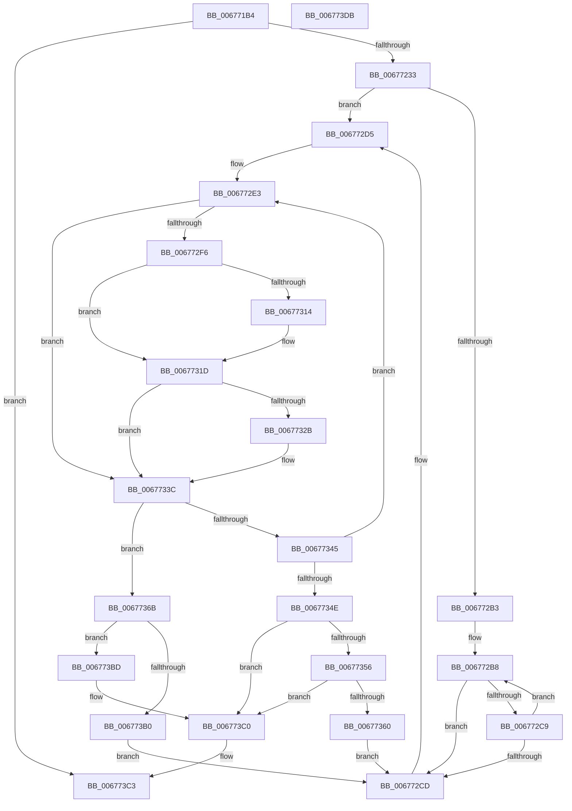

# MiRemoveHugeRangeAnyColor

- RVA: `0x006771B4`–`0x006773DC` (길이 `552` bytes)
- VA: `0x00000001406771B4`
- 실행 섹션: `.text`
- PDB 이름 있음: `예`; PDB Function 태그: `아니요`
- unwind 정보 RVA: `0x000BF840`
- 디코드: `154`개 명령, `552/552` bytes 표시
- 미해석 바이트: `0` (있으면 어셈블리에 `.byte`로 보존)

> 이 문서는 커널 이미지의 기계어와 PDB 기호를 분석해 생성했습니다. 4번과 5번은 함수 원형과 자료형을 바이너리 사용 방식에서 추정한 C 해석이며 원본 소스 복구 결과는 아닙니다.

## 1. Dependencies

- 직접 호출 지점: **2**; 고유 호출 대상: **2**
- 직접 호출자로 확인된 함수: **1**
- RIP 상대 이미지 참조: **3**

### Outgoing calls
- `0x0067724E` → [MiGetColorHeadHugeRangeBase](../43/MiGetColorHeadHugeRangeBase_function_00437160.md) (function, `0x00437160`)
- `0x006773A6` → [MiGetPerfectColorHeadHugeRange](MiGetPerfectColorHeadHugeRange_function_00675C08.md) (function, `0x00675C08`)

### Direct callers
- [MiGetBestHugeRangeFromNode](MiGetBestHugeRangeFromNode_function_00675710.md) at `0x006757B1`
- [MiGetBestHugeRangeFromNode](MiGetBestHugeRangeFromNode_function_00675710.md) at `0x006757D9`
- [MiGetBestHugeRangeFromNode](MiGetBestHugeRangeFromNode_function_00675710.md) at `0x006757EF`

### Static image references
- `0x006771DD` → RVA `0x00011038` (`.rdata`; read)
- `0x006771E7` → RVA `0x00010860` (`.rdata`; read)
- `0x00677257` → RVA `0x00E2CB40` (`.data`; read)

## 2. Other-region calls and transfers

- 다른 실행 섹션으로 향하는 call: **0**
- 별도 외부 분기/꼬리 이동을 확인하지 못했습니다.

## 3. Assembly (complete function range)

```asm
006771B4  48 89 5C 24 20                  mov qword ptr [rsp + 0x20], rbx
006771B9  55                              push rbp
006771BA  56                              push rsi
006771BB  57                              push rdi
006771BC  41 54                           push r12
006771BE  41 55                           push r13
006771C0  41 56                           push r14
006771C2  41 57                           push r15
006771C4  48 83 EC 50                     sub rsp, 0x50
006771C8  33 F6                           xor esi, esi
006771CA  8B DA                           mov ebx, edx
006771CC  41 0F BA E0 04                  bt r8d, 4
006771D1  89 74 24 44                     mov dword ptr [rsp + 0x44], esi
006771D5  41 8B F8                        mov edi, r8d
006771D8  48 89 74 24 48                  mov qword ptr [rsp + 0x48], rsi
006771DD  4C 8D 05 54 9E 99 FF            lea r8, [rip - 0x6661ac]
006771E4  44 8B DA                        mov r11d, edx
006771E7  48 8D 05 72 96 99 FF            lea rax, [rip - 0x66698e]
006771EE  49 0F 43 C0                     cmovae rax, r8
006771F2  0F BA E7 04                     bt edi, 4
006771F6  48 89 44 24 30                  mov qword ptr [rsp + 0x30], rax
006771FB  8B C6                           mov eax, esi
006771FD  0F 93 C0                        setae al
00677200  8B E8                           mov ebp, eax
00677202  8B C2                           mov eax, edx
00677204  48 C1 E8 09                     shr rax, 9
00677208  83 E0 3F                        and eax, 0x3f
0067720B  4C 69 D0 80 DF 00 00            imul r10, rax, 0xdf80
00677212  8B C2                           mov eax, edx
00677214  4C 03 51 10                     add r10, qword ptr [rcx + 0x10]
00677218  C1 E8 08                        shr eax, 8
0067721B  83 E0 01                        and eax, 1
0067721E  48 8D 04 68                     lea rax, [rax + rbp*2]
00677222  49 8B 84 C2 98 3A 00 00         mov rax, qword ptr [r10 + rax*8 + 0x3a98]
0067722A  48 85 C0                        test rax, rax
0067722D  0F 84 90 01 00 00               je 0x1406773c3
00677233  44 8B C5                        mov r8d, ebp
00677236  4C 89 54 24 20                  mov qword ptr [rsp + 0x20], r10
0067723B  49 8B CA                        mov rcx, r10
0067723E  89 7C 24 40                     mov dword ptr [rsp + 0x40], edi
00677242  89 5C 24 3C                     mov dword ptr [rsp + 0x3c], ebx
00677246  C7 44 24 38 01 00 00 00         mov dword ptr [rsp + 0x38], 1
0067724E  E8 0D FF DB FF                  call 0x140437160
00677253  49 C1 EB 10                     shr r11, 0x10
00677257  48 8D 0D E2 58 7B 00            lea rcx, [rip + 0x7b58e2]
0067725E  41 83 E3 03                     and r11d, 3
00677262  48 89 44 24 28                  mov qword ptr [rsp + 0x28], rax
00677267  48 8D 85 AC 03 00 00            lea rax, [rbp + 0x3ac]
0067726E  89 B4 24 98 00 00 00            mov dword ptr [rsp + 0x98], esi
00677275  48 C1 E0 04                     shl rax, 4
00677279  4C 8B EE                        mov r13, rsi
0067727C  49 03 C2                        add rax, r10
0067727F  48 8B EE                        mov rbp, rsi
00677282  42 8B 94 99 80 11 00 00         mov edx, dword ptr [rcx + r11*4 + 0x1180]
0067728A  44 8B FA                        mov r15d, edx
0067728D  44 0F B6 DB                     movzx r11d, bl
00677291  4C 8B E6                        mov r12, rsi
00677294  44 89 9C 24 A0 00 00 00         mov dword ptr [rsp + 0xa0], r11d
0067729C  45 8B F3                        mov r14d, r11d
0067729F  48 89 84 24 90 00 00 00         mov qword ptr [rsp + 0x90], rax
006772A7  89 94 24 98 00 00 00            mov dword ptr [rsp + 0x98], edx
006772AE  83 E7 40                        and edi, 0x40
006772B1  74 22                           je 0x1406772d5
006772B3  8B CB                           mov ecx, ebx
006772B5  83 E1 0F                        and ecx, 0xf
006772B8  8B C1                           mov eax, ecx
006772BA  83 C1 10                        add ecx, 0x10
006772BD  83 E0 3F                        and eax, 0x3f
006772C0  49 0F AB C4                     bts r12, rax
006772C4  83 F9 40                        cmp ecx, 0x40
006772C7  73 04                           jae 0x1406772cd
006772C9  3B CA                           cmp ecx, edx
006772CB  72 EB                           jb 0x1406772b8
006772CD  48 8B 84 24 90 00 00 00         mov rax, qword ptr [rsp + 0x90]
006772D5  4C 8B 50 08                     mov r10, qword ptr [rax + 8]
006772D9  45 8B C7                        mov r8d, r15d
006772DC  41 83 E0 3F                     and r8d, 0x3f
006772E0  45 8B CF                        mov r9d, r15d
006772E3  41 8B C6                        mov eax, r14d
006772E6  48 C1 E8 06                     shr rax, 6
006772EA  41 8B D6                        mov edx, r14d
006772ED  49 8D 0C C2                     lea rcx, [r10 + rax*8]
006772F1  4C 3B E9                        cmp r13, rcx
006772F4  74 46                           je 0x14067733c
006772F6  4C 8B E9                        mov r13, rcx
006772F9  BD 01 00 00 00                  mov ebp, 1
006772FE  8A CA                           mov cl, dl
00677300  80 E1 3F                        and cl, 0x3f
00677303  48 D3 E5                        shl rbp, cl
00677306  48 FF CD                        dec rbp
00677309  48 F7 D5                        not rbp
0067730C  49 23 6D 00                     and rbp, qword ptr [r13]
00677310  85 FF                           test edi, edi
00677312  74 09                           je 0x14067731d
00677314  49 8B C4                        mov rax, r12
00677317  48 F7 D0                        not rax
0067731A  48 23 E8                        and rbp, rax
0067731D  49 8B C1                        mov rax, r9
00677320  48 33 C2                        xor rax, rdx
00677323  48 A9 C0 FF FF FF               test rax, -0x40
00677329  75 11                           jne 0x14067733c
0067732B  49 8B C8                        mov rcx, r8
0067732E  B8 01 00 00 00                  mov eax, 1
00677333  48 D3 E0                        shl rax, cl
00677336  48 FF C8                        dec rax
00677339  48 23 E8                        and rbp, rax
0067733C  41 83 E6 C0                     and r14d, 0xffffffc0
00677340  48 85 ED                        test rbp, rbp
00677343  75 26                           jne 0x14067736b
00677345  41 83 C6 40                     add r14d, 0x40
00677349  45 3B F7                        cmp r14d, r15d
0067734C  72 95                           jb 0x1406772e3
0067734E  4C 8B EE                        mov r13, rsi
00677351  45 85 DB                        test r11d, r11d
00677354  74 6A                           je 0x1406773c0
00677356  44 3B BC 24 98 00 00 00         cmp r15d, dword ptr [rsp + 0x98]
0067735E  75 60                           jne 0x1406773c0
00677360  45 8B FB                        mov r15d, r11d
00677363  44 8B F6                        mov r14d, esi
00677366  E9 62 FF FF FF                  jmp 0x1406772cd
0067736B  4C 0F BC C5                     bsf r8, rbp
0067736F  33 D2                           xor edx, edx
00677371  4C 8D 0D C8 57 7B 00            lea r9, [rip + 0x7b57c8]
00677378  8B CB                           mov ecx, ebx
0067737A  45 03 F0                        add r14d, r8d
0067737D  48 C1 E9 10                     shr rcx, 0x10
00677381  41 8B C6                        mov eax, r14d
00677384  83 E1 03                        and ecx, 3
00677387  41 F7 B4 89 80 11 00 00         div dword ptr [r9 + rcx*4 + 0x1180]
0067738F  48 8D 4C 24 20                  lea rcx, [rsp + 0x20]
00677394  33 D3                           xor edx, ebx
00677396  0F B6 C2                        movzx eax, dl
00677399  33 D8                           xor ebx, eax
0067739B  41 8B C0                        mov eax, r8d
0067739E  48 0F B3 C5                     btr rbp, rax
006773A2  89 5C 24 3C                     mov dword ptr [rsp + 0x3c], ebx
006773A6  E8 5D E8 FF FF                  call 0x140675c08
006773AB  48 85 C0                        test rax, rax
006773AE  75 0D                           jne 0x1406773bd
006773B0  44 8B 9C 24 A0 00 00 00         mov r11d, dword ptr [rsp + 0xa0]
006773B8  E9 10 FF FF FF                  jmp 0x1406772cd
006773BD  48 8B F0                        mov rsi, rax
006773C0  48 8B C6                        mov rax, rsi
006773C3  48 8B 9C 24 A8 00 00 00         mov rbx, qword ptr [rsp + 0xa8]
006773CB  48 83 C4 50                     add rsp, 0x50
006773CF  41 5F                           pop r15
006773D1  41 5E                           pop r14
006773D3  41 5D                           pop r13
006773D5  41 5C                           pop r12
006773D7  5F                              pop rdi
006773D8  5E                              pop rsi
006773D9  5D                              pop rbp
006773DA  C3                              ret
006773DB  CC                              int3
```

## 4. C-style interpretation (structured pseudocode)

```c
__int64 __fastcall MiRemoveHugeRangeAnyColor(__int64 a1, int a2, int a3)
{
    __int64 result;
    __int64 v_r10;
    __int64 v_r11;
    __int64 v_r14;
    __int64 v_rbp;
    __int64 v_rbx;
    __int64 v_rdi;
    __int64 v_rsi;
    __int64 v_rsp;
    unsigned __int64 v_stack_m40;
    unsigned int v_stack_m44;
    unsigned int v_stack_m48;
    unsigned int v_stack_m4C;
    unsigned int v_stack_m50;
    unsigned __int64 v_stack_m58;
    unsigned __int64 v_stack_m60;
    unsigned __int64 v_stack_m68;
    unsigned int v_stack_p10;
    unsigned int v_stack_p18;
    unsigned __int64 v_stack_p20;
    unsigned __int64 v_stack_p8;

    v_stack_p20 = v_rbx;
    v_rsp = (v_rsp) - (80);
    v_rsi = 0;
    v_stack_m44 = 0;
    v_stack_m40 = 0;
    result = v_rip - 6711694;
    if (condition_is_above_or_equal) { result = v_rip - 6709676; }
    v_stack_m58 = result;
    result = (condition_is_above_or_equal) ? 1 : 0;
    result = ((unsigned int)(a2)) >> (9);
    result = (unsigned int)((result) & (63));
    v_r10 = (v_r10) * (result);
    v_r10 = (v_r10) + (*(unsigned __int64 *)(a1 + 16));
    result = (unsigned int)(((unsigned int)(a2)) >> (8));
    result = (unsigned int)((result) & (1));
    if (*(unsigned __int64 *)(v_r10 + result + (unsigned int)((unsigned int)(result)) * 2 * 8 + 15000) == 0) goto loc_006773C3;
    v_stack_m68 = v_r10;
    v_stack_m48 = (unsigned int)((unsigned int)(a3));
    v_stack_m4C = (unsigned int)((unsigned int)(a2));
    v_stack_m50 = 1;
    result = MiGetColorHeadHugeRangeBase(v_r10, a2, (unsigned int)((unsigned int)((unsigned int)((unsigned int)(result)))), a4);
    v_r11 = ((unsigned int)(a2)) >> (16);
    v_r11 = (unsigned int)((v_r11) & (3));
    v_stack_m60 = result;
    v_stack_p10 = 0;
    result = ((unsigned int)((unsigned int)(result)) + 940) << (4);
    result = (result) + (v_r10);
    v_stack_p18 = (unsigned int)((unsigned __int8)((unsigned int)(a2)));
    v_stack_p8 = result;
    v_stack_p10 = (unsigned int)((unsigned int)(*(unsigned int *)(v_rip + 8083682 + v_r11 * 4 + 4480)));
    v_rdi = (unsigned int)(((unsigned int)(a3)) & (64));
    if (condition_is_equal) goto loc_006772D5;
    a1 = (unsigned int)(((unsigned int)((unsigned int)((unsigned int)(a2)))) & (15));
loc_006772B8:
    a1 = (unsigned int)((a1) + (16));
    result = (unsigned int)(((unsigned int)((unsigned int)(a1))) & (63));
    if (((unsigned int)(a1)) >= 64) goto loc_006772CD;
    if (((unsigned int)(a1)) < ((unsigned int)((unsigned int)(*(unsigned int *)(v_rip + 8083682 + v_r11 * 4 + 4480))))) goto loc_006772B8;
loc_006772CD:
loc_006772D5:
    a3 = (unsigned int)(((unsigned int)((unsigned int)((unsigned int)((unsigned int)((unsigned int)(*(unsigned int *)(v_rip + 8083682 + v_r11 * 4 + 4480))))))) & (63));
loc_006772E3:
    result = ((unsigned int)((unsigned int)((unsigned int)((unsigned int)((unsigned __int8)((unsigned int)(a2))))))) >> (6);
    if (0 == (*(unsigned __int64 *)(v_stack_p8 + 8) + result * 8)) goto loc_0067733C;
    a1 = (unsigned __int8)(((unsigned __int8)((unsigned int)((unsigned int)((unsigned int)((unsigned int)((unsigned __int8)((unsigned int)(a2)))))))) & (63));
    v_rbp = (1) << ((unsigned __int8)(a1));
    v_rbp = (v_rbp) - 1;
    v_rbp = ~(v_rbp);
    v_rbp = (v_rbp) & (*(unsigned __int64 *)(*(unsigned __int64 *)(v_stack_p8 + 8) + result * 8));
    if ((unsigned int)(v_rdi) != 0) {
        result = 0;
        result = ~(result);
        v_rbp = (v_rbp) & (result);
    }
    result = ((unsigned int)((unsigned int)((unsigned int)((unsigned int)((unsigned int)(*(unsigned int *)(v_rip + 8083682 + v_r11 * 4 + 4480))))))) ^ ((unsigned int)((unsigned int)((unsigned int)((unsigned int)((unsigned __int8)((unsigned int)(a2)))))));
    if (((result) & (-64)) == 0) {
        a1 = a3;
        result = 1;
        result = (result) << ((unsigned __int8)(a1));
        result = (result) - 1;
        v_rbp = (v_rbp) & (result);
    }
    v_r14 = (unsigned int)(((unsigned int)((unsigned int)((unsigned __int8)((unsigned int)(a2))))) & (0xFFFFFFC0ULL));
    if (v_rbp != 0) goto loc_0067736B;
    v_r14 = (unsigned int)((v_r14) + (64));
    if (((unsigned int)(v_r14)) < ((unsigned int)((unsigned int)((unsigned int)((unsigned int)(*(unsigned int *)(v_rip + 8083682 + v_r11 * 4 + 4480))))))) goto loc_006772E3;
    if ((unsigned int)((unsigned __int8)((unsigned int)(a2))) == 0) goto loc_006773C0;
    if (((unsigned int)((unsigned int)((unsigned int)((unsigned int)(*(unsigned int *)(v_rip + 8083682 + v_r11 * 4 + 4480)))))) != v_stack_p10) goto loc_006773C0;
    goto loc_006772CD;
loc_0067736B:
    a2 = 0;
    v_r14 = (unsigned int)((0) + (a3));
    a1 = ((unsigned int)((unsigned int)((unsigned int)(a2)))) >> (16);
    a1 = (unsigned int)((a1) & (3));
    a2 = (unsigned int)((a2) ^ ((unsigned int)((unsigned int)(a2))));
    v_rbx = (unsigned int)(((unsigned int)(a2)) ^ ((unsigned int)((unsigned __int8)(a2))));
    v_stack_m4C = (unsigned int)(v_rbx);
    result = MiGetPerfectColorHeadHugeRange(v_stack_m68, a2, a3, v_rip + 8083400);
    if (result != 0) goto loc_006773BD;
    goto loc_006772CD;
loc_006773BD:
loc_006773C0:
loc_006773C3:
    v_rsp = (v_rsp) + (80);
    return result;
}
```

## 5. (Beta) C Style

```c
int64_t MiRemoveHugeRangeAnyColor(void *Arg1, int32_t Arg2, int32_t Arg3)
{
    uint8_t *arg1 = (uint8_t *)Arg1;

    int64_t result;
    int64_t local_r10;
    int64_t local_r11;
    int64_t local_r14;
    int64_t local_rbp;
    int64_t local_rbx;
    int64_t local_rdi;
    int64_t local_rsi;
    int64_t local_rsp;
    uint64_t v_stack_m40;
    uint32_t v_stack_m44;
    uint32_t v_stack_m48;
    uint32_t v_stack_m4C;
    uint32_t v_stack_m50;
    uint64_t v_stack_m58;
    uint64_t v_stack_m60;
    uint64_t v_stack_m68;
    uint32_t v_stack_p10;
    uint32_t v_stack_p18;
    uint64_t v_stack_p20;
    uint64_t v_stack_p8;

    v_stack_p20 = local_rbx;
    local_rsp = (local_rsp) - (80);
    local_rsi = 0;
    v_stack_m44 = 0;
    v_stack_m40 = 0;
    result = v_rip - 6711694;
    if (condition_is_above_or_equal) { result = v_rip - 6709676; }
    v_stack_m58 = result;
    result = (condition_is_above_or_equal) ? 1 : 0;
    result = ((uint32_t)(Arg2)) >> (9);
    result = (uint32_t)((result) & (63));
    local_r10 = (local_r10) * (result);
    local_r10 = (local_r10) + (*(uint64_t *)(arg1 + 0x10));
    result = (uint32_t)(((uint32_t)(Arg2)) >> (8));
    result = (uint32_t)((result) & (1));
    if (*(uint64_t *)(local_r10 + result + (uint32_t)((uint32_t)(result)) * 2 * 8 + 0x3A98) == 0) goto loc_006773C3;
    v_stack_m68 = local_r10;
    v_stack_m48 = (uint32_t)((uint32_t)(Arg3));
    v_stack_m4C = (uint32_t)((uint32_t)(Arg2));
    v_stack_m50 = 1;
    result = MiGetColorHeadHugeRangeBase(local_r10, Arg2, (uint32_t)((uint32_t)((uint32_t)((uint32_t)(result)))), a4);
    local_r11 = ((uint32_t)(Arg2)) >> (16);
    local_r11 = (uint32_t)((local_r11) & (3));
    v_stack_m60 = result;
    v_stack_p10 = 0;
    result = ((uint32_t)((uint32_t)(result)) + 940) << (4);
    result = (result) + (local_r10);
    v_stack_p18 = (uint32_t)((uint8_t)((uint32_t)(Arg2)));
    v_stack_p8 = result;
    v_stack_p10 = (uint32_t)((uint32_t)(*(uint32_t *)(v_rip + 0x7B58E2 + local_r11 * 4 + 0x1180)));
    local_rdi = (uint32_t)(((uint32_t)(Arg3)) & (64));
    if (condition_is_equal) goto loc_006772D5;
    Arg1 = (uint32_t)(((uint32_t)((uint32_t)((uint32_t)(Arg2)))) & (15));
loc_006772B8:
    Arg1 = (uint32_t)((Arg1) + (16));
    result = (uint32_t)(((uint32_t)((uint32_t)(Arg1))) & (63));
    if (((uint32_t)(Arg1)) >= 64) goto loc_006772CD;
    if (((uint32_t)(Arg1)) < ((uint32_t)((uint32_t)(*(uint32_t *)(v_rip + 0x7B58E2 + local_r11 * 4 + 0x1180))))) goto loc_006772B8;
loc_006772CD:
loc_006772D5:
    Arg3 = (uint32_t)(((uint32_t)((uint32_t)((uint32_t)((uint32_t)((uint32_t)(*(uint32_t *)(v_rip + 0x7B58E2 + local_r11 * 4 + 0x1180))))))) & (63));
loc_006772E3:
    result = ((uint32_t)((uint32_t)((uint32_t)((uint32_t)((uint8_t)((uint32_t)(Arg2))))))) >> (6);
    if (0 == (*(uint64_t *)(v_stack_p8 + 0x8) + result * 8)) goto loc_0067733C;
    Arg1 = (uint8_t)(((uint8_t)((uint32_t)((uint32_t)((uint32_t)((uint32_t)((uint8_t)((uint32_t)(Arg2)))))))) & (63));
    local_rbp = (1) << ((uint8_t)(Arg1));
    local_rbp = (local_rbp) - 1;
    local_rbp = ~(local_rbp);
    local_rbp = (local_rbp) & (*(uint64_t *)(*(uint64_t *)(v_stack_p8 + 0x8) + result * 8));
    if ((uint32_t)(local_rdi) != 0) {
        result = 0;
        result = ~(result);
        local_rbp = (local_rbp) & (result);
    }
    result = ((uint32_t)((uint32_t)((uint32_t)((uint32_t)((uint32_t)(*(uint32_t *)(v_rip + 0x7B58E2 + local_r11 * 4 + 0x1180))))))) ^ ((uint32_t)((uint32_t)((uint32_t)((uint32_t)((uint8_t)((uint32_t)(Arg2)))))));
    if (((result) & (-64)) == 0) {
        Arg1 = Arg3;
        result = 1;
        result = (result) << ((uint8_t)(Arg1));
        result = (result) - 1;
        local_rbp = (local_rbp) & (result);
    }
    local_r14 = (uint32_t)(((uint32_t)((uint32_t)((uint8_t)((uint32_t)(Arg2))))) & (0xFFFFFFC0ULL));
    if (local_rbp != 0) goto loc_0067736B;
    local_r14 = (uint32_t)((local_r14) + (64));
    if (((uint32_t)(local_r14)) < ((uint32_t)((uint32_t)((uint32_t)((uint32_t)(*(uint32_t *)(v_rip + 0x7B58E2 + local_r11 * 4 + 0x1180))))))) goto loc_006772E3;
    if ((uint32_t)((uint8_t)((uint32_t)(Arg2))) == 0) goto loc_006773C0;
    if (((uint32_t)((uint32_t)((uint32_t)((uint32_t)(*(uint32_t *)(v_rip + 0x7B58E2 + local_r11 * 4 + 0x1180)))))) != v_stack_p10) goto loc_006773C0;
    goto loc_006772CD;
loc_0067736B:
    Arg2 = 0;
    local_r14 = (uint32_t)((0) + (Arg3));
    Arg1 = ((uint32_t)((uint32_t)((uint32_t)(Arg2)))) >> (16);
    Arg1 = (uint32_t)((Arg1) & (3));
    Arg2 = (uint32_t)((Arg2) ^ ((uint32_t)((uint32_t)(Arg2))));
    local_rbx = (uint32_t)(((uint32_t)(Arg2)) ^ ((uint32_t)((uint8_t)(Arg2))));
    v_stack_m4C = (uint32_t)(local_rbx);
    result = MiGetPerfectColorHeadHugeRange(v_stack_m68, Arg2, Arg3, v_rip + 8083400);
    if (result != 0) goto loc_006773BD;
    goto loc_006772CD;
loc_006773BD:
loc_006773C0:
loc_006773C3:
    local_rsp = (local_rsp) + (80);
    return result;
}
```

### 관측된 메모리 오프셋

구조체 형식이 확인되지 않은 접근은 인자 기준의 오프셋으로만 기록했습니다.

| 기준 인자 | 오프셋 표현 | 폭 (bit) | 접근 |
|---|---:|---:|---|
| `Arg1` | `+ 0x10` | `64` | `R` |

## 6. Execution-region graph

[열기: 2D/3D 그래프와 함수 탐색 컨트롤 패널](../../../control-panel.html?section=text&rva=0x006771B4&view=graph)

- 2D 그래프는 위에서 아래로 흐르고, 3D 그래프는 빈 공간을 드래그해 회전합니다. Shift+드래그는 이동, 휠은 확대·축소, 함수 노드 선택은 대상 보고서 이동입니다.

### Static fallback


