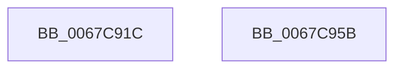

# MiRemoveIoPageExclusion

- RVA: `0x0067C91C`–`0x0067C95C` (길이 `64` bytes)
- VA: `0x000000014067C91C`
- 실행 섹션: `.text`
- PDB 이름 있음: `예`; PDB Function 태그: `아니요`
- unwind 정보 RVA: `0x0005CAAC`
- 디코드: `18`개 명령, `64/64` bytes 표시
- 미해석 바이트: `0` (있으면 어셈블리에 `.byte`로 보존)

> 이 문서는 커널 이미지의 기계어와 PDB 기호를 분석해 생성했습니다. 4번과 5번은 함수 원형과 자료형을 바이너리 사용 방식에서 추정한 C 해석이며 원본 소스 복구 결과는 아닙니다.

## 1. Dependencies

- 직접 호출 지점: **3**; 고유 호출 대상: **3**
- 직접 호출자로 확인된 함수: **1**
- RIP 상대 이미지 참조: **1**

### Outgoing calls
- `0x0067C92E` → [MiLockIoPfnTree](../2A/MiLockIoPfnTree_function_002AC8A4.md) (function, `0x002AC8A4`)
- `0x0067C93F` → [RtlAvlRemoveNode](../29/RtlAvlRemoveNode_function_00296650.md) (function, `0x00296650`)
- `0x0067C94B` → [MiUnlockIoPfnTree](../2A/MiUnlockIoPfnTree_function_002AC7F8.md) (function, `0x002AC7F8`)

### Direct callers
- [MiMapNewPfns](../../page/7F/MiMapNewPfns_function_007FA63C.md) at `0x007FA820`

### Static image references
- `0x0067C936` → RVA `0x00E37308` (`.data`; read)

## 2. Other-region calls and transfers

- 다른 실행 섹션으로 향하는 call: **0**
- 별도 외부 분기/꼬리 이동을 확인하지 못했습니다.

## 3. Assembly (complete function range)

```asm
0067C91C  48 89 5C 24 08                  mov qword ptr [rsp + 8], rbx
0067C921  57                              push rdi
0067C922  48 83 EC 20                     sub rsp, 0x20
0067C926  48 8B F9                        mov rdi, rcx
0067C929  B9 02 00 00 00                  mov ecx, 2
0067C92E  E8 71 FF C2 FF                  call 0x1402ac8a4
0067C933  48 8B D7                        mov rdx, rdi
0067C936  48 8D 0D CB A9 7B 00            lea rcx, [rip + 0x7ba9cb]
0067C93D  8A D8                           mov bl, al
0067C93F  E8 0C 9D C1 FF                  call 0x140296650
0067C944  BA 02 00 00 00                  mov edx, 2
0067C949  8A CB                           mov cl, bl
0067C94B  E8 A8 FE C2 FF                  call 0x1402ac7f8
0067C950  48 8B 5C 24 30                  mov rbx, qword ptr [rsp + 0x30]
0067C955  48 83 C4 20                     add rsp, 0x20
0067C959  5F                              pop rdi
0067C95A  C3                              ret
0067C95B  CC                              int3
```

## 4. C-style interpretation (structured pseudocode)

```c
__int64 __fastcall MiRemoveIoPageExclusion(__int64 a1)
{
    __int64 result;
    __int64 v_rsp;
    unsigned __int64 v_stack_p8;

    v_stack_p8 = v_rbx;
    v_rsp = (v_rsp) - (32);
    result = MiLockIoPfnTree(2, a2, a3, a4);
    result = RtlAvlRemoveNode(v_rip + 8104395, a1, a3, a4);
    result = MiUnlockIoPfnTree((unsigned __int8)((unsigned __int8)(result)), 2, a3, a4);
    v_rsp = (v_rsp) + (32);
    return result;
}
```

## 5. (Beta) C Style

```c
int64_t MiRemoveIoPageExclusion(int64_t Arg1)
{
    int64_t result;
    int64_t local_rsp;
    uint64_t v_stack_p8;

    v_stack_p8 = local_rbx;
    local_rsp = (local_rsp) - (32);
    result = MiLockIoPfnTree(2, a2, a3, a4);
    result = RtlAvlRemoveNode(v_rip + 8104395, Arg1, a3, a4);
    result = MiUnlockIoPfnTree((uint8_t)((uint8_t)(result)), 2, a3, a4);
    local_rsp = (local_rsp) + (32);
    return result;
}
```

## 6. Execution-region graph

[열기: 2D/3D 그래프와 함수 탐색 컨트롤 패널](../../../control-panel.html?section=text&rva=0x0067C91C&view=graph)

- 2D 그래프는 위에서 아래로 흐르고, 3D 그래프는 빈 공간을 드래그해 회전합니다. Shift+드래그는 이동, 휠은 확대·축소, 함수 노드 선택은 대상 보고서 이동입니다.

### Static fallback


