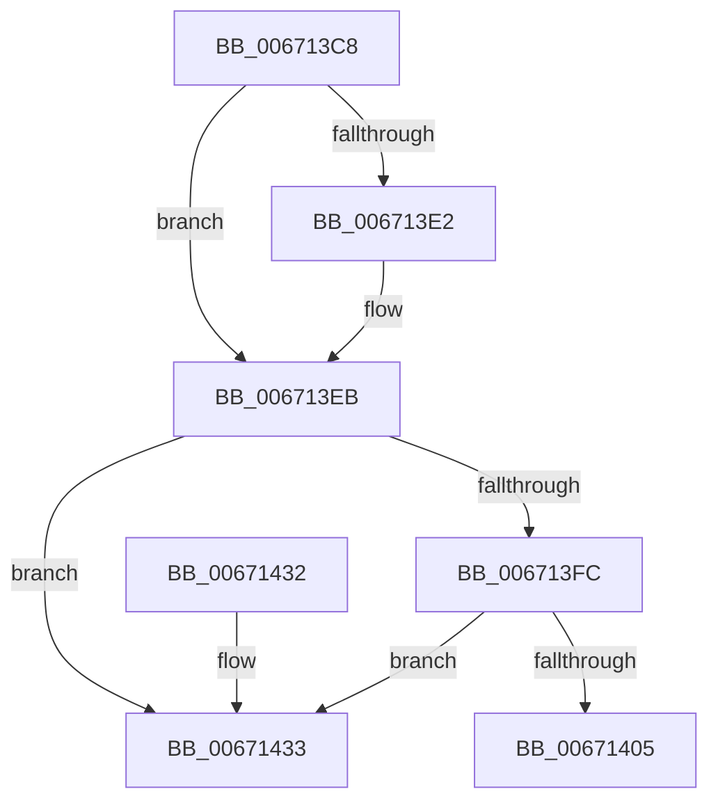

# MiRemoveLoaderEntry

- RVA: `0x006713C8`–`0x0067143A` (길이 `114` bytes)
- VA: `0x00000001406713C8`
- 실행 섹션: `.text`
- PDB 이름 있음: `예`; PDB Function 태그: `아니요`
- unwind 정보 RVA: `0x0006CF28`
- 디코드: `30`개 명령, `114/114` bytes 표시
- 미해석 바이트: `0` (있으면 어셈블리에 `.byte`로 보존)

> 이 문서는 커널 이미지의 기계어와 PDB 기호를 분석해 생성했습니다. 4번과 5번은 함수 원형과 자료형을 바이너리 사용 방식에서 추정한 C 해석이며 원본 소스 복구 결과는 아닙니다.

## 1. Dependencies

- 직접 호출 지점: **4**; 고유 호출 대상: **4**
- 직접 호출자로 확인된 함수: **1**
- RIP 상대 이미지 참조: **2**

### Outgoing calls
- `0x006713E6` → [RtlRemoveInvertedFunctionTable](../43/RtlRemoveInvertedFunctionTable_function_004320E8.md) (function, `0x004320E8`)
- `0x006713EB` → [MmLockLoadedModuleListExclusive](../43/MmLockLoadedModuleListExclusive_function_0043229C.md) (function, `0x0043229C`)
- `0x0067141A` → [RtlAvlRemoveNode](../29/RtlAvlRemoveNode_function_00296650.md) (function, `0x00296650`)
- `0x00671422` → [MmUnlockLoadedModuleListExclusive](../43/MmUnlockLoadedModuleListExclusive_function_004322E0.md) (function, `0x004322E0`)

### Direct callers
- [MiUnloadSystemImage](../../page/AA/MiUnloadSystemImage_function_00AA2FD4.md) at `0x00AA3333`

### Static image references
- `0x006713D2` → RVA `0x00FC6A88` (`ALMOSTRO`; read)
- `0x00671413` → RVA `0x00E2D980` (`.data`; read)

## 2. Other-region calls and transfers

- 다른 실행 섹션으로 향하는 call: **0**
- 별도 외부 분기/꼬리 이동을 확인하지 못했습니다.

## 3. Assembly (complete function range)

```asm
006713C8  48 89 5C 24 08                  mov qword ptr [rsp + 8], rbx
006713CD  57                              push rdi
006713CE  48 83 EC 20                     sub rsp, 0x20
006713D2  48 F7 05 AB 56 95 00 00 00 04 00  test qword ptr [rip + 0x9556ab], 0x40000
006713DD  48 8B D9                        mov rbx, rcx
006713E0  75 09                           jne 0x1406713eb
006713E2  48 8B 49 30                     mov rcx, qword ptr [rcx + 0x30]
006713E6  E8 FD 0C DC FF                  call 0x1404320e8
006713EB  E8 AC 0E DC FF                  call 0x14043229c
006713F0  48 8B 13                        mov rdx, qword ptr [rbx]
006713F3  40 8A F8                        mov dil, al
006713F6  48 39 5A 08                     cmp qword ptr [rdx + 8], rbx
006713FA  75 37                           jne 0x140671433
006713FC  48 8B 4B 08                     mov rcx, qword ptr [rbx + 8]
00671400  48 39 19                        cmp qword ptr [rcx], rbx
00671403  75 2E                           jne 0x140671433
00671405  48 89 11                        mov qword ptr [rcx], rdx
00671408  48 89 4A 08                     mov qword ptr [rdx + 8], rcx
0067140C  48 8D 93 D0 00 00 00            lea rdx, [rbx + 0xd0]
00671413  48 8D 0D 66 C5 7B 00            lea rcx, [rip + 0x7bc566]
0067141A  E8 31 52 C2 FF                  call 0x140296650
0067141F  40 8A CF                        mov cl, dil
00671422  E8 B9 0E DC FF                  call 0x1404322e0
00671427  48 8B 5C 24 30                  mov rbx, qword ptr [rsp + 0x30]
0067142C  48 83 C4 20                     add rsp, 0x20
00671430  5F                              pop rdi
00671431  C3                              ret
00671432  CC                              int3
00671433  B9 03 00 00 00                  mov ecx, 3
00671438  CD 29                           int 0x29
```

## 4. C-style interpretation (structured pseudocode)

```c
__int64 __fastcall MiRemoveLoaderEntry(__int64 a1)
{
    __int64 result;
    __int64 v_rsp;
    unsigned __int64 v_stack_p8;

    v_stack_p8 = v_rbx;
    v_rsp = (v_rsp) - (32);
    if (((*(unsigned __int64 *)(v_rip + 9787051)) & (0x40000ULL)) == 0) {
        a1 = *(unsigned __int64 *)(a1 + 48);
        result = RtlRemoveInvertedFunctionTable(a1, a2, a3, a4);
    }
    result = MmLockLoadedModuleListExclusive(a1, a2, a3, a4);
    if ((*(unsigned __int64 *)(*(unsigned __int64 *)(a1) + 8)) != a1) goto loc_00671433;
    if ((*(unsigned __int64 *)(*(unsigned __int64 *)(a1 + 8))) != a1) goto loc_00671433;
    *(unsigned __int64 *)(*(unsigned __int64 *)(a1 + 8)) = *(unsigned __int64 *)(a1);
    *(unsigned __int64 *)(*(unsigned __int64 *)(a1) + 8) = *(unsigned __int64 *)(a1 + 8);
    result = RtlAvlRemoveNode(v_rip + 8111462, a1 + 208, a3, a4);
    result = MmUnlockLoadedModuleListExclusive((unsigned __int8)((unsigned __int8)(result)), a1 + 208, a3, a4);
    v_rsp = (v_rsp) + (32);
    return result;
loc_00671433:
    return result;
}
```

## 5. (Beta) C Style

```c
int64_t MiRemoveLoaderEntry(void *Arg1)
{
    uint8_t *arg1 = (uint8_t *)Arg1;

    int64_t result;
    int64_t local_rsp;
    uint64_t v_stack_p8;

    v_stack_p8 = local_rbx;
    local_rsp = (local_rsp) - (32);
    if (((*(uint64_t *)(v_rip + 0x9556AB)) & (0x40000ULL)) == 0) {
        Arg1 = *(uint64_t *)(arg1 + 0x30);
        result = RtlRemoveInvertedFunctionTable(Arg1, a2, a3, a4);
    }
    result = MmLockLoadedModuleListExclusive(Arg1, a2, a3, a4);
    if ((*(uint64_t *)(*(uint64_t *)(arg1) + 0x8)) != Arg1) goto loc_00671433;
    if ((*(uint64_t *)(*(uint64_t *)(arg1 + 0x8))) != Arg1) goto loc_00671433;
    *(uint64_t *)(*(uint64_t *)(arg1 + 0x8)) = *(uint64_t *)(arg1);
    *(uint64_t *)(*(uint64_t *)(arg1) + 0x8) = *(uint64_t *)(arg1 + 0x8);
    result = RtlAvlRemoveNode(v_rip + 8111462, Arg1 + 208, a3, a4);
    result = MmUnlockLoadedModuleListExclusive((uint8_t)((uint8_t)(result)), Arg1 + 208, a3, a4);
    local_rsp = (local_rsp) + (32);
    return result;
loc_00671433:
    return result;
}
```

### 관측된 메모리 오프셋

구조체 형식이 확인되지 않은 접근은 인자 기준의 오프셋으로만 기록했습니다.

| 기준 인자 | 오프셋 표현 | 폭 (bit) | 접근 |
|---|---:|---:|---|
| `Arg1` | `+ 0x0` | `64` | `R` |
| `Arg1` | `+ 0x8` | `64` | `R` |
| `Arg1` | `+ 0x30` | `64` | `R` |
| `Arg1` | `+ 0xD0` | `64` | `R` |

## 6. Execution-region graph

[열기: 2D/3D 그래프와 함수 탐색 컨트롤 패널](../../../control-panel.html?section=text&rva=0x006713C8&view=graph)

- 2D 그래프는 위에서 아래로 흐르고, 3D 그래프는 빈 공간을 드래그해 회전합니다. Shift+드래그는 이동, 휠은 확대·축소, 함수 노드 선택은 대상 보고서 이동입니다.

### Static fallback


