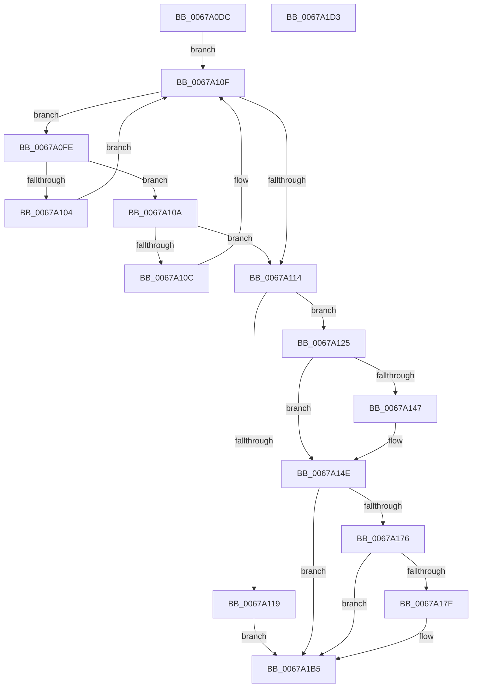

# MiRemovePendingBadPageNode

- RVA: `0x0067A0DC`–`0x0067A1D4` (길이 `248` bytes)
- VA: `0x000000014067A0DC`
- 실행 섹션: `.text`
- PDB 이름 있음: `예`; PDB Function 태그: `아니요`
- unwind 정보 RVA: `0x0005CAAC`
- 디코드: `56`개 명령, `248/248` bytes 표시
- 미해석 바이트: `0` (있으면 어셈블리에 `.byte`로 보존)

> 이 문서는 커널 이미지의 기계어와 PDB 기호를 분석해 생성했습니다. 4번과 5번은 함수 원형과 자료형을 바이너리 사용 방식에서 추정한 C 해석이며 원본 소스 복구 결과는 아닙니다.

## 1. Dependencies

- 직접 호출 지점: **4**; 고유 호출 대상: **4**
- 직접 호출자로 확인된 함수: **1**
- RIP 상대 이미지 참조: **16**

### Outgoing calls
- `0x0067A0F0` → [ExAcquireSpinLockExclusiveAtDpcLevel](../24/ExAcquireSpinLockExclusiveAtDpcLevel_function_00248E80.md) (function, `0x00248E80`)
- `0x0067A12F` → [RtlAvlRemoveNode](../29/RtlAvlRemoveNode_function_00296650.md) (function, `0x00296650`)
- `0x0067A1A9` → [ExQueueWorkItem](../2F/ExQueueWorkItem_function_002F9520.md) (function, `0x002F9520`)
- `0x0067A1C3` → [ExReleaseSpinLockExclusiveFromDpcLevel](../24/ExReleaseSpinLockExclusiveFromDpcLevel_function_002497E0.md) (function, `0x002497E0`)

### Direct callers
- [MiSetPfnRemovalRequested](MiSetPfnRemovalRequested_function_0067A4D0.md) at `0x0067A626`

### Static image references
- `0x0067A0E9` → RVA `0x00E2FFD0` (`.data`; read)
- `0x0067A0F5` → RVA `0x00E2FFC0` (`.data`; read)
- `0x0067A119` → RVA `0x00E2FFD8` (`.data`; read/write)
- `0x0067A134` → RVA `0x00E2FFE8` (`.data`; read)
- `0x0067A13B` → RVA `0x00E2FFE0` (`.data`; read)
- `0x0067A158` → RVA `0x00E2FFF0` (`.data`; read)
- `0x0067A162` → RVA `0x00E2FFE8` (`.data`; write)
- `0x0067A169` → RVA `0x00E2FFF0` (`.data`; write)
- `0x0067A176` → RVA `0x00E2FFF8` (`.data`; read)
- `0x0067A17F` → RVA `0x00E30018` (`.data`; read/write)
- `0x0067A187` → RVA `0x00679660` (`MiDeletePendingBadPageNodesAwaitingDeleteList`; read)
- `0x0067A18E` → RVA `0x00E30000` (`.data`; read/write)
- `0x0067A196` → RVA `0x00E30000` (`.data`; read)
- `0x0067A1A2` → RVA `0x00E30010` (`.data`; write)
- `0x0067A1AE` → RVA `0x00E2FFF8` (`.data`; write)
- `0x0067A1B5` → RVA `0x00E2FFC8` (`.data`; read/write)

## 2. Other-region calls and transfers

- 다른 실행 섹션으로 향하는 call: **0**
- 별도 외부 분기/꼬리 이동을 확인하지 못했습니다.

## 3. Assembly (complete function range)

```asm
0067A0DC  48 89 5C 24 08                  mov qword ptr [rsp + 8], rbx
0067A0E1  57                              push rdi
0067A0E2  48 83 EC 20                     sub rsp, 0x20
0067A0E6  48 8B F9                        mov rdi, rcx
0067A0E9  48 8D 0D E0 5E 7B 00            lea rcx, [rip + 0x7b5ee0]
0067A0F0  E8 8B ED BC FF                  call 0x140248e80
0067A0F5  48 8B 1D C4 5E 7B 00            mov rbx, qword ptr [rip + 0x7b5ec4]
0067A0FC  EB 11                           jmp 0x14067a10f
0067A0FE  48 3B 7B 18                     cmp rdi, qword ptr [rbx + 0x18]
0067A102  76 06                           jbe 0x14067a10a
0067A104  48 8B 5B 08                     mov rbx, qword ptr [rbx + 8]
0067A108  EB 05                           jmp 0x14067a10f
0067A10A  73 08                           jae 0x14067a114
0067A10C  48 8B 1B                        mov rbx, qword ptr [rbx]
0067A10F  48 85 DB                        test rbx, rbx
0067A112  75 EA                           jne 0x14067a0fe
0067A114  48 85 DB                        test rbx, rbx
0067A117  75 0C                           jne 0x14067a125
0067A119  48 FF 0D B8 5E 7B 00            dec qword ptr [rip + 0x7b5eb8]
0067A120  E9 90 00 00 00                  jmp 0x14067a1b5
0067A125  48 8B D3                        mov rdx, rbx
0067A128  48 8D 0D 91 5E 7B 00            lea rcx, [rip + 0x7b5e91]
0067A12F  E8 1C C5 C1 FF                  call 0x140296650
0067A134  48 8B 05 AD 5E 7B 00            mov rax, qword ptr [rip + 0x7b5ead]
0067A13B  48 8D 0D 9E 5E 7B 00            lea rcx, [rip + 0x7b5e9e]
0067A142  48 39 08                        cmp qword ptr [rax], rcx
0067A145  74 07                           je 0x14067a14e
0067A147  B9 03 00 00 00                  mov ecx, 3
0067A14C  CD 29                           int 0x29
0067A14E  48 89 43 08                     mov qword ptr [rbx + 8], rax
0067A152  48 89 0B                        mov qword ptr [rbx], rcx
0067A155  48 89 18                        mov qword ptr [rax], rbx
0067A158  48 8B 05 91 5E 7B 00            mov rax, qword ptr [rip + 0x7b5e91]
0067A15F  48 FF C0                        inc rax
0067A162  48 89 1D 7F 5E 7B 00            mov qword ptr [rip + 0x7b5e7f], rbx
0067A169  48 89 05 80 5E 7B 00            mov qword ptr [rip + 0x7b5e80], rax
0067A170  48 83 F8 20                     cmp rax, 0x20
0067A174  72 3F                           jb 0x14067a1b5
0067A176  80 3D 7B 5E 7B 00 00            cmp byte ptr [rip + 0x7b5e7b], 0
0067A17D  75 36                           jne 0x14067a1b5
0067A17F  48 83 25 91 5E 7B 00 00         and qword ptr [rip + 0x7b5e91], 0
0067A187  48 8D 05 D2 F4 FF FF            lea rax, [rip - 0xb2e]
0067A18E  48 83 25 6A 5E 7B 00 00         and qword ptr [rip + 0x7b5e6a], 0
0067A196  48 8D 0D 63 5E 7B 00            lea rcx, [rip + 0x7b5e63]
0067A19D  BA 01 00 00 00                  mov edx, 1
0067A1A2  48 89 05 67 5E 7B 00            mov qword ptr [rip + 0x7b5e67], rax
0067A1A9  E8 72 F3 C7 FF                  call 0x1402f9520
0067A1AE  C6 05 43 5E 7B 00 01            mov byte ptr [rip + 0x7b5e43], 1
0067A1B5  48 FF 0D 0C 5E 7B 00            dec qword ptr [rip + 0x7b5e0c]
0067A1BC  48 8D 0D 0D 5E 7B 00            lea rcx, [rip + 0x7b5e0d]
0067A1C3  E8 18 F6 BC FF                  call 0x1402497e0
0067A1C8  48 8B 5C 24 30                  mov rbx, qword ptr [rsp + 0x30]
0067A1CD  48 83 C4 20                     add rsp, 0x20
0067A1D1  5F                              pop rdi
0067A1D2  C3                              ret
0067A1D3  CC                              int3
```

## 4. C-style interpretation (structured pseudocode)

```c
__int64 __fastcall MiRemovePendingBadPageNode(__int64 a1)
{
    __int64 result;
    __int64 v_rsp;
    unsigned __int64 v_stack_p8;

    v_stack_p8 = v_rbx;
    v_rsp = (v_rsp) - (32);
    result = ExAcquireSpinLockExclusiveAtDpcLevel(v_rip + 8085216, a2, a3, a4);
    goto loc_0067A10F;
loc_0067A0FE:
    if (a1 <= (*(unsigned __int64 *)(*(unsigned __int64 *)(v_rip + 8085188) + 24))) goto loc_0067A10A;
    goto loc_0067A10F;
loc_0067A10A:
    if (a1 >= (*(unsigned __int64 *)(*(unsigned __int64 *)(v_rip + 8085188) + 24))) goto loc_0067A114;
loc_0067A10F:
    if (*(unsigned __int64 *)(*(unsigned __int64 *)(*(unsigned __int64 *)(v_rip + 8085188) + 8)) != 0) goto loc_0067A0FE;
loc_0067A114:
    if (*(unsigned __int64 *)(*(unsigned __int64 *)(*(unsigned __int64 *)(v_rip + 8085188) + 8)) != 0) goto loc_0067A125;
    goto loc_0067A1B5;
loc_0067A125:
    result = RtlAvlRemoveNode(v_rip + 8085137, *(unsigned __int64 *)(*(unsigned __int64 *)(*(unsigned __int64 *)(v_rip + 8085188) + 8)), a3, a4);
    if ((*(unsigned __int64 *)(*(unsigned __int64 *)(v_rip + 8085165))) != (v_rip + 8085150)) {
        a1 = 3;
    }
    *(unsigned __int64 *)(*(unsigned __int64 *)(*(unsigned __int64 *)(*(unsigned __int64 *)(v_rip + 8085188) + 8)) + 8) = *(unsigned __int64 *)(v_rip + 8085165);
    *(unsigned __int64 *)(*(unsigned __int64 *)(*(unsigned __int64 *)(*(unsigned __int64 *)(v_rip + 8085188) + 8))) = a1;
    *(unsigned __int64 *)(*(unsigned __int64 *)(v_rip + 8085165)) = *(unsigned __int64 *)(*(unsigned __int64 *)(*(unsigned __int64 *)(v_rip + 8085188) + 8));
    result = (*(unsigned __int64 *)(v_rip + 8085137)) + 1;
    *(unsigned __int64 *)(v_rip + 8085119) = *(unsigned __int64 *)(*(unsigned __int64 *)(*(unsigned __int64 *)(v_rip + 8085188) + 8));
    *(unsigned __int64 *)(v_rip + 8085120) = result;
    if (result < 32) goto loc_0067A1B5;
    if ((*(unsigned __int8 *)(v_rip + 8085115)) == 0) {
        result = v_rip - 2862;
        a1 = v_rip + 8085091;
        a2 = 1;
        *(unsigned __int64 *)(v_rip + 8085095) = result;
        result = ExQueueWorkItem(a1, a2, a3, a4);
        *(unsigned __int8 *)(v_rip + 8085059) = 1;
    }
    result = ExReleaseSpinLockExclusiveFromDpcLevel(v_rip + 8085005, a2, a3, a4);
    v_rsp = (v_rsp) + (32);
    return result;
}
```

## 5. (Beta) C Style

```c
int64_t MiRemovePendingBadPageNode(int64_t Arg1)
{
    int64_t result;
    int64_t local_rsp;
    uint64_t v_stack_p8;

    v_stack_p8 = local_rbx;
    local_rsp = (local_rsp) - (32);
    result = ExAcquireSpinLockExclusiveAtDpcLevel(v_rip + 8085216, a2, a3, a4);
    goto loc_0067A10F;
loc_0067A0FE:
    if (Arg1 <= (*(uint64_t *)(*(uint64_t *)(v_rip + 0x7B5EC4) + 0x18))) goto loc_0067A10A;
    goto loc_0067A10F;
loc_0067A10A:
    if (Arg1 >= (*(uint64_t *)(*(uint64_t *)(v_rip + 0x7B5EC4) + 0x18))) goto loc_0067A114;
loc_0067A10F:
    if (*(uint64_t *)(*(uint64_t *)(*(uint64_t *)(v_rip + 0x7B5EC4) + 0x8)) != 0) goto loc_0067A0FE;
loc_0067A114:
    if (*(uint64_t *)(*(uint64_t *)(*(uint64_t *)(v_rip + 0x7B5EC4) + 0x8)) != 0) goto loc_0067A125;
    goto loc_0067A1B5;
loc_0067A125:
    result = RtlAvlRemoveNode(v_rip + 8085137, *(uint64_t *)(*(uint64_t *)(*(uint64_t *)(v_rip + 0x7B5EC4) + 0x8)), a3, a4);
    if ((*(uint64_t *)(*(uint64_t *)(v_rip + 0x7B5EAD))) != (v_rip + 8085150)) {
        Arg1 = 3;
    }
    *(uint64_t *)(*(uint64_t *)(*(uint64_t *)(*(uint64_t *)(v_rip + 0x7B5EC4) + 0x8)) + 0x8) = *(uint64_t *)(v_rip + 0x7B5EAD);
    *(uint64_t *)(*(uint64_t *)(*(uint64_t *)(*(uint64_t *)(v_rip + 0x7B5EC4) + 0x8))) = Arg1;
    *(uint64_t *)(*(uint64_t *)(v_rip + 0x7B5EAD)) = *(uint64_t *)(*(uint64_t *)(*(uint64_t *)(v_rip + 0x7B5EC4) + 0x8));
    result = (*(uint64_t *)(v_rip + 0x7B5E91)) + 1;
    *(uint64_t *)(v_rip + 0x7B5E7F) = *(uint64_t *)(*(uint64_t *)(*(uint64_t *)(v_rip + 0x7B5EC4) + 0x8));
    *(uint64_t *)(v_rip + 0x7B5E80) = result;
    if (result < 32) goto loc_0067A1B5;
    if ((*(uint8_t *)(v_rip + 0x7B5E7B)) == 0) {
        result = v_rip - 2862;
        Arg1 = v_rip + 8085091;
        a2 = 1;
        *(uint64_t *)(v_rip + 0x7B5E67) = result;
        result = ExQueueWorkItem(Arg1, a2, a3, a4);
        *(uint8_t *)(v_rip + 0x7B5E43) = 1;
    }
    result = ExReleaseSpinLockExclusiveFromDpcLevel(v_rip + 8085005, a2, a3, a4);
    local_rsp = (local_rsp) + (32);
    return result;
}
```

## 6. Execution-region graph

[열기: 2D/3D 그래프와 함수 탐색 컨트롤 패널](../../../control-panel.html?section=text&rva=0x0067A0DC&view=graph)

- 2D 그래프는 위에서 아래로 흐르고, 3D 그래프는 빈 공간을 드래그해 회전합니다. Shift+드래그는 이동, 휠은 확대·축소, 함수 노드 선택은 대상 보고서 이동입니다.

### Static fallback


