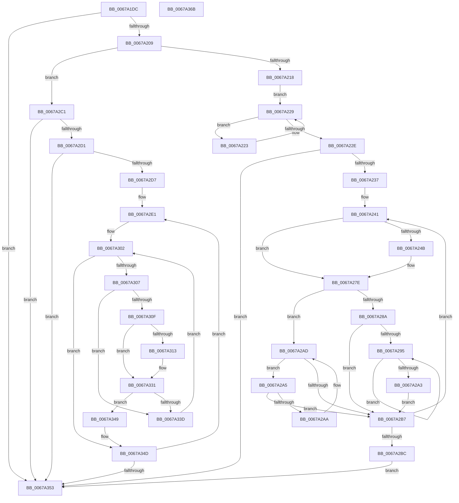

# MiRemovePendingBadPagesFromDump

- RVA: `0x0067A1DC`–`0x0067A36C` (길이 `400` bytes)
- VA: `0x000000014067A1DC`
- 실행 섹션: `.text`
- PDB 이름 있음: `예`; PDB Function 태그: `아니요`
- unwind 정보 RVA: `0x000D7DD8`
- 디코드: `114`개 명령, `400/400` bytes 표시
- 미해석 바이트: `0` (있으면 어셈블리에 `.byte`로 보존)

> 이 문서는 커널 이미지의 기계어와 PDB 기호를 분석해 생성했습니다. 4번과 5번은 함수 원형과 자료형을 바이너리 사용 방식에서 추정한 C 해석이며 원본 소스 복구 결과는 아닙니다.

## 1. Dependencies

- 직접 호출 지점: **2**; 고유 호출 대상: **1**
- 직접 호출자로 확인된 함수: **1**
- RIP 상대 이미지 참조: **4**

### Outgoing calls
- `0x0067A274` → [guard_dispatch_icall](../6B/guard_dispatch_icall_function_006BAAD0.md) (function, `0x006BAAD0`)
- `0x0067A327` → [guard_dispatch_icall](../6B/guard_dispatch_icall_function_006BAAD0.md) (function, `0x006BAAD0`)

### Direct callers
- [MmGetDumpRange](MmGetDumpRange_function_0067DA68.md) at `0x0067DCF3`

### Static image references
- `0x0067A1F8` → RVA `0x00E2FFC8` (`.data`; read)
- `0x0067A20B` → RVA `0x00E2FFD8` (`.data`; read)
- `0x0067A218` → RVA `0x00E2FFC0` (`.data`; read)
- `0x0067A2C1` → RVA `0x00FC6B88` (`ALMOSTRO`; read)

## 2. Other-region calls and transfers

- 다른 실행 섹션으로 향하는 call: **0**
- 별도 외부 분기/꼬리 이동을 확인하지 못했습니다.

## 3. Assembly (complete function range)

```asm
0067A1DC  48 89 5C 24 10                  mov qword ptr [rsp + 0x10], rbx
0067A1E1  48 89 6C 24 18                  mov qword ptr [rsp + 0x18], rbp
0067A1E6  48 89 4C 24 08                  mov qword ptr [rsp + 8], rcx
0067A1EB  57                              push rdi
0067A1EC  41 54                           push r12
0067A1EE  41 55                           push r13
0067A1F0  41 56                           push r14
0067A1F2  41 57                           push r15
0067A1F4  48 83 EC 30                     sub rsp, 0x30
0067A1F8  48 83 3D C8 5D 7B 00 00         cmp qword ptr [rip + 0x7b5dc8], 0
0067A200  4C 8B D1                        mov r10, rcx
0067A203  0F 84 4A 01 00 00               je 0x14067a353
0067A209  33 ED                           xor ebp, ebp
0067A20B  48 39 2D C6 5D 7B 00            cmp qword ptr [rip + 0x7b5dc6], rbp
0067A212  0F 85 A9 00 00 00               jne 0x14067a2c1
0067A218  48 8B 05 A1 5D 7B 00            mov rax, qword ptr [rip + 0x7b5da1]
0067A21F  33 DB                           xor ebx, ebx
0067A221  EB 06                           jmp 0x14067a229
0067A223  48 8B D8                        mov rbx, rax
0067A226  48 8B 00                        mov rax, qword ptr [rax]
0067A229  48 85 C0                        test rax, rax
0067A22C  75 F5                           jne 0x14067a223
0067A22E  48 85 DB                        test rbx, rbx
0067A231  0F 84 1C 01 00 00               je 0x14067a353
0067A237  49 BD 00 00 00 00 00 DE FF FF   movabs r13, 0xffffde0000000000
0067A241  48 8B 53 18                     mov rdx, qword ptr [rbx + 0x18]
0067A245  40 38 6A 23                     cmp byte ptr [rdx + 0x23], bpl
0067A249  7D 33                           jge 0x14067a27e
0067A24B  49 8B C5                        mov rax, r13
0067A24E  48 2B D0                        sub rdx, rax
0067A251  41 B9 02 00 00 00               mov r9d, 2
0067A257  48 C1 FA 04                     sar rdx, 4
0067A25B  48 B8 AB AA AA AA AA AA AA AA   movabs rax, 0xaaaaaaaaaaaaaaab
0067A265  48 0F AF D0                     imul rdx, rax
0067A269  49 8B 42 08                     mov rax, qword ptr [r10 + 8]
0067A26D  45 8D 41 FF                     lea r8d, [r9 - 1]
0067A271  49 8B CA                        mov rcx, r10
0067A274  E8 57 08 04 00                  call 0x1406baad0
0067A279  4C 8B 54 24 60                  mov r10, qword ptr [rsp + 0x60]
0067A27E  48 8B 43 08                     mov rax, qword ptr [rbx + 8]
0067A282  48 8B CB                        mov rcx, rbx
0067A285  48 85 C0                        test rax, rax
0067A288  74 23                           je 0x14067a2ad
0067A28A  48 8B 08                        mov rcx, qword ptr [rax]
0067A28D  48 8B D8                        mov rbx, rax
0067A290  48 85 C9                        test rcx, rcx
0067A293  74 22                           je 0x14067a2b7
0067A295  48 8B 01                        mov rax, qword ptr [rcx]
0067A298  48 8B D9                        mov rbx, rcx
0067A29B  48 8B C8                        mov rcx, rax
0067A29E  48 85 C0                        test rax, rax
0067A2A1  75 F2                           jne 0x14067a295
0067A2A3  EB 12                           jmp 0x14067a2b7
0067A2A5  48 39 0B                        cmp qword ptr [rbx], rcx
0067A2A8  74 0D                           je 0x14067a2b7
0067A2AA  48 8B CB                        mov rcx, rbx
0067A2AD  48 8B 5B 10                     mov rbx, qword ptr [rbx + 0x10]
0067A2B1  48 83 E3 FC                     and rbx, 0xfffffffffffffffc
0067A2B5  75 EE                           jne 0x14067a2a5
0067A2B7  48 85 DB                        test rbx, rbx
0067A2BA  75 85                           jne 0x14067a241
0067A2BC  E9 92 00 00 00                  jmp 0x14067a353
0067A2C1  48 8B 3D C0 C8 94 00            mov rdi, qword ptr [rip + 0x94c8c0]
0067A2C8  48 85 FF                        test rdi, rdi
0067A2CB  0F 84 82 00 00 00               je 0x14067a353
0067A2D1  33 DB                           xor ebx, ebx
0067A2D3  39 1F                           cmp dword ptr [rdi], ebx
0067A2D5  76 7C                           jbe 0x14067a353
0067A2D7  49 BD 00 00 00 00 00 DE FF FF   movabs r13, 0xffffde0000000000
0067A2E1  8B D3                           mov edx, ebx
0067A2E3  48 03 D2                        add rdx, rdx
0067A2E6  4C 8B 74 D7 10                  mov r14, qword ptr [rdi + rdx*8 + 0x10]
0067A2EB  4F 8D 24 76                     lea r12, [r14 + r14*2]
0067A2EF  49 C1 E4 04                     shl r12, 4
0067A2F3  49 8B C5                        mov rax, r13
0067A2F6  4C 8B 7C D7 18                  mov r15, qword ptr [rdi + rdx*8 + 0x18]
0067A2FB  48 83 C0 23                     add rax, 0x23
0067A2FF  4C 03 E0                        add r12, rax
0067A302  4D 85 FF                        test r15, r15
0067A305  74 46                           je 0x14067a34d
0067A307  41 8A 04 24                     mov al, byte ptr [r12]
0067A30B  A8 40                           test al, 0x40
0067A30D  74 2E                           je 0x14067a33d
0067A30F  84 C0                           test al, al
0067A311  79 1E                           jns 0x14067a331
0067A313  49 8B 42 08                     mov rax, qword ptr [r10 + 8]
0067A317  41 B9 02 00 00 00               mov r9d, 2
0067A31D  49 8B D6                        mov rdx, r14
0067A320  49 8B CA                        mov rcx, r10
0067A323  45 8D 41 FF                     lea r8d, [r9 - 1]
0067A327  E8 A4 07 04 00                  call 0x1406baad0
0067A32C  4C 8B 54 24 60                  mov r10, qword ptr [rsp + 0x60]
0067A331  48 FF C5                        inc rbp
0067A334  48 3B 2D 8D 5C 7B 00            cmp rbp, qword ptr [rip + 0x7b5c8d]
0067A33B  74 0C                           je 0x14067a349
0067A33D  49 FF CF                        dec r15
0067A340  49 FF C6                        inc r14
0067A343  49 83 C4 30                     add r12, 0x30
0067A347  EB B9                           jmp 0x14067a302
0067A349  8B 1F                           mov ebx, dword ptr [rdi]
0067A34B  FF CB                           dec ebx
0067A34D  FF C3                           inc ebx
0067A34F  3B 1F                           cmp ebx, dword ptr [rdi]
0067A351  72 8E                           jb 0x14067a2e1
0067A353  48 8B 5C 24 68                  mov rbx, qword ptr [rsp + 0x68]
0067A358  48 8B 6C 24 70                  mov rbp, qword ptr [rsp + 0x70]
0067A35D  48 83 C4 30                     add rsp, 0x30
0067A361  41 5F                           pop r15
0067A363  41 5E                           pop r14
0067A365  41 5D                           pop r13
0067A367  41 5C                           pop r12
0067A369  5F                              pop rdi
0067A36A  C3                              ret
0067A36B  CC                              int3
```

## 4. C-style interpretation (structured pseudocode)

```c
__int64 __fastcall MiRemovePendingBadPagesFromDump(__int64 a1)
{
    __int64 result;
    __int64 v_r10;
    __int64 v_r12;
    __int64 v_r14;
    __int64 v_r15;
    __int64 v_rbp;
    __int64 v_rbx;
    __int64 v_rsp;
    unsigned __int64 v_stack_p10;
    unsigned __int64 v_stack_p18;
    unsigned __int64 v_stack_p8;

    v_stack_p10 = v_rbx;
    v_stack_p18 = v_rbp;
    v_stack_p8 = a1;
    v_rsp = (v_rsp) - (48);
    if ((*(unsigned __int64 *)(v_rip + 8084936)) == 0) goto loc_0067A353;
    v_rbp = 0;
    if ((*(unsigned __int64 *)(v_rip + 8084934)) != 0) goto loc_0067A2C1;
    v_rbx = 0;
    goto loc_0067A229;
loc_0067A223:
loc_0067A229:
    if (*(unsigned __int64 *)(*(unsigned __int64 *)(v_rip + 8084897)) != 0) goto loc_0067A223;
    if (*(unsigned __int64 *)(v_rip + 8084897) == 0) goto loc_0067A353;
loc_0067A241:
    result = *(unsigned __int64 *)(*(unsigned __int64 *)(v_rip + 8084897));
    v_r10 = a1;
    if ((*(unsigned __int8 *)(*(unsigned __int64 *)(*(unsigned __int64 *)(v_rip + 8084897) + 24) + 35)) < 0) {
        result = v_r13;
        a2 = (*(unsigned __int64 *)(*(unsigned __int64 *)(v_rip + 8084897) + 24)) - (result);
        a4 = 2;
        a2 = (a2) >> (4);
        a2 = (a2) * (result);
        result = *(unsigned __int64 *)(a1 + 8);
        a3 = a4 - 1;
        a1 = a1;
        result = guard_dispatch_icall(a1, a2, a3, a4);
        v_r10 = v_stack_p8;
    }
    if (*(unsigned __int64 *)(*(unsigned __int64 *)(v_rip + 8084897) + 8) == 0) goto loc_0067A2AD;
    if (*(unsigned __int64 *)(*(unsigned __int64 *)(*(unsigned __int64 *)(v_rip + 8084897) + 8)) == 0) goto loc_0067A2B7;
loc_0067A295:
    if (*(unsigned __int64 *)(*(unsigned __int64 *)(*(unsigned __int64 *)(*(unsigned __int64 *)(v_rip + 8084897) + 8))) != 0) goto loc_0067A295;
    goto loc_0067A2B7;
loc_0067A2A5:
    if ((*(unsigned __int64 *)(*(unsigned __int64 *)(*(unsigned __int64 *)(*(unsigned __int64 *)(v_rip + 8084897) + 8)))) == (*(unsigned __int64 *)(*(unsigned __int64 *)(*(unsigned __int64 *)(*(unsigned __int64 *)(v_rip + 8084897) + 8))))) goto loc_0067A2B7;
loc_0067A2AD:
    v_rbx = (*(unsigned __int64 *)(*(unsigned __int64 *)(*(unsigned __int64 *)(*(unsigned __int64 *)(v_rip + 8084897) + 8)) + 16)) & (-4);
    if (condition_is_not_equal) goto loc_0067A2A5;
loc_0067A2B7:
    if (v_rbx != 0) goto loc_0067A241;
    goto loc_0067A353;
loc_0067A2C1:
    if (*(unsigned __int64 *)(v_rip + 9750720) == 0) goto loc_0067A353;
    v_rbx = 0;
    if ((*(unsigned int *)(*(unsigned __int64 *)(v_rip + 9750720))) <= 0) goto loc_0067A353;
loc_0067A2E1:
    a2 = (0) + (0);
    v_r12 = (*(unsigned __int64 *)(*(unsigned __int64 *)(v_rip + 9750720) + a2 * 8 + 16) + *(unsigned __int64 *)(*(unsigned __int64 *)(v_rip + 9750720) + a2 * 8 + 16) * 2) << (4);
    result = (v_r13) + (35);
    v_r12 = (v_r12) + (result);
loc_0067A302:
    if (*(unsigned __int64 *)(*(unsigned __int64 *)(v_rip + 9750720) + a2 * 8 + 24) == 0) goto loc_0067A34D;
    if ((((unsigned __int8)(*(unsigned __int8 *)(v_r12))) & (64)) == 0) goto loc_0067A33D;
    result = *(unsigned __int8 *)(v_r12);
    if (sign_flag) {
        result = *(unsigned __int64 *)(v_r10 + 8);
        a4 = 2;
        a2 = *(unsigned __int64 *)(*(unsigned __int64 *)(v_rip + 9750720) + a2 * 8 + 16);
        a1 = v_r10;
        a3 = a4 - 1;
        result = guard_dispatch_icall(a1, a2, a3, a4);
        v_r10 = v_stack_p8;
    }
    v_rbp = (v_rbp) + 1;
    if (v_rbp == (*(unsigned __int64 *)(v_rip + 8084621))) goto loc_0067A349;
loc_0067A33D:
    v_r15 = (*(unsigned __int64 *)(*(unsigned __int64 *)(v_rip + 9750720) + a2 * 8 + 24)) - 1;
    v_r14 = (*(unsigned __int64 *)(*(unsigned __int64 *)(v_rip + 9750720) + a2 * 8 + 16)) + 1;
    v_r12 = (v_r12) + (48);
    goto loc_0067A302;
loc_0067A349:
    v_rbx = (unsigned int)(((unsigned int)(*(unsigned int *)(*(unsigned __int64 *)(v_rip + 9750720)))) - 1);
loc_0067A34D:
    v_rbx = (unsigned int)((v_rbx) + 1);
    if (((unsigned int)(v_rbx)) < (*(unsigned int *)(*(unsigned __int64 *)(v_rip + 9750720)))) goto loc_0067A2E1;
loc_0067A353:
    v_rsp = (v_rsp) + (48);
    return result;
}
```

## 5. (Beta) C Style

```c
int64_t MiRemovePendingBadPagesFromDump(int64_t Arg1)
{
    int64_t result;
    int64_t local_r10;
    int64_t local_r12;
    int64_t local_r14;
    int64_t local_r15;
    int64_t local_rbp;
    int64_t local_rbx;
    int64_t local_rsp;
    uint64_t v_stack_p10;
    uint64_t v_stack_p18;
    uint64_t v_stack_p8;

    v_stack_p10 = local_rbx;
    v_stack_p18 = local_rbp;
    v_stack_p8 = Arg1;
    local_rsp = (local_rsp) - (48);
    if ((*(uint64_t *)(v_rip + 0x7B5DC8)) == 0) goto loc_0067A353;
    local_rbp = 0;
    if ((*(uint64_t *)(v_rip + 0x7B5DC6)) != 0) goto loc_0067A2C1;
    local_rbx = 0;
    goto loc_0067A229;
loc_0067A223:
loc_0067A229:
    if (*(uint64_t *)(*(uint64_t *)(v_rip + 0x7B5DA1)) != 0) goto loc_0067A223;
    if (*(uint64_t *)(v_rip + 0x7B5DA1) == 0) goto loc_0067A353;
loc_0067A241:
    result = *(uint64_t *)(*(uint64_t *)(v_rip + 0x7B5DA1));
    local_r10 = Arg1;
    if ((*(uint8_t *)(*(uint64_t *)(*(uint64_t *)(v_rip + 0x7B5DA1) + 0x18) + 0x23)) < 0) {
        result = local_r13;
        a2 = (*(uint64_t *)(*(uint64_t *)(v_rip + 0x7B5DA1) + 0x18)) - (result);
        a4 = 2;
        a2 = (a2) >> (4);
        a2 = (a2) * (result);
        result = *(uint64_t *)(Arg1 + 0x8);
        a3 = a4 - 1;
        Arg1 = Arg1;
        result = guard_dispatch_icall(Arg1, a2, a3, a4);
        local_r10 = v_stack_p8;
    }
    if (*(uint64_t *)(*(uint64_t *)(v_rip + 0x7B5DA1) + 0x8) == 0) goto loc_0067A2AD;
    if (*(uint64_t *)(*(uint64_t *)(*(uint64_t *)(v_rip + 0x7B5DA1) + 0x8)) == 0) goto loc_0067A2B7;
loc_0067A295:
    if (*(uint64_t *)(*(uint64_t *)(*(uint64_t *)(*(uint64_t *)(v_rip + 0x7B5DA1) + 0x8))) != 0) goto loc_0067A295;
    goto loc_0067A2B7;
loc_0067A2A5:
    if ((*(uint64_t *)(*(uint64_t *)(*(uint64_t *)(*(uint64_t *)(v_rip + 0x7B5DA1) + 0x8)))) == (*(uint64_t *)(*(uint64_t *)(*(uint64_t *)(*(uint64_t *)(v_rip + 0x7B5DA1) + 0x8))))) goto loc_0067A2B7;
loc_0067A2AD:
    local_rbx = (*(uint64_t *)(*(uint64_t *)(*(uint64_t *)(*(uint64_t *)(v_rip + 0x7B5DA1) + 0x8)) + 0x10)) & (-4);
    if (condition_is_not_equal) goto loc_0067A2A5;
loc_0067A2B7:
    if (local_rbx != 0) goto loc_0067A241;
    goto loc_0067A353;
loc_0067A2C1:
    if (*(uint64_t *)(v_rip + 0x94C8C0) == 0) goto loc_0067A353;
    local_rbx = 0;
    if ((*(uint32_t *)(*(uint64_t *)(v_rip + 0x94C8C0))) <= 0) goto loc_0067A353;
loc_0067A2E1:
    a2 = (0) + (0);
    local_r12 = (*(uint64_t *)(*(uint64_t *)(v_rip + 0x94C8C0) + a2 * 8 + 0x10) + *(uint64_t *)(*(uint64_t *)(v_rip + 0x94C8C0) + a2 * 8 + 0x10) * 2) << (4);
    result = (local_r13) + (35);
    local_r12 = (local_r12) + (result);
loc_0067A302:
    if (*(uint64_t *)(*(uint64_t *)(v_rip + 0x94C8C0) + a2 * 8 + 0x18) == 0) goto loc_0067A34D;
    if ((((uint8_t)(*(uint8_t *)(local_r12))) & (64)) == 0) goto loc_0067A33D;
    result = *(uint8_t *)(local_r12);
    if (sign_flag) {
        result = *(uint64_t *)(local_r10 + 0x8);
        a4 = 2;
        a2 = *(uint64_t *)(*(uint64_t *)(v_rip + 0x94C8C0) + a2 * 8 + 0x10);
        Arg1 = local_r10;
        a3 = a4 - 1;
        result = guard_dispatch_icall(Arg1, a2, a3, a4);
        local_r10 = v_stack_p8;
    }
    local_rbp = (local_rbp) + 1;
    if (local_rbp == (*(uint64_t *)(v_rip + 0x7B5C8D))) goto loc_0067A349;
loc_0067A33D:
    local_r15 = (*(uint64_t *)(*(uint64_t *)(v_rip + 0x94C8C0) + a2 * 8 + 0x18)) - 1;
    local_r14 = (*(uint64_t *)(*(uint64_t *)(v_rip + 0x94C8C0) + a2 * 8 + 0x10)) + 1;
    local_r12 = (local_r12) + (48);
    goto loc_0067A302;
loc_0067A349:
    local_rbx = (uint32_t)(((uint32_t)(*(uint32_t *)(*(uint64_t *)(v_rip + 0x94C8C0)))) - 1);
loc_0067A34D:
    local_rbx = (uint32_t)((local_rbx) + 1);
    if (((uint32_t)(local_rbx)) < (*(uint32_t *)(*(uint64_t *)(v_rip + 0x94C8C0)))) goto loc_0067A2E1;
loc_0067A353:
    local_rsp = (local_rsp) + (48);
    return result;
}
```

## 6. Execution-region graph

[열기: 2D/3D 그래프와 함수 탐색 컨트롤 패널](../../../control-panel.html?section=text&rva=0x0067A1DC&view=graph)

- 2D 그래프는 위에서 아래로 흐르고, 3D 그래프는 빈 공간을 드래그해 회전합니다. Shift+드래그는 이동, 휠은 확대·축소, 함수 노드 선택은 대상 보고서 이동입니다.

### Static fallback


