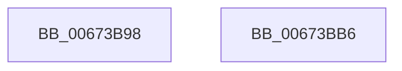

# MiRemovePhysicalMemoryBatchComplete

- RVA: `0x00673B98`–`0x00673BB7` (길이 `31` bytes)
- VA: `0x0000000140673B98`
- 실행 섹션: `.text`
- PDB 이름 있음: `예`; PDB Function 태그: `아니요`
- unwind 정보 RVA: `0x0005C788`
- 디코드: `8`개 명령, `31/31` bytes 표시
- 미해석 바이트: `0` (있으면 어셈블리에 `.byte`로 보존)

> 이 문서는 커널 이미지의 기계어와 PDB 기호를 분석해 생성했습니다. 4번과 5번은 함수 원형과 자료형을 바이너리 사용 방식에서 추정한 C 해석이며 원본 소스 복구 결과는 아닙니다.

## 1. Dependencies

- 직접 호출 지점: **3**; 고유 호출 대상: **3**
- 직접 호출자로 확인된 함수: **2**
- RIP 상대 이미지 참조: **1**

### Outgoing calls
- `0x00673B9C` → [MiFlushEntireTbDueToAttributeChange](../30/MiFlushEntireTbDueToAttributeChange_function_00308AE0.md) (function, `0x00308AE0`)
- `0x00673BA7` → [KeInvalidateAllCaches](../30/KeInvalidateAllCaches_function_00308CC0.md) (function, `0x00308CC0`)
- `0x00673BAC` → [IoUpdateDumpPhysicalRanges](../59/IoUpdateDumpPhysicalRanges_function_0059343C.md) (function, `0x0059343C`)

### Direct callers
- [MiInsertPartitionPages](../69/MiInsertPartitionPages_function_006911A0.md) at `0x006913C7`
- [MiRemoveMdlPages](../../page/7F/MiRemoveMdlPages_function_007FC568.md) at `0x007FC715`

### Static image references
- `0x00673BA1` → RVA `0x00E2DC54` (`.data`; read/write)

## 2. Other-region calls and transfers

- 다른 실행 섹션으로 향하는 call: **0**
- 별도 외부 분기/꼬리 이동을 확인하지 못했습니다.

## 3. Assembly (complete function range)

```asm
00673B98  48 83 EC 28                     sub rsp, 0x28
00673B9C  E8 3F 4F C9 FF                  call 0x140308ae0
00673BA1  FF 05 AD A0 7B 00               inc dword ptr [rip + 0x7ba0ad]
00673BA7  E8 14 51 C9 FF                  call 0x140308cc0
00673BAC  E8 8B F8 F1 FF                  call 0x14059343c
00673BB1  48 83 C4 28                     add rsp, 0x28
00673BB5  C3                              ret
00673BB6  CC                              int3
```

## 4. C-style interpretation (structured pseudocode)

```c
__int64 __fastcall MiRemovePhysicalMemoryBatchComplete(void)
{
    __int64 result;
    __int64 v_rsp;

    v_rsp = (v_rsp) - (40);
    result = MiFlushEntireTbDueToAttributeChange(a1, a2, a3, a4);
    result = KeInvalidateAllCaches(a1, a2, a3, a4);
    result = IoUpdateDumpPhysicalRanges(a1, a2, a3, a4);
    v_rsp = (v_rsp) + (40);
    return result;
}
```

## 5. (Beta) C Style

```c
void MiRemovePhysicalMemoryBatchComplete(void)
{
    int64_t result;
    int64_t local_rsp;

    local_rsp = (local_rsp) - (40);
    result = MiFlushEntireTbDueToAttributeChange(a1, a2, a3, a4);
    result = KeInvalidateAllCaches(a1, a2, a3, a4);
    result = IoUpdateDumpPhysicalRanges(a1, a2, a3, a4);
    local_rsp = (local_rsp) + (40);
    return result;
}
```

## 6. Execution-region graph

[열기: 2D/3D 그래프와 함수 탐색 컨트롤 패널](../../../control-panel.html?section=text&rva=0x00673B98&view=graph)

- 2D 그래프는 위에서 아래로 흐르고, 3D 그래프는 빈 공간을 드래그해 회전합니다. Shift+드래그는 이동, 휠은 확대·축소, 함수 노드 선택은 대상 보고서 이동입니다.

### Static fallback


